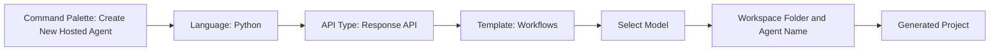

# ਮੋਡੀਊਲ 2 - ਮਲਟੀ-ਏਜੰਟ ਪ੍ਰੋਜੈਕਟ ਦਾ ਸਕੈਫੋਲਡ

⏱️ ~5 ਮਿੰਟ

ਇਸ ਮੋਡੀਊਲ ਵਿੱਚ, ਤੁਸੀਂ [VS Code ਲਈ Foundry Toolkit](https://aka.ms/foundrytk) ਦੀ ਵਰਤੋਂ ਕਰਦੇ ਹੋ تاکہ **ਮਲਟੀ-ਏਜੰਟ ਪ੍ਰੋਜੈਕਟ ਬਣਾਉਣਾ**। ਵਿਜ਼ਾਰਡ `agent.yaml`, `main.py`, `Dockerfile`, `requirements.txt`, `.env` ਅਤੇ VS Code ਡੀਬੱਗ ਕੰਫਿਗਰੇਸ਼ਨ ਜਨਰੇਟ ਕਰਦਾ ਹੈ - ਤਾਂ ਜੋ ਤੁਸੀਂ Module 3 ਵਿੱਚ 4-ਏਜੰਟ ਵਰਕਫਲੋ ਦੀ ਵਾਇਰਿੰਗ 'ਤੇ ਧਿਆਨ ਦੇ ਸਕੋ।

> **ਮੁੱਖ ਧਾਰਨਾ:** ਸਕੈਫੋਲਡ ਇੱਕ ਕੰਮ ਕਰਨ ਵਾਲਾ ਸਟੱਬ ਹੈ ਜਿਸ ਵਿੱਚ ਇੱਕ ਏਜੰਟ ਹੁੰਦਾ ਹੈ। ਤੁਸੀਂ ਪਲੇਸਹੋਲਡਰ ਲੋਜਿਕ ਨੂੰ Module 3 ਵਿੱਚ `WorkflowBuilder` ਗ੍ਰਾਫ ਨਾਲ ਬਦਲ ਦਿਓਗੇ। ਤੁਹਾਨੂੰ ਬੌਇਲਰਪਲੇਟ ਸ਼ुरੂ ਤੋਂ ਨਹੀਂ ਲਿਖਣਾ ਪੈਂਦਾ।

> **ਹਵਾਲਾ ਅਮਲ:** [`PersonalCareerCopilot/`](../../../../../workshop/lab02-multi-agent/PersonalCareerCopilot) ਇੱਕ ਪੂਰਾ ਕੰਮ ਕਰਨ ਵਾਲਾ ਉਦਾਹਰਨ ਹੈ। ਜਿਵੇਂ-ਜਿਵੇਂ ਤੁਸੀਂ ਅੱਗੇ ਵਧਦੇ ਹੋ, ਆਪਣੀ ਕੰਮ ਨਾਲ ਤੁਲਨਾ ਕਰਨ ਲਈ ਇਸਦਾ ਉਪਯੋਗ ਕਰੋ।

### ਸਕੈਫੋਲਡ ਵਿਜ਼ਾਰਡ ਫਲੋ



---

## ਕਦਮ 1: Create Hosted Agent ਵਿਜ਼ਾਰਡ ਖੋਲ੍ਹੋ

1. `Ctrl+Shift+P` ਦਬਾਕੇ **ਕਮਾਂਡ ਪੈਲੇਟ** ਖੋਲ੍ਹੋ।
2. ਟਾਈਪ ਕਰੋ: **Foundry Toolkit: Create a New Hosted Agent** ਅਤੇ ਇਸਨੂੰ ਚੁਣੋ।
3. ਵਿਜ਼ਾਰਡ **Agent Details** ਟੈਬ 'ਤੇ ਖੁਲ ਜਾਏਗਾ।

> **ਵਿਕਲਪ:** Activity Bar ਵਿੱਚ **Foundry Toolkit** ਆਈਕਨ 'ਤੇ ਕਲਿੱਕ ਕਰੋ → **Hosted Agents** ਦੇ ਨਜ਼ਦੀਕ **+** ਆਈਕਨ 'ਤੇ ਕਲਿੱਕ ਕਰੋ → **Create New Hosted Agent**।

---

## ਕਦਮ 2: ਸੈਟਿੰਗ ਚੁਣੋ


1. ਖੱਬੇ ਨੈਵੀਗੇਸ਼ਨ/ਚੋਣਾਂ ਖੰਡ ਵਿੱਚ ਹੇਠਾਂ ਦੀਆਂ ਚੀਜਾਂ ਚੁਣੋ:

| ਮੀਨੂ | ਚੋਣ | ਨੋਟਸ |
|--------|-----------|-------|
| **ਭਾਸ਼ਾ** | Python | C# (.NET) ਵੀ ਸਮਰਥਿਤ |
| **ਫਰੇਮਵਰਕ** | Agent Framework | ਇਹ `Agent`, `AgentExecutor`, `WorkflowBuilder` ਪ੍ਰਦਾਨ ਕਰਦਾ ਹੈ |
| **API ਪ੍ਰਕਾਰ** | Response API | `POST /responses` - ਪਲੇਟਫਾਰਮ-ਨਿਯੰਤ੍ਰਿਤ ਇਤਿਹਾਸ, ਸਟ੍ਰੀਮਿੰਗ ਸਪੋਰਟ |
| **ਟੈਮਪਲੇਟ** | **Workflows** | ਬੇਨਤੀਆਂ ਨੂੰ ਕਈ ਏਜੰਟਾਂ ਰਾਹੀਂ ਕ੍ਰਮਵਾਰ ਪ੍ਰਕਿਰਿਆ ਕਰਦਾ ਹੈ |

2. ਇੱਕ ਵਾਰੀ ਚੁਣਨ ਕੇ ਬਾਅਦ, **Next** 'ਤੇ ਕਲਿੱਕ ਕਰੋ


3. ਅਗਲੀ ਵਿੰਡੋ ਵਿੱਚ, ਹੇٺਾਂ ਦਿੱਤੀਆਂ ਚੀਜਾਂ ਚੁਣੋ:

| ਮੀਨੂ | ਚੋਣ | ਨੋਟਸ |
|--------|-----------|-------|
| **ਵਰਕਸਪੇਸ ਫੋਲਡਰ** | ਨਿਸ਼ਾਨੀ ਫੋਲਡਰ ਤੱਕ ਬ੍ਰਾਊਜ਼ ਕਰੋ | ਉਦਾਹਰਨ: `workshop/lab02-multi-agent/` ਇਸ ਰੇਪੋ ਵਿੱਚ |
| **ਏਜੰਟ ਨਾਮ** | `PersonalCareerCopilot` | ਇਹ ਪ੍ਰੋਜੈਕਟ ਡਾਇਰੈਕਟਰੀ ਦਾ ਨਾਮ ਬਣ ਜਾਂਦਾ ਹੈ |
| **ਮਾਡਲ ਡਿਪਲੋਇਮੈਂਟ** | ਆਪਣਾ ਡਿਪਲੋਇਡ ਮਾਡਲ ਚੁਣੋ | ਉਦਾਹਰਨ: `gpt-4.1-mini` Lab 01 ਤੋਂ |

4. ਪ੍ਰੋਜੈਕਟ ਸਕੈਫੋਲਡ ਕਰਨ ਲਈ **Create** 'ਤੇ ਕਲਿੱਕ ਕਰੋ। VS Code ਫਾਈਲਾਂ ਬਣਾਏਗਾ ਅਤੇ ਫੋਲਡਰ ਖੋਲ੍ਹੇਗਾ।

> **ਸੁਝਾਅ:** [`gpt-4.1-mini`](https://learn.microsoft.com/azure/foundry/foundry-models/concepts/models-sold-directly-by-azure#gpt-41-series) ਮਲਟੀ-ਏਜੰਟ ਵਿਕਾਸ ਲਈ ਗਤੀ ਤੇ ਗੁਣਵੱਤਾ ਦਾ ਵਧੀਆ ਸੰਤੁਲਨ ਦਿੰਦਾ ਹੈ।

---

## ਕਦਮ 3: ਬਣਾਇਆ ਗਿਆ ਪ੍ਰੋਜੈਕਟ ਜਾਂਚੋ

ਸਕੈਫੋਲਡ ਮੁਕੰਮਲ ਹੋਣ 'ਤੇ, Explorer (`Ctrl+Shift+E`) ਵਿੱਚ ਇਹ ਫਾਈਲਾਂ ਦਿਖ ਰਹੀਆਂ ਹਨ ਕਿ ਨਹੀਂ, ਜਾਂਚੋ:

```
📂 <your-agent-name>/
├── .azdignore          ← Files excluded from Azure Developer CLI deployments
├── .dockerignore       ← Files excluded from Docker builds
├── .env                ← Environment variables (placeholders - fill in Module 3)
├── .vscode/
│   ├── launch.json     ← Debug config (F5 → run + Agent Inspector)
│   └── tasks.json      ← VS Code task definitions
├── agent.yaml          ← Agent definition (kind: hosted, protocol: responses)
├── Dockerfile          ← Container config for deployment
├── main.py             ← Stub agent entry point (replace with WorkflowBuilder in Module 3)
└── requirements.txt    ← Python dependencies
```

> **ਮਹੱਤਵਪੂਰਨ:** ਇਸ ਸਕੈਫੋਲਡ ਫੋਲਡਰ ਨੂੰ ਸਿੱਧਾ VS Code ਵਿੱਚ ਖੋਲ੍ਹੋ ਤਾਂ ਜੋ `.vscode/launch.json` ਅਤੇ `tasks.json` F5 ਡੀਬੱਗਿੰਗ ਲਈ ਸਹੀ ਤਰੀਕੇ ਨਾਲ ਲਾਗੂ ਹੋ ਰਹੇ ਹੋਣ।

### ਮੁੱਖ ਫਾਈਲਾਂ ਦੀ ਵਿਆਖਿਆ

| ਫਾਇਲ | ਉਦੇਸ਼ |
|------|---------|
| `agent.yaml` | `kind: hosted` ਦੀ ਘੋਸ਼ਣਾ ਕਰਦਾ ਹੈ, env vars ਨੂੰ ਮੈਪ ਕਰਦਾ ਹੈ, `/responses` ਪ੍ਰੋਟੋਕੋਲ ਨੂੰ ਪਰਿਭਾਸ਼ਿਤ ਕਰਦਾ ਹੈ |
| `main.py` | ਸਟੱਬ: ਇੱਕ `FoundryChatClient` → `Agent` → `ResponsesHostServer`। ਤੁਸੀਂ ਇਸਨੂੰ Module 3 ਵਿੱਚ 4 ਏਜੰਟ + `WorkflowBuilder` ਨਾਲ ਬਦਲ ਦਿਓਗੇ |
| `Dockerfile` | `python:3.12-slim`, `requirements.txt` ਇੰਸਟਾਲ ਕਰਦਾ ਹੈ, ਪੋਰਟ 8088 ਖੋਲ੍ਹਦਾ ਹੈ, `python main.py` ਚਲਾਉਂਦਾ ਹੈ |
| `requirements.txt` | `agent-framework-foundry`, `agent-framework-foundry-hosting`, `mcp<2,>=1.24.0`, `debugpy` |

> **ਹਵਾਲਾ:** ਪੂਰੀ ਬਣਾਈ ਗਈ ਸਮੱਗਰੀ ਲਈ [`PersonalCareerCopilot/agent.yaml`](../../../../../workshop/lab02-multi-agent/PersonalCareerCopilot/agent.yaml) ਅਤੇ [`PersonalCareerCopilot/requirements.txt`](../../../../../workshop/lab02-multi-agent/PersonalCareerCopilot/requirements.txt) ਨੂੰ ਵੇਖੋ।

---

### ✅ ਚੈਕਪੌਇੰਟ

- [ ] ਸਕੈਫੋਲਡ ਵਿਜ਼ਾਰਡ ਪੂਰਾ ਹੋਇਆ - ਨਵਾਂ ਪ੍ਰੋਜੈਕਟ ਫੋਲਡਰ Explorer ਵਿੱਚ ਦਿਖਾਈ ਦੇ ਰਿਹਾ ਹੈ
- [ ] ਸਾਰੀਆਂ ਉਮੀਦ ਕੀਤੀਆਂ ਫਾਈਲਾਂ ਮੌਜੂਦ ਹਨ: `agent.yaml`, `main.py`, `Dockerfile`, `requirements.txt`, `.env`
- [ ] `agent.yaml` `kind: hosted` ਅਤੇ `protocol: responses` ਦਿਖਾਉਂਦਾ ਹੈ
- [ ] `main.py` `Agent`, `FoundryChatClient`, `ResponsesHostServer` ਨੂੰ ਇੰਪੋਰਟ ਕਰਦਾ ਹੈ
- [ ] ਸਕੈਫੋਲਡ ਫੋਲਡਰ VS Code ਵਰਕਸਪੇਸ ਰੂਟ ਵਜੋਂ ਖੁੱਲਿਆ ਹੋਇਆ ਹੈ
- [ ] ਤੁਸੀਂ ਸਮਝਦੇ ਹੋ ਕਿ `main.py` ਇੱਕ ਸਟੱਬ ਹੈ - `WorkflowBuilder` Module 3 ਵਿੱਚ ਜੋੜਿਆ ਜਾਵੇਗਾ

---

**ਪਹਿਲਾਂ:** [01 - ਮਲਟੀ-ਏਜੰਟ ਆਰਕੀਟੈਕਚਰ ਨੂੰ ਸਮਝੋ](01-understand-multi-agent.md) · **ਅਗਲਾ:** [03 - ਏਜੰਟ ਅਤੇ ਵਾਤਾਵਰਣ ਕਨਫ਼ਿਗਰ ਕਰੋ →](03-configure-agents.md)

---

<!-- CO-OP TRANSLATOR DISCLAIMER START -->
**ਅਸਵੀਕਾਰੋਪਣ**:
ਇਸ ਦਸਤਾਵੇਜ਼ ਦਾ ਅਨੁਵਾਦ ਏਆਈ ਅਨੁਵਾਦ ਸੇਵਾ [Co-op Translator](https://github.com/Azure/co-op-translator) ਦੀ ਵਰਤੋਂ ਕਰਕੇ ਕੀਤਾ ਗਿਆ ਹੈ। ਜਦੋਂ ਕਿ ਅਸੀਂ ਸਹੀਤਾਵਾਂ ਲਈ ਯਤਨਸ਼ੀਲ ਹਾਂ, ਕਿਰਪਾ ਕਰਕੇ ਧਿਆਨ ਰੱਖੋ ਕਿ ਸਵੈਚਾਲਿਤ ਅਨੁਵਾਦਾਂ ਵਿੱਚ ਗਲਤੀਆਂ ਜਾਂ ਅਸਮੱਤਿਆਵਾਂ ਹੋ ਸਕਦੀਆਂ ਹਨ। ਮੂਲ ਦਸਤਾਵੇਜ਼ ਆਪਣੀ ਮੂਲ ਭਾਸ਼ਾ ਵਿੱਚ ਅਧਿਕਾਰਕ ਸਰੋਤ ਮੰਨਿਆ ਜਾਣਾ ਚਾਹੀਦਾ ਹੈ। ਜਰੂਰੀ ਜਾਣਕਾਰੀ ਲਈ, ਪੇਸ਼ੇਵਰ ਮਨੁੱਖੀ ਅਨੁਵਾਦ ਦੀ ਸਿਫ਼ਾਰਸ਼ ਕੀਤੀ ਜਾਂਦੀ ਹੈ। ਅਸੀਂ ਇਸ ਅਨੁਵਾਦ ਦੇ ਉਪਯੋਗ ਤੋਂ ਪੈਦਾ ਹੋਣ ਵਾਲੀਆਂ ਕਿਸੇ ਵੀ ਗਲਤਫਹਿਮੀਆਂ ਜਾਂ ਗਲਤ ਵਿਆਖਿਆਵਾਂ ਲਈ ਜਵਾਬਦੇਹ ਨਹੀਂ ਹਾਂ।
<!-- CO-OP TRANSLATOR DISCLAIMER END -->