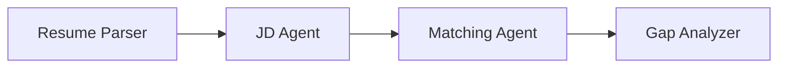
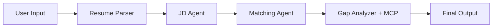

# ਮੋਡਿਊਲ 4 - ਆਰਕੀਸਟਰੈਸ਼ਨ ਪੈਟਰਨ

⏱️ ~10 ਮਿੰਟ

ਇਸ ਮੋਡਿਊਲ ਵਿੱਚ, ਤੁਸੀਂ Resume Job Fit Evaluator ਵਿੱਚ ਵਰਤੇ ਗਏ ਆਰਕੀਸਟਰੈਸ਼ਨ ਪੈਟਰਨਾਂ ਦੀ ਖੋਜ ਕਰਦੇ ਹੋ ਅਤੇ ਸਿੱਖਦੇ ਹੋ ਕਿ ਵਰਕਫਲੋ ਗ੍ਰਾਫ ਨੂੰ ਕਿਵੇਂ ਪੜ੍ਹਨਾ, ਸੋਧਣਾ ਅਤੇ ਵਧਾਉਣਾ ਹੈ। ਇਹ ਪੈਟਰਨ ਸਮਝਣਾ ਡਾਟਾ ਫਲੋ ਸਮੱਸਿਆਵਾਂ ਨੂੰ ਡੀਬੱਗ ਕਰਨ ਅਤੇ ਆਪਣੇ [ਮਲਟੀ-ਏਜੰਟ ਵਰਕਫਲੋਜ਼](https://learn.microsoft.com/agent-framework/workflows/) ਬਣਾਉਣ ਲਈ ਜਰੂਰੀ ਹੈ।

---

## ਪੈਟਰਨ 1: ਲੜੀਵਾਰ ਚੇਨ

ਵਰਕਫਲੋ ਵਿੱਚ ਮੂਲ ਪੈਟਰਨ **ਲੜੀਵਾਰ ਚੇਨ** ਹੈ - ਹਰ ਏਜੰਟ ਦਾ ਨਤੀਜਾ ਸਿੱਧਾ ਅਗਲੇ ਨੂੰ ਮਿਲਦਾ ਹੈ।



ਕੋਡ ਵਿੱਚ, ਹਰ `add_edge()` ਕਾਲ ਨਾਲ ਚੇਨ ਵਿੱਚ ਇੱਕ ਕਦਮ ਬਣਦਾ ਹੈ:

```python
.add_edge(resume_executor, jd_executor)       # ResumeParser output → JD Agent
.add_edge(jd_executor, matching_executor)     # JD Agent output → MatchingAgent
.add_edge(matching_executor, gap_executor)    # MatchingAgent output → GapAnalyzer
```

> **ਲੜੀਵਾਰ ਕਿਉਂ, fan-out/fan-in ਨਹੀਂ?** `WorkflowBuilder` ਆਉਣ ਵਾਲੀਆਂ ਕਨੈਕਸ਼ਨਾਂ ਲਈ **OR-ਸੈਂਮੈਂਟਿਕਸ** ਵਰਤਦਾ ਹੈ: ਜਦੋਂ ਵੀ **ਕੋਈ ਵੀ** ਪੂਰਵਜ ਖਤਮ ਹੁੰਦਾ ਹੈ, ਇੱਕ ਦਾਅਵਾ ਕਰਨ ਵਾਲਾ ਚਾਲੂ ਹੋ ਜਾਂਦਾ ਹੈ। ਜੇ `matching_executor` ਕੋਲ ਦੋ ਆਉਣ ਵਾਲੀਆਂ ਕਨੈਕਸ਼ਨਾਂ ਹੁੰਦੀਆਂ (ਦੋਹਾਂ `resume_executor` ਅਤੇ `jd_executor` ਤੋਂ), ਤਾਂ ਇਹ ਦੂਜਾ ਦਫਾ ਚਾਲੂ ਹੋਵੇਗਾ - ਇੱਕ ਵਾਰ ResumeParser ਖਤਮ ਹੋਣ ਤੇ ਅਤੇ ਇੱਕ ਵਾਰ JD Agent ਖਤਮ ਹੋਣ ਤੇ - ਜਿਸ ਨਾਲ GapAnalyzer ਵੀ ਦੋ ਵਾਰੀ ਚੱਲੇਗਾ ਅਤੇ ਨਤੀਜਾ ਦੋ ਵਾਰੀ ਦਿਖਾਈ ਦੇਵੇਗਾ। ਲੜੀਵਾਰ ਪਾਈਪਲਾਈਨ ਇਸ ਦੀ ਪੂਰੀ ਤਰ੍ਹਾਂ ਰੋਕਥਾਮ ਕਰਦੀ ਹੈ।

## ਪੈਟਰਨ 2: ਸਮੱਗਰੀ ਰੀਲੇ

ਕਿਉਂਕਿ `context_mode="last_agent"` ਦਾ ਮਤਲਬ ਹੈ ਕਿ ਹਰ ਐਗਜ਼ਿਕਿਊਟਰ ਕੇਵਲ ਆਪਣੇ **ਸਿੱਧੇ ਪੂਰਵਜ ਦਾ ਨਤੀਜਾ** ਵੇਖਦਾ ਹੈ, ਇਸ ਲਈ ਲੜੀਵਾਰ ਚੇਨ ਵਿੱਚ ਏਜੰਟਾਂ ਨੂੰ ਕਿਸੇ ਵੀ ਡਾਟਾ ਨੂੰ ਸਪష్ట ਤੌਰ 'ਤੇ ਅਗਲੇ ਏਜੰਟਾਂ ਨੂੰ ਭੇਜਣਾ ਪੈਂਦਾ ਹੈ।

ਇਸ ਵਰਕਫਲੋ ਵਿੱਚ:
- **ResumeParser** JD ਨੂੰ ਬਿਨਾਂ ਕਿਸੇ ਤਬਦੀਲੀ ਦੇ ਕੇ `[JOB DESCRIPTION PASS-THROUGH]` ਵਿੱਚ ਕਾਪੀ ਕਰਦਾ ਹੈ (ਤਾਂ ਜੋ JD Agent ਇਸ ਨੂੰ ਲੱਭ ਸਕੇ).
- **JD Agent** `[PARSED RESUME]` ਨੂੰ ਬਿਨਾਂ ਬਦਲਾਅ ਦੇ `[PARSED RESUME PASS-THROUGH]` ਵਿੱਚ ਕਾਪੀ ਕਰਦਾ ਹੈ (ਤਾਂ ਜੋ MatchingAgent ਦੋਹਾਂ ਪ੍ਰੋਫਾਈਲਾਂ ਦੀ ਤੁਲਨਾ ਕਰ ਸਕੇ).

```
ResumeParser output
└─ [PARSED RESUME]               ← extracted by JD Agent
└─ [JOB DESCRIPTION PASS-THROUGH] ← extracted by JD Agent

JD Agent output
└─ [JD REQUIREMENTS]             ← extracted by MatchingAgent
└─ [PARSED RESUME PASS-THROUGH]  ← extracted by MatchingAgent
```

ਹਰ ਰੀਲੇ ਸੈਕਸ਼ਨ ਨੂੰ **ਬਿਨਾਂ ਕਿਸੇ ਤਬਦੀਲੀ ਦੇ** ਕਾਪੀ ਕਰਨਾ ਲਾਜ਼ਮੀ ਹੈ - ਇਸ ਦਾ ਸਾਰ ਜਾਂ ਤਬਦੀਲੀ ਅੱਗੇ ਆਉਣ ਵਾਲੇ ਏਜੰਟ ਨੂੰ ਖਰਾਬ ਕਰਦਾ ਹੈ ਜੋ ਇਸ 'ਤੇ ਨਿਰਭਰ ਹੈ।

---

## ਪੂਰਾ ਗ੍ਰਾਫ

ਲੜੀਵਾਰ ਚੇਨ ਅਤੇ ਸਮੱਗਰੀ ਰੀਲੇ ਪੈਟਰਨ ਨੂੰ ਮਿਲਾ ਕੇ ਪੂਰਾ ਵਰਕਫਲੋ ਤਿਆਰ ਹੁੰਦਾ ਹੈ:



ਏਜੰਟ ਇੰਸਪੈਕਟਰ ਇਹੀ ਗ੍ਰਾਫ ਬਣਤਰ ਦਿਖਾਉਂਦਾ ਹੈ ਜਦੋਂ ਏਜੰਟ ਲੋਕਲ ਰੂਪ ਵਿੱਚ ਚੱਲ ਰਿਹਾ ਹੁੰਦਾ ਹੈ। ਸਕਰੀਨਸ਼ਾਟ ਲਈ [ਮੋਡਿਊਲ 5 - ਟੈਸਟ ਲੋਕਲੀ](05-test-locally.md) ਵੇਖੋ।

---

## WorkflowBuilder ਕੋਡ ਪੜ੍ਹਨਾ

ਵਰਕਫਲੋ ਗ੍ਰਾਫ `main()` ਫੰਕਸ਼ਨ ਵਿੱਚ ਬਣਾਇਆ ਗਿਆ ਹੈ [`PersonalCareerCopilot/main.py`](../../../../../workshop/lab02-multi-agent/PersonalCareerCopilot/main.py) ਵਿੱਚ। ਤਿੰਨ `add_edge()` ਕਾਲਾਂ ਅਨੁਕ੍ਰਮਿਕ ਪਾਈਪਲਾਈਨ ਬਣਾਉਂਦੀਆਂ ਹਨ:

| # | ਕਿਨਾਰਾ | ਪ੍ਰਭਾਵ |
|---|------|--------|
| 1 | `resume_executor → jd_executor` | JD ਏਜੰਟ ਨੂੰ `[PARSED RESUME]` + `[JOB DESCRIPTION PASS-THROUGH]` ਮਿਲਦਾ ਹੈ |
| 2 | `jd_executor → matching_executor` | ਮੈਚਿੰਗਏਜੰਟ ਨੂੰ `[JD REQUIREMENTS]` + `[PARSED RESUME PASS-THROUGH]` ਮਿਲਦੇ ਹਨ |
| 3 | `matching_executor → gap_executor` | ਗੈਪਅਨਾਲਾਈਜ਼ਰ ਨੂੰ ਫਿੱਟ ਰਿਪੋਰਟ + ਗੈਪ ਸੂਚੀ ਮਿਲਦੀ ਹੈ |

---

## ਗ੍ਰਾਫ ਸੋਧਨਾ

### ਨਵਾਂ ਏਜੰਟ ਸ਼ਾਮਲ ਕਰਨਾ

ਗੈਪਅਨਾਲਾਈਜ਼ਰ ਤੋਂ ਬਾਅਦ ਪੰਜਵਾਂ ਏਜੰਟ (ਜਿਵੇਂ ਕਿ **InterviewPrepAgent**) ਸ਼ਾਮਲ ਕਰਨ ਲਈ:

1. ਇੱਕ `INTERVIEW_PREP_INSTRUCTIONS` ਕਾਂਸਟੈਂਟ ਪਰਿਭਾਸ਼ਿਤ ਕਰੋ।
2. `Agent` + `AgentExecutor` ਆਬਜੈਕਟ ਬਣਾਓ (ਮੌਜੂਦਾ ਚਾਰਾਂ ਵਰਗਾ ਹੀ ਪੈਟਰਨ).
3. `.add_edge(gap_executor, interview_exec)` ਨੂੰ `WorkflowBuilder` ਵਿੱਚ ਸ਼ਾਮਲ ਕਰੋ।
4. `output_executors=[interview_exec]` ਨੂੰ ਅਪਡੇਟ ਕਰੋ।

> **ਜਰੂਰੀ:** `start_executor` ਇਕਮਾਤਰ ਏਜੰਟ ਹੈ ਜੋ ਕੱਚਾ ਯੂਜ਼ਰ ਇਨਪੁੱਟ ਪ੍ਰਾਪਤ ਕਰਦਾ ਹੈ। ਬਾਕੀ ਸਾਰੇ ਏਜੰਟ ਆਪਣੇ ਅਪਸਟ੍ਰੀਮ ਕਿਨਾਰੇ ਤੋਂ ਆਉਟਪੁੱਟ ਪ੍ਰਾਪਤ ਕਰਦੇ ਹਨ।

---

## ਆਮ ਗ੍ਰਾਫ ਗਲਤੀਆਂ

| ਗਲਤੀ | ਲੱਛਣ | ਠੀਕ ਕਰਨਾ |
|---------|---------|-----|
| `output_executors` ਲਈ ਕਿਨਾਰਾ ਗੁੰਮ ਹੈ | ਏਜੰਟ ਚਲਦਾ ਹੈ ਪਰ ਆਉਟਪੁੱਟ ਖਾਲੀ ਹੈ | ਯਕੀਨ ਕਰੋ ਕਿ ਹਰ ਏਜੰਟ ਲਈ `start_executor` ਤੋਂ ਮਾਰਗ ਹੈ `output_executors` ਵਿੱਚ |
| ਸਿਰਕੁਲਰ ਨਿਰਭਰਤਾ | ਅਨੰਤ ਲੂਪ ਜਾਂ ਟਾਈਮਆਊਟ | ਚੈੱਕ ਕਰੋ ਕਿ ਕੋਈ ਵੀ ਏਜੰਟ ਆਪਣੇ ਅਪਸਟ੍ਰੀਮ ਏਜੰਟ ਨੂੰ ਫੀਡ ਬੈਕ ਨਹੀਂ ਕਰ ਰਿਹਾ |
| `output_executors` ਵਿੱਚ ਏਜੰਟ ਜਿਸਦਾ ਕੋਈ ਅਗਲਾ ਕਿਨਾਰਾ ਨਹੀਂ | ਖਾਲੀ ਆਉਟਪੁੱਟ | ਘੱਟੋ-ਘੱਟ ਇੱਕ `add_edge(source, that_agent)` ਸ਼ਾਮਲ ਕਰੋ |
| ਕਈ `output_executors` ਬਿਨਾਂ ਫੈਨ-ਇਨ ਦੇ | ਆਉਟਪੁੱਟ ਵਿੱਚ ਸਿਰਫ਼ ਇੱਕ ਏਜੰਟ ਦੀ ਪ੍ਰਤੀਕ੍ਰਿਆ ਹੁੰਦੀ ਹੈ | ਇੱਕਲੌਤਾ ਆਉਟਪੁੱਟ ਏਜੰਟ ਵਰਤੋ ਜੋ ਸਾਰਾ ਇਕੱਤਰ ਕਰਦਾ ਹੈ, ਜਾਂ ਕਈ ਆਉਟਪੁੱਟ ਸਵੀਕਾਰ ਕਰੋ |
| `start_executor` ਗੁੰਮ | ਤਿਆਰ ਕਰਨ ਸਮੇਂ `ValueError` | ਹਮੇਸ਼ਾ `start_executor` ਨੂੰ `WorkflowBuilder()` ਵਿੱਚ ਨਿਰਧਾਰਿਤ ਕਰੋ |

---

## ਗ੍ਰਾਫ ਡੀਬੱਗ ਕਰਨਾ

### ਏਜੰਟ ਇੰਸਪੈਕਟਰ ਦੀ ਵਰਤੋਂ

1. F5 ਨਾਲ ਲੋਕੇਲ ਐਜੰਟ ਸ਼ੁਰੂ ਕਰੋ।
2. ਏਜੰਟ ਇੰਸਪੈਕਟਰ ਖੋਲ੍ਹੋ (`Ctrl+Shift+P` → **Foundry Toolkit: Open Agent Inspector**).
3. ਇੱਕ ਟੈਸਟ ਸੰਦਰਭ ਭੇਜੋ।
4. ਇੰਸਪੈਕਟਰ ਦੇ ਪ੍ਰਤੀਕ੍ਰਿਆ ਪੈਨਲ ਵਿੱਚ, **ਸਟ੍ਰੀਮਿੰਗ ਆਉਟਪੁੱਟ** ਵੇਖੋ - ਇਹ ਹਰ ਏਜੰਟ ਦੀ ਯੋਗਦਾਨ ਕ੍ਰਮਵਾਰ ਦਿਖਾਉਂਦਾ ਹੈ।


### ਲੌਗਿੰਗ ਦੀ ਵਰਤੋਂ

ਡਾਟਾ ਫਲੋ ਟ੍ਰੇਸ ਕਰਨ ਲਈ `main.py` ਵਿੱਚ ਲੌਗਿੰਗ ਸ਼ਾਮਲ ਕਰੋ:

```python
import logging
logger = logging.getLogger("resume-job-fit")

# In main(), after building the workflow:
logger.info("Workflow graph built with edges: RP→JD, JD→MA, MA→GA")
```

ਸਰਵਰ ਲੌਗਾਂ ਵਿੱਚ ਏਜੰਟ ਐਗਜ਼ਿਕਿਊਸ਼ਨ ਆਰਡਰ ਅਤੇ MCP ਟੂਲ ਕਾਲ ਦਿੱਤੀਆਂ ਹਨ:

```
INFO:agent_framework:Executing agent: ResumeParser
INFO:agent_framework:Executing agent: JobDescriptionAgent
INFO:agent_framework:Executing agent: MatchingAgent
INFO:agent_framework:Executing agent: GapAnalyzer
INFO:agent_framework:Tool call: search_microsoft_learn_for_plan(skill="Kubernetes")
POST https://learn.microsoft.com/api/mcp → 200
INFO:agent_framework:Tool call: search_microsoft_learn_for_plan(skill="Terraform")
POST https://learn.microsoft.com/api/mcp → 200
```

---

### ਚੈਕਪੌਇੰਟ

- [ ] ਤੁਸੀਂ ਵਰਕਫਲੋ ਵਿੱਚ ਦੋ ਓਰਕੇਸਟਰਸ਼ਨ ਪੈਟਰਨਾਂ ਦੀ ਪਹਚਾਣ ਕਰ ਸਕਦੇ ਹੋ: ਕ੍ਰਮਬੱਧ ਚੇਨ ਅਤੇ ਸਮੱਗਰੀ ਰੀਲੇ
- [ ] ਤੁਸੀਂ ਸਮਝਦੇ ਹੋ ਕਿ ਕਿਉਂ `context_mode="last_agent"` ਨੂੰ ਏਜੰਟਾਂ ਵਿਚਕਾਰ ਸਪਸ਼ਟ ਡਾਟਾ ਰੀਲੇ ਦੀ ਲੋੜ ਹੈ
- [ ] ਤੁਸੀਂ `WorkflowBuilder` ਕੋਡ ਪੜ੍ਹ ਸਕਦੇ ਹੋ ਅਤੇ ਹਰ `add_edge()` ਕਾਲ ਨੂੰ ਵਿਜ਼ੂਅਲ ਗ੍ਰਾਫ ਨਾਲ ਜੋੜ ਸਕਦੇ ਹੋ
- [ ] ਤੁਸੀਂ ਪਾਈਪਲਾਈਨ ਦੇ ਅੰਤ ਵਿੱਚ ਨਵਾਂ ਏਜੰਟ ਸ਼ਾਮਲ ਕਰਨਾ ਜਾਣਦੇ ਹੋ
- [ ] ਤੁਸੀਂ ਆਮ ਗ੍ਰਾਫ ਗਲਤੀਆਂ ਅਤੇ ਉਨ੍ਹਾਂ ਦੇ ਲੱਛਣਾਂ ਦੀ ਪਹਚਾਣ ਕਰ ਸਕਦੇ ਹੋ

---

**ਪਿਛਲਾ:** [03 - ਏਜੰਟ ਅਤੇ ਵਾਤਾਵਰਣ ਸੈਟ ਅੱਪ](03-configure-agents.md) · **ਅਗਲਾ:** [05 - ਸਥਾਨਕ ਤੌਰ 'ਤੇ ਟੈਸਟ ਕਰੋ →](05-test-locally.md)

---

<!-- CO-OP TRANSLATOR DISCLAIMER START -->
**ਅਸਵੀਕਾਰੋਪਣ**:
ਇਸ ਦਸਤਾਵੇਜ਼ ਦਾ ਅਨੁਵਾਦ ਏਆਈ ਅਨੁਵਾਦ ਸੇਵਾ [Co-op Translator](https://github.com/Azure/co-op-translator) ਦੀ ਵਰਤੋਂ ਕਰਕੇ ਕੀਤਾ ਗਿਆ ਹੈ। ਜਦੋਂ ਕਿ ਅਸੀਂ ਸਹੀਤਾਵਾਂ ਲਈ ਯਤਨਸ਼ੀਲ ਹਾਂ, ਕਿਰਪਾ ਕਰਕੇ ਧਿਆਨ ਰੱਖੋ ਕਿ ਸਵੈਚਾਲਿਤ ਅਨੁਵਾਦਾਂ ਵਿੱਚ ਗਲਤੀਆਂ ਜਾਂ ਅਸਮੱਤਿਆਵਾਂ ਹੋ ਸਕਦੀਆਂ ਹਨ। ਮੂਲ ਦਸਤਾਵੇਜ਼ ਆਪਣੀ ਮੂਲ ਭਾਸ਼ਾ ਵਿੱਚ ਅਧਿਕਾਰਕ ਸਰੋਤ ਮੰਨਿਆ ਜਾਣਾ ਚਾਹੀਦਾ ਹੈ। ਜਰੂਰੀ ਜਾਣਕਾਰੀ ਲਈ, ਪੇਸ਼ੇਵਰ ਮਨੁੱਖੀ ਅਨੁਵਾਦ ਦੀ ਸਿਫ਼ਾਰਸ਼ ਕੀਤੀ ਜਾਂਦੀ ਹੈ। ਅਸੀਂ ਇਸ ਅਨੁਵਾਦ ਦੇ ਉਪਯੋਗ ਤੋਂ ਪੈਦਾ ਹੋਣ ਵਾਲੀਆਂ ਕਿਸੇ ਵੀ ਗਲਤਫਹਿਮੀਆਂ ਜਾਂ ਗਲਤ ਵਿਆਖਿਆਵਾਂ ਲਈ ਜਵਾਬਦੇਹ ਨਹੀਂ ਹਾਂ।
<!-- CO-OP TRANSLATOR DISCLAIMER END -->