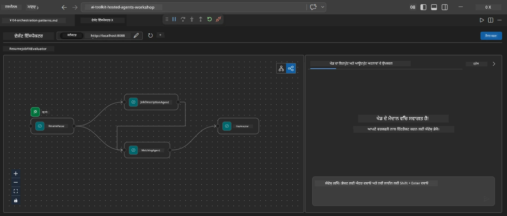
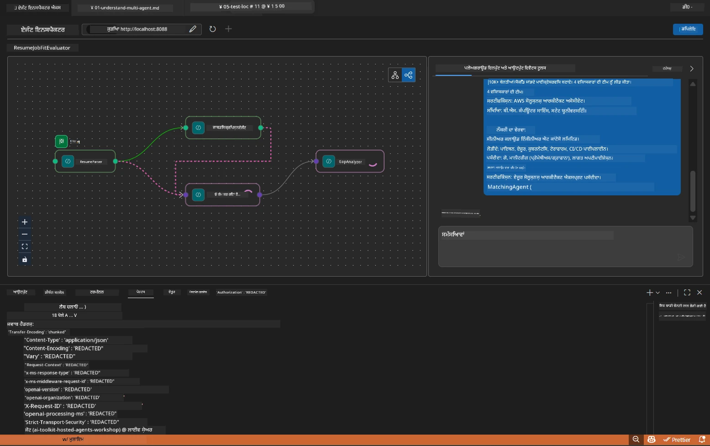
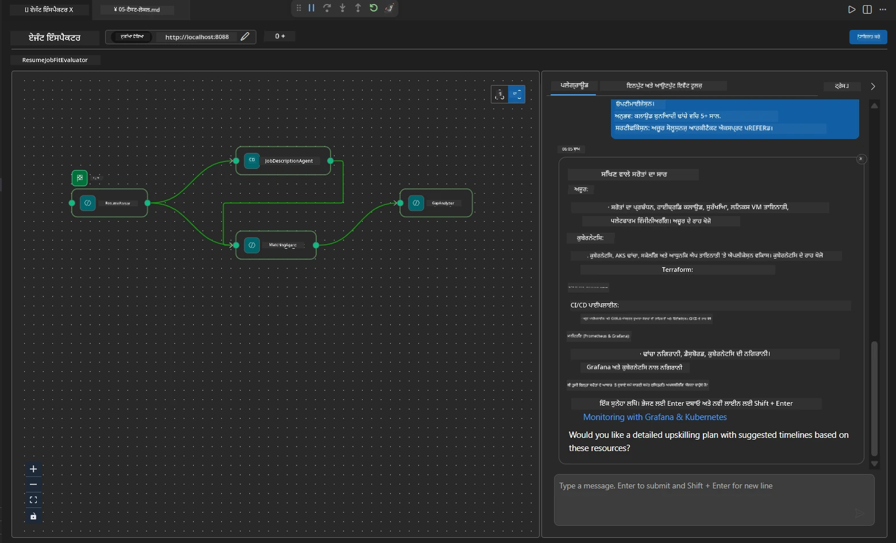

# ਮਾਡਿਊਲ 5 - ਸਥਾਨਕ ਟੈਸਟ ਕਰੋ

⏱️ ~15 ਮਿੰਟ

ਇਸ ਮਾਡਿਊਲ ਵਿੱਚ, ਤੁਸੀਂ ਬਹੁ-ਏਜੰਟ ਵਰਕਫਲੋ ਸਥਾਨਕ ਤੌਰ 'ਤੇ ਚਲਾਉਂਦੇ ਹੋ, Agent Inspector ਨਾਲ ਟੈਸਟ ਕਰਦੇ ਹੋ, ਅਤੇ ਤਿੰਨ ਏਜੰਟਾਂ ਅਤੇ MCP ਟੂਲ ਸਹੀ ਤਰੀਕੇ ਨਾਲ ਕੰਮ ਕਰ ਰਹੇ ਹਨ ਕਿ ਨਹੀਂ ਇਹ ਸਾਬਤ ਕਰਦੇ ਹੋ ਪਹਿਲਾਂ ਡਿਪਲੌਇ ਕਰਨ ਤੋਂ.

---

## ਕਦਮ 1: ਏਜੰਟ ਸਰਵਰ ਸ਼ੁਰੂ ਕਰੋ

### ਵਿਕਲਪ A: VS ਕੋਡ ਟਾਸਕ ਦੀ ਵਰਤੋਂ ਕਰਕੇ (ਸਿਫਾਰਸ਼ੀ)

1. `workshop/lab02-multi-agent/PersonalCareerCopilot/` ਨੂੰ ਆਪਣੇ VS ਕੋਡ ਫੋਲਡਰ ਵਜੋਂ ਖੋਲ੍ਹੋ।
2. `Ctrl+Shift+P` ਦਬਾਓ → ਟਾਈਪ ਕਰੋ **Tasks: Run Task** → ਚੁਣੋ **Run Agent HTTP Server**।
3. ਟਾਸਕ ਡੀਬੱਗਪੀ ਨਾਲ ਪੋਰਟ `5679` 'ਤੇ ਸਰਵਰ ਚਲਾਉਂਦਾ ਹੈ ਅਤੇ ਏਜੰਟ ਪੋਰਟ `8088` 'ਤੇ ਚੱਲਦਾ ਹੈ।
4. ਨਤੀਜੇ ਲਈ ਉਡੀਕ ਕਰੋ ਜਿਸ ਵਿੱਚ ਸਟਾਰਟਅਪ ਸੁਨੇਹਾ ਦਿਖਾਈ ਦੇਵੇ, ਫਿਰ ਸਰਵਰ ਦਾ ਤਿਆਰ ਸੁਨੇਹਾ (ਦੂਜੇ ਲਾਗ ਲਾਈਨਾਂ ਵਿਚਕਾਰ ਆ ਸਕਦੀਆ ਹਨ):

```
INFO:resume-job-fit:Starting Resume -> Job Fit Evaluator HTTP server...
...
INFO:hypercorn.error:Running on http://0.0.0.0:8088 (CTRL + C to quit)
```

### ਵਿਕਲਪ B: F5 (ਡਿਬੱਗ ਮੋਡ) ਦੀ ਵਰਤੋਂ ਕਰਕੇ

1. `F5` ਦਬਾਓ → ਚੁਣੋ **Debug Local Agent HTTP Server**।
2. ਸਰਵਰ ਪੂਰੇ ਬ੍ਰੇਕਪੌਇੰਟ ਸਮਰਥਨ ਨਾਲ ਚੱਲਦਾ ਹੈ - MCP ਜਵਾਬਾਂ ਜਾਂ ਏਜੰਟ ਨਤੀਜਿਆਂ ਦੀ ਜਾਂਚ ਲਈ ਲਾਭਦਾਇਕ।

---

## ਕਦਮ 2: ਏਜੰਟ ਇੰਸਪੈਕਟਰ ਖੋਲ੍ਹੋ

1. `Ctrl+Shift+P` ਦਬਾਓ → ਟਾਈਪ ਕਰੋ **Foundry Toolkit: Open Agent Inspector**।
2. Agent Inspector VS ਕੋਡ ਪੈਨਲ ਵਜੋਂ ਖੁਲਦਾ ਹੈ ਜੋ `http://localhost:8088` ਨਾਲ ਜੁੜਿਆ ਹੈ।
3. ਤੁਹਾਨੂੰ ਏਜੰਟ ਇੰਟਰਫੇਸ ਸੰਦੇਸ਼ ਲੈਣ ਲਈ ਤਿਆਰ ਦਿਖਾਈ ਦੇਣਾ ਚਾਹੀਦਾ ਹੈ।



> **ਜੇ Agent Inspector ਨਹੀਂ ਖੁਲਦਾ:** ਯਕੀਨੀ ਬਣਾਓ ਕਿ ਸਰਵਰ ਪੂਰੀ ਤਰ੍ਹਾਂ ਚਲਾਇਆ ਗਿਆ ਹੈ (ਤੁਹਾਨੂੰ `Running on http://0.0.0.0:8088` ਲਾਗ ਦਿੱਖਦਾ ਹੈ)। ਜੇ ਪੋਰਟ 5679 ਵਿਆਸਤ ਹੈ, ਤਾਂ [Module 8 - Troubleshooting](08-troubleshooting.md) ਵੇਖੋ।

---

## ਕਦਮ 2b: (ਵਿਕਲਪਿਕ) ਵਰਕਫਲੋ ਵਿਜੂਅਲਾਈਜ਼ਰ ਖੋਲ੍ਹੋ

Foundry Toolkit ਵਿੱਚ ਇੱਕ ਤੁਰੰਤ **Workflow Visualizer** ਹੈ ਜੋ ਦਿਖਾਉਂਦਾ ਹੈ ਕਿ ਏਜੰਟ ਕਿਵੇਂ ਗ੍ਰਾਫ਼ ਦੇ ਹਿਸਾਬ ਨਾਲ ਏਕ-ਦੂਜੇ ਨਾਲ ਇੰਟਰਐਕਟ ਕਰਦੇ ਹਨ। ਇਹ ਖਾਸ ਕਰਕੇ ਬਹੁ-ਏਜੰਟ ਡਿਬੱਗਿੰਗ ਲਈ ਲਾਭਦਾਇਕ ਹੈ।

1. `Ctrl+Shift+P` ਦਬਾਓ → ਟਾਈਪ ਕਰੋ **Foundry Toolkit: Open Visualizer for Hosted Agents**।
2. ਇੱਕ ਨਵਾਂ VS ਕੋਡ ਟੈਬ ਖੁਲਦਾ ਹੈ ਜੋ ਲਾਈਵ ਐਕਜ਼ੀਕਿਊਸ਼ਨ ਗ੍ਰਾਫ਼ ਦਿਖਾਉਂਦਾ ਹੈ।
3. ਜਿਵੇਂ ਹੀ ਤੁਸੀਂ Agent Inspector ਵਿੱਚ ਸੰਦੇਸ਼ ਭੇਜਦੇ ਹੋ, ਵਿਜੂਅਲਾਈਜ਼ਰ ਖੁਦ-ਬ-ਖੁਦ ਅੱਪਡੇਟ ਹੁੰਦਾ ਹੈ - ਹਰੇ ਨੋਡ ਪੂਰੇ ਹੋਏ ਏਜੰਟ ਦਰਸਾਉਂਦੇ ਹਨ, ਅਤੇ ਚਲਦੇ ਹੋਏ ਏਜ ਲਾਈਨਾਂ ਵਿਚਕਾਰ ਡਾਟਾ ਦੇ ਵਹਿਣ ਦਾ ਇਸ਼ਾਰਾ ਦਿੰਦੀਆਂ ਹਨ।

> **ਪੋਰਟ ਟਕਰਾਅ:** ਜੇ ਵਿਜੂਅਲਾਈਜ਼ਰ ਪੋਰਟ ਪਹਿਲਾਂ ਹੀ ਵਰਤ ਰਿਹਾ ਹੈ, ਤਾਂ VS ਕੋਡ ਸੈਟਿੰਗਜ਼ → **Extensions** → **Microsoft Foundry Configuration** → **Hosted Agents: Visualizer Port** ਵਿੱਚ ਇਹਨਾਂ ਨੂੰ ਬਦਲੋ।

---

## ਕਦਮ 3: ਸਮੋਕ ਟੈਸਟ ਚਲਾਓ

ਇਹ ਦੋ ਟੈਸਟ ਇੱਕ ਵਾਰ ਵਿੱਚ ਚਲਾਓ। ਹਰ ਇੱਕ ਵਰਕਫਲੋ ਦਾ ਜ਼ਿਆਦਾ ਹਿੱਸਾ ਟੈਸਟ ਕਰਦਾ ਹੈ।

### ਟੈਸਟ 1: ਮੂਲ ਰਿਜ਼ਯੂਮੇ + ਨੌਕਰੀ ਦਾ ਵੇਰਵਾ

ਹੇਠ ਦਿੱਤਾ ਪੇਸਟ ਕਰੋ Agent Inspector ਵਿੱਚ:

```
Resume:
Jane Doe
Senior Software Engineer with 5 years of experience in Python, Django, and AWS.
Built microservices handling 10K+ requests/second. Led a team of 4 developers.
Certifications: AWS Solutions Architect Associate.
Education: B.S. Computer Science, State University.

Job Description:
Senior Cloud Engineer at Contoso Ltd.
Required: Python, Azure, Kubernetes, Terraform, CI/CD pipelines.
Preferred: Go, monitoring (Prometheus/Grafana), cost optimization.
Experience: 5+ years in cloud infrastructure.
Certifications: Azure Solutions Architect Expert preferred.
```

**ਉਮੀਦ ਕੀਤੀ ਨਤੀਜੇ ਦੀ ਰਚਨਾ:**

ਜਵਾਬ ਵਿੱਚ ਲਗਾਤਾਰ ਚਾਰ ਏਜੰਟਾਂ ਦੀਆਂ ਆਉਟਪੁੱਟ ਹੋਣੀਆਂ ਚਾਹੀਦੀਆਂ ਹਨ:

1. **Resume Parser ਆਉਟਪੁੱਟ** - ਦੋ ਲੇਬਲ ਕੀਤੀਆਂ ਸੈਕਸ਼ਨਾਂ: `[PARSED RESUME]` (ਉਮੀਦਵਾਰ ਦਾ ਪ੍ਰੋਫ਼ਾਈਲ ਗਰੁੱਪ ਕੀਤੀਆਂ ਸਖਲਤਾਂ ਸਮੇਤ) ਅਤੇ `[JOB DESCRIPTION PASS-THROUGH]` (ਜੀਡੀ ਦਾ ਵਰਬੈਟਿਮ ਟੈਕਸਟ ਜੋ JD ਏਜੰਟ ਨੂੰ ਫੀਡ ਕਰਦਾ ਹੈ)
2. **JD Agent ਆਉਟਪੁੱਟ** - ਸੰਰਚਿਤ ਮੰਗਾਂ ਜਿਹੜੀਆਂ ਲੋੜੀਂਦੇ ਅਤੇ ਪਸੰਦੀਦਾ ਹੁਨਰ ਵੱਖ ਵੱਖ ਦਰਸਾਉਂਦੀਆਂ ਹਨ
3. **Matching Agent ਆਉਟਪੁੱਟ** - ਫਿਟ ਸਕੋਰ (0-100) ਨਾਲ ਵਿਸ਼ਲੇਸ਼ਣ, ਮੇਲ ਖਾਂਦੇ ਹੁਨਰ, ਗੁੰਮ ਹੁਨਰ, ਖਾਮੀਆਂ
4. **Gap Analyzer ਆਉਟਪੁੱਟ** - ਹਰ ਗੁੰਮ ਹੁਨਰ ਲਈ ਵਿਅਕਤੀਗਤ ਗੈਪ ਕਾਰਡ, ਹਰ ਇੱਕ ਵਿੱਚ Microsoft Learn URLs ਹਨ





### ਟੈਸਟ 1 ਵਿੱਚ ਕੀ ਜਾਂਚਣਾ ਹੈ

| ਜਾਚ | ਉਮੀਦ ਕੀਤੀ | ਪਾਸ? |
|-------|----------|-------|
| ਜਵਾਬ ਵਿੱਚ ਫਿਟ ਸਕੋਰ ਹੈ | 0-100 ਵਿੱਚ ਨੰਬਰ ਅਤੇ ਵਿਸ਼ਲੇਸ਼ਣ | |
| ਮੇਲ ਖਾਂਦੇ ਹੁਨਰ ਦਿੱਤੇ ਗਏ ਹਨ | Python, CI/CD (ਆਧਾ), ਆਦਿ | |
| ਗੁੰਮ ਹੁਨਰ ਦਿੱਤੇ ਗਏ ਹਨ | Azure, Kubernetes, Terraform, ਆਦਿ | |
| ਹਰ ਗੁੰਮ ਹੁਨਰ ਲਈ ਗੈਪ ਕਾਰਡ ਹਨ | ਪ੍ਰਤੀ ਹੁਨਰ ਇੱਕ ਕਾਰਡ | |
| Microsoft Learn URLs ਮੌਜੂਦ ਹਨ | ਅਸਲੀ `learn.microsoft.com` ਲਿੰਕ | |
| ਜਵਾਬ ਵਿੱਚ ਕੋਈ ਗਲਤੀ ਸੁਨੇਹਾ ਨਹੀਂ | ਸਾਫ਼ ਸੰਰਚਿਤ ਆਉਟਪੁੱਟ | |

### ਟੈਸਟ 2: ਐਜ ਕੇਸ - ਉੱਚ-ਫਿਟ ਉਮੀਦਵਾਰ

ਇੱਕ ਰਿਜ਼ਯੂਮੇ ਪੇਸਟ ਕਰੋ ਜੋ ਕਰੀਬੀ ਤੌਰ 'ਤੇ JD ਨਾਲ ਮੇਲ ਖਾਂਦਾ ਹੈ ਤਾਂ ਜੋ GapAnalyzer ਉੱਚ-ਫਿਟ ਸਥਿਤੀਆਂ ਨੂੰ ਸੰਭਾਲਦਾ ਹੈ:

```
Resume:
Alex Chen
Senior Cloud Engineer with 7 years of experience.
Skills: Python, Azure (AKS, Functions, DevOps), Kubernetes, Terraform, CI/CD (GitHub Actions, Azure Pipelines), Go, Prometheus, Grafana, cost optimization.
Certifications: Azure Solutions Architect Expert, Azure DevOps Engineer Expert.
Led infrastructure migration to Azure for 3 enterprise clients.
Education: M.S. Computer Science, Tech University.

Job Description:
Senior Cloud Engineer at Contoso Ltd.
Required: Python, Azure, Kubernetes, Terraform, CI/CD pipelines.
Preferred: Go, monitoring (Prometheus/Grafana), cost optimization.
Experience: 5+ years in cloud infrastructure.
Certifications: Azure Solutions Architect Expert preferred.
```

**ਉਮੀਦ ਕੀਤੀ ਵਰਤੋਂਕਾਰਤਾ:**
- ਫਿਟ ਸਕੋਰ ਹੋਣਾ ਚਾਹੀਦਾ ਹੈ **80+** (ਜ਼ਿਆਦਾਤਰ ਹੁਨਰ ਮੇਲ ਖਾਂਦੇ ਹਨ)
- ਗੈਪ ਕਾਰਡ ਡੂੰਘਾਈ ਤੇਜ਼-ਤਰਤੀਬ ਦੁਆਰਾ ਧਿਆਨ ਦਿੰਦੇ ਹਨ ਬਜਾਏ ਬੁਨਿਆਦੀ ਸਿਖਲਾਈ ਦੇ
- GapAnalyzer ਦੇ ਨਿਰਦੇਸ਼ ਕਹਿੰਦੇ ਹਨ: "ਜੇ ਫਿਟ >= 80, ਤਾਂ ਧਿਆਨ ਧਰੋ ਪਾਲਿਸ਼/ਸਾਕਸ਼ਾਤਕਾਰ ਦੀ ਤਿਆਰੀ ਉੱਪਰ"

---

## ਕਦਮ 4: ਆਪਣਾ ਡਾਟਾ ਨਾਲ ਟੈਸਟ ਕਰੋ (ਵੈਕਲਪਿਕ)

ਆਪਣਾ ਰਿਜ਼ਯੂਮੇ ਅਤੇ ਅਸਲੀ ਨੌਕਰੀ ਦਾ ਵੇਰਵਾ ਪੇਸਟ ਕਰਨ ਦੀ ਕੋਸ਼ਿਸ਼ ਕਰੋ। ਇਹ ਸਾਬਤ ਕਰਨ ਵਿੱਚ ਮਦਦ ਕਰਦਾ ਹੈ:

- ਏਜੰਟ ਵੱਖ-ਵੱਖ ਰਿਜ਼ਯੂਮੇ ਫਾਰਮੈਟ (ਕ੍ਰਮਵਾਰ, ਕਾਰਜਾਤਮਕ, ਮਿਸ਼ਰਿਤ) ਸੰਭਾਲਦੇ ਹਨ
- JD ਏਜੰਟ ਵੱਖ-ਵੱਖ JD ਸਟਾਈਲ (ਬੁਲੇਟ ਪਆਇੰਟ, ਪੈਰੇਗ੍ਰਾਫ, ਸੰਰਚਿਤ) ਸੰਭਾਲਦਾ ਹੈ
- MCP ਟੂਲ ਅਸਲੀ ਹੁਨਰਾਂ ਲਈ ਸਬੰਧਤ ਸਾਡੇਸੋਨ ਰੀਟਰਨ ਕਰਦਾ ਹੈ
- ਗੈਪ ਕਾਰਡ ਤੁਹਾਡੇ ਨਿੱਜੀ ਪਿਛੋਕੜ ਲਈ ਵਿਅਕਤੀਗਤ ਹਨ

> **ਪ੍ਰਾਈਵੇਸੀ - ਪਾਥ A (Foundry ਕਲਾਉਡ):** ਰਿਜ਼ਯੂਮੇ ਅਤੇ JD ਟੈਕਸਟ ਤੁਹਾਡੇ Azure OpenAI ਡਿਪਲੌਇਮੈਂਟ ਨੂੰ ਭੇਜੇ ਜਾਂਦੇ ਹਨ ਟਕੇ ਦਾ ਨਿਰਣਾ ਕਰਨ ਲਈ। ਇਹ ਵਰਕਸ਼ਾਪ ਢਾਂਚੇ ਦੁਆਰਾ ਲਾਗ ਜਾਂ ਸਟੋਰ ਨਹੀਂ ਕੀਤਾ ਜਾਂਦਾ। ਜੇ ਤੁਸੀਂ ਚਾਹੁੰਦੇ ਹੋ, ਤਾਂ ਥਾਂ-ਰੱਖਵੇਂ ਨਾਮ (ਜੈਸੇ "Jane Doe") ਵਰਤੋ।
>
> **ਪ੍ਰਾਈਵੇਸੀ - ਪਾਥ B (Foundry ਸਥਾਨਕ):** ਸਾਰੇ ਚਾਰ ਏਜੰਟ ਇਨਫਰੰਸ ਪੂਰੀ ਤਰ੍ਹਾਂ ਤੁਹਾਡੇ ਡਿਵਾਈਸ 'ਤੇ ਚਲਦੇ ਹਨ। ਤੁਹਾਡਾ ਰਿਜ਼ਯੂਮੇ ਅਤੇ ਨੌਕਰੀ ਦਾ ਵੇਰਵਾ ਟੈਕਸਟ **ਤੁਹਾਡੇ ਮਸ਼ੀਨ ਤੋਂ ਕਦੇ ਨਹੀਂ ਬਾਹਰ ਜਾਂਦਾ**। ਇਕੱਲਾ ਆਉਟਬਾਉਂਡ ਕਾਲ MCP ਟੂਲ ਤੋਂ ਵਰਤਣ ਵਾਲੇ ਸਰੋਤ ਲੈਣਾ ਹੈ ਜੋ `https://learn.microsoft.com/api/mcp` ਤੇ ਹੈ; ਉਹ ਜਾਂਚ ਸਿਰਫ ਹੁਨਰ ਦਾ ਨਾਮ ਮੰਗਦੀ ਹੈ, ਤੁਹਾਡੇ ਨਿੱਜੀ ਡੇਟਾ ਦੀ ਨਹੀਂ।

---

### ਚੈੱਕਪੋਇੰਟ

- [ ] ਸਰਵਰ ਪੋਰਟ `8088` 'ਤੇ ਸਫਲਤਾ ਨਾਲ ਸ਼ੁਰੂ ਹੋਇਆ (ਲਾਗ ਵਿੱਚ `Running on http://0.0.0.0:8088` ਦਿਖਾਈ ਦਿੱਤਾ)
- [ ] Agent Inspector ਖੁਲਿਆ ਅਤੇ ਏਜੰਟ ਨਾਲ ਜੁੜਿਆ
- [ ] ਟੈਸਟ 1: ਫਿਟ ਸਕੋਰ, ਮੇਲ ਖਾਂਦੇ/ਗੁੰਮ ਹੁਨਰ, ਗੈਪ ਕਾਰਡ ਅਤੇ Microsoft Learn URLs ਦੇ ਨਾਲ ਪੂਰਾ ਜਵਾਬ
- [ ] ਟੈਸਟ 2: ਉੱਚ-ਫਿਟ ਉਮੀਦਵਾਰ ਨੂੰ ਸਕੋਰ 80+ ਮਿਲਿਆ ਪਾਲਿਸ਼ ਤੇ ਧਿਆਨ ਮੁਤਾਬਕ ਸਿਫ਼ਾਰਸ਼ਾਂ ਨਾਲ
- [ ] ਸਾਰੇ ਗੈਪ ਕਾਰਡ ਮੌਜੂਦ ਹਨ (ਹਰ ਗੁੰਮ ਹੁਨਰ ਲਈ ਇੱਕਦਮ, ਕੋਈ ਕਮੀ ਨਹੀਂ)
- [ ] ਸਰਵਰ ਟਰਮੀਨਲ ਵਿੱਚ ਕੋਈ ਗਲਤੀਆਂ ਜਾਂ ਸਟੈਕ ਟ੍ਰੇਸ ਨਹੀਂ

---

**ਪਿਛਲਾ:** [04 - ਪਰਚਾਲਨ ਪੈਟਰਨ](04-orchestration-patterns.md) · **ਅਗਲਾ:** [06 - Foundry ਵਿੱਚ ਡਿਪਲੋਇ ਕਰੋ →](06-deploy-to-foundry.md)

---

<!-- CO-OP TRANSLATOR DISCLAIMER START -->
**ਅਸਵੀਕਾਰੋਪਣ**:
ਇਸ ਦਸਤਾਵੇਜ਼ ਦਾ ਅਨੁਵਾਦ ਏਆਈ ਅਨੁਵਾਦ ਸੇਵਾ [Co-op Translator](https://github.com/Azure/co-op-translator) ਦੀ ਵਰਤੋਂ ਕਰਕੇ ਕੀਤਾ ਗਿਆ ਹੈ। ਜਦੋਂ ਕਿ ਅਸੀਂ ਸਹੀਤਾਵਾਂ ਲਈ ਯਤਨਸ਼ੀਲ ਹਾਂ, ਕਿਰਪਾ ਕਰਕੇ ਧਿਆਨ ਰੱਖੋ ਕਿ ਸਵੈਚਾਲਿਤ ਅਨੁਵਾਦਾਂ ਵਿੱਚ ਗਲਤੀਆਂ ਜਾਂ ਅਸਮੱਤਿਆਵਾਂ ਹੋ ਸਕਦੀਆਂ ਹਨ। ਮੂਲ ਦਸਤਾਵੇਜ਼ ਆਪਣੀ ਮੂਲ ਭਾਸ਼ਾ ਵਿੱਚ ਅਧਿਕਾਰਕ ਸਰੋਤ ਮੰਨਿਆ ਜਾਣਾ ਚਾਹੀਦਾ ਹੈ। ਜਰੂਰੀ ਜਾਣਕਾਰੀ ਲਈ, ਪੇਸ਼ੇਵਰ ਮਨੁੱਖੀ ਅਨੁਵਾਦ ਦੀ ਸਿਫ਼ਾਰਸ਼ ਕੀਤੀ ਜਾਂਦੀ ਹੈ। ਅਸੀਂ ਇਸ ਅਨੁਵਾਦ ਦੇ ਉਪਯੋਗ ਤੋਂ ਪੈਦਾ ਹੋਣ ਵਾਲੀਆਂ ਕਿਸੇ ਵੀ ਗਲਤਫਹਿਮੀਆਂ ਜਾਂ ਗਲਤ ਵਿਆਖਿਆਵਾਂ ਲਈ ਜਵਾਬਦੇਹ ਨਹੀਂ ਹਾਂ।
<!-- CO-OP TRANSLATOR DISCLAIMER END -->