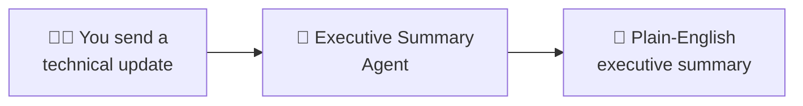

# Module 0 - Introduction

⏱️ ~10 min

> [!WARNING]
> **Preview & Limitations:** [Hosted Agents](https://learn.microsoft.com/azure/foundry/agents/concepts/hosted-agents) dey currently for **public preview** - no good for production workloads. Make you sabi dis tin:
> - **Supported regions dey limited** - check [region availability](https://learn.microsoft.com/azure/foundry/agents/concepts/hosted-agents#region-availability) before you create resources. If you choose one region wey no support am, deployment go fail.
> - The `agent-framework-foundry-hosting` package na pre-release - APIs fit change from one version to another.
> - Scale limits: hosted agents fit support 0–5 replicas (including scale-to-zero).
> - Some features wey dem show for this workshop fit change as the service dey go GA.

## Wetin you go build

For dis workshop, you go build **"Explain Like I'm an Executive"** agent - na hosted AI agent wey dey take complex technical updates come rewrite am as plain-English executive summaries.

**The agent dey use:**
- **Microsoft Agent Framework** - for agent logic and structure
- **Foundry Toolkit for VS Code** - to scaffold, test for your machine, and deploy
- **An AI model** (like `gpt-4.1-mini/gpt-5-mini`) - to generate the summaries

By the time you finish dis lab, you go get working agent wey you fit test local through the Agent Inspector, and if you like deploy to cloud.

---

## Wetin be hosted agents?

One **hosted agent** na AI agent wey dey run as managed service for Microsoft Foundry. Instead make you manage your own infrastructure, you go package your agent code for container and Foundry dey handle scaling, hosting, and expose am through standard HTTP endpoint.

| Concept | Wetin e mean |
|---------|--------------|
| **Agent** | Na your Python code wey dey receive user message, call AI model, and give structured response |
| **Hosted** | Foundry dey run your container for you - no VMs, no Kubernetes, no infrastructure to manage |
| **Responses protocol** | Na standard HTTP API (`POST /responses`) wey any client fit call to interact with your agent |
| **Agent Inspector** | Na local testing UI (wey dem build inside Foundry Toolkit) wey let you yarn with your agent before you deploy am |

For dis workshop, you go waka from zero go reach fully hosted agent - or you fit stop for local testing if na so you want.

---

## Choose your path

> ⚠️ **Choose one path before you continue.** The choice wey you make go determine which tools you go install and which modules go apply. You fit change from Path B → Path A later if you get subscription.

<strong>🅰️ Path A - Azure cloud (you need Azure subscription)</strong>

| | Details |
|---|---|
| **Who be this one for?** | You get active Azure subscription and fit create Foundry resources |
| **Model** | Azure OpenAI via Foundry (like `gpt-4.1-mini/gpt-5-mini`) |
| **Modules wey dem cover** | All modules (00–07) |
| **You go deploy to cloud?** | ✅ Yes - full end-to-end deployment |

<strong>🅱️ Path B - Local / free-tier (no need Azure subscription)</strong>

| | Details |
|---|---|
| **Who be this one for?** | MVPs, students, or anybodi wey no get Azure access |
| **Model** | **Foundry Local** (free, e dey run for your machine) |
| **Modules wey dem cover** | Modules 00–04 (skip deploy & cloud verify) |
| **You go deploy to cloud?** | ❌ No - only local testing through Agent Inspector |

---

## All paths: Tools wey you go need

Install each tool as e dey below. After you install am, make sure e work by running check command.

| # | Tool | Version | Install | Verify (Wetyn dem expect) |
|---|------|---------|---------|---------------------------|
| 1 | **Visual Studio Code** | Latest | [code.visualstudio.com](https://code.visualstudio.com/) | E go open without any error |
| 2 | **Python** | 3.12 or higher| [python.org/downloads](https://www.python.org/downloads/) | `python --version` $\rightarrow$ `Python 3.12.x` |
| 3 | **Foundry Toolkit for VS Code** | Latest | Extension ID: `ms-windows-ai-studio.windows-ai-studio` | You go see Foundry icon for Activity Bar |
| 4 | **Python extension for VS Code** | Latest | Extension ID: `ms-python.python` | E go be for Extensions panel |

> [!TIP]
> **Pro-tips for installation:**
> - **Python PATH (Windows):** Always confirm say you select **"Add Python to PATH"** for the first screen of Python installer. Without dis, `python` no go recognize for your terminal.
> - **Plenty Python versions:** If you get both Python 3.10 and 3.12 installed, use `python3.12 -m venv .venv` to make sure say correct version dey for your virtual environment.
> - **Docker WSL 2 (Windows):** When you dey install Docker Desktop, make sure say **WSL 2 backend** dey selected. Docker wey get Hyper-V dey slow and fit cause wahala with Foundry container build.
> - **Docker no dey start?** Wait 30–60 seconds after you launch Docker Desktop. Run `docker info` - if you see "Cannot connect to the Docker daemon," e mean Docker dey still initialize.
> - **VS Code extensions no dey load?** After you install extensions, reload the window: `Ctrl+Shift+P` → `Developer: Reload Window`.

> **Windows users:** Make sure say you check **"Add Python to PATH"** during Python installation.

**Next:** [01 - Setup →](01-setup.md)

---

<!-- CO-OP TRANSLATOR DISCLAIMER START -->
**Disclaimer**:
Dis document don translate wit AI translation service [Co-op Translator](https://github.com/Azure/co-op-translator). Even tho we dey try make am correct, abeg make you know say automated translation fit get errors or mistakes. Di original document for dia own language na im be di correct source. For important info, make person wey sabi human translation do am. We no go responsible for any misunderstanding or wrong understanding wey fit happen because of dis translation.
<!-- CO-OP TRANSLATOR DISCLAIMER END -->