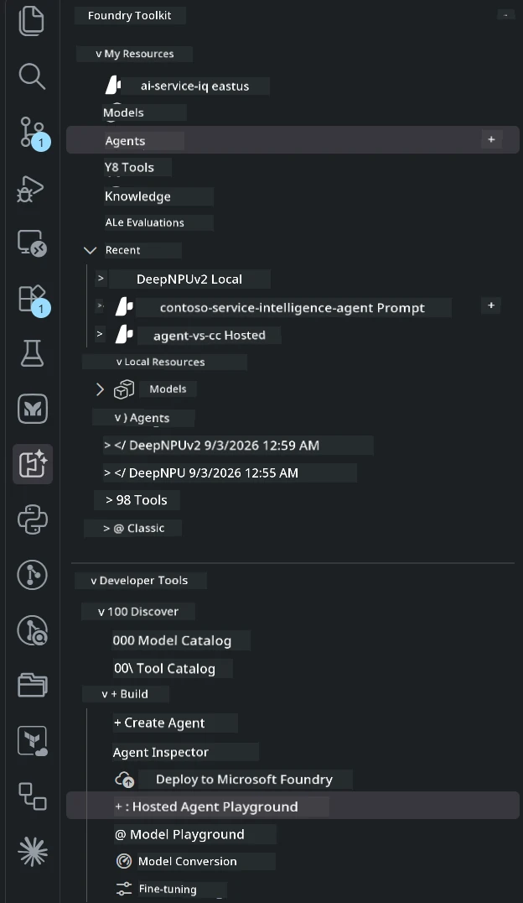
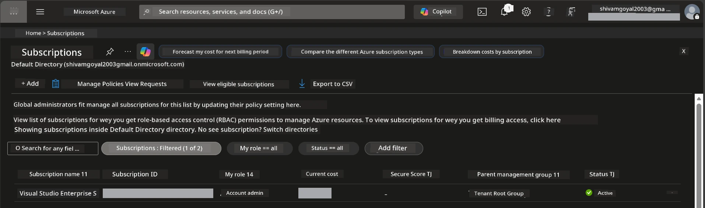
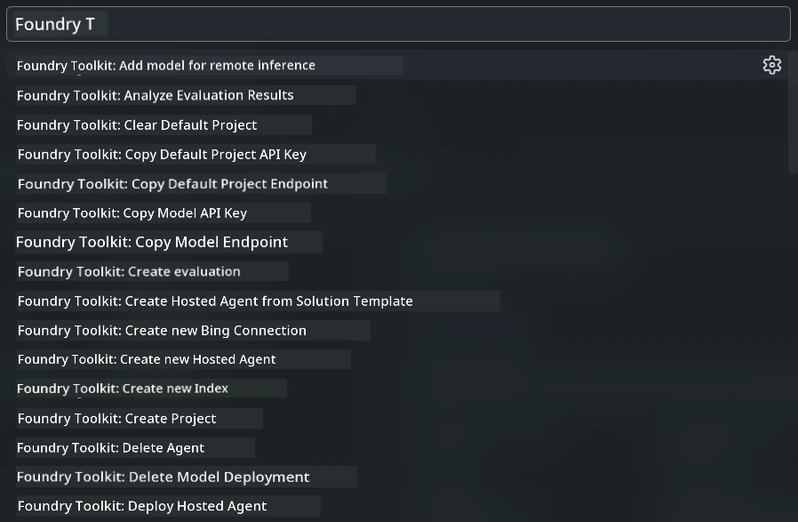
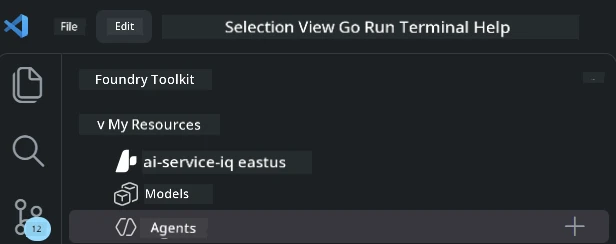
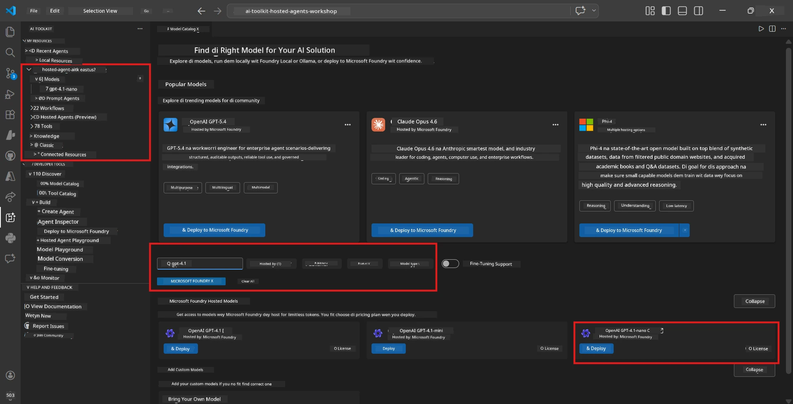
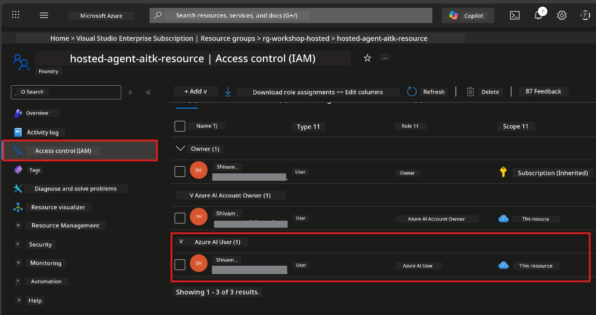

# Setup: Extension, Project & Model

⏱️ ~15 min

Inside dis module, you go install and verify di Foundry Toolkit extension, create (or connect to) Foundry project, plus deploy model wey your agent go use.

## Step 1: Install Foundry Toolkit

**Foundry Toolkit for VS Code** na di main extension for dis workshop. E dey provide project creation, model deployment, agent scaffolding, local testing (Agent Inspector), and cloud deployment - all from VS Code.

1. Open VS Code then press `Ctrl+Shift+X` to open di **Extensions** panel.
2. Search for **Foundry Toolkit**.
3. Install **Foundry Toolkit for VS Code** (Publisher: Microsoft, ID: `ms-windows-ai-studio.windows-ai-studio`).
4. After you don install am, di **Foundry Toolkit** icon go show for di Activity Bar (left sidebar).

> *Note: Di Activity Bar fit show "AI TOOLKIT" for older extension versions. Di functionality na di same.*



## Step 2: Set up based on your access

> **Choose your path:** Expand di section wey match your setup. You only need to complete **one** way.

<details>
<summary><strong>🅰️ Path A - Azure cloud (you need Azure subscription)</strong></summary>

### Azure CLI

1. Install from [learn.microsoft.com/cli/azure/install-azure-cli](https://learn.microsoft.com/cli/azure/install-azure-cli).
2. Verify: `az --version` (expect 2.80.0+).
3. Sign in: `az login`

### Authentication Options

Di [Microsoft Agent Framework](https://learn.microsoft.com/agent-framework/overview/) dey use [`DefaultAzureCredential`](https://learn.microsoft.com/azure/developer/python/sdk/authentication/credential-chains#defaultazurecredential-overview) wey dey try plenty authentication methods one after di other. Choose di one wey fit your environment:

#### Option 1: VS Code Accounts (we recommend for workshops)
1. Click di **Accounts** icon (person silhouette) for di bottom-left corner of VS Code.
2. Select **Sign in to use Microsoft Foundry** (or **Sign in with Azure**).
3. Browser go open - sign in wit di Azure account wey get access to your subscription.
4. Come back to VS Code. You go see your account name for di bottom-left.

#### Option 2: Azure CLI
```bash
az login
az account set --subscription "<your-subscription-id>"
```

#### Option 3: Service Principal (Enterprise/CI)
For locked-down environments or CI/CD pipelines, set these environment variables for your `.env` file:
```env
AZURE_TENANT_ID=<your-tenant-id>
AZURE_CLIENT_ID=<your-client-id>
AZURE_CLIENT_SECRET=<your-client-secret>
```

> **How `DefaultAzureCredential` dey work:** E dey try environment variables first, then managed identity, then VS Code sign-in, then Azure CLI - e go use whichever one succeed first. See [credential chain docs](https://learn.microsoft.com/azure/developer/python/sdk/authentication/credential-chains#defaultazurecredential-overview).

### Azure Developer CLI (azd)

1. Install: `winget install microsoft.azd` (Windows) or check [install docs](https://learn.microsoft.com/azure/developer/azure-developer-cli/install-azd).
2. Verify: `azd version`
3. Sign in: `azd auth login`

### Docker Desktop (optional)

Docker na only if you wan build containers locally. Foundry extension dey handle build automatically during deployment.

1. Install from [docs.docker.com/get-docker](https://docs.docker.com/get-docker/).
2. Verify: `docker info`

### Azure subscription & RBAC

1. Sign in for [portal.azure.com](https://portal.azure.com).
2. Go to **Subscriptions** and confirm at least one dey **Active**.
3. Note your **Subscription ID** - you go need am for Module 01.



#### RBAC Scenario Table

[Hosted Agent](https://learn.microsoft.com/azure/foundry/agents/concepts/hosted-agents) deployment need **data action** permissions wey standard Azure `Owner` and `Contributor` roles no **get**. Use di table below to find out which roles you go need:

| Scenario | Required roles | Where to assign them |
|----------|---------------|----------------------|
| Create new Foundry project | **Azure AI Owner** on Foundry resource | Foundry resource for Azure Portal |
| Deploy to existing project (new resources) | **Azure AI Owner** + **Contributor** on subscription | Subscription + Foundry resource |
| Deploy to fully configured project | **Reader** on account + **Azure AI User** on project | Account + Project for Azure Portal |
| Local testing only (no deployment) | **Azure AI User** on project | Project for Azure Portal |

> **Key point:** Azure `Owner` and `Contributor` roles na only *management* permissions (ARM operations) dem dey cover. You go need [**Azure AI User**](https://learn.microsoft.com/azure/foundry/concepts/rbac-foundry#built-in-roles) (or higher) for *data actions* like `agents/write` wey e dey required to create and deploy agents.

## Connect or create a Foundry project



1. Press `Ctrl+Shift+P` → type **Foundry Toolkit: Create Project** → choose am.
2. Choose your **Azure subscription** from the dropdown.
3. Select or create a **resource group** (for example, `rg-hosted-agents-workshop`).
4. Chọs wan **region** wey dey support hosted agents: `East US`, `West US 2`, or `Sweden Central`. Sii [region availability](https://learn.microsoft.com/azure/foundry/agents/concepts/hosted-agents#region-availability).
5. Put project name (e.g., `workshop-agents`).
6. Wait 2–5 minutes make e ready. Progress notification go show for VS Code.
7. When e finish, your project go show for **Foundry Toolkit** sidebar under **My Resources**.



## Deploy model & assign RBAC

Your hosted agent need AI model to fit give response.

#### Model Selection Matrix
Depending on your need dem, you fit choose from different model tiers:

| Model | Best for | Cost | Notes |
|-------|----------|------|-------|
| `gpt-4.1` | High-quality, nuanced responses | Higher | Best results, na e dem recommend for final testing |
| `gpt-4.1-mini/gpt-5-mini` | Fast iteration, lower cost | Lower | Good for workshop development and rapid testing |
| `gpt-4.1-nano` | Lightweight tasks | Lowest | Na e get cheapest cost, but e responses simple |

1. Press `Ctrl+Shift+P` → **Foundry Toolkit: Open Model Catalog** (or click **Model Catalog** for sidebar under **Developer Tools** → **Discover**).
2. Search for **gpt-4.1** for catalog.
3. Find **OpenAI GPT-4.1-mini** (or `gpt-5-mini` for beta quality) and click **Deploy**.



4. For di deployment configuration:
   - **Deployment name:** Leave di default or put your own custom name. **Make sure say you remember dis name.**
   - **Target:** Select **Deploy to Foundry Toolkit** → choose your project.
5. Click **Deploy** and wait for 1–3 minutes.

> **Recommendation:** Use `gpt-4.1-mini/gpt-5-mini` for di workshop - e fast, e cheap, and e get beta result.

### Note down your values

After you deploy, note these two values (you go need dem for Module 03):

| Value | Where to find am |
|-------|-----------------|
| **Project endpoint** | Click your project for di sidebar → detail view go show di URL (e.g., `https://<account>.services.ai.azure.com/api/projects/<project>`) |
| **Model deployment name** | Expand project → **Models** → di name wey dey next to your deployed model (e.g., `gpt-4.1-mini/gpt-5-mini`) |

### Assign RBAC role

> ⚠️ **Dis one na di step wey people dey mostly forget.** If you no get di correct role, deployment for Module 05 no go work.

#### Which role I suppose get?
Depending on your case, you go need these role combinations:

| Scenario | Roles wey dey needed | Where to assign dem |
|----------|---------------------|--------------------|
| Create new Foundry project | **Azure AI Owner** for Foundry resource | Foundry resource inside Azure Portal |
| Deploy to existing project (new resources) | **Azure AI Owner** + **Contributor** for subscription | Subscription + Foundry resource |
| Deploy to fully configured project | **Reader** for account + **Azure AI User** for project | Account + Project inside Azure Portal |

**Key point:** Azure `Owner` and `Contributor` roles na only *management* permission dem cover. You need **Azure AI User** (or higher) for *data actions* like `agents/write` wey e need to create and deploy agents.

1. Open [portal.azure.com](https://portal.azure.com).
2. Search for your **Foundry project** name → click di result wey dem type **"Foundry Toolkit project"** (NO be di parent account).
3. Click **Access control (IAM)** for di left navigation.
4. Click **+ Add** → **Add role assignment**.
5. **Role tab:** Search for **Azure AI User**, select am, click **Next**.
6. **Members tab:** Select **User, group, or service principal** → click **+ Select members** → find yourself → click **Select**.
7. Click **Review + assign** → **Review + assign** again.
8. **Wait 1–2 minutes** make e propagate.

> **Why dis role?** Azure `Owner`/`Contributor` na only dem dey give management permission. Di **Azure AI User** role dey give di `agents/write` data action wey you need to create and deploy agents. See [Foundry RBAC docs](https://learn.microsoft.com/azure/foundry/concepts/rbac-foundry#built-in-roles).



</details>

<details>
<summary><strong>🅱️ Path B - Local / free-tier (no Azure subscription needed)</strong></summary>

### Foundry Local

Foundry Local dey make you fit run AI models for your own machine - no need cloud account. You fit access Foundry Local models using Foundry Toolkit through di model catalog like this:

1. Go to di Foundry Toolkit extension.
2. For Foundry Toolkit navigation go to **Developer Tools** > and select **Model Catalog**
3. For di new window, select **local** for di navigation bar.
4. Scroll down go reach **Phi 4 Mini,** and click di **add button** one popup go show say di model dey download.
5. Once di model don download, you fit continue go di next step.

</details>

### ✅ Checkpoint


- [ ] `Ctrl+Shift+P` → "Foundry Toolkit" dey show commands wey dey available
- [ ] Foundry Toolkit extension don install and sidebar dey load without error
- [ ] VS Code dey open and dey run correct
- [ ] `python --version` dey show 3.12+
- [ ] Foundry Toolkit icon dey visible for VS Code Activity Bar
- [ ] **Path A:** `az login` succeed, subscription still Active
- [ ] **Path B:** Foundry Local dey run (`foundry local status`)
- [ ] **Path A:** Foundry project dey visible for sidebar, model don deploy, Azure AI User role don assign
- [ ] **Path B:** Foundry Local dey run with model
- [ ] You don note your **endpoint** and **model deployment name**


**Previous:** [00 - Prerequisites](00-prerequisites.md) · **Next:** [02 - Create Hosted Agent →](02-create-hosted-agent.md)

---

<!-- CO-OP TRANSLATOR DISCLAIMER START -->
**Disclaimer**:
Dis document don translate wit AI translation service [Co-op Translator](https://github.com/Azure/co-op-translator). Even tho we dey try make am correct, abeg make you know say automated translation fit get errors or mistakes. Di original document for dia own language na im be di correct source. For important info, make person wey sabi human translation do am. We no go responsible for any misunderstanding or wrong understanding wey fit happen because of dis translation.
<!-- CO-OP TRANSLATOR DISCLAIMER END -->