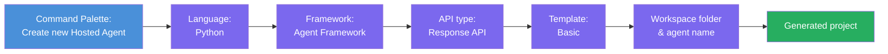
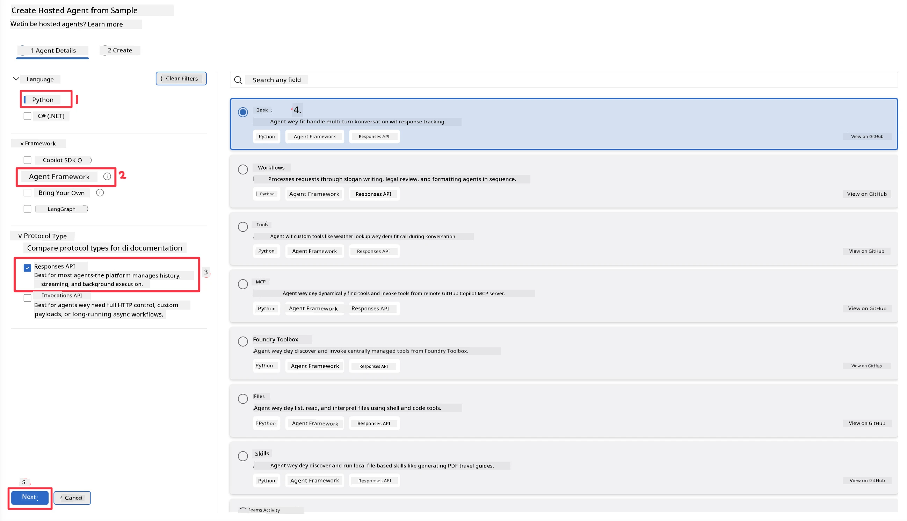
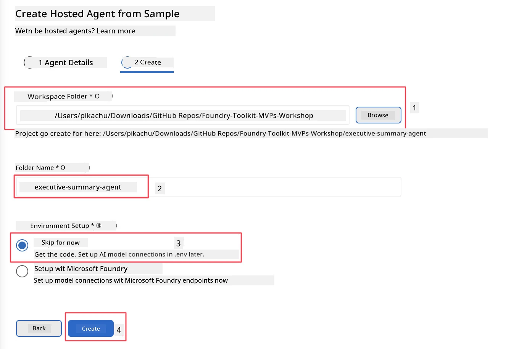

# Module 2 - Create New Hosted Agent

⏱️ ~5 min

For dis module, you go use Foundry Toolkit to **scaffold hosted agent project**. The scaffold go generate full project structure - `agent.yaml`, `main.py`, `Dockerfile`, `requirements.txt`, plus VS Code debug configuration - make you fit focus to customize how the agent go behave.

> **Key concept:** The `agent/` folder wey dey dis lab na example of wetin Foundry Toolkit go generate. You no go write all these files from zero.

### Scaffold wizard flow



---

## Step 1: Open the Create Hosted Agent wizard

1. Press `Ctrl+Shift+P` to open **Command Palette**.
2. Type: **Foundry Toolkit: Create new Hosted Agent** and select am.

> **Alternative: Create via Foundry Portal**
> If browser dey your choice, you fit create your project for [https://ai.azure.com](https://ai.azure.com). After dem don provision the project, come back VS Code and use **Foundry Toolkit** sidebar connect to am.

> **Alternative:** For Foundry Toolkit sidebar, hover your mouse for **Agents** under your project, click **+** icon, then choose **Create in Code With Template**.

## Step 2: Choose settings



1. For left side navigation/options section, select dis ones:

| Menu | Selection | Notes |
|--------|-----------|-------|
| **Language** | Python | C# too dey supported |
| **Framework** | Agent Framework | Simple start point with Agent Framework SDK |
| **API type** | Response API | `POST /responses` - na conversational, with platform-managed history |
| **Template** | Basic | Simple start point with Agent Framework SDK |

2. After you select, click **Next**



3. For di next window, select dis ones:

| Menu | Selection | Notes |
|--------|-----------|-------|
| **Workspace folder** | Choose where you wan put am | e.g., `/workspace/Foundry_Toolkit_for_VSCode_Lab/` or any subfolder for dis repo |
| **Agent name** | Put name | e.g., `executive-summary-agent` |
| **Environment Setup** | no need set for now |  |

Click **create** to create our agent. New folder go create wey get hosted agent name.

## Step 3: Inspect the generated project

After scaffolding don finish, check if you see these files for Explorer (`Ctrl+Shift+E`):

```
📂 executive-summary-agent/
├── .env                ← Environment variables (placeholders)
├── .vscode/
│   ├── launch.json     ← Debug config (F5 → run + Agent Inspector)
│   └── tasks.json      ← VS Code task definitions
├── agent.yaml          ← Agent definition (kind: hosted)
├── Dockerfile          ← Container config for deployment
├── main.py             ← Agent entry point (your main code)
└── requirements.txt    ← Python dependencies
```

### Key files explained

| File | Purpose |
|------|---------|
| `agent.yaml` | Declare the agent as `kind: hosted`, map environment variables, define `/responses` protocol |
| `main.py` | Create `FoundryChatClient` → wrap am inside `Agent` with instruction → serve with `ResponsesHostServer` for port 8088 |
| `Dockerfile` | Use `python:3.12-slim`, install dependencies, expose port 8088, run `main.py` |
| `requirements.txt` | `agent-framework-foundry`, `agent-framework-foundry-hosting`, `mcp`, `debugpy` |

> **Important:** Open the scaffolded agent folder direct for VS Code (na `agent/` folder itself) so that `.vscode/launch.json` and `tasks.json` go work well for F5 debugging.

---

### ✅ Checkpoint

- [ ] Scaffolded project create with all expected files
- [ ] `agent.yaml` show `kind: hosted` and `protocol: responses`
- [ ] `main.py` dey import `Agent`, `FoundryChatClient`, `ResponsesHostServer`
- [ ] The agent folder dey open for VS Code as workspace root

---

**Previous:** [01 - Setup](01-setup.md) · **Next:** [03 - Configure & Code →](03-configure-and-code.md)

---

<!-- CO-OP TRANSLATOR DISCLAIMER START -->
**Disclaimer**:
Dis document don translate wit AI translation service [Co-op Translator](https://github.com/Azure/co-op-translator). Even tho we dey try make am correct, abeg make you know say automated translation fit get errors or mistakes. Di original document for dia own language na im be di correct source. For important info, make person wey sabi human translation do am. We no go responsible for any misunderstanding or wrong understanding wey fit happen because of dis translation.
<!-- CO-OP TRANSLATOR DISCLAIMER END -->