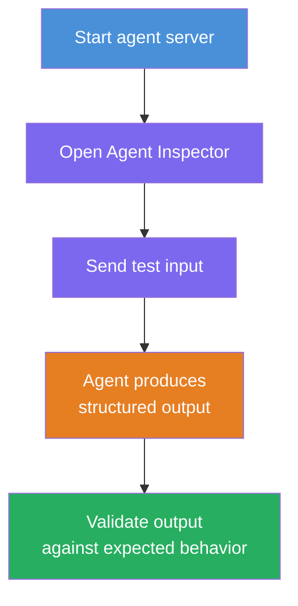
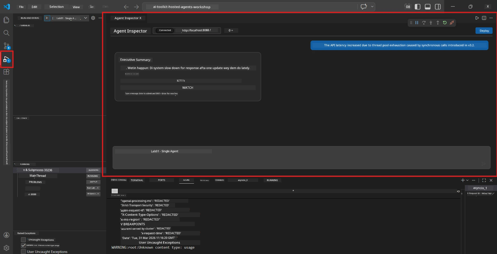
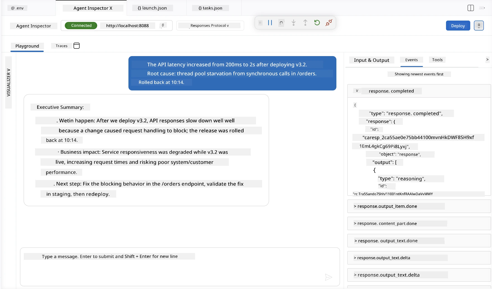

# Module 4 - Test Am Locally

⏱️ ~10 min

For dis module, you go run your agent lokalli and check say e dey work well using **happy-path functional tests**. You go use Agent Inspector (visual UI) or direct HTTP calls to confirm say the agent dey produce correct structured responses.

### How to test am locally



---

## Option 1: Press F5 - Debug wit Agent Inspector (wey dem recommend)

### How to start debugger

1. Open the **executive-summary-agent/** folder direct for VS Code (`File → Open Folder`).
2. Open the **Run and Debug** panel (`Ctrl+Shift+D`).
3. Choose **Debug Local Agent HTTP Server** from the dropdown.
4. Press **F5** (or click ▶ Start Debugging).

> ⚠️ **Sharp: Choose your Python Interpreter**
> If you see "ModuleNotFoundError" or debugger no fit start, you need tell VS Code to use your virtual environment:
  > 1. Press `Ctrl+Shift+P` $\rightarrow$ type **Python: Select Interpreter**.
  > 2. Choose the interpreter wey dey for your project folder `.venv` (e.g., `.\.venv\Scripts\python.exe` for Windows).
  > 3. Start the debug session again.
> If e still dey vex you, manually change your file `tasks.json` like this:
  > 1. Go the `.vscode/tasks.json` file
  > 2. Find the task wey dem mark: `Run Agent HTTP Server`
  > 3. Update the command value like this:
  >    - **Windows:** `"value": "${workspaceFolder}/.venv/Scripts/python.exe",`
  >    - **macOS/Linux:** `"value": "${workspaceFolder}/.venv/bin/python",`

### Wetin go happen

1. The HTTP server go start for `http://localhost:8088/responses`.
2. The **Agent Inspector** panel go open automatically - na visual chat interface for testing.
3. Breakpoints go dey enabled for `main.py`.

Watch the Terminal for:
```
Starting executive summary hosted agent
Executive agent server running on http://localhost:8088
```

> **If the Agent Inspector no open:** Press `Ctrl+Shift+P` → **Foundry Toolkit: Open Agent Inspector**.



> *Screenshot fit show old 'AI TOOLKIT' brand from one older extension version.*

---

## Option 2: Test from Terminal (another way)

Start the agent for one terminal, send requests from another:

```bash
# Terminal 1: Start agent
cd executive-summary-agent/
source .venv/bin/activate
python main.py
```

```bash
# Terminal 2: Send test (curl)
curl -sS -X POST http://localhost:8088/responses \
  -H "Content-Type: application/json" \
  -d '{"input": "The API latency increased due to thread pool exhaustion caused by sync calls in v3.2.", "stream": false}'
```

---

## Scenario tests: Happy-path functional check

Run **all three** scenarios wey dey below. Dem go check say your agent dey produce correct structured output for realistic inputs.



### Scenario 1: IT Wahala - API latency spike

**Input:**
```
The API latency increased from 200ms to 2s after deploying v3.2.
Root cause: thread pool starvation from synchronous calls in /orders.
Rolled back at 10:14.
```

**Wetindem expect:**
- ✅ Follow the "Executive Summary" structure (Wetin happen / How e affect business / Wetin to do next)
- ✅ No technical words (no "thread pool", no "/orders", no "v3.2")
- ✅ Clearly talk how business dey affected (like users dey get delay)
- ✅ Get one next step (like fix don deploy, monitoring dey)

---

### Scenario 2: Data Pipeline - ETL failure

**Input:**
```
The nightly ETL job failed because the upstream schema changed. APAC dashboards show missing data.
```

**Wetindem expect:**
- ✅ Summarize the data refresh failure in plain talk
- ✅ Talk about the APAC dashboard wahala
- ✅ Get one next step to fix am
- ✅ No talk "ETL", "schema", or other technical terms

---

### Scenario 3: Security wahala - Credential show for eye

**Input:**
```
Static analysis flagged a hardcoded secret in the repository.
The secret may have been exposed in commit history.
```

**Wetindem expect:**
- ✅ Describe the credential/security problem in executive-friendly talk
- ✅ Talk about possible risk (unauthorized access)
- ✅ Talk wetin dem go do (credential rotation, audit)
- ✅ No include terms like "static analysis", "commit history", or "hardcoded"

---

## Validation criteria

For each scenario, check:

| # | Criteria | Pass condition |
|---|----------|---------------|
| 1 | **Structure** | Response dey use "Executive Summary" format with all three bullets |
| 2 | **Plain language** | No technical talk wey executive no go understand |
| 3 | **Accuracy** | Summary dey reflect the input - no fake details |
| 4 | **Brevity** | Response dey under 100 words |
| 5 | **Next step** | Clear action or mitigation dey talk |

---

## Tips for debugging

| Wahala | How to fix |
|-------|-----|
| Agent no start | Check `.env` values, confirm venv dey activated, run `pip install -r requirements.txt` |
| Empty or general response | Review instructions for `main.py` - make sure output format dey |
| Response get jargon | Make "remove technical terms" instructions stronger |
| Agent Inspector no open | `Ctrl+Shift+P` → **Foundry Toolkit: Open Agent Inspector** |
| Model error for Terminal | Confirm `AZURE_AI_MODEL_DEPLOYMENT_NAME` match exactly (case-sensitive) |

---

### ✅ Checkpoint

- [ ] Agent start lokalli without wahala
- [ ] Agent Inspector open and show chat interface (if you dey use F5)
- [ ] **Scenario 1** (IT wahala) - structured Executive Summary, no jargon
- [ ] **Scenario 2** (data pipeline) - correct summary wit business impact
- [ ] **Scenario 3** (security alert) - better risk communication
- [ ] All responses follow the correct output structure

> **Save your responses** (make copy or screenshot) - you go compare dem wit cloud results for Module 06.

---

**Previous:** [03 - Configure & Code](03-configure-and-code.md) · **Next:** [05 - Deploy to Foundry →](05-deploy-to-foundry.md)

---

<!-- CO-OP TRANSLATOR DISCLAIMER START -->
**Disclaimer**:
Dis document don translate wit AI translation service [Co-op Translator](https://github.com/Azure/co-op-translator). Even tho we dey try make am correct, abeg make you know say automated translation fit get errors or mistakes. Di original document for dia own language na im be di correct source. For important info, make person wey sabi human translation do am. We no go responsible for any misunderstanding or wrong understanding wey fit happen because of dis translation.
<!-- CO-OP TRANSLATOR DISCLAIMER END -->