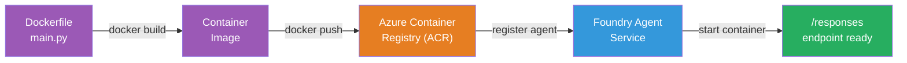
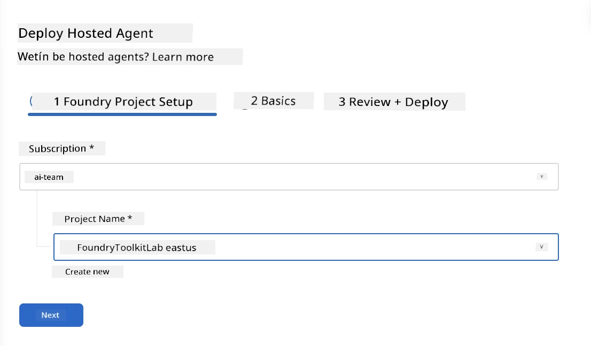
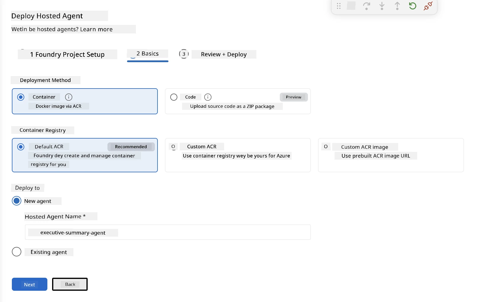
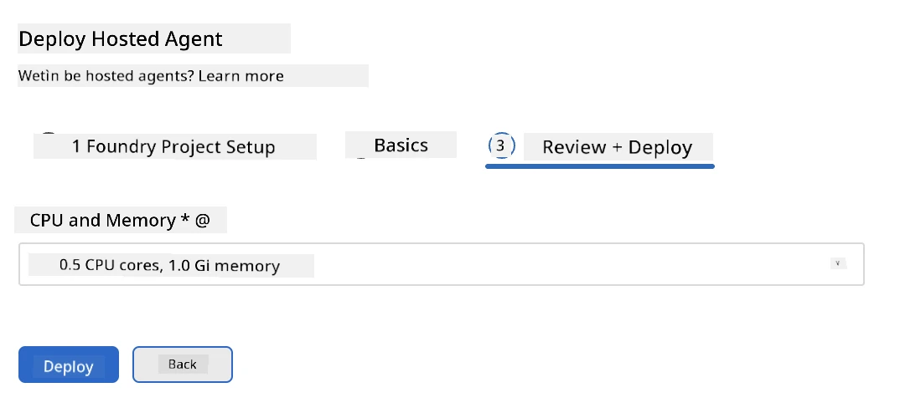
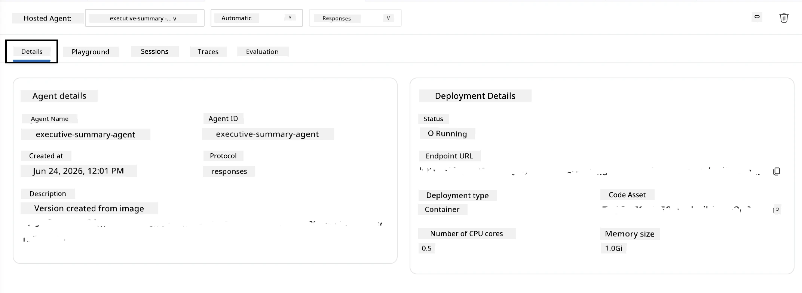

# Module 5 - Deploy to Foundry Agent Service

⏱️ ~10 min

> ⚠️ **Path B users:** Dis module need Foundry subscription. If you dey use Foundry Local, waka go [Module 07 - Summary](07-summary.md). You don finish local development workflow well-well!

For dis module, you go deploy your agent wey you don test for local to Microsoft Foundry as **Hosted Agent**. The deployment dey build container image, push am go Azure Container Registry, come start the agent for Foundry managed infrastructure.

### Deployment pipeline

---

## Prerequisites check

Before you deploy:

- [ ] Agent pass all 3 local scenarios from [Module 04](04-test-locally.md)
- [ ] You get **Azure AI User** role for the project level ([Module 01, Assign RBAC](01-setup.md#deploy-a-model--assign-rbac))
- [ ] You don sign in Azure for VS Code (Accounts icon dey show your name)

---

## Step 1: Start the deployment

### Option A: Deploy from Agent Inspector (recommended)

If Agent Inspector dey open (from testing):
1. Click **Deploy** button for top-right corner (cloud icon ↑).

### Option B: Deploy from Command Palette

1. Press `Ctrl+Shift+P` → **Foundry Toolkit: Deploy Hosted Agent**.

---

## Step 2: Configure the deployment

The wizard go ask you for:

| Prompt | Selection |
|--------|-----------|
| **Subscription** | Your Azure Subscription |
| **Target project** | Your Foundry project (for example, `workshop-agents`) |

Click **next** to setup your agent.

| Prompt | Selection |
|--------|-----------|
| **Deployment Method** | Container |
| **Container registry** | **Default ACR** (Microsoft Foundry go create and manage one for you) |
| **Deploy to** | New Agent (name, `executive-summary-agent`) |

Click **next** to check and deploy your agent.

| Prompt | Selection |
|--------|-----------|
| **CPU and memory** | **0.25 CPU cores, 0.5 Gi memory** (enough for workshop) |

---

## Step 3: Deploy and monitor

1. Click **Deploy**.
2. Watch **Output** panel (choose **Microsoft Foundry** from dropdown).
3. Deployment go run through these steps:
   - **Docker build** - build container from your Dockerfile
   - **Docker push** - push image to ACR (1–3 min for first deploy)
   - **Agent registration** - create hosted agent for Foundry
   - **Container start** - start with system-managed identity

4. When e finish, notification go show:
   > **my-agent don deploy finish well-well.** `View logs` `Run agent`

5. Click **Run agent** to open Agent Playground.

### Deployment status values

| Status | Meaning |
|--------|---------|
| **Running** | Container ready, agent dey respond |
| **Pending** | Container dey start - wait 30–60 seconds |
| **Failed** | Check logs (see troubleshooting below) |

---

## Common deployment errors

| Error | Root cause | Fix |
|-------|-----------|-----|
| `agents/write` permission denied | You never get **Azure AI User** role for project level | [Module 01, Assign RBAC](01-setup.md#deploy-a-model--assign-rbac) |
| Docker no dey run | Docker Desktop never start | Start Docker Desktop → verify `docker info` |
| ACR authorization | Managed identity no fit pull image | See [Module 08 - Troubleshooting](08-troubleshooting.md) |

---

### ✅ Checkpoint

- [ ] Deployment finish without error
- [ ] Agent dey under **Hosted Agents (Preview)** for Foundry sidebar
- [ ] Container status dey show **Running**
- [ ] Agent Playground tab open show agent details and endpoint URL

---

**Previous:** [04 - Test Locally](04-test-locally.md) · **Next:** [06 - Verify in Playground →](06-verify-in-playground.md)

---

<!-- CO-OP TRANSLATOR DISCLAIMER START -->
**Disclaimer**:
Dis document don translate wit AI translation service [Co-op Translator](https://github.com/Azure/co-op-translator). Even tho we dey try make am correct, abeg make you know say automated translation fit get errors or mistakes. Di original document for dia own language na im be di correct source. For important info, make person wey sabi human translation do am. We no go responsible for any misunderstanding or wrong understanding wey fit happen because of dis translation.
<!-- CO-OP TRANSLATOR DISCLAIMER END -->