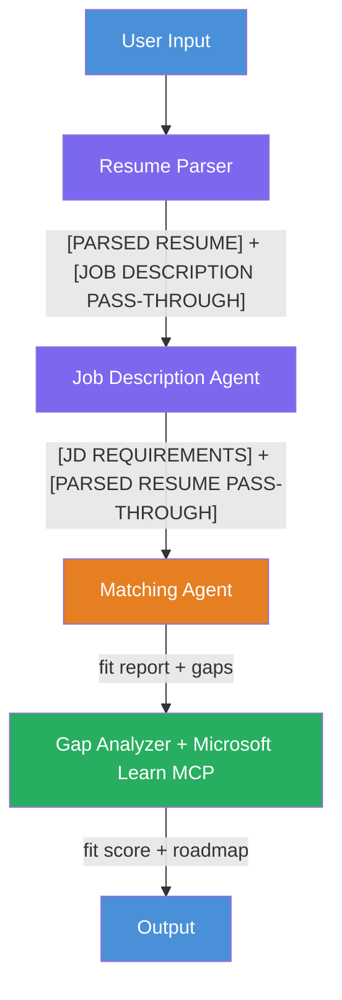

# Lab 02 - Multi-Agent Workflow: Resume → Job Fit Evaluator

## Overview

For dis hands-on lab, you go build **workflow-first multi-agent app** using Foundry Toolkit for VS Code and deploy am to Microsoft Foundry Agent Service.

**Wetin you go build:** Resume → Job Fit Evaluator wey go parse resume and job description, score how dem match, and make personalized learning roadmap using Microsoft Learn resources.

---

## Architecture

**How e dey work:**
1. User go paste resume and job description.
2. **ResumeParser** go parse the resume and copy the JD exactly for inside `[JOB DESCRIPTION PASS-THROUGH]` section.
3. **JD Agent** go comot structured requirements from the pass-through, then pass the `[PARSED RESUME]` forward as `[PARSED RESUME PASS-THROUGH]`.
4. **MatchingAgent** go compare `[PARSED RESUME PASS-THROUGH]` and `[JD REQUIREMENTS]` then produce fit score.
5. **GapAnalyzer** go turn di gaps to practical roadmap and find correct Microsoft Learn links via MCP.

---

## Prerequisites

Make you finish Lab 01 first:

- [Lab 01 - Single Agent](../lab01-single-agent/README.md)

---

## Part 1: Read the modules in order

See the full learning path for:

- [Lab 2 Docs - Prerequisites](docs/00-prerequisites.md)
- [Lab 2 Docs - Full Learning Path](docs/README.md)
- [PersonalCareerCopilot run guide](PersonalCareerCopilot/README.md)

---

## Part 2: Build and test the workflow

1. Use Foundry Toolkit wizard to start the workflow-based project.
2. Copy the prompt blocks and workflow graph from `PersonalCareerCopilot/main.py` go put am for your workspace.
3. Run am locally with Agent Inspector and make sure sey all four agents plus MCP tool dey work.
4. Deploy the hosted agent to Foundry when local testing don pass.

---

## Orchestration patterns

Lab 02 dey use **sequential pipeline**: each agent output dey feed the next one, and the workflow go return final agent response. Two patterns dey make am work:

- **Sequential chain** - `WorkflowBuilder` connect ResumeParser → JD Agent → MatchingAgent → GapAnalyzer with one `add_edge()` call for each step
- **Content relay** - because each agent fit only see output from direct predecessor, ResumeParser and JD Agent copy data wey downstream agents need enter labeled pass-through sections

The docs still explain why the lab no use fan-out/fan-in, and how to add another agent for the graph.

See [docs/04-orchestration-patterns.md](docs/04-orchestration-patterns.md).

---

**Previous:** [Lab 01 - Single Agent](../lab01-single-agent/README.md) · **Back to:** [Workshop Home](../../README.md)

---

<!-- CO-OP TRANSLATOR DISCLAIMER START -->
**Disclaimer**:
Dis document don translate wit AI translation service [Co-op Translator](https://github.com/Azure/co-op-translator). Even tho we dey try make am correct, abeg make you know say automated translation fit get errors or mistakes. Di original document for dia own language na im be di correct source. For important info, make person wey sabi human translation do am. We no go responsible for any misunderstanding or wrong understanding wey fit happen because of dis translation.
<!-- CO-OP TRANSLATOR DISCLAIMER END -->