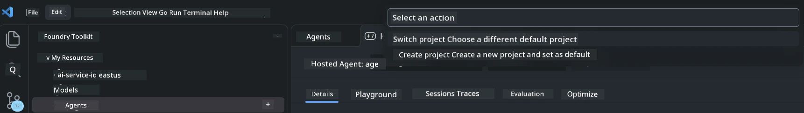

# Module 0 - Introduction

⏱️ ~10 min

> [!WARNING]
> **Preview & Limitations:** [Hosted Agents](https://learn.microsoft.com/azure/foundry/agents/concepts/hosted-agents) dey currently for **public preview** - e no good for production workloads. Some features wey dem show for this workshop fit change as service dey waka go GA.

## Wetin you go build

For this lab, you go extend the single-agent skills from Lab 01 to build **multi-agent workflow** - the Resume → Job Fit Evaluator.

You go paste in **resume** and **job description**. Four special agents go process the input one after another, then return:
- Fit score (0–100 wit scoring breakdown)
- Skill and certification gap list
- Personalized learning roadmap wit real Microsoft Learn links for each gap

**The workflow dey use:**
- **Microsoft Agent Framework** - `WorkflowBuilder` for sequential pipeline orchestration
- **Foundry Toolkit for VS Code** - scaffold, test locally, deploy
- **An AI model** (e.g., `gpt-4.1-mini`) - e dey used by all four agents
- **Microsoft Learn MCP server** - e provide real learning resource links for each skill gap

---

## Choose your path

> ⚠️ **Continue with the same path wey you use for Lab 01.**

<details open>
<summary><strong>🅰️ Path A - Azure cloud (you go need Azure subscription)</strong></summary>

| | Details |
|---|---|
| **Who na for?** | You don complete Lab 01 wit Azure subscription |
| **Model** | Azure OpenAI via Foundry (e.g., `gpt-4.1-mini`) |
| **Modules wey cover** | All modules (00–09) |
| **Deploy to cloud?** | ✅ Yes - full end-to-end deployment |

</details>

<details open>
<summary><strong>🅱️ Path B - Foundry Local (no need Azure subscription)</strong></summary>

| | Details |
|---|---|
| **Who na for?** | You don complete Lab 01 wit Foundry Local |
| **Model** | Foundry Local (free, e dey run for your machine) |
| **Modules wey cover** | Modules 00–05 (skip 06–07 - deploy & cloud verify) |
| **Deploy to cloud?** | ❌ No - local testing only through Agent Inspector |

</details>

---

## Lab 01 check

Lab 02 base directly on Lab 01. Make you complete Lab 01 before you start here.

You never do Lab 01? Start here: [Lab 01 - Introduction](../../lab01-single-agent/docs/00-prerequisites.md)

<details open>
<summary><strong>🅰️ Path A - Azure cloud</strong></summary>

```powershell
az account show --query "{name:name, id:id}" --output table
```

If e fail, run `az login`. Then check for VS Code:

1. `Ctrl+Shift+P` → type **Foundry Toolkit** → confirm say commands dey.
2. Click **Foundry Toolkit** icon → your project and deployed model go show **Succeeded**.



> **RBAC:** You assign **Foundry User** for Lab 01. If you need re-assign am, see [Lab 01, Module 1](../../lab01-single-agent/docs/01-setup.md#deploy-a-model--assign-rbac). The role before e be **Azure AI User** - permissions still the same.

</details>

<details open>
<summary><strong>🅱️ Path B - Foundry Local</strong></summary>

```powershell
Invoke-WebRequest -Uri "http://localhost:5273/v1/health" -UseBasicParsing | Select-Object StatusCode
```

Expected: `StatusCode: 200`. If no be so, restart Foundry Local from the Foundry Toolkit sidebar.

> All inference dey run for your machine. The only call wey dey outside na MCP tool to `https://learn.microsoft.com/api/mcp`.

</details>

---

## Wetin new for Lab 02

| | Lab 01 | Lab 02 |
|--|--------|--------|
| Agents | 1 | 4 (dem chain with WorkflowBuilder) |
| Scaffold template | Basic - Agent Framework | Workflows - Agent Framework |
| New package | - | `mcp` |
| Orchestration | Single conversational agent | Sequential pipeline (WorkflowBuilder) |
| New tool | - | `search_microsoft_learn_for_plan` (MCP) |

---

**Next:** [01 - Understand the Architecture →](01-understand-multi-agent.md)

---

<!-- CO-OP TRANSLATOR DISCLAIMER START -->
**Disclaimer**:
Dis document don translate wit AI translation service [Co-op Translator](https://github.com/Azure/co-op-translator). Even tho we dey try make am correct, abeg make you know say automated translation fit get errors or mistakes. Di original document for dia own language na im be di correct source. For important info, make person wey sabi human translation do am. We no go responsible for any misunderstanding or wrong understanding wey fit happen because of dis translation.
<!-- CO-OP TRANSLATOR DISCLAIMER END -->