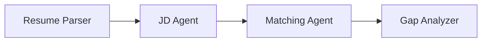
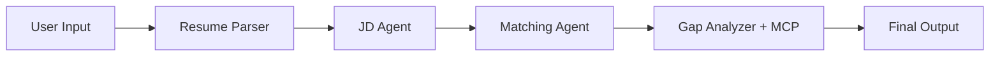

# Module 4 - Orchestration Patterns

⏱️ ~10 min

For dis module, you go explore di orchestration patterns wey dem use for di Resume Job Fit Evaluator and you go learn how to read, change, and extend di workflow graph. To sabi these patterns na beta tin if you wan fit solve problem for data flow and build your own [multi-agent workflows](https://learn.microsoft.com/agent-framework/workflows/).

---

## Pattern 1: Sequential chain

Di main pattern for di workflow na **sequential chain** - one agent output dey go directly to di next agent.



For code, every `add_edge()` call dey create one step for di chain:

```python
.add_edge(resume_executor, jd_executor)       # ResumeParser output → JD Agent
.add_edge(jd_executor, matching_executor)     # JD Agent output → MatchingAgent
.add_edge(matching_executor, gap_executor)    # MatchingAgent output → GapAnalyzer
```

> **Why na sequential, no be fan-out/fan-in?** `WorkflowBuilder` dey use **OR-semantics** for di incoming edges: di executor wey dey downstream go start as soon as **any** predecessor finish. If `matching_executor` get two incoming edges (from both `resume_executor` and `jd_executor`), e go trigger twice - one time when ResumeParser finish and another time when JD Agent finish - dis go make GapAnalyzer run twice and output go show twice too. Di sequential pipeline dey stop dis kain yawa.

## Pattern 2: Content Relay

Because `context_mode="last_agent"` mean say every executor only dey see output from him **direct predecessor** only, agents for sequential chain suppose explicitly pass forward any data wey downstream agents need.

For dis workflow:
- **ResumeParser** dey copy di JD word for word enter `[JOB DESCRIPTION PASS-THROUGH]` (make JD Agent fit find am).
- **JD Agent** dey copy di `[PARSED RESUME]` word for word enter `[PARSED RESUME PASS-THROUGH]` (make MatchingAgent fit compare both profiles).

```
ResumeParser output
└─ [PARSED RESUME]               ← extracted by JD Agent
└─ [JOB DESCRIPTION PASS-THROUGH] ← extracted by JD Agent

JD Agent output
└─ [JD REQUIREMENTS]             ← extracted by MatchingAgent
└─ [PARSED RESUME PASS-THROUGH]  ← extracted by MatchingAgent
```

Every relay section suppose dey copied **word for word** - if you try summarize or paraphrase am, e go break di downstream agent wey depend on am.

---

## The complete graph

If you combine di sequential chain and content relay patterns, you go get di full workflow:



Di Agent Inspector go show di same graph structure when di agent dey run for local. Check [Module 5 - Test Locally](05-test-locally.md) for screenshots.

---

## Reading the WorkflowBuilder code

Di workflow graph dey build for `main()` function inside [`PersonalCareerCopilot/main.py`](../../../../../workshop/lab02-multi-agent/PersonalCareerCopilot/main.py). Di three `add_edge()` calls dey build di sequential pipeline:

| # | Edge | Effect |
|---|------|--------|
| 1 | `resume_executor → jd_executor` | JD Agent dey receive `[PARSED RESUME]` + `[JOB DESCRIPTION PASS-THROUGH]` |
| 2 | `jd_executor → matching_executor` | MatchingAgent dey receive `[JD REQUIREMENTS]` + `[PARSED RESUME PASS-THROUGH]` |
| 3 | `matching_executor → gap_executor` | GapAnalyzer dey receive fit report + gap list |

---

## Modifying the graph

### Adding a new agent

To add fifth agent (like **InterviewPrepAgent** after GapAnalyzer):

1. Define one `INTERVIEW_PREP_INSTRUCTIONS` constant.
2. Create `Agent` + `AgentExecutor` objects (same pattern as di four wey dey already).
3. Add `.add_edge(gap_executor, interview_exec)` for `WorkflowBuilder`.
4. Update `output_executors=[interview_exec]`.

> **Important:** `start_executor` na di only agent wey dey receive raw user input. All other agents dey receive output from their upstream edge.

---

## Common graph mistakes

| Mistake | Symptom | Fix |
|---------|---------|-----|
| Missing edge to `output_executors` | Agent dey run but output empty | Make sure say path dey from `start_executor` to every agent for `output_executors` |
| Circular dependency | Infinite loop or timeout | Check say no agent dey feed back into upstream agent |
| Agent for `output_executors` with no incoming edge | Empty output | Add at least one `add_edge(source, that_agent)` |
| Multiple `output_executors` with no fan-in | Output get only one agent response | Use one single output agent wey dey aggregate, or accept multiple outputs |
| Missing `start_executor` | `ValueError` at build time | Always specify `start_executor` inside `WorkflowBuilder()` |

---

## Debugging the graph

### Using Agent Inspector

1. Start the agent locally with F5.
2. Open Agent Inspector (`Ctrl+Shift+P` → **Foundry Toolkit: Open Agent Inspector**).
3. Send one test message.
4. For Inspector response panel, look for **streaming output** - e go show each agent contribution one after another.


### Using logging

Add logging to `main.py` to trace data flow:

```python
import logging
logger = logging.getLogger("resume-job-fit")

# In main(), after building the workflow:
logger.info("Workflow graph built with edges: RP→JD, JD→MA, MA→GA")
```

Di server logs go show order wey agents run and MCP tool calls:

```
INFO:agent_framework:Executing agent: ResumeParser
INFO:agent_framework:Executing agent: JobDescriptionAgent
INFO:agent_framework:Executing agent: MatchingAgent
INFO:agent_framework:Executing agent: GapAnalyzer
INFO:agent_framework:Tool call: search_microsoft_learn_for_plan(skill="Kubernetes")
POST https://learn.microsoft.com/api/mcp → 200
INFO:agent_framework:Tool call: search_microsoft_learn_for_plan(skill="Terraform")
POST https://learn.microsoft.com/api/mcp → 200
```

---

### Checkpoint

- [ ] You fit identify di two orchestration patterns for di workflow: sequential chain and content relay
- [ ] You sabi why `context_mode="last_agent"` need explicit data relay between agents
- [ ] You fit read `WorkflowBuilder` code and connect every `add_edge()` call to di visual graph
- [ ] You sabi how to add new agent to di end of di pipeline
- [ ] You fit identify common graph mistakes and di symptoms wey dem dey cause

---

**Previous:** [03 - Configure Agents & Environment](03-configure-agents.md) · **Next:** [05 - Test Locally →](05-test-locally.md)

---

<!-- CO-OP TRANSLATOR DISCLAIMER START -->
**Disclaimer**:
Dis document don translate wit AI translation service [Co-op Translator](https://github.com/Azure/co-op-translator). Even tho we dey try make am correct, abeg make you know say automated translation fit get errors or mistakes. Di original document for dia own language na im be di correct source. For important info, make person wey sabi human translation do am. We no go responsible for any misunderstanding or wrong understanding wey fit happen because of dis translation.
<!-- CO-OP TRANSLATOR DISCLAIMER END -->