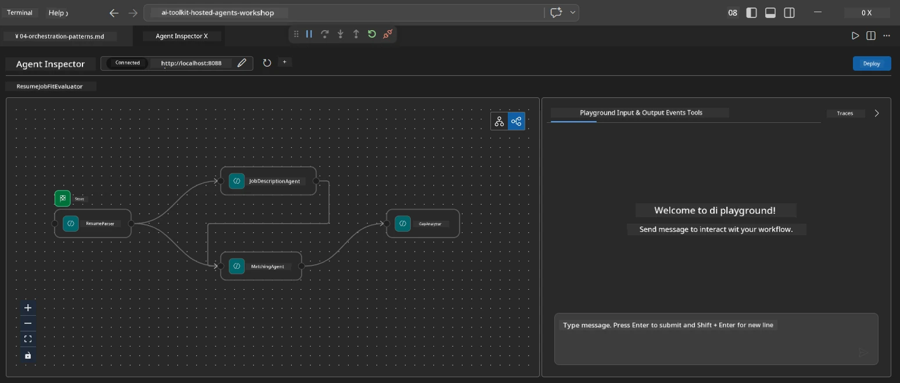
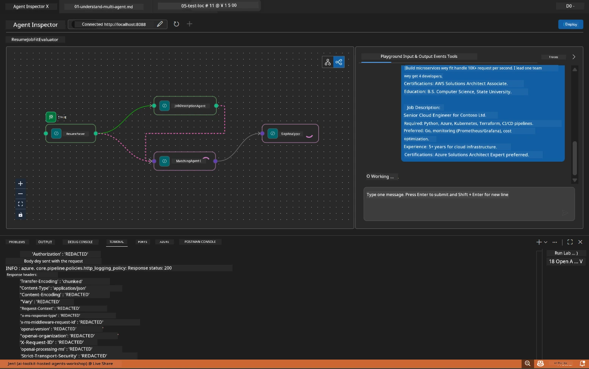
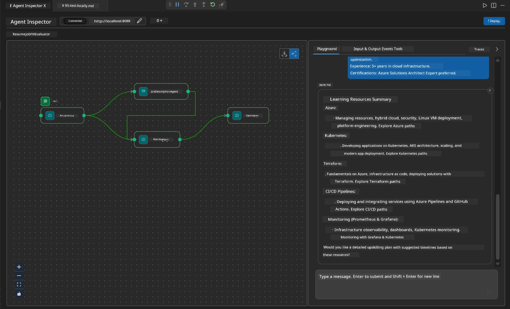

# Module 5 - Test for Local

⏱️ ~15 min

For this module, you go run di multi-agent workflow for your area, test am wit Agent Inspector, and confirm say all four agents and di MCP tool dey work well before you deploy am.

---

## Step 1: Start di agent server

### Option A: Use di VS Code task (wey dem recommend)

1. Open `workshop/lab02-multi-agent/PersonalCareerCopilot/` as your VS Code folder.
2. Press `Ctrl+Shift+P` → type **Tasks: Run Task** → select **Run Agent HTTP Server**.
3. Di task go start di server wit debugpy wey attach for port `5679` and di agent for port `8088`.
4. Wait make output show di startup message, then di server own ready message (other log lines go still appear):

```
INFO:resume-job-fit:Starting Resume -> Job Fit Evaluator HTTP server...
...
INFO:hypercorn.error:Running on http://0.0.0.0:8088 (CTRL + C to quit)
```

### Option B: Use F5 (debug mode)

1. Press `F5` → select **Debug Local Agent HTTP Server**.
2. Di server go start wit full breakpoint support - dis dey usefu for inspect MCP responses or agent outputs.

---

## Step 2: Open Agent Inspector

1. Press `Ctrl+Shift+P` → type **Foundry Toolkit: Open Agent Inspector**.
2. Agent Inspector go open as VS Code panel wey connect to `http://localhost:8088`.
3. You suppose see di agent interface ready to accept messages.



> **If Agent Inspector no open:** Make sure say di server don start well (you go see di `Running on http://0.0.0.0:8088` log). If port 5679 dey busy, check [Module 8 - Troubleshooting](08-troubleshooting.md).

---

## Step 2b: (Optional) Open di Workflow Visualizer

Di Foundry Toolkit get real-time **Workflow Visualizer** wey dey show how agents dey interact as di graph dey run. Dis one dey especially usefu for multi-agent debugging.

1. Press `Ctrl+Shift+P` → type **Foundry Toolkit: Open Visualizer for Hosted Agents**.
2. New VS Code tab go open wey show di live execution graph.
3. As you dey send messages for Agent Inspector, di visualizer go update automatically - green nodes mean say agents don complete, and animated edges dey show data wey dey flow between dem.

> **Port conflict:** If di visualizer port don already dey use, change am for VS Code Settings → **Extensions** → **Microsoft Foundry Configuration** → **Hosted Agents: Visualizer Port**.

---

## Step 3: Run smoke tests

Run dis two tests one after di other. Every test dey test more of di workflow.

### Test 1: Basic resume + job description

Paste dis one inside Agent Inspector:

```
Resume:
Jane Doe
Senior Software Engineer with 5 years of experience in Python, Django, and AWS.
Built microservices handling 10K+ requests/second. Led a team of 4 developers.
Certifications: AWS Solutions Architect Associate.
Education: B.S. Computer Science, State University.

Job Description:
Senior Cloud Engineer at Contoso Ltd.
Required: Python, Azure, Kubernetes, Terraform, CI/CD pipelines.
Preferred: Go, monitoring (Prometheus/Grafana), cost optimization.
Experience: 5+ years in cloud infrastructure.
Certifications: Azure Solutions Architect Expert preferred.
```

**Expected output structure:**

Di response suppose contain output from all four agents one by one:

1. **Resume Parser output** - Two labeled sections: `[PARSED RESUME]` (candidate profile wit grouped skills) and `[JOB DESCRIPTION PASS-THROUGH]` (verbatim JD text wey dey feed di JD Agent)
2. **JD Agent output** - Structured requirements wit required vs. preferred skills separate
3. **Matching Agent output** - Fit score (0-100) wit breakdown, matched skills, missing skills, gaps
4. **Gap Analyzer output** - Individual gap cards for each missing skill, each get Microsoft Learn URLs





### Wetin to check for Test 1

| Check | Expected | Pass? |
|-------|----------|-------|
| Response get fit score | Number between 0-100 wit breakdown | |
| Matched skills dey listed | Python, CI/CD (partial), etc. | |
| Missing skills dey listed | Azure, Kubernetes, Terraform, etc. | |
| Gap cards dey for every missing skill | One card per skill | |
| Microsoft Learn URLs dey present | Real `learn.microsoft.com` links | |
| No error messages inside response | Clean structured output | |

### Test 2: Edge case - high-fit candidate

Paste one resume wey close match di JD to verify say GapAnalyzer fit handle high-fit situations:

```
Resume:
Alex Chen
Senior Cloud Engineer with 7 years of experience.
Skills: Python, Azure (AKS, Functions, DevOps), Kubernetes, Terraform, CI/CD (GitHub Actions, Azure Pipelines), Go, Prometheus, Grafana, cost optimization.
Certifications: Azure Solutions Architect Expert, Azure DevOps Engineer Expert.
Led infrastructure migration to Azure for 3 enterprise clients.
Education: M.S. Computer Science, Tech University.

Job Description:
Senior Cloud Engineer at Contoso Ltd.
Required: Python, Azure, Kubernetes, Terraform, CI/CD pipelines.
Preferred: Go, monitoring (Prometheus/Grafana), cost optimization.
Experience: 5+ years in cloud infrastructure.
Certifications: Azure Solutions Architect Expert preferred.
```

**Expected behavior:**
- Fit score suppose dey **80+** (most skills dem match)
- Gap cards go focus on polish/interview readiness instead of foundational learning
- Di GapAnalyzer instructions talk say: "If fit >= 80, focus on polish/interview readiness"

---

## Step 4: Test wit your own data (optional)

Try paste your own resume and real job description. Dis one go help confirm:

- Di agents fit handle different resume formats (chronological, functional, hybrid)
- Di JD Agent fit handle different JD styles (bullet points, paragraphs, structured)
- Di MCP tool go return relevant resources for real skills
- Di gap cards go be personal to your own background

> **Privacy - Path A (Foundry cloud):** Resume and JD text go your Azure OpenAI deployment for inference. E no go log or store for di workshop infrastructure. Use placeholder names (like "Jane Doe") if you want.
>
> **Privacy - Path B (Foundry Local):** All four agent inferences go run complete for your own device. Your resume and job description text **no go comot from your machine at all**. Di only outbound call na di MCP tool wey dey fetch resources from `https://learn.microsoft.com/api/mcp`; dat query get only di skill name, no your personal data.

---

### Checkpoint

- [ ] Server start one time for port `8088` (log show `Running on http://0.0.0.0:8088`)
- [ ] Agent Inspector open and connect to di agent
- [ ] Test 1: Complete response wit fit score, matched/missing skills, gap cards, and Microsoft Learn URLs
- [ ] Test 2: High-fit candidate get score 80+ wit polish-focused recommendations
- [ ] All gap cards dey (one per missing skill, no truncate)
- [ ] No error or stack trace dey for server terminal

---

**Previous:** [04 - Orchestration Patterns](04-orchestration-patterns.md) · **Next:** [06 - Deploy to Foundry →](06-deploy-to-foundry.md)

---

<!-- CO-OP TRANSLATOR DISCLAIMER START -->
**Disclaimer**:
Dis document don translate wit AI translation service [Co-op Translator](https://github.com/Azure/co-op-translator). Even tho we dey try make am correct, abeg make you know say automated translation fit get errors or mistakes. Di original document for dia own language na im be di correct source. For important info, make person wey sabi human translation do am. We no go responsible for any misunderstanding or wrong understanding wey fit happen because of dis translation.
<!-- CO-OP TRANSLATOR DISCLAIMER END -->