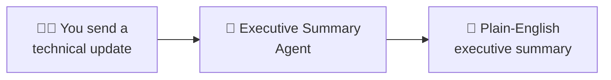

# Moduł 0 - Wprowadzenie

⏱️ ~10 min

> [!WARNING]
> **Podgląd i ograniczenia:** [Hosted Agents](https://learn.microsoft.com/azure/foundry/agents/concepts/hosted-agents) są obecnie w **publicznym podglądzie** – niezalecane do produkcyjnych obciążeń. Weź pod uwagę następujące kwestie:
> - **Obsługiwane regiony są ograniczone** – sprawdź [dostępność regionu](https://learn.microsoft.com/azure/foundry/agents/concepts/hosted-agents#region-availability) przed tworzeniem zasobów. Jeśli wybierzesz nieobsługiwany region, wdrożenie zakończy się niepowodzeniem.
> - Pakiet `agent-framework-foundry-hosting` jest wersją przedpremierową – API mogą się zmienić między wersjami.
> - Limity skali: hosted agents obsługują 0–5 replik (w tym skalowanie do zera).
> - Niektóre funkcje pokazane w tym warsztacie mogą się zmienić, gdy usługa przejdzie do GA.

## Co zbudujesz

W tym warsztacie zbudujesz agenta **„Wyjaśnij jak dla Dyrektora”** – hostowanego agenta AI, który przekształca złożone aktualizacje techniczne w proste, angielskie streszczenia dla kadry kierowniczej.

**Agent korzysta z:**
- **Microsoft Agent Framework** – do logiki i struktury agenta
- **Foundry Toolkit dla VS Code** – do szkieletu, lokalnego testowania i wdrażania
- **Modelu AI** (np. `gpt-4.1-mini/gpt-5-mini`) – do generowania streszczeń

Do końca tego ćwiczenia będziesz mieć działającego agenta, którego możesz przetestować lokalnie za pomocą Agent Inspector, a opcjonalnie wdrożyć w chmurze.

---

## Czym są hosted agents?

**Hosted agent** to agent AI działający jako zarządzana usługa w Microsoft Foundry. Zamiast zarządzać własną infrastrukturą, pakujesz kod agenta w kontener, a Foundry zajmuje się skalowaniem, hostowaniem i udostępnianiem go przez standardowy punkt końcowy HTTP.

| Koncepcja | Co oznacza |
|---------|--------------|
| **Agent** | Twój kod w Pythonie, który odbiera wiadomość użytkownika, wywołuje model AI i zwraca ustrukturyzowaną odpowiedź |
| **Hosted** | Foundry uruchamia twój kontener za ciebie – bez VM, Kubernetes czy zarządzania infrastrukturą |
| **Protokół odpowiedzi** | Standardowe API HTTP (`POST /responses`), które każdy klient może wywołać do interakcji z twoim agentem |
| **Agent Inspector** | Lokalny interfejs testowy (wbudowany w Foundry Toolkit), który pozwala rozmawiać z agentem przed wdrożeniem |

W tym warsztacie przejdziesz od zera do w pełni hostowanego agenta – lub zatrzymasz się na testowaniu lokalnym, jeśli wolisz.

---

## Wybierz swoją ścieżkę

> ⚠️ **Wybierz jedną ścieżkę przed kontynuowaniem.** Twój wybór determinuje, które narzędzia zainstalujesz i które moduły mają zastosowanie. Możesz przełączyć się ze Ścieżki B → Ścieżkę A później, jeśli zdobędziesz subskrypcję.

<strong>🅰️ Ścieżka A – chmura Azure (wymaga subskrypcji Azure)</strong>

| | Szczegóły |
|---|---|
| **Dla kogo?** | Masz aktywną subskrypcję Azure i możesz tworzyć zasoby Foundry |
| **Model** | Azure OpenAI przez Foundry (np. `gpt-4.1-mini/gpt-5-mini`) |
| **Obejmowane moduły** | Wszystkie moduły (00–07) |
| **Wdrożenie w chmurze?** | ✅ Tak – pełne wdrożenie end-to-end |

<strong>🅱️ Ścieżka B – lokalna / darmowy poziom (bez subskrypcji Azure)</strong>

| | Szczegóły |
|---|---|
| **Dla kogo?** | MVP, studenci lub każdy bez dostępu do Azure |
| **Model** | **Foundry Local** (darmowy, działa na twoim komputerze) |
| **Obejmowane moduły** | Moduły 00–04 (pomiń wdrożenie i weryfikację chmurową) |
| **Wdrożenie w chmurze?** | ❌ Nie – tylko lokalne testy przez Agent Inspector |

---

## Wszystkie ścieżki: wymagane narzędzia

Zainstaluj każde z poniższych narzędzi. Po instalacji zweryfikuj działanie, wykonując polecenie sprawdzające.

| # | Narzędzie | Wersja | Instalacja | Weryfikacja (oczekiwany wynik) |
|---|----------|--------|------------|-------------------------------|
| 1 | **Visual Studio Code** | Najnowsza | [code.visualstudio.com](https://code.visualstudio.com/) | Uruchamia się bez błędów |
| 2 | **Python** | 3.12 lub wyższy | [python.org/downloads](https://www.python.org/downloads/) | `python --version` $\rightarrow$ `Python 3.12.x` |
| 3 | **Foundry Toolkit dla VS Code** | Najnowsza | Identyfikator rozszerzenia: `ms-windows-ai-studio.windows-ai-studio` | Ikona Foundry na pasku aktywności |
| 4 | **Rozszerzenie Python dla VS Code** | Najnowsza | Identyfikator rozszerzenia: `ms-python.python` | Zainstalowane w panelu rozszerzeń |

> [!TIP]
> **Porady instalacyjne:**
> - **Ścieżka Pythona (Windows):** Zawsze zaznacz **„Add Python to PATH”** na pierwszym ekranie instalatora Pythona. Bez tego `python` nie będzie rozpoznawany w terminalu.
> - **Wiele wersji Pythona:** Jeśli masz zainstalowane wersje Python 3.10 i 3.12, użyj `python3.12 -m venv .venv`, aby upewnić się, że dla środowiska wirtualnego używana jest właściwa wersja.
> - **Docker WSL 2 (Windows):** Podczas instalacji Docker Desktop upewnij się, że wybrano **WSL 2 backend**. Docker z Hyper-V działa wolniej i może powodować problemy z budową kontenerów Foundry.
> - **Docker się nie uruchamia?** Odczekaj 30–60 sekund po uruchomieniu Docker Desktop. Uruchom `docker info` – jeśli widzisz komunikat „Cannot connect to the Docker daemon,” Docker wciąż się inicjalizuje.
> - **Rozszerzenia VS Code się nie ładują?** Po instalacji rozszerzeń przeładuj okno: `Ctrl+Shift+P` → `Developer: Reload Window`.

> **Użytkownicy Windows:** Podczas instalacji Pythona zaznacz **„Add Python to PATH”**.

**Dalej:** [01 - Konfiguracja →](01-setup.md)

---

<!-- CO-OP TRANSLATOR DISCLAIMER START -->
**Zastrzeżenie**:
Niniejszy dokument został przetłumaczony za pomocą usługi tłumaczenia AI [Co-op Translator](https://github.com/Azure/co-op-translator). Choć dążymy do dokładności, prosimy pamiętać, że automatyczne tłumaczenia mogą zawierać błędy lub niedokładności. Oryginalny dokument w jego języku źródłowym należy uznawać za autorytatywne źródło. W przypadku informacji krytycznych zalecane jest skorzystanie z profesjonalnego tłumaczenia wykonanego przez człowieka. Nie ponosimy odpowiedzialności za jakiekolwiek nieporozumienia lub błędne interpretacje wynikające z użycia tego tłumaczenia.
<!-- CO-OP TRANSLATOR DISCLAIMER END -->