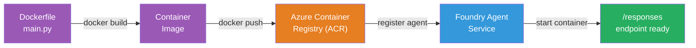
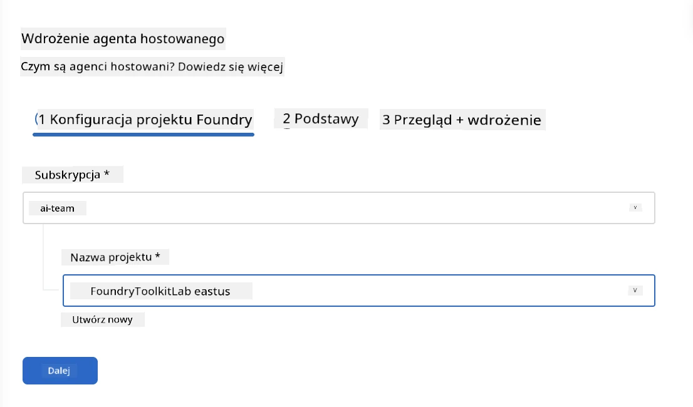
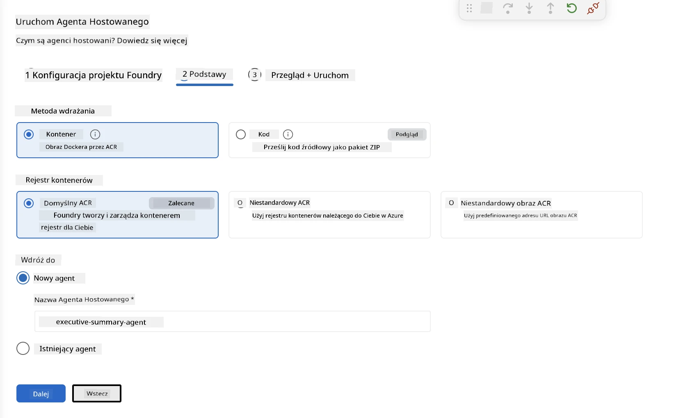
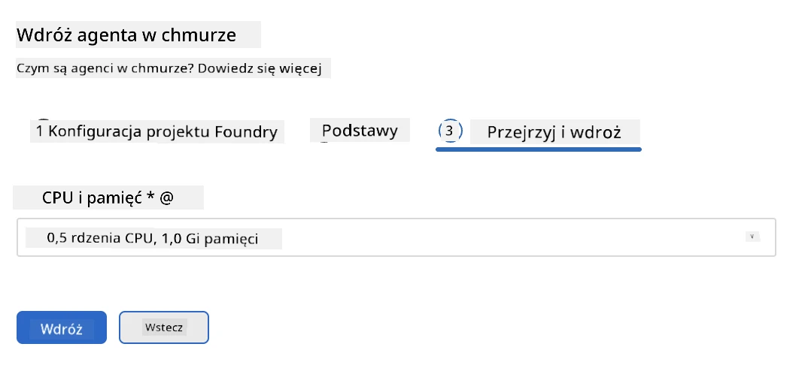
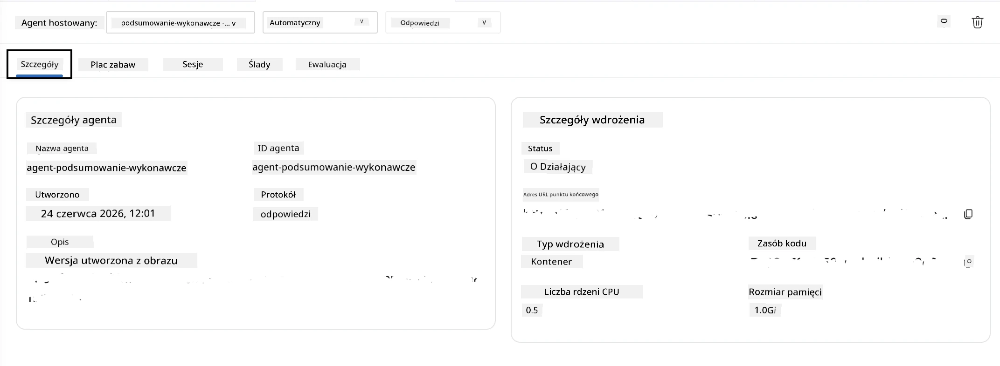

# Moduł 5 - Wdrożenie do usługi Foundry Agent

⏱️ ~10 min

> ⚠️ **Użytkownicy ścieżki B:** Ten moduł wymaga subskrypcji Foundry. Jeśli korzystasz z Foundry Local, przejdź do [Moduł 07 - Podsumowanie](07-summary.md). Pomyślnie zakończyłeś lokalny workflow deweloperski!

W tym module wdrażasz lokalnie przetestowanego agenta do Microsoft Foundry jako **Hosted Agent**. Wdrożenie buduje obraz kontenera, wypycha go do Azure Container Registry i uruchamia agenta w zarządzanej infrastrukturze Foundry.

### Pipeline wdrożeniowy

---

## Sprawdzenie wymagań wstępnych

Przed wdrożeniem upewnij się:

- [ ] Agent pomyślnie przeszedł wszystkie 3 lokalne scenariusze z [Modułu 04](04-test-locally.md)
- [ ] Masz rolę **Azure AI User** na poziomie projektu ([Moduł 01, Przypisywanie RBAC](01-setup.md#deploy-a-model--assign-rbac))
- [ ] Jesteś zalogowany do Azure w VS Code (ikona konta pokazuje twoje imię)

---

## Krok 1: Rozpocznij wdrożenie

### Opcja A: Wdrożenie z Agent Inspector (zalecane)

Jeśli Agent Inspector jest otwarty (po testowaniu):
1. Kliknij przycisk **Deploy** w prawym górnym rogu (ikona chmury ↑).

### Opcja B: Wdrożenie z Command Palette

1. Naciśnij `Ctrl+Shift+P` → **Foundry Toolkit: Deploy Hosted Agent**.

---

## Krok 2: Skonfiguruj wdrożenie

Kreator poprosi Cię o:

| Zapytanie | Wybór |
|--------|-----------|
| **Subskrypcja** | Twoja subskrypcja Azure |
| **Docelowy projekt** | Twój projekt Foundry (np. `workshop-agents`) |

Kliknij **dalej**, aby skonfigurować agenta.

| Zapytanie | Wybór |
|--------|-----------|
| **Metoda wdrożenia** | Kontener |
| **Rejestr kontenerów** | **Domyślny ACR** (Microsoft Foundry tworzy i zarządza nim dla Ciebie) |
| **Wdroż do** | Nowy Agent (nazwa, `executive-summary-agent`) |

Kliknij **dalej**, aby przejrzeć i wdrożyć agenta.

| Zapytanie | Wybór |
|--------|-----------|
| **CPU i pamięć** | **0.5 rdzenia CPU, 1.0 Gi pamięci** (domyślne - wystarczające do warsztatu) |

---

## Krok 3: Wdróż i monitoruj

1. Kliknij **Deploy**.
2. Obserwuj panel **Output** (wybierz **Microsoft Foundry** z listy rozwijanej).
3. Wdrożenie przebiega przez następujące etapy:
   - **Budowa Dockera** – buduje kontener z twojego Dockerfile
   - **Wypchnięcie Dockera** – wypycha obraz do ACR (1–3 min przy pierwszym wdrożeniu)
   - **Rejestracja agenta** – tworzy hostowanego agenta w Foundry
   - **Start kontenera** – uruchamia z systemowym zarządzaniem tożsamością

4. Po zakończeniu pojawi się powiadomienie:
   > **executive-summary-agent został pomyślnie wdrożony.** `View logs` `Run agent`

5. Kliknij **Run agent**, aby otworzyć Agent Playground.

### Wartości statusów wdrożenia

| Status | Znaczenie |
|--------|---------|
| **Running** | Kontener gotowy, agent odpowiada |
| **Pending** | Kontener się uruchamia - poczekaj 30–60 sekund |
| **Failed** | Sprawdź logi (patrz rozwiązywanie problemów poniżej) |

---

## Typowe błędy wdrożenia

| Błąd | Przyczyna | Naprawa |
|-------|-----------|-----|
| `agents/write` odmowa dostępu | Brak roli **Użytkownik Azure AI** na poziomie projektu | [Moduł 01, Przypisz RBAC](01-setup.md#deploy-a-model--assign-rbac) |
| Docker nie działa | Docker Desktop nie został uruchomiony | Uruchom Docker Desktop → zweryfikuj `docker info` |
| Autoryzacja ACR | Tożsamość zarządzana nie może pobrać obrazu | Zobacz [Moduł 08 - Rozwiązywanie problemów](08-troubleshooting.md) |

---

### ✅ Punkt kontrolny

- [ ] Wdrożenie zakończone bez błędów
- [ ] Agent pojawia się na karcie **Hosted Agent** po kliknięciu **Agents** w ramach Twojego projektu w panelu Foundry Toolkit
- [ ] Status kontenera pokazuje **Running**
- [ ] Otwarta karta Agent Playground pokazująca szczegóły agenta i adres URL punktu końcowego

---

**Poprzedni:** [04 - Test lokalny](04-test-locally.md) · **Następny:** [06 - Weryfikacja w Playground →](06-verify-in-playground.md)

---

<!-- CO-OP TRANSLATOR DISCLAIMER START -->
**Zastrzeżenie**:
Niniejszy dokument został przetłumaczony za pomocą usługi tłumaczenia AI [Co-op Translator](https://github.com/Azure/co-op-translator). Choć dążymy do dokładności, prosimy pamiętać, że automatyczne tłumaczenia mogą zawierać błędy lub niedokładności. Oryginalny dokument w jego języku źródłowym należy uznawać za autorytatywne źródło. W przypadku informacji krytycznych zalecane jest skorzystanie z profesjonalnego tłumaczenia wykonanego przez człowieka. Nie ponosimy odpowiedzialności za jakiekolwiek nieporozumienia lub błędne interpretacje wynikające z użycia tego tłumaczenia.
<!-- CO-OP TRANSLATOR DISCLAIMER END -->