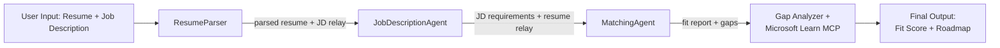

# PersonalCareerCopilot - Oceniacz dopasowania CV do pracy

Aplikacja multiagentowa oparta na przepływie pracy, która ocenia, jak dobrze CV odpowiada opisowi stanowiska, a następnie generuje spersonalizowaną ścieżkę nauki do zamknięcia luk.

---

## Agenci

| Agent | Rola | Narzędzia |
|-------|------|-------|
| **ResumeParser** | Ekstrahuje ustrukturyzowane umiejętności, doświadczenie, certyfikaty z tekstu CV | - |
| **JobDescriptionAgent** | Ekstrahuje wymagane/preferowane umiejętności, doświadczenie, certyfikaty z JD | - |
| **MatchingAgent** | Porównuje profil z wymaganiami → wynik dopasowania (0-100) + dopasowane/brakujące umiejętności | - |
| **GapAnalyzer** | Buduje spersonalizowaną ścieżkę nauki z zasobami Microsoft Learn | `search_microsoft_learn_for_plan` (MCP) |

## Przepływ pracy



---

## Szybki start

### 1. Skonfiguruj środowisko

Ten folder jest implementacją referencyjną szkieletu Lab 02 opartego na przepływie pracy. Jego `main.py` używa istniejących bloków promptów oraz `WorkflowBuilder` do połączenia czterech agentów.

```powershell
cd workshop\lab02-multi-agent\PersonalCareerCopilot
python -m venv .venv
.\.venv\Scripts\Activate.ps1          # Windows PowerShell
# source .venv/bin/activate            # macOS / Linux
pip install -r requirements.txt
```

### 2. Skonfiguruj poświadczenia

Utwórz plik `.env` w tym folderze:

```powershell
copy .env .env.bak 2>$null; echo $null > .env
```

Edytuj `.env`:

```env
FOUNDRY_PROJECT_ENDPOINT=https://<your-account>.services.ai.azure.com/api/projects/<your-project>
AZURE_AI_MODEL_DEPLOYMENT_NAME=gpt-4.1-mini
```

| Wartość | Gdzie ją znaleźć |
|-------|------------------|
| `FOUNDRY_PROJECT_ENDPOINT` | Pasek boczny Foundry Toolkit → kliknij prawym przyciskiem na swój projekt → **Kopiuj punkt końcowy projektu** |
| `AZURE_AI_MODEL_DEPLOYMENT_NAME` | Pasek boczny Foundry → rozwiń projekt → **Modele + punkty końcowe** → nazwa wdrożenia |

### 3. Uruchom lokalnie

```powershell
python -m debugpy --listen 127.0.0.1:5679 main.py --port 8088
```

Lub użyj zadania VS Code: `Ctrl+Shift+P` → **Tasks: Run Task** → **Uruchom serwer HTTP agenta**.

Do debugowania F5 użyj **Debuguj lokalny serwer HTTP agenta**.

### 4. Testuj za pomocą Agent Inspector

Otwórz Agent Inspector: `Ctrl+Shift+P` → **Foundry Toolkit: Otwórz Agent Inspector**.

Wklej ten testowy prompt:

```
Resume:
Jane Doe
Senior Software Engineer with 5 years of experience in Python, Django, and AWS.
Built microservices handling 10K+ requests/second. Led a team of 4 developers.
Certifications: AWS Solutions Architect Associate.
Education: B.S. Computer Science, State University.

Job Description:
Senior Cloud Engineer at Contoso Ltd.
Required: Python, Azure, Kubernetes, Terraform, CI/CD pipelines.
Preferred: Go, monitoring (Prometheus/Grafana), cost optimization.
Experience: 5+ years in cloud infrastructure.
Certifications: Azure Solutions Architect Expert preferred.
```

**Oczekiwane:** Wynik dopasowania (0-100), dopasowane/brakujące umiejętności oraz spersonalizowana ścieżka nauki z linkami do Microsoft Learn.

### 5. Wdróż do Foundry

`Ctrl+Shift+P` → **Foundry Toolkit: Wdróż hostowanego agenta** → wybierz swój projekt → potwierdź.

---

## Struktura projektu

```
PersonalCareerCopilot/
├── .env                ← Your credentials (git-ignored)
├── agent.yaml          ← Hosted agent definition (name, resources, env vars)
├── Dockerfile          ← Container image for Foundry deployment
├── main.py             ← 4-agent workflow (instructions, MCP tool, WorkflowBuilder)
└── requirements.txt    ← Python dependencies
```

## Kluczowe pliki

### `agent.yaml`

Definiuje hostowanego agenta dla Foundry Agent Service:
- `kind: hosted` - działa jako zarządzany kontener
- `protocols` - protokół `responses` z `version: 2.0.0`, udostępniający punkt końcowy HTTP `/responses`
- `environment_variables` - tutaj deklarowany jest `AZURE_AI_MODEL_DEPLOYMENT_NAME`; `FOUNDRY_PROJECT_ENDPOINT` jest wstrzykiwany automatycznie w czasie wdrożenia

### `main.py`

Zawiera:
- **Instrukcje dla agenta** - cztery stałe `*_INSTRUCTIONS`, po jednej na agenta
- **Narzędzie MCP** - `search_microsoft_learn_for_plan()` wywołuje `https://learn.microsoft.com/api/mcp` poprzez Streamable HTTP
- **Tworzenie agenta** - cztery instancje `Agent()` + `AgentExecutor()` dzielące jedno `FoundryChatClient`
- **Graf przepływu pracy** - `WorkflowBuilder` łączy agentów w sekwencyjną linię: ResumeParser → Agent JD → MatchingAgent → GapAnalyzer
- **Uruchomienie serwera** - `ResponsesHostServer` działa na porcie 8088

### `requirements.txt`

| Pakiet | Przeznaczenie |
|---------|----------|
| `agent-framework-foundry` | Główne środowisko wykonawcze: `Agent`, `AgentExecutor`, `WorkflowBuilder`, `@tool`, `FoundryChatClient` |
| `agent-framework-foundry-hosting` | Integracja hostingu Foundry + `ResponsesHostServer` |
| `mcp<2,>=1.24.0` | Klient MCP dla GapAnalyzer (`streamable_http_client`) |
| `debugpy` | Debugowanie Pythona (F5 w VS Code) |

---

## Rozwiązywanie problemów

| Problem | Rozwiązanie |
|-------|-----------|
| `KeyError: 'FOUNDRY_PROJECT_ENDPOINT'` lub `KeyError: 'AZURE_AI_MODEL_DEPLOYMENT_NAME'` | Utwórz `.env` z ustawionymi `FOUNDRY_PROJECT_ENDPOINT` i `AZURE_AI_MODEL_DEPLOYMENT_NAME` |
| `ModuleNotFoundError: No module named 'agent_framework'` | Aktywuj venv i uruchom `pip install -r requirements.txt` |
| Brak linków Microsoft Learn w wyniku | Sprawdź łączność internetową do `https://learn.microsoft.com/api/mcp` |
| Tylko 1 karta z luką (przycięta) | Zweryfikuj, że `GAP_ANALYZER_INSTRUCTIONS` zawiera blok `CRITICAL:` |
| Port 8088 jest zajęty | Zatrzymaj inne serwery: `netstat -ano \| findstr :8088` |

Aby uzyskać szczegółowe rozwiązania problemów, zobacz [Moduł 8 - Rozwiązywanie problemów](../docs/08-troubleshooting.md).

---

**Pełny przewodnik:** [Dokumentacja Lab 02](../docs/README.md) · **Powrót do:** [README Lab 02](../README.md) · [Strona główna warsztatu](../../../README.md)

---

<!-- CO-OP TRANSLATOR DISCLAIMER START -->
**Zastrzeżenie**:
Niniejszy dokument został przetłumaczony za pomocą usługi tłumaczenia AI [Co-op Translator](https://github.com/Azure/co-op-translator). Choć dążymy do dokładności, prosimy pamiętać, że automatyczne tłumaczenia mogą zawierać błędy lub niedokładności. Oryginalny dokument w jego języku źródłowym należy uznawać za autorytatywne źródło. W przypadku informacji krytycznych zalecane jest skorzystanie z profesjonalnego tłumaczenia wykonanego przez człowieka. Nie ponosimy odpowiedzialności za jakiekolwiek nieporozumienia lub błędne interpretacje wynikające z użycia tego tłumaczenia.
<!-- CO-OP TRANSLATOR DISCLAIMER END -->