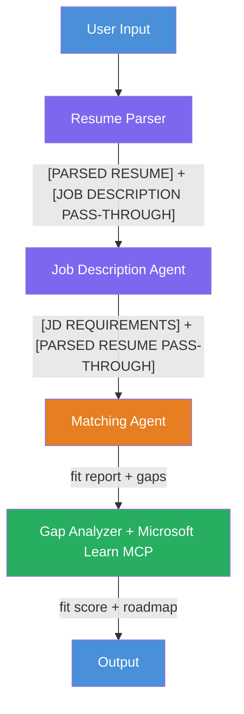

# Laboratorium 02 - Workflow wieloagentowy: Oceniacz dopasowania CV do pracy

## Przegląd

W tym praktycznym laboratorium zbudujesz **aplikację wieloagentową opartą na workflow** używając Foundry Toolkit w VS Code i wdrożysz ją do Microsoft Foundry Agent Service.

**Co zbudujesz:** Oceniacz dopasowania CV do pracy, który analizuje CV i opis stanowiska, ocenia dopasowanie i tworzy spersonalizowaną ścieżkę nauki wykorzystując zasoby Microsoft Learn.

---

## Architektura

**Jak to działa:**
1. Użytkownik wkleja CV i opis stanowiska.
2. **ResumeParser** analizuje CV i kopiuje opis stanowiska dosłownie do sekcji `[JOB DESCRIPTION PASS-THROUGH]`.
3. **JD Agent** wyodrębnia ustrukturyzowane wymagania z przekazu, potem przesyła `[PARSED RESUME]` dalej jako `[PARSED RESUME PASS-THROUGH]`.
4. **MatchingAgent** porównuje `[PARSED RESUME PASS-THROUGH]` z `[JD REQUIREMENTS]` i generuje wynik dopasowania.
5. **GapAnalyzer** przekształca luki w praktyczną ścieżkę rozwoju i pobiera rzeczywiste linki Microsoft Learn przez MCP.

---

## Wymagania wstępne

Najpierw zakończ Laboratorium 01:

- [Laboratorium 01 - Jeden Agent](../lab01-single-agent/README.md)

---

## Część 1: Przeczytaj moduły po kolei

Pełna ścieżka nauki dostępna jest w:

- [Dokumentacja Laboratorium 2 - Wymagania wstępne](docs/00-prerequisites.md)
- [Dokumentacja Laboratorium 2 - Pełna ścieżka nauki](docs/README.md)
- [Przewodnik uruchomienia PersonalCareerCopilot](PersonalCareerCopilot/README.md)

---

## Część 2: Zbuduj i przetestuj workflow

1. Użyj kreatora Foundry Toolkit do stworzenia projektu opartego na workflow.
2. Skopiuj bloki promptów i graf workflow z `PersonalCareerCopilot/main.py` do swojego obszaru roboczego.
3. Uruchom lokalnie z Agent Inspector i zweryfikuj działanie wszystkich czterech agentów oraz narzędzia MCP.
4. Wdróż hostowanego agenta do Foundry po pomyślnym teście lokalnym.

---

## Wzorce orkiestracji

Laboratorium 02 używa **sekwencyjnej linii przetwarzania**: output każdego agenta jest wejściem dla następnego, a workflow zwraca ostateczną odpowiedź ostatniego agenta. Dwa wzorce to umożliwiają:

- **Łańcuch sekwencyjny** - `WorkflowBuilder` łączy ResumeParser → JD Agent → MatchingAgent → GapAnalyzer jednym wywołaniem `add_edge()` na krok
- **Przekazywanie treści** - ponieważ każdy agent widzi tylko output bezpośredniego poprzednika, ResumeParser i JD Agent kopiują dane potrzebne agentom późniejszym do oznaczonych sekcji przekazu

Dokumentacja także wyjaśnia, dlaczego laboratorium nie używa fan-out/fan-in oraz jak rozszerzyć grafik o kolejnego agenta.

Zobacz [docs/04-orchestration-patterns.md](docs/04-orchestration-patterns.md).

---

**Poprzednie:** [Laboratorium 01 - Jeden Agent](../lab01-single-agent/README.md) · **Powrót do:** [Strona główna warsztatu](../../README.md)

---

<!-- CO-OP TRANSLATOR DISCLAIMER START -->
**Zastrzeżenie**:
Niniejszy dokument został przetłumaczony za pomocą usługi tłumaczenia AI [Co-op Translator](https://github.com/Azure/co-op-translator). Choć dążymy do dokładności, prosimy pamiętać, że automatyczne tłumaczenia mogą zawierać błędy lub niedokładności. Oryginalny dokument w jego języku źródłowym należy uznawać za autorytatywne źródło. W przypadku informacji krytycznych zalecane jest skorzystanie z profesjonalnego tłumaczenia wykonanego przez człowieka. Nie ponosimy odpowiedzialności za jakiekolwiek nieporozumienia lub błędne interpretacje wynikające z użycia tego tłumaczenia.
<!-- CO-OP TRANSLATOR DISCLAIMER END -->