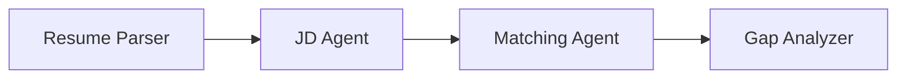
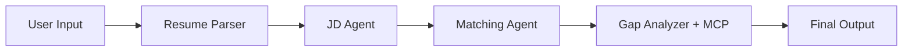

# Moduł 4 - Wzorce orkiestracji

⏱️ ~10 min

W tym module poznasz wzorce orkiestracji używane w Resume Job Fit Evaluator oraz nauczysz się, jak czytać, modyfikować i rozszerzać graf przepływu pracy. Zrozumienie tych wzorców jest kluczowe do debugowania problemów z przepływem danych oraz tworzenia własnych [workflowów multi-agentowych](https://learn.microsoft.com/agent-framework/workflows/).

---

## Wzorzec 1: Łańcuch sekwencyjny

Podstawowym wzorcem w workflow jest **łańcuch sekwencyjny** – wyjście każdego agenta jest bezpośrednio podawane do następnego.



W kodzie każde wywołanie `add_edge()` tworzy jeden krok w łańcuchu:

```python
.add_edge(resume_executor, jd_executor)       # ResumeParser output → JD Agent
.add_edge(jd_executor, matching_executor)     # JD Agent output → MatchingAgent
.add_edge(matching_executor, gap_executor)    # MatchingAgent output → GapAnalyzer
```

> **Dlaczego sekwencyjny, a nie fan-out/fan-in?** `WorkflowBuilder` używa **semantyki OR** dla krawędzi przychodzących: executor downstream uruchamia się, gdy **jakiś** poprzednik zakończy działanie. Gdyby `matching_executor` miało dwie krawędzie przychodzące (z `resume_executor` i `jd_executor`), uruchomiłoby się dwukrotnie – raz po zakończeniu ResumeParser i raz po zakończeniu JD Agent – powodując dwukrotne uruchomienie GapAnalyzer i pojawienie się dwukrotnie wyniku. Pipeline sekwencyjny całkowicie unika tego problemu.

## Wzorzec 2: Przekazywanie treści

Ponieważ `context_mode="last_agent"` oznacza, że każdy executor widzi tylko wyjście swojego **bezpośredniego poprzednika**, agenci w łańcuchu sekwencyjnym muszą jawnie przekazywać dalej wszelkie dane potrzebne agentom downstream.

W tym workflow:
- **ResumeParser** kopiuje JD dosłownie do `[JOB DESCRIPTION PASS-THROUGH]` (aby JD Agent mógł go znaleźć).
- **JD Agent** kopiuje `[PARSED RESUME]` dosłownie do `[PARSED RESUME PASS-THROUGH]` (aby MatchingAgent mógł porównać oba profile).

```
ResumeParser output
└─ [PARSED RESUME]               ← extracted by JD Agent
└─ [JOB DESCRIPTION PASS-THROUGH] ← extracted by JD Agent

JD Agent output
└─ [JD REQUIREMENTS]             ← extracted by MatchingAgent
└─ [PARSED RESUME PASS-THROUGH]  ← extracted by MatchingAgent
```

Każda sekcja przekazywania musi być skopiowana **dosłownie** – podsumowanie czy parafrazowanie jej psuje agenta downstream, który na niej polega.

---

## Kompletny graf

Połączenie wzorców łańcucha sekwencyjnego i przekazywania treści daje pełny workflow:



Agent Inspector pokazuje tę samą strukturę grafu, gdy agent działa lokalnie. Zobacz [Moduł 5 - Test lokalny](05-test-locally.md) dla zrzutów ekranu.

---

## Czytanie kodu WorkflowBuilder

Graf workflow budowany jest w funkcji `main()` w [`PersonalCareerCopilot/main.py`](../../../../../workshop/lab02-multi-agent/PersonalCareerCopilot/main.py). Trzy wywołania `add_edge()` tworzą pipeline sekwencyjny:

| # | Krawędź | Efekt |
|---|---------|--------|
| 1 | `resume_executor → jd_executor` | JD Agent otrzymuje `[PARSED RESUME]` + `[JOB DESCRIPTION PASS-THROUGH]` |
| 2 | `jd_executor → matching_executor` | MatchingAgent otrzymuje `[JD REQUIREMENTS]` + `[PARSED RESUME PASS-THROUGH]` |
| 3 | `matching_executor → gap_executor` | GapAnalyzer otrzymuje raport dopasowania + listę luk |

---

## Modyfikowanie grafu

### Dodawanie nowego agenta

Aby dodać piątego agenta (np. **InterviewPrepAgent** po GapAnalyzer):

1. Zdefiniuj stałą `INTERVIEW_PREP_INSTRUCTIONS`.
2. Utwórz obiekty `Agent` + `AgentExecutor` (ten sam wzorzec co dla istniejących czterech).
3. Dodaj `.add_edge(gap_executor, interview_exec)` w `WorkflowBuilder`.
4. Zaktualizuj `output_executors=[interview_exec]`.

> **Ważne:** `start_executor` jest jedynym agentem otrzymującym surowe dane od użytkownika. Pozostali agenci otrzymują dane z krawędzi upstream.

---

## Typowe błędy w grafie

| Błąd | Objaw | Naprawa |
|---------|---------|-----|
| Brak krawędzi do `output_executors` | Agent działa, ale wyjście jest puste | Upewnij się, że istnieje ścieżka z `start_executor` do każdego agenta w `output_executors` |
| Zależność cykliczna | Nieskończona pętla lub timeout | Sprawdź, czy żaden agent nie odsyła danych z powrotem do agentów upstream |
| Agent w `output_executors` bez krawędzi przychodzącej | Puste wyjście | Dodaj przynajmniej jedną `add_edge(source, that_agent)` |
| Wiele `output_executors` bez fan-in | Wyjście zawiera tylko odpowiedź jednego agenta | Użyj pojedynczego agenta wyjściowego agregującego dane lub zaakceptuj wiele wyjść |
| Brak `start_executor` | `ValueError` podczas budowania | Zawsze określaj `start_executor` w `WorkflowBuilder()` |

---

## Debugowanie grafu

### Używanie Agent Inspector

1. Uruchom agenta lokalnie klawiszem F5.
2. Otwórz Agent Inspector (`Ctrl+Shift+P` → **Foundry Toolkit: Open Agent Inspector**).
3. Wyślij wiadomość testową.
4. W panelu odpowiedzi Inspectora poszukaj **strumieniowego wyjścia** – pokazuje ono wkład każdego agenta w kolejności.


### Używanie logowania

Dodaj logowanie do `main.py`, aby śledzić przepływ danych:

```python
import logging
logger = logging.getLogger("resume-job-fit")

# In main(), after building the workflow:
logger.info("Workflow graph built with edges: RP→JD, JD→MA, MA→GA")
```

Logi serwera pokazują kolejność wykonywania agentów oraz wywołania narzędzi MCP:

```
INFO:agent_framework:Executing agent: ResumeParser
INFO:agent_framework:Executing agent: JobDescriptionAgent
INFO:agent_framework:Executing agent: MatchingAgent
INFO:agent_framework:Executing agent: GapAnalyzer
INFO:agent_framework:Tool call: search_microsoft_learn_for_plan(skill="Kubernetes")
POST https://learn.microsoft.com/api/mcp → 200
INFO:agent_framework:Tool call: search_microsoft_learn_for_plan(skill="Terraform")
POST https://learn.microsoft.com/api/mcp → 200
```

---

### Checkpoint

- [ ] Potrafisz zidentyfikować dwa wzorce orkiestracji w workflow: łańcuch sekwencyjny i przekazywanie treści
- [ ] Rozumiesz, dlaczego `context_mode="last_agent"` wymaga jawnego przekazywania danych między agentami
- [ ] Potrafisz przeczytać kod `WorkflowBuilder` i przyporządkować każde wywołanie `add_edge()` do wizualnego grafu
- [ ] Wiesz, jak dodać nowego agenta na końcu pipeline'u
- [ ] Potrafisz zidentyfikować typowe błędy w grafie i ich objawy

---

**Poprzedni:** [03 - Konfiguracja Agentów i Środowiska](03-configure-agents.md) · **Następny:** [05 - Test lokalny →](05-test-locally.md)

---

<!-- CO-OP TRANSLATOR DISCLAIMER START -->
**Zastrzeżenie**:
Niniejszy dokument został przetłumaczony za pomocą usługi tłumaczenia AI [Co-op Translator](https://github.com/Azure/co-op-translator). Choć dążymy do dokładności, prosimy pamiętać, że automatyczne tłumaczenia mogą zawierać błędy lub niedokładności. Oryginalny dokument w jego języku źródłowym należy uznawać za autorytatywne źródło. W przypadku informacji krytycznych zalecane jest skorzystanie z profesjonalnego tłumaczenia wykonanego przez człowieka. Nie ponosimy odpowiedzialności za jakiekolwiek nieporozumienia lub błędne interpretacje wynikające z użycia tego tłumaczenia.
<!-- CO-OP TRANSLATOR DISCLAIMER END -->