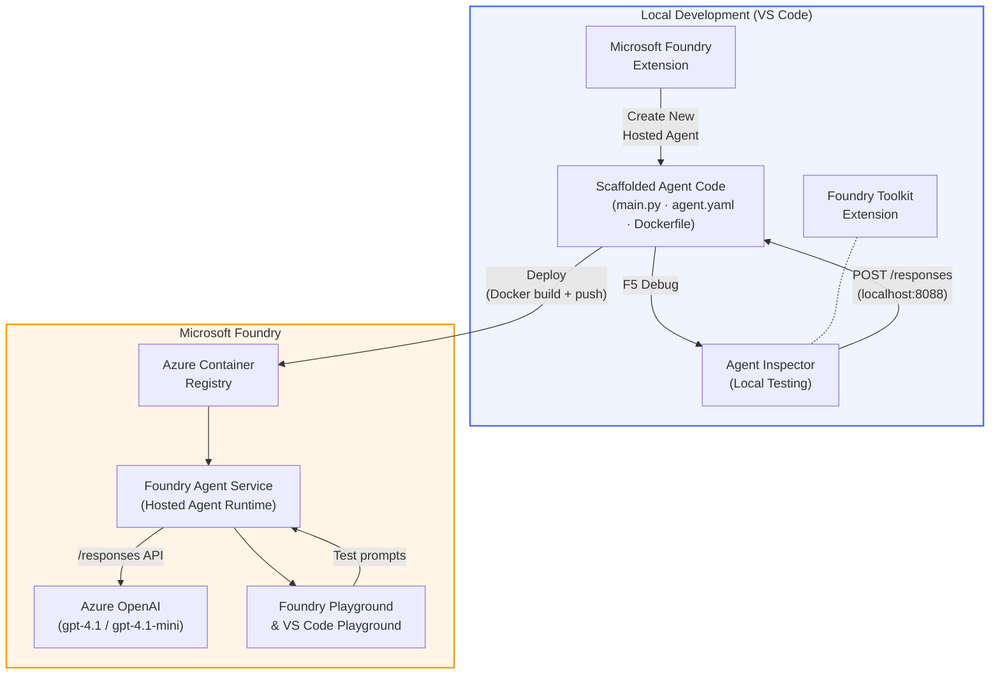

# Oficina Foundry Toolkit + Foundry Hosted Agents

[](https://www.python.org/)
[](https://github.com/microsoft/agents)
[](https://learn.microsoft.com/azure/foundry/agents/concepts/hosted-agents)
[](https://ai.azure.com/)
[](https://learn.microsoft.com/azure/ai-services/openai/)
[](https://learn.microsoft.com/cli/azure/install-azure-cli)
[](https://learn.microsoft.com/azure/developer/azure-developer-cli/install-azd)
[](https://www.docker.com/)
[](https://marketplace.visualstudio.com/items?itemName=ms-windows-ai-studio.windows-ai-studio)
[](../../LICENSE)

Construa, teste e implante agentes de IA no **Microsoft Foundry Agent Service** como **Hosted Agents** - inteiramente a partir do VS Code usando a **extensão Microsoft Foundry** e o **Foundry Toolkit**.

> **Hosted Agents estão atualmente em visualização.** As regiões suportadas são limitadas - veja a [disponibilidade por região](https://learn.microsoft.com/azure/foundry/agents/concepts/hosted-agents#region-availability).

> A pasta `agent/` dentro de cada laboratório é **automaticamente gerada** pela extensão Foundry - você então personaliza o código, testa localmente e faz o deploy.

### 🌐 Suporte a Múltiplos Idiomas

#### Suportado via GitHub Action (Automatizado e Sempre Atualizado)

<!-- CO-OP TRANSLATOR LANGUAGES TABLE START -->
[Arabic](../ar/README.md) | [Bengali](../bn/README.md) | [Bulgarian](../bg/README.md) | [Burmese (Myanmar)](../my/README.md) | [Chinese (Simplified)](../zh-CN/README.md) | [Chinese (Traditional, Hong Kong)](../zh-HK/README.md) | [Chinese (Traditional, Macau)](../zh-MO/README.md) | [Chinese (Traditional, Taiwan)](../zh-TW/README.md) | [Croatian](../hr/README.md) | [Czech](../cs/README.md) | [Danish](../da/README.md) | [Dutch](../nl/README.md) | [Estonian](../et/README.md) | [Finnish](../fi/README.md) | [French](../fr/README.md) | [German](../de/README.md) | [Greek](../el/README.md) | [Hebrew](../he/README.md) | [Hindi](../hi/README.md) | [Hungarian](../hu/README.md) | [Indonesian](../id/README.md) | [Italian](../it/README.md) | [Japanese](../ja/README.md) | [Kannada](../kn/README.md) | [Khmer](../km/README.md) | [Korean](../ko/README.md) | [Lithuanian](../lt/README.md) | [Malay](../ms/README.md) | [Malayalam](../ml/README.md) | [Marathi](../mr/README.md) | [Nepali](../ne/README.md) | [Nigerian Pidgin](../pcm/README.md) | [Norwegian](../no/README.md) | [Persian (Farsi)](../fa/README.md) | [Polish](../pl/README.md) | [Portuguese (Brazil)](./README.md) | [Portuguese (Portugal)](../pt-PT/README.md) | [Punjabi (Gurmukhi)](../pa/README.md) | [Romanian](../ro/README.md) | [Russian](../ru/README.md) | [Serbian (Cyrillic)](../sr/README.md) | [Slovak](../sk/README.md) | [Slovenian](../sl/README.md) | [Spanish](../es/README.md) | [Swahili](../sw/README.md) | [Swedish](../sv/README.md) | [Tagalog (Filipino)](../tl/README.md) | [Tamil](../ta/README.md) | [Telugu](../te/README.md) | [Thai](../th/README.md) | [Turkish](../tr/README.md) | [Ukrainian](../uk/README.md) | [Urdu](../ur/README.md) | [Vietnamese](../vi/README.md)

> **Prefere clonar localmente?**
>
> Este repositório inclui mais de 50 traduções, o que aumenta significativamente o tamanho do download. Para clonar sem as traduções, use sparse checkout:
>
> **Bash / macOS / Linux:**
> ```bash
> git clone --filter=blob:none --sparse https://github.com/microsoft-foundry/Foundry_Toolkit_for_VSCode_Lab.git
> cd Foundry_Toolkit_for_VSCode_Lab
> git sparse-checkout set --no-cone '/*' '!translations' '!translated_images'
> ```
>
> **CMD (Windows):**
> ```cmd
> git clone --filter=blob:none --sparse https://github.com/microsoft-foundry/Foundry_Toolkit_for_VSCode_Lab.git
> cd Foundry_Toolkit_for_VSCode_Lab
> git sparse-checkout set --no-cone "/*" "!translations" "!translated_images"
> ```
>
> Isso lhe dá tudo o que precisa para completar o curso com um download muito mais rápido.
<!-- CO-OP TRANSLATOR LANGUAGES TABLE END -->

---

## Arquitetura



**Fluxo:** a extensão Foundry gera o esqueleto do agente → você personaliza o código e as instruções → testa localmente com o Agent Inspector → faz o deploy para o Foundry (imagem Docker enviada para ACR) → verifica no Playground.

---

## O que você irá construir

| Lab | Description | Status |
|-----|-------------|--------|
| **Lab 01 - Agente Único** | Construa o agente **"Explain Like I'm an Executive"**, teste-o localmente e faça o deploy para o Foundry | ✅ Disponível |
| **Lab 02 - Fluxo de Trabalho Multi-Agente** | Construa o **"Resume → Job Fit Evaluator"** - 4 agentes colaboram para avaliar a compatibilidade do currículo e gerar um roadmap de aprendizado | ✅ Disponível |

---

## Conheça o Agente Executivo

Neste workshop você construirá o agente **"Explain Like I'm an Executive"** - um agente de IA que pega jargões técnicos complexos e os traduz em resumos calmos, prontos para a sala de reunião. Porque sejamos honestos, ninguém na alta gestão quer ouvir sobre "exaurição do pool de threads causada por chamadas síncronas introduzidas na v3.2."

Eu criei este agente depois de mais incidentes do que eu gostaria, quando meu post-mortem perfeitamente elaborado recebeu a resposta: *"Então... o site está fora do ar ou não?"*

### Como funciona

Você fornece uma atualização técnica. Ele devolve um resumo executivo - três pontos, sem jargões, sem rastros de pilha, sem desespero existencial. Apenas **o que aconteceu**, **impacto no negócio** e **próximo passo**.

### Veja em ação

**Você diz:**
> "A latência da API aumentou devido à exaustão do pool de threads causada por chamadas síncronas introduzidas na v3.2."

**O agente responde:**

> **Resumo Executivo:**
> - **O que aconteceu:** Após a última versão, o sistema ficou mais lento.
> - **Impacto nos negócios:** Alguns usuários experimentaram atrasos ao usar o serviço.
> - **Próximo passo:** A alteração foi revertida e uma correção está sendo preparada antes do novo deploy.

### Por que este agente?

É um agente extremamente simples e de objetivo único - perfeito para aprender o fluxo de trabalho de hosted agent de ponta a ponta sem se enrolar em cadeias de ferramentas complexas. E, sinceramente? Toda equipe de engenharia poderia usar um desses.

---

## Estrutura do workshop

```
📂 Foundry_Toolkit_for_VSCode_Lab/
├── 📄 README.md                      ← You are here
└── 📂 workshop/
    ├── 📂 lab01-single-agent/        ← Full lab: docs + agent code
    │   ├── README.md                 ← Hands-on lab instructions
    │   ├── 📂 docs/                  ← Step-by-step tutorial modules
    │   │   ├── 00-prerequisites.md
    │   │   ├── 01-setup.md
    │   │   ├── 02-create-hosted-agent.md
    │   │   ├── 03-configure-and-code.md
    │   │   ├── 04-test-locally.md
    │   │   ├── 05-deploy-to-foundry.md
    │   │   ├── 06-verify-in-playground.md
    │   │   ├── 07-summary.md
    │   │   └── 08-troubleshooting.md
    │   └── 📂 agent/                 ← Reference solution (auto-scaffolded by Foundry extension)
    │       ├── agent.yaml
    │       ├── Dockerfile
    │       ├── main.py
    │       └── requirements.txt
    └── 📂 lab02-multi-agent/         ← Resume → Job Fit Evaluator
        ├── README.md                 ← Hands-on lab instructions (end-to-end)
        ├── 📂 docs/                  ← Step-by-step tutorial modules
        │   ├── 00-prerequisites.md
        │   ├── 01-understand-multi-agent.md
        │   ├── 02-scaffold-multi-agent.md
        │   ├── 03-configure-agents.md
        │   ├── 04-orchestration-patterns.md
        │   ├── 05-test-locally.md
        │   ├── 06-deploy-to-foundry.md
        │   ├── 07-verify-in-playground.md
        │   └── 08-troubleshooting.md
        └── 📂 PersonalCareerCopilot/ ← Reference solution (multi-agent workflow)
            ├── agent.yaml
            ├── Dockerfile
            ├── main.py
            └── requirements.txt
```

> **Nota:** A pasta `agent/` dentro de cada laboratório é o que a **Microsoft Foundry extension** gera quando você executa `Microsoft Foundry: Create a New Hosted Agent` a partir da Paleta de Comandos. Os arquivos são então personalizados com as instruções, ferramentas e configurações do seu agente. O Lab 01 orienta você a recriar isso do zero.

---

## Primeiros passos

### 1. Clone o repositório

```bash
git clone https://github.com/microsoft-foundry/Foundry_Toolkit_for_VSCode_Lab.git
cd Foundry_Toolkit_for_VSCode_Lab
```

### 2. Configure um ambiente virtual Python

```bash
python -m venv venv
```

Ative-o:

- **Windows (PowerShell):**
  ```powershell
  .\venv\Scripts\Activate.ps1
  ```
- **macOS / Linux:**
  ```bash
  source venv/bin/activate
  ```

### 3. Instale as dependências

```bash
pip install -r workshop/lab01-single-agent/agent/requirements.txt
```

### 4. Configure as variáveis de ambiente

Copie o arquivo de exemplo `.env` dentro da pasta do agente e preencha seus valores:

```bash
cp workshop/lab01-single-agent/agent/.env.example workshop/lab01-single-agent/agent/.env
```

Edite `workshop/lab01-single-agent/agent/.env`:

```env
AZURE_AI_PROJECT_ENDPOINT=https://<your-account>.services.ai.azure.com/api/projects/<your-project>
AZURE_AI_MODEL_DEPLOYMENT_NAME=<your-model-deployment-name>
```

### 5. Siga os laboratórios do workshop

Cada laboratório é autocontido com seus próprios módulos. Comece pelo **Lab 01** para aprender os fundamentos e depois passe para o **Lab 02** para fluxos de trabalho multi-agente.

#### Lab 01 - Agente Único ([instruções completas](workshop/lab01-single-agent/README.md))

| # | Módulo | Link |
|---|--------|------|
| 1 | Leia os pré-requisitos | [00-prerequisites.md](workshop/lab01-single-agent/docs/00-prerequisites.md) |
| 2 | Instale o Foundry Toolkit e a extensão Foundry | [01-setup.md](workshop/lab01-single-agent/docs/01-setup.md) |
| 3 | Crie um projeto Foundry | [01-setup.md](workshop/lab01-single-agent/docs/01-setup.md) |
| 4 | Crie um agente hospedado | [02-create-hosted-agent.md](workshop/lab01-single-agent/docs/02-create-hosted-agent.md) |
| 5 | Configure instruções e o ambiente | [03-configure-and-code.md](workshop/lab01-single-agent/docs/03-configure-and-code.md) |
| 6 | Teste localmente | [04-test-locally.md](workshop/lab01-single-agent/docs/04-test-locally.md) |
| 7 | Faça o deploy para o Foundry | [05-deploy-to-foundry.md](workshop/lab01-single-agent/docs/05-deploy-to-foundry.md) |
| 8 | Verifique no playground | [06-verify-in-playground.md](workshop/lab01-single-agent/docs/06-verify-in-playground.md) |
| 9 | Solução de problemas | [08-troubleshooting.md](workshop/lab01-single-agent/docs/08-troubleshooting.md) |

#### Lab 02 - Fluxo de Trabalho Multi-Agente ([instruções completas](workshop/lab02-multi-agent/README.md))

| # | Módulo | Link |
|---|--------|------|
| 1 | Pré-requisitos (Lab 02) | [00-prerequisites.md](workshop/lab02-multi-agent/docs/00-prerequisites.md) |
| 2 | Entenda a arquitetura multi-agente | [01-understand-multi-agent.md](workshop/lab02-multi-agent/docs/01-understand-multi-agent.md) |
| 3 | Estruture o projeto multi-agente | [02-scaffold-multi-agent.md](workshop/lab02-multi-agent/docs/02-scaffold-multi-agent.md) |
| 4 | Configure os agentes e o ambiente | [03-configure-agents.md](workshop/lab02-multi-agent/docs/03-configure-agents.md) |
| 5 | Padrões de orquestração | [04-orchestration-patterns.md](workshop/lab02-multi-agent/docs/04-orchestration-patterns.md) |
| 6 | Teste localmente (multi-agente) | [05-test-locally.md](workshop/lab02-multi-agent/docs/05-test-locally.md) |
| 7 | Faça o deploy para o Foundry | [06-deploy-to-foundry.md](workshop/lab02-multi-agent/docs/06-deploy-to-foundry.md) |
| 8 | Verifique no playground | [07-verify-in-playground.md](workshop/lab02-multi-agent/docs/07-verify-in-playground.md) |
| 9 | Solução de problemas (multi-agente) | [08-troubleshooting.md](workshop/lab02-multi-agent/docs/08-troubleshooting.md) |

---

## Mantenedor

<table>
<tr>
    <td align="center"><a href="https://github.com/ShivamGoyal03">
        <br />
        <sub><b>Shivam Goyal</b></sub>
    </a><br />
    </td>
</tr>
</table>

---

## Permissões necessárias (referência rápida)

| Scenario | Required roles |
|----------|---------------|
| Criar novo projeto Foundry | **Azure AI Owner** on Foundry resource |
| Fazer deploy em projeto existente (novos recursos) | **Azure AI Owner** + **Contributor** on subscription |
| Fazer deploy em projeto totalmente configurado | **Reader** on account + **Azure AI User** on project |

> **Importante:** As funções Azure `Owner` e `Contributor` incluem apenas permissões de *gerenciamento*, não permissões de *desenvolvimento* (ações de dados). Você precisa de **Azure AI User** ou **Azure AI Owner** para construir e implantar agentes.

---

## Referências

- [Início rápido: Implante seu primeiro agente hospedado (VS Code)](https://learn.microsoft.com/azure/foundry/agents/quickstarts/quickstart-hosted-agent)
- [O que são agentes hospedados?](https://learn.microsoft.com/azure/foundry/agents/concepts/hosted-agents)
- [Crie fluxos de trabalho para agentes hospedados no VS Code](https://learn.microsoft.com/azure/foundry/agents/how-to/vs-code-agents-workflow-pro-code)
- [Implante um agente hospedado](https://learn.microsoft.com/azure/foundry/agents/how-to/deploy-hosted-agent)
- [RBAC para Microsoft Foundry](https://learn.microsoft.com/azure/foundry/concepts/rbac-foundry)
- [Exemplo de Agente de Revisão de Arquitetura](https://github.com/Azure-Samples/agent-architecture-review-sample) - Agente hospedado do mundo real com ferramentas MCP, diagramas Excalidraw e implantação dupla

---


## Licença

[MIT](../../LICENSE)

---

<!-- CO-OP TRANSLATOR DISCLAIMER START -->
**Aviso Legal**:
Este documento foi traduzido usando o serviço de tradução por IA [Co-op Translator](https://github.com/Azure/co-op-translator). Embora nos esforcemos pela precisão, por favor, esteja ciente de que traduções automatizadas podem conter erros ou imprecisões. O documento original em seu idioma nativo deve ser considerado a fonte autorizada. Para informações críticas, recomenda-se tradução profissional humana. Não nos responsabilizamos por quaisquer mal-entendidos ou interpretações incorretas decorrentes do uso desta tradução.
<!-- CO-OP TRANSLATOR DISCLAIMER END -->
