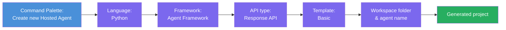
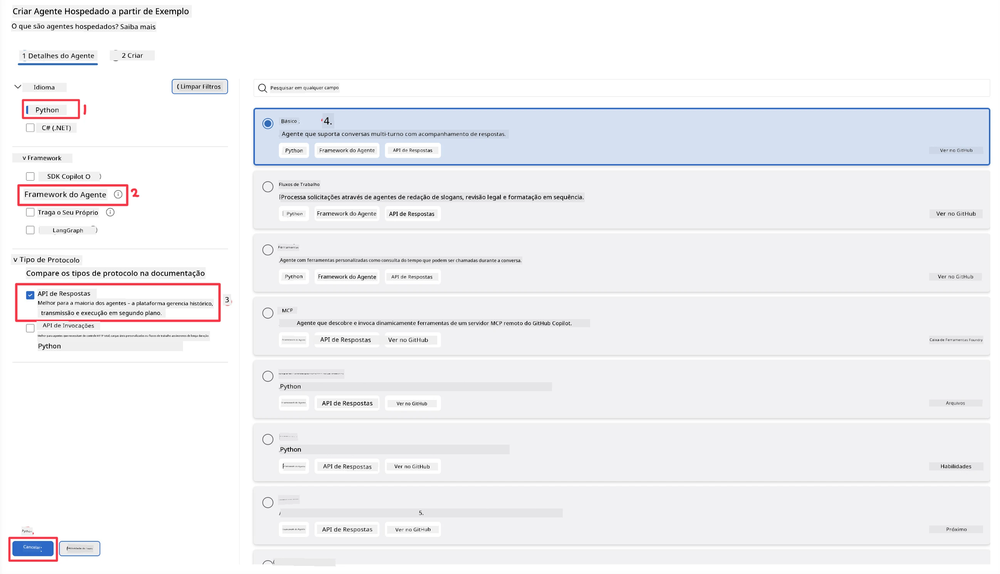
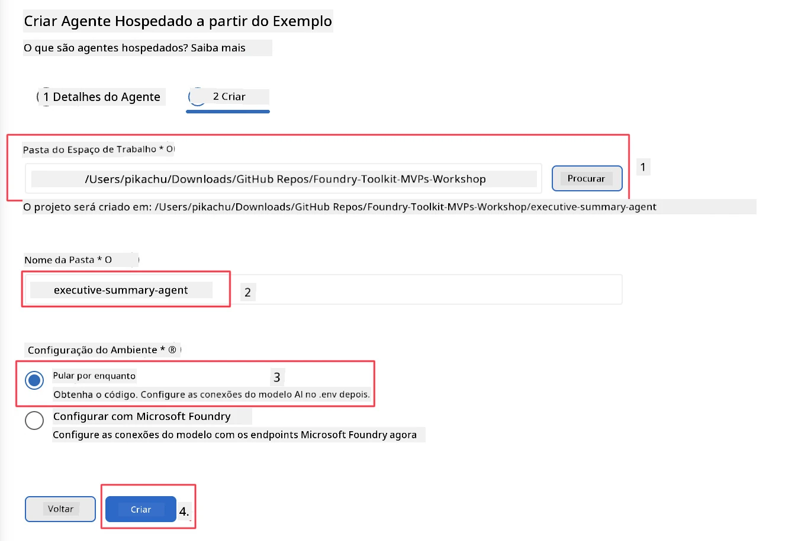

# Módulo 2 - Criar um Novo Agente Hospedado

⏱️ ~5 min

Neste módulo, você usa o Foundry Toolkit para **criar a estrutura de um projeto de agente hospedado**. A estrutura gera toda a estrutura do projeto - `agent.yaml`, `main.py`, `Dockerfile`, `requirements.txt` e a configuração de depuração do VS Code - para que você possa se concentrar em personalizar o comportamento do agente.

> **Conceito chave:** A pasta `agent/` neste laboratório é um exemplo do que o Foundry Toolkit gera. Você não escreve esses arquivos do zero.

### Fluxo do assistente de scaffolding



---

## Passo 1: Abrir o assistente Criar Agente Hospedado

1. Pressione `Ctrl+Shift+P` para abrir a **Paleta de Comandos**.
2. Digite: **Foundry Toolkit: Create new Hosted Agent** e selecione.

> **Alternativa: Criar via Foundry Portal**
> Se preferir o navegador, você pode criar seu projeto em [https://ai.azure.com](https://ai.azure.com). Quando o projeto estiver provisionado, volte para o VS Code e utilize a barra lateral do **Foundry Toolkit** para se conectar a ele.

> **Alternativa:** Na barra lateral do Foundry Toolkit, passe o mouse sobre **Agentes** dentro do seu projeto, clique no ícone **+** e depois selecione **Create in Code With Template**.

## Passo 2: Escolher configurações



1. Na seção de navegação/opções à esquerda, selecione o seguinte:

| Menu | Seleção | Notas |
|--------|-----------|-------|
| **Idioma** | Python | C# também suportado |
| **Framework** | Agent Framework | Ponto de partida simples usando o SDK Agent Framework |
| **Tipo de API** | Response API | `POST /responses` - conversacional, com histórico gerenciado pela plataforma |
| **Modelo** | Basic | Ponto de partida simples usando o SDK Agent Framework |

2. Depois de selecionar, clique em **Próximo**



3. Na próxima janela, selecione o seguinte:

| Menu | Seleção | Notas |
|--------|-----------|-------|
| **Pasta do espaço de trabalho** | Escolha uma pasta alvo | ex.: `/workspace/Foundry_Toolkit_for_VSCode_Lab/` ou uma subpasta deste repositório |
| **Nome do agente** | Digite o nome | ex.: `executive-summary-agent` |
| **Configuração do Ambiente** | pule a configuração por enquanto |  |

Clique em **criar** para criar nosso agente. Uma nova pasta será criada com o nome do agente hospedado.

## Passo 3: Inspecionar o projeto gerado

Após o scaffolding ser concluído, verifique se você vê estes arquivos no Explorador (`Ctrl+Shift+E`):

```
📂 executive-summary-agent/
├── .env                ← Environment variables (placeholders)
├── .vscode/
│   ├── launch.json     ← Debug config (F5 → run + Agent Inspector)
│   └── tasks.json      ← VS Code task definitions
├── agent.yaml          ← Agent definition (kind: hosted)
├── Dockerfile          ← Container config for deployment
├── main.py             ← Agent entry point (your main code)
└── requirements.txt    ← Python dependencies
```

### Explicação dos arquivos principais

| Arquivo | Propósito |
|------|---------|
| `agent.yaml` | Declara o agente como `kind: hosted`, mapeia variáveis de ambiente, define o protocolo `/responses` |
| `main.py` | Cria um `FoundryChatClient` → envolve em um `Agent` com instruções → serve via `ResponsesHostServer` na porta 8088 |
| `Dockerfile` | Usa `python:3.12-slim`, instala dependências, expõe porta 8088, executa `main.py` |
| `requirements.txt` | `agent-framework-foundry`, `agent-framework-foundry-hosting`, `mcp`, `debugpy` |

> **Importante:** Abra a pasta do agente criada diretamente no VS Code (a própria pasta `agent/`) para que `.vscode/launch.json` e `tasks.json` funcionem corretamente para a depuração com F5.

---

### ✅ Ponto de verificação

- [ ] Projeto criado com scaffold e todos os arquivos esperados
- [ ] `agent.yaml` mostra `kind: hosted` e `protocol: responses`
- [ ] `main.py` importa `Agent`, `FoundryChatClient`, `ResponsesHostServer`
- [ ] A pasta do agente está aberta no VS Code como raiz do espaço de trabalho

---

**Anterior:** [01 - Configuração](01-setup.md) · **Próximo:** [03 - Configurar & Codificar →](03-configure-and-code.md)

---

<!-- CO-OP TRANSLATOR DISCLAIMER START -->
**Aviso Legal**:
Este documento foi traduzido usando o serviço de tradução por IA [Co-op Translator](https://github.com/Azure/co-op-translator). Embora nos esforcemos pela precisão, por favor, esteja ciente de que traduções automatizadas podem conter erros ou imprecisões. O documento original em seu idioma nativo deve ser considerado a fonte autorizada. Para informações críticas, recomenda-se tradução profissional humana. Não nos responsabilizamos por quaisquer mal-entendidos ou interpretações incorretas decorrentes do uso desta tradução.
<!-- CO-OP TRANSLATOR DISCLAIMER END -->