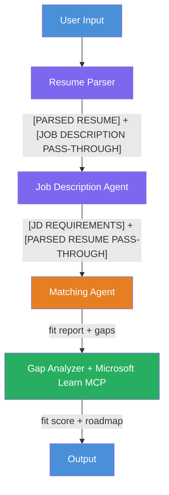

# Laboratório 02 - Fluxo de Trabalho Multi-Agente: Avaliador de Compatibilidade Currículo → Vaga

## Visão Geral

Neste laboratório prático, você construirá um **aplicativo multi-agente com foco em fluxo de trabalho** usando Foundry Toolkit no VS Code e o implantará no Microsoft Foundry Agent Service.

**O que você vai construir:** um Avaliador Currículo → Compatibilidade de Vaga que analisa um currículo e a descrição da vaga, pontua a compatibilidade e gera um roadmap de aprendizado personalizado usando recursos do Microsoft Learn.

---

## Arquitetura

**Como funciona:**
1. O usuário cola um currículo e uma descrição da vaga.
2. **ResumeParser** analisa o currículo e copia a JD literalmente em uma seção `[JOB DESCRIPTION PASS-THROUGH]`.
3. **JD Agent** extrai requisitos estruturados do conteúdo repassado e repassa o `[PARSED RESUME]` adiante como `[PARSED RESUME PASS-THROUGH]`.
4. **MatchingAgent** compara `[PARSED RESUME PASS-THROUGH]` vs `[JD REQUIREMENTS]` e gera uma pontuação de compatibilidade.
5. **GapAnalyzer** transforma as lacunas em um roteiro prático e busca links reais do Microsoft Learn via MCP.

---

## Pré-requisitos

Complete o Laboratório 01 primeiro:

- [Laboratório 01 - Agente Único](../lab01-single-agent/README.md)

---

## Parte 1: Leia os módulos na ordem

Veja o caminho completo de aprendizado em:

- [Documentação do Lab 2 - Pré-requisitos](docs/00-prerequisites.md)
- [Documentação do Lab 2 - Caminho Completo de Aprendizado](docs/README.md)
- [Guia de execução do PersonalCareerCopilot](PersonalCareerCopilot/README.md)

---

## Parte 2: Construa e teste o fluxo de trabalho

1. Use o assistente Foundry Toolkit para estruturar o projeto baseado em fluxo de trabalho.
2. Copie os blocos de prompt e o gráfico do fluxo de trabalho de `PersonalCareerCopilot/main.py` para seu espaço de trabalho.
3. Execute localmente com o Agent Inspector e verifique todos os quatro agentes mais a ferramenta MCP.
4. Implemente o agente hospedado no Foundry quando os testes locais forem bem-sucedidos.

---

## Padrões de orquestração

O Laboratório 02 usa uma **pipeline sequencial**: a saída de cada agente alimenta o próximo, e o fluxo de trabalho retorna a resposta final do agente. Dois padrões fazem isso funcionar:

- **Cadeia sequencial** - `WorkflowBuilder` conecta ResumeParser → JD Agent → MatchingAgent → GapAnalyzer com uma chamada `add_edge()` por etapa
- **Repassar conteúdo** - porque cada agente vê apenas a saída direta do predecessor, ResumeParser e JD Agent copiam os dados que os agentes seguintes precisam em seções de passagem rotuladas

A documentação também explica por que o laboratório não usa fan-out/fan-in, e como estender o gráfico com outro agente.

Veja [docs/04-orchestration-patterns.md](docs/04-orchestration-patterns.md).

---

**Anterior:** [Laboratório 01 - Agente Único](../lab01-single-agent/README.md) · **Voltar para:** [Página Inicial do Workshop](../../README.md)

---

<!-- CO-OP TRANSLATOR DISCLAIMER START -->
**Aviso Legal**:
Este documento foi traduzido usando o serviço de tradução por IA [Co-op Translator](https://github.com/Azure/co-op-translator). Embora nos esforcemos pela precisão, por favor, esteja ciente de que traduções automatizadas podem conter erros ou imprecisões. O documento original em seu idioma nativo deve ser considerado a fonte autorizada. Para informações críticas, recomenda-se tradução profissional humana. Não nos responsabilizamos por quaisquer mal-entendidos ou interpretações incorretas decorrentes do uso desta tradução.
<!-- CO-OP TRANSLATOR DISCLAIMER END -->