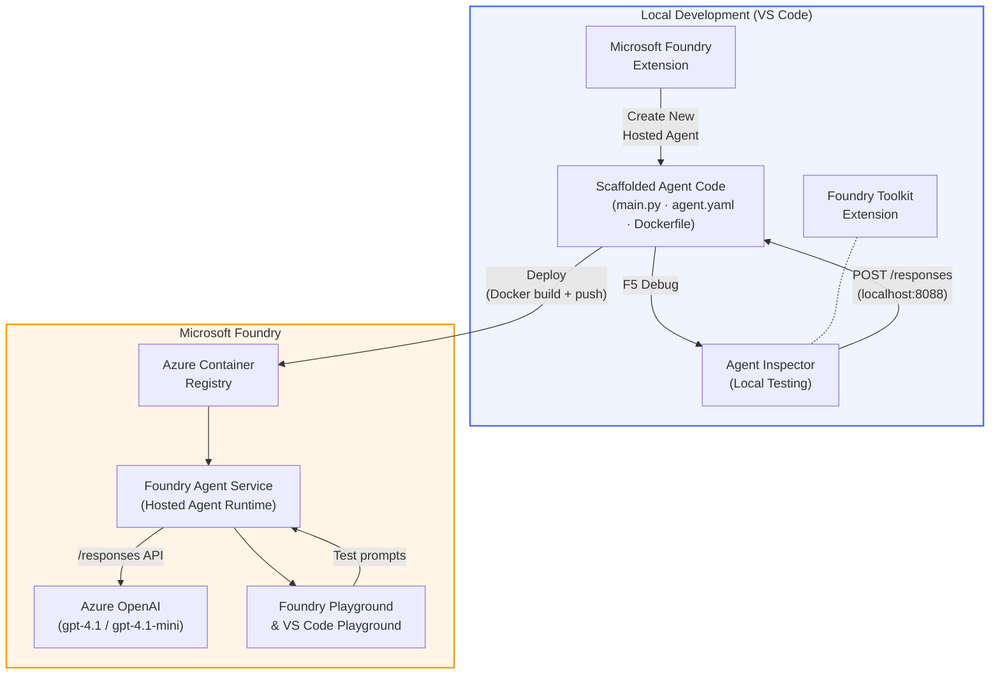

# Foundry Toolkit + Foundry Hosted Agents Oficina

[](https://www.python.org/)
[](https://github.com/microsoft/agents)
[](https://learn.microsoft.com/azure/foundry/agents/concepts/hosted-agents)
[](https://ai.azure.com/)
[](https://learn.microsoft.com/azure/ai-services/openai/)
[](https://learn.microsoft.com/cli/azure/install-azure-cli)
[](https://learn.microsoft.com/azure/developer/azure-developer-cli/install-azd)
[](https://www.docker.com/)
[](https://marketplace.visualstudio.com/items?itemName=ms-windows-ai-studio.windows-ai-studio)
[](../../LICENSE)

Construa, teste e implemente agentes de IA para **Microsoft Foundry Agent Service** como **Hosted Agents** - inteiramente a partir do VS Code usando a **extensão Microsoft Foundry** e o **Foundry Toolkit**.

> **Hosted Agents estão atualmente em pré-visualização.** As regiões suportadas são limitadas - veja [disponibilidade por região](https://learn.microsoft.com/azure/foundry/agents/concepts/hosted-agents#region-availability).

> A pasta `agent/` dentro de cada laboratório é **gerada automaticamente** pela Foundry extension - depois personaliza o código, testa localmente, e implementa.

### 🌐 Suporte Multilingue

#### Suportado via GitHub Action (Automatizado e Sempre Atualizado)

<!-- CO-OP TRANSLATOR LANGUAGES TABLE START -->
[Árabe](../ar/README.md) | [Bengali](../bn/README.md) | [Búlgaro](../bg/README.md) | [Birmanês (Myanmar)](../my/README.md) | [Chinês (Simplificado)](../zh-CN/README.md) | [Chinês (Tradicional, Hong Kong)](../zh-HK/README.md) | [Chinês (Tradicional, Macau)](../zh-MO/README.md) | [Chinês (Tradicional, Taiwan)](../zh-TW/README.md) | [Croata](../hr/README.md) | [Checo](../cs/README.md) | [Dinamarquês](../da/README.md) | [Holandês](../nl/README.md) | [Estónio](../et/README.md) | [Finlandês](../fi/README.md) | [Francês](../fr/README.md) | [Alemão](../de/README.md) | [Grego](../el/README.md) | [Hebraico](../he/README.md) | [Hindi](../hi/README.md) | [Húngaro](../hu/README.md) | [Indonésio](../id/README.md) | [Italiano](../it/README.md) | [Japonês](../ja/README.md) | [Canarês](../kn/README.md) | [Khmer](../km/README.md) | [Coreano](../ko/README.md) | [Lituano](../lt/README.md) | [Malaio](../ms/README.md) | [Malayalam](../ml/README.md) | [Marathi](../mr/README.md) | [Nepalês](../ne/README.md) | [Pidgin Nigeriano](../pcm/README.md) | [Norueguês](../no/README.md) | [Persa (Farsi)](../fa/README.md) | [Polaco](../pl/README.md) | [Português (Brasil)](../pt-BR/README.md) | [Português (Portugal)](./README.md) | [Punjabi (Gurmukhi)](../pa/README.md) | [Romeno](../ro/README.md) | [Russo](../ru/README.md) | [Sérvio (Cirílico)](../sr/README.md) | [Eslovaco](../sk/README.md) | [Esloveno](../sl/README.md) | [Espanhol](../es/README.md) | [Suaíli](../sw/README.md) | [Sueco](../sv/README.md) | [Tagalo (Filipino)](../tl/README.md) | [Tamil](../ta/README.md) | [Telugu](../te/README.md) | [Tailandês](../th/README.md) | [Turco](../tr/README.md) | [Ucraniano](../uk/README.md) | [Urdu](../ur/README.md) | [Vietnamita](../vi/README.md)

> **Prefere clonar localmente?**
>
> Este repositório inclui mais de 50 traduções de idiomas, o que aumenta significativamente o tamanho do download. Para clonar sem traduções, use sparse checkout:
>
> **Bash / macOS / Linux:**
> ```bash
> git clone --filter=blob:none --sparse https://github.com/microsoft-foundry/Foundry_Toolkit_for_VSCode_Lab.git
> cd Foundry_Toolkit_for_VSCode_Lab
> git sparse-checkout set --no-cone '/*' '!translations' '!translated_images'
> ```
>
> **CMD (Windows):**
> ```cmd
> git clone --filter=blob:none --sparse https://github.com/microsoft-foundry/Foundry_Toolkit_for_VSCode_Lab.git
> cd Foundry_Toolkit_for_VSCode_Lab
> git sparse-checkout set --no-cone "/*" "!translations" "!translated_images"
> ```
>
> Isto dá-lhe tudo o que precisa para completar o curso com um download muito mais rápido.
<!-- CO-OP TRANSLATOR LANGUAGES TABLE END -->

---

## Arquitectura



**Fluxo:** Foundry extension scaffolds the agent → you customize code & instructions → test locally with Agent Inspector → deploy to Foundry (Docker image pushed to ACR) → verify in Playground.

---

## O que vai construir

| Laboratório | Descrição | Estado |
|-----|-------------|--------|
| **Lab 01 - Single Agent** | Construa o agente **"Explain Like I'm an Executive"**, teste-o localmente, e implemente-o no Foundry | ✅ Disponível |
| **Lab 02 - Multi-Agent Workflow** | Construa o **"Resume → Job Fit Evaluator"** - 4 agentes colaboram para avaliar a compatibilidade do currículo e gerar um roteiro de aprendizagem | ✅ Disponível |

---

## Conheça o Agente Executivo

Nesta oficina irá construir o **"Explain Like I'm an Executive" Agent** - um agente de IA que pega em jargão técnico intrincado e o traduz em resumos calmos, prontos para a sala de reuniões. Porque sejamos honestos, ninguém na C-suite quer ouvir sobre "thread pool exhaustion caused by synchronous calls introduced in v3.2."

Criei este agente depois de incidentes a mais em que o meu post-mortem perfeitamente elaborado recebeu a resposta: *"Então... o site está em baixo ou não?"*

### Como funciona

Você fornece uma atualização técnica. Ele responde com um resumo executivo - três pontos, sem jargão, sem stack traces, sem angústia existencial. Apenas **o que aconteceu**, **impacto nos negócios**, e **próximo passo**.

### Veja em ação

**Você diz:**
> "A latência da API aumentou devido à exaustão do thread pool causada por chamadas síncronas introduzidas na v3.2."

**O agente responde:**

> **Resumo Executivo:**
> - **O que aconteceu:** Após a última versão, o sistema ficou mais lento.
> - **Impacto para o negócio:** Alguns utilizadores experienciaram atrasos ao usar o serviço.
> - **Próximo passo:** A alteração foi revertida e está a ser preparada uma correção antes de nova implementação.

### Por que este agente?

É um agente extremamente simples e com um único propósito - perfeito para aprender o fluxo de trabalho de Hosted Agents de ponta a ponta sem se enredar em cadeias de ferramentas complexas. E, honestamente? Qualquer equipa de engenharia poderia usar um destes.

---

## Estrutura da oficina

```
📂 Foundry_Toolkit_for_VSCode_Lab/
├── 📄 README.md                      ← You are here
└── 📂 workshop/
    ├── 📂 lab01-single-agent/        ← Full lab: docs + agent code
    │   ├── README.md                 ← Hands-on lab instructions
    │   ├── 📂 docs/                  ← Step-by-step tutorial modules
    │   │   ├── 00-prerequisites.md
    │   │   ├── 01-setup.md
    │   │   ├── 02-create-hosted-agent.md
    │   │   ├── 03-configure-and-code.md
    │   │   ├── 04-test-locally.md
    │   │   ├── 05-deploy-to-foundry.md
    │   │   ├── 06-verify-in-playground.md
    │   │   ├── 07-summary.md
    │   │   └── 08-troubleshooting.md
    │   └── 📂 agent/                 ← Reference solution (auto-scaffolded by Foundry extension)
    │       ├── agent.yaml
    │       ├── Dockerfile
    │       ├── main.py
    │       └── requirements.txt
    └── 📂 lab02-multi-agent/         ← Resume → Job Fit Evaluator
        ├── README.md                 ← Hands-on lab instructions (end-to-end)
        ├── 📂 docs/                  ← Step-by-step tutorial modules
        │   ├── 00-prerequisites.md
        │   ├── 01-understand-multi-agent.md
        │   ├── 02-scaffold-multi-agent.md
        │   ├── 03-configure-agents.md
        │   ├── 04-orchestration-patterns.md
        │   ├── 05-test-locally.md
        │   ├── 06-deploy-to-foundry.md
        │   ├── 07-verify-in-playground.md
        │   └── 08-troubleshooting.md
        └── 📂 PersonalCareerCopilot/ ← Reference solution (multi-agent workflow)
            ├── agent.yaml
            ├── Dockerfile
            ├── main.py
            └── requirements.txt
```

> **Nota:** A pasta `agent/` dentro de cada laboratório é o que a **extensão Microsoft Foundry** gera quando executa `Microsoft Foundry: Create a New Hosted Agent` na Paleta de Comandos. Os ficheiros são depois personalizados com as instruções, ferramentas e configuração do seu agente. O Lab 01 guia-o a recriar isto desde o início.

---

## Como começar

### 1. Clonar o repositório

```bash
git clone https://github.com/microsoft-foundry/Foundry_Toolkit_for_VSCode_Lab.git
cd Foundry_Toolkit_for_VSCode_Lab
```

### 2. Configurar um ambiente virtual Python

```bash
python -m venv venv
```

Ative-o:

- **Windows (PowerShell):**
  ```powershell
  .\venv\Scripts\Activate.ps1
  ```
- **macOS / Linux:**
  ```bash
  source venv/bin/activate
  ```

### 3. Instalar dependências

```bash
pip install -r workshop/lab01-single-agent/agent/requirements.txt
```

### 4. Configurar variáveis de ambiente

Copie o ficheiro de exemplo `.env` para dentro da pasta do agente e preencha os seus valores:

```bash
cp workshop/lab01-single-agent/agent/.env.example workshop/lab01-single-agent/agent/.env
```

Edite `workshop/lab01-single-agent/agent/.env`:

```env
AZURE_AI_PROJECT_ENDPOINT=https://<your-account>.services.ai.azure.com/api/projects/<your-project>
AZURE_AI_MODEL_DEPLOYMENT_NAME=<your-model-deployment-name>
```

### 5. Siga os laboratórios da oficina

Cada laboratório é autónomo com os seus próprios módulos. Comece com o **Lab 01** para aprender os fundamentos, depois avance para o **Lab 02** para fluxos de trabalho multi-agente.

#### Lab 01 - Single Agent ([instruções completas](workshop/lab01-single-agent/README.md))

| # | Módulo | Ligação |
|---|--------|------|
| 1 | Ler os pré-requisitos | [00-prerequisites.md](workshop/lab01-single-agent/docs/00-prerequisites.md) |
| 2 | Instalar o Foundry Toolkit & Foundry extension | [01-setup.md](workshop/lab01-single-agent/docs/01-setup.md) |
| 3 | Criar um projeto Foundry | [01-setup.md](workshop/lab01-single-agent/docs/01-setup.md) |
| 4 | Criar um hosted agent | [02-create-hosted-agent.md](workshop/lab01-single-agent/docs/02-create-hosted-agent.md) |
| 5 | Configurar instruções e ambiente | [03-configure-and-code.md](workshop/lab01-single-agent/docs/03-configure-and-code.md) |
| 6 | Testar localmente | [04-test-locally.md](workshop/lab01-single-agent/docs/04-test-locally.md) |
| 7 | Implantar no Foundry | [05-deploy-to-foundry.md](workshop/lab01-single-agent/docs/05-deploy-to-foundry.md) |
| 8 | Verificar no Playground | [06-verify-in-playground.md](workshop/lab01-single-agent/docs/06-verify-in-playground.md) |
| 9 | Resolução de problemas | [08-troubleshooting.md](workshop/lab01-single-agent/docs/08-troubleshooting.md) |

#### Lab 02 - Multi-Agent Workflow ([instruções completas](workshop/lab02-multi-agent/README.md))

| # | Módulo | Ligação |
|---|--------|------|
| 1 | Pré-requisitos (Lab 02) | [00-prerequisites.md](workshop/lab02-multi-agent/docs/00-prerequisites.md) |
| 2 | Compreender a arquitetura multi-agente | [01-understand-multi-agent.md](workshop/lab02-multi-agent/docs/01-understand-multi-agent.md) |
| 3 | Criar a estrutura do projeto multi-agente | [02-scaffold-multi-agent.md](workshop/lab02-multi-agent/docs/02-scaffold-multi-agent.md) |
| 4 | Configurar agentes e ambiente | [03-configure-agents.md](workshop/lab02-multi-agent/docs/03-configure-agents.md) |
| 5 | Padrões de orquestração | [04-orchestration-patterns.md](workshop/lab02-multi-agent/docs/04-orchestration-patterns.md) |
| 6 | Testar localmente (multi-agente) | [05-test-locally.md](workshop/lab02-multi-agent/docs/05-test-locally.md) |
| 7 | Implantar no Foundry | [06-deploy-to-foundry.md](workshop/lab02-multi-agent/docs/06-deploy-to-foundry.md) |
| 8 | Verificar no Playground | [07-verify-in-playground.md](workshop/lab02-multi-agent/docs/07-verify-in-playground.md) |
| 9 | Resolução de problemas (multi-agente) | [08-troubleshooting.md](workshop/lab02-multi-agent/docs/08-troubleshooting.md) |

---

## Mantenedor

<table>
<tr>
    <td align="center"><a href="https://github.com/ShivamGoyal03">
        <br />
        <sub><b>Shivam Goyal</b></sub>
    </a><br />
    </td>
</tr>
</table>

---

## Permissões necessárias (referência rápida)

| Cenário | Funções necessárias |
|----------|---------------|
| Criar novo projeto Foundry | **Azure AI Owner** no recurso Foundry |
| Implantar num projeto existente (novos recursos) | **Azure AI Owner** + **Contributor** na subscrição |
| Implantar num projeto totalmente configurado | **Reader** na conta + **Azure AI User** no projeto |

> **Importante:** Azure `Owner` and `Contributor` roles only include *management* permissions, not *development* (data action) permissions. You need **Azure AI User** or **Azure AI Owner** to build and deploy agents.

---

## Referências

- [Início rápido: Implemente o seu primeiro agente hospedado (VS Code)](https://learn.microsoft.com/azure/foundry/agents/quickstarts/quickstart-hosted-agent)
- [O que são agentes hospedados?](https://learn.microsoft.com/azure/foundry/agents/concepts/hosted-agents)
- [Criar fluxos de trabalho de agentes hospedados no VS Code](https://learn.microsoft.com/azure/foundry/agents/how-to/vs-code-agents-workflow-pro-code)
- [Implantar um agente hospedado](https://learn.microsoft.com/azure/foundry/agents/how-to/deploy-hosted-agent)
- [RBAC para Microsoft Foundry](https://learn.microsoft.com/azure/foundry/concepts/rbac-foundry)
- [Exemplo de Agente de Revisão de Arquitetura](https://github.com/Azure-Samples/agent-architecture-review-sample) - Agente hospedado do mundo real com ferramentas MCP, diagramas Excalidraw e implantação dupla

---


## Licença

[MIT](../../LICENSE)

---

<!-- CO-OP TRANSLATOR DISCLAIMER START -->
**Aviso Legal**:
Este documento foi traduzido utilizando o serviço de tradução automática [Co-op Translator](https://github.com/Azure/co-op-translator). Embora nos esforcemos pela precisão, esteja ciente de que traduções automáticas podem conter erros ou imprecisões. O documento original na sua língua nativa deve ser considerado a fonte autorizada. Para informações críticas, recomenda-se tradução profissional humana. Não nos responsabilizamos por quaisquer mal-entendidos ou interpretações incorretas resultantes da utilização desta tradução.
<!-- CO-OP TRANSLATOR DISCLAIMER END -->
