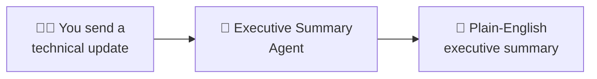

# Módulo 0 - Introdução

⏱️ ~10 min

> [!WARNING]
> **Pré-visualização e limitações:** [Agentes hospedados](https://learn.microsoft.com/azure/foundry/agents/concepts/hosted-agents) estão atualmente em **pré-visualização pública** - não recomendados para cargas de trabalho de produção. Tenha em conta o seguinte:
> - **As regiões suportadas são limitadas** - verifique a [disponibilidade da região](https://learn.microsoft.com/azure/foundry/agents/concepts/hosted-agents#region-availability) antes de criar recursos. Se escolher uma região não suportada, a implantação irá falhar.
> - O pacote `agent-framework-foundry-hosting` está em pré-lançamento - as APIs podem mudar entre versões.
> - Limites de escala: agentes hospedados suportam 0–5 réplicas (incluindo escala para zero).
> - Algumas funcionalidades mostradas neste workshop podem alterar-se à medida que o serviço avança para GA.

## O que vais construir

Neste workshop, vais construir um agente **"Explica Como se Eu Fosse um Executivo"** - um agente de IA hospedado que pega em atualizações técnicas complexas e reescreve-as como resumos executivos em inglês simples.

**O agente utiliza:**
- **Microsoft Agent Framework** - para a lógica e estrutura do agente
- **Foundry Toolkit para VS Code** - para estruturar, testar localmente e implantar
- **Um modelo de IA** (ex.: `gpt-4.1-mini/gpt-5-mini`) - para gerar os resumos

No final deste laboratório, terás um agente funcional que podes testar localmente via o Agent Inspector, e opcionalmente implantar na cloud.

---

## O que são agentes hospedados?

Um **agente hospedado** é um agente de IA que corre como um serviço gerido na Microsoft Foundry. Em vez de gerir a tua própria infraestrutura, empacotas o código do agente num contentor e a Foundry trata da escala, hospedagem e exposição através de um endpoint HTTP padrão.

| Conceito | O que significa |
|---------|----------------|
| **Agente** | O teu código Python que recebe uma mensagem do utilizador, chama um modelo de IA, e devolve uma resposta estruturada |
| **Hospedado** | A Foundry executa o teu contentor por ti - sem VMs, sem Kubernetes, sem infraestrutura para gerir |
| **Protocolo de respostas** | Uma API HTTP padrão (`POST /responses`) que qualquer cliente pode chamar para interagir com o teu agente |
| **Agent Inspector** | Uma UI para testes local (incorporada no Foundry Toolkit) que te permite conversar com o teu agente antes de o implantar |

Neste workshop, irás desde zero até a um agente totalmente hospedado - ou podes parar na fase de testes local se preferires.

---

## Escolhe o teu percurso

> ⚠️ **Escolhe um percurso antes de continuar.** A tua escolha determina quais as ferramentas a instalar e os módulos aplicáveis. Podes mudar do Percurso B → Percurso A mais tarde se obteres uma subscrição.

<strong>🅰️ Percurso A - Cloud Azure (necessita subscrição Azure)</strong>

| | Detalhes |
|---|---|
| **Para quem é?** | Tens uma subscrição Azure ativa e podes criar recursos Foundry |
| **Modelo** | Azure OpenAI via Foundry (ex.: `gpt-4.1-mini/gpt-5-mini`) |
| **Módulos cobertos** | Todos os módulos (00–07) |
| **Implantar na cloud?** | ✅ Sim - implantação completa end-to-end |

<strong>🅱️ Percurso B - Local / nível gratuito (não requer subscrição Azure)</strong>

| | Detalhes |
|---|---|
| **Para quem é?** | MVPs, estudantes, ou quem não tem acesso ao Azure |
| **Modelo** | **Foundry Local** (gratuito, corre na tua máquina) |
| **Módulos cobertos** | Módulos 00–04 (ignorar deploy e verificação cloud) |
| **Implantar na cloud?** | ❌ Não - apenas testes locais via Agent Inspector |

---

## Todos os percursos: Ferramentas necessárias

Instala cada ferramenta abaixo. Após instalar, verifica se funciona executando o comando de verificação.

| # | Ferramenta | Versão | Instalar | Verificar (Saída Esperada) |
|---|------------|---------|----------|---------------------------|
| 1 | **Visual Studio Code** | Última | [code.visualstudio.com](https://code.visualstudio.com/) | Abre sem erros |
| 2 | **Python** | 3.12 ou superior | [python.org/downloads](https://www.python.org/downloads/) | `python --version` $\rightarrow$ `Python 3.12.x` |
| 3 | **Foundry Toolkit para VS Code** | Última | ID da Extensão: `ms-windows-ai-studio.windows-ai-studio` | Ícone Foundry na Barra de Atividades |
| 4 | **Extensão Python para VS Code** | Última | ID da Extensão: `ms-python.python` | Instalado no painel de Extensões |

> [!TIP]
> **Dicas para a instalação:**
> - **PATH do Python (Windows):** Marca sempre **"Add Python to PATH"** no primeiro ecrã do instalador Python. Sem isso, `python` não será reconhecido no terminal.
> - **Múltiplas versões do Python:** Se tens Python 3.10 e 3.12 instalados, usa `python3.12 -m venv .venv` para garantir que a versão correta é usada no ambiente virtual.
> - **Docker WSL 2 (Windows):** Durante a instalação do Docker Desktop, certifica-te que selecionas o **WSL 2 backend**. Docker com Hyper-V é mais lento e pode causar problemas com as builds dos contentores Foundry.
> - **Docker não arranca?** Espera 30–60 segundos após abrir o Docker Desktop. Executa `docker info` - se visses "Cannot connect to the Docker daemon," o Docker ainda está a inicializar.
> - **Extensões do VS Code não carregam?** Após instalar extensões, recarrega a janela: `Ctrl+Shift+P` → `Developer: Reload Window`.

> **Utilizadores Windows:** Marca **"Add Python to PATH"** durante a instalação do Python.

**Próximo:** [01 - Configuração →](01-setup.md)

---

<!-- CO-OP TRANSLATOR DISCLAIMER START -->
**Aviso Legal**:
Este documento foi traduzido utilizando o serviço de tradução automática [Co-op Translator](https://github.com/Azure/co-op-translator). Embora nos esforcemos pela precisão, esteja ciente de que traduções automáticas podem conter erros ou imprecisões. O documento original na sua língua nativa deve ser considerado a fonte autorizada. Para informações críticas, recomenda-se tradução profissional humana. Não nos responsabilizamos por quaisquer mal-entendidos ou interpretações incorretas resultantes da utilização desta tradução.
<!-- CO-OP TRANSLATOR DISCLAIMER END -->