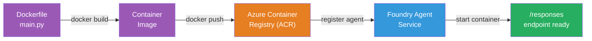
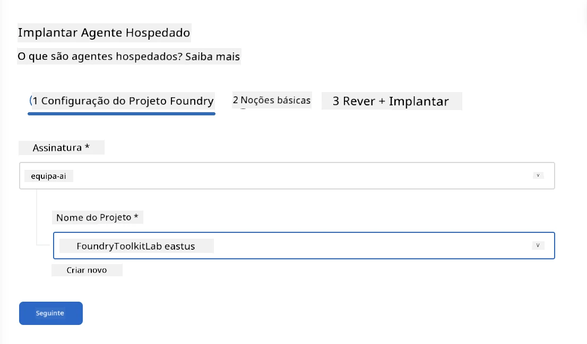
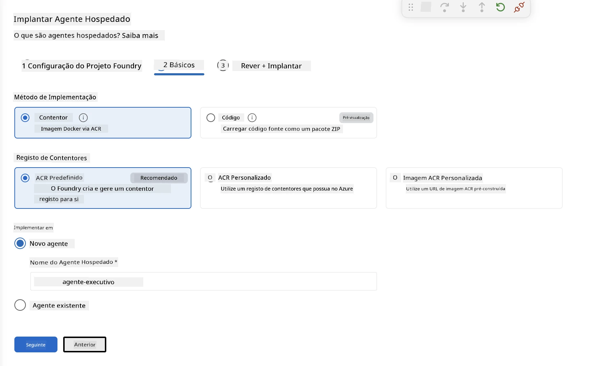
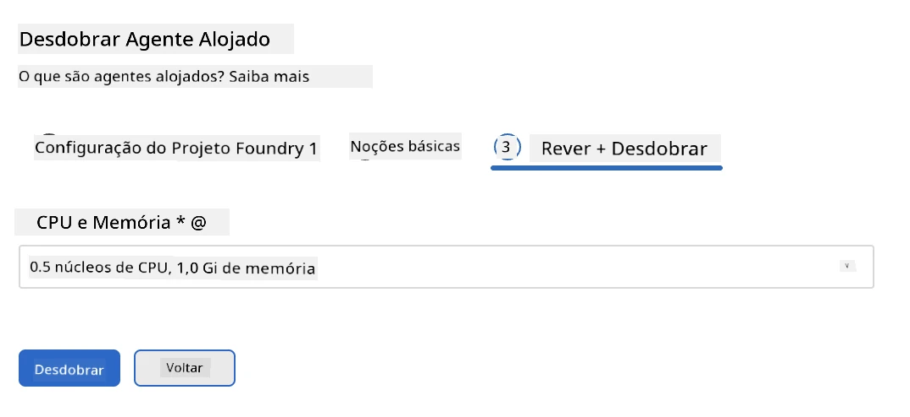
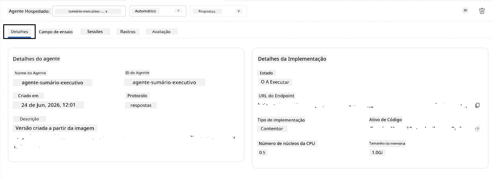

# Módulo 5 - Implantar no Serviço de Agente Foundry

⏱️ ~10 min

> ⚠️ **Utilizadores do Caminho B:** Este módulo requer uma subscrição Foundry. Se estiver a usar Foundry Local, passe para [Módulo 07 - Resumo](07-summary.md). Completar o fluxo de trabalho local com sucesso!

Neste módulo, implanta o seu agente testado localmente na Microsoft Foundry como um **Agente Hospedado**. A implantação constrói uma imagem de contentor, envia-a para o Azure Container Registry e inicia o agente na infraestrutura gerida da Foundry.

### Pipeline de implantação

---

## Verificação de pré-requisitos

Antes de implantar, verifique:

- [ ] O agente passa nos 3 cenários locais do [Módulo 04](04-test-locally.md)
- [ ] Tem o papel **Utilizador Azure AI** ao nível do projeto ([Módulo 01, Atribuir RBAC](01-setup.md#deploy-a-model--assign-rbac))
- [ ] Está autenticado no Azure no VS Code (o ícone de Contas mostra o seu nome)

---

## Passo 1: Iniciar a implantação

### Opção A: Implantar a partir do Agent Inspector (recomendado)

Se o Agent Inspector estiver aberto (após testar):
1. Clique no botão **Deploy** no canto superior direito (ícone de nuvem ↑).

### Opção B: Implantar a partir da Command Palette

1. Pressione `Ctrl+Shift+P` → **Foundry Toolkit: Deploy Hosted Agent**.

---

## Passo 2: Configurar a implantação

O assistente solicita:

| Pedido | Seleção |
|--------|-----------|
| **Subscrição** | A sua Subscrição Azure |
| **Projeto alvo** | O seu projeto Foundry (ex., `workshop-agents`) |

Clique em **seguinte** para configurar o seu agente.

| Pedido | Seleção |
|--------|-----------|
| **Método de implantação** | Contentor |
| **Registo de contentores** | **ACR predefinido** (a Microsoft Foundry cria e gere um para si) |
| **Implantar em** | Novo Agente (nome, `executive-summary-agent`) |

Clique em **seguinte** para rever e implantar o seu agente.

| Pedido | Seleção |
|--------|-----------|
| **CPU e memória** | **0.5 núcleos CPU, 1.0 Gi memória** (predefinido - suficiente para o workshop) |

---

## Passo 3: Implantar e monitorizar

1. Clique em **Deploy**.
2. Observe o painel **Output** (selecione **Microsoft Foundry** no menu pendente).
3. A implantação passa pelas seguintes etapas:
   - **Construção Docker** - constrói o contentor a partir do seu Dockerfile
   - **Push Docker** - envia a imagem para o ACR (1–3 min na primeira implantação)
   - **Registo do agente** - cria agente hospedado na Foundry
   - **Início do contentor** - inicia com identidade gerida pelo sistema

4. Quando concluído, aparece uma notificação:
   > **executive-summary-agent foi implantado com sucesso.** `View logs` `Run agent`

5. Clique em **Run agent** para abrir o Agent Playground.

### Valores do estado da implantação

| Estado | Significado |
|--------|------------|
| **A correr** | Contentor pronto, agente a responder |
| **Pendente** | Contentor a iniciar - aguarde 30–60 segundos |
| **Falhou** | Verifique logs (veja solução de problemas abaixo) |

---

## Erros comuns na implantação

| Erro | Causa raiz | Solução |
|-------|-----------|-------|
| `agents/write` permissão negada | Falta o papel **Azure AI User** ao nível do projeto | [Módulo 01, Atribuir RBAC](01-setup.md#deploy-a-model--assign-rbac) |
| Docker não iniciado | Docker Desktop não iniciado | Inicie o Docker Desktop → verifique `docker info` |
| Autorização ACR | A identidade gerida não consegue obter a imagem | Veja [Módulo 08 - Resolução de Problemas](08-troubleshooting.md) |

---

### ✅ Ponto de verificação

- [ ] Implantação concluída sem erros
- [ ] O agente aparece no separador **Hosted Agent** quando clica em **Agents** no seu projeto na barra lateral do Foundry Toolkit
- [ ] O estado do contentor mostra **Running**
- [ ] Separador Agent Playground aberto a mostrar detalhes do agente e URL do endpoint

---

**Anterior:** [04 - Testar Localmente](04-test-locally.md) · **Seguinte:** [06 - Verificar no Playground →](06-verify-in-playground.md)

---

<!-- CO-OP TRANSLATOR DISCLAIMER START -->
**Aviso Legal**:
Este documento foi traduzido utilizando o serviço de tradução automática [Co-op Translator](https://github.com/Azure/co-op-translator). Embora nos esforcemos pela precisão, esteja ciente de que traduções automáticas podem conter erros ou imprecisões. O documento original na sua língua nativa deve ser considerado a fonte autorizada. Para informações críticas, recomenda-se tradução profissional humana. Não nos responsabilizamos por quaisquer mal-entendidos ou interpretações incorretas resultantes da utilização desta tradução.
<!-- CO-OP TRANSLATOR DISCLAIMER END -->