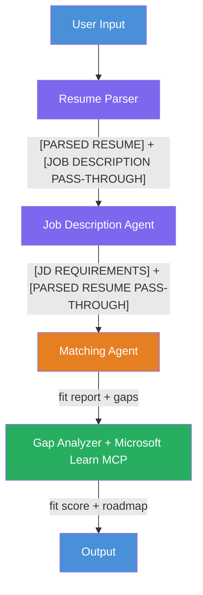

# Laboratório 02 - Fluxo de Trabalho Multi-Agente: Avaliador de Ajuste Currículo → Emprego

## Visão Geral

Neste laboratório prático, irá construir uma **aplicação multi-agente focada em fluxo de trabalho** utilizando Foundry Toolkit no VS Code e implementá-la no Microsoft Foundry Agent Service.

**O que irá construir:** um Avaliador de Ajuste Currículo → Emprego que analisa um currículo e uma descrição de emprego, pontua o grau de correspondência e produz um roteiro de aprendizagem personalizado utilizando recursos do Microsoft Learn.

---

## Arquitetura

**Como funciona:**
1. O utilizador cola um currículo e uma descrição de emprego.
2. **ResumeParser** analisa o currículo e copia a descrição de emprego literalmente para uma secção `[JOB DESCRIPTION PASS-THROUGH]`.
3. **JD Agent** extrai requisitos estruturados do pass-through, depois retransmite o `[PARSED RESUME]` em frente como `[PARSED RESUME PASS-THROUGH]`.
4. **MatchingAgent** compara `[PARSED RESUME PASS-THROUGH]` vs `[JD REQUIREMENTS]` e produz uma pontuação de ajuste.
5. **GapAnalyzer** converte as lacunas num roteiro prático e obtém links reais do Microsoft Learn via MCP.

---

## Pré-requisitos

Complete primeiro o Laboratório 01:

- [Laboratório 01 - Agente Único](../lab01-single-agent/README.md)

---

## Parte 1: Leia os módulos por ordem

Veja o percurso completo de aprendizagem em:

- [Documentação do Lab 2 - Pré-requisitos](docs/00-prerequisites.md)
- [Documentação do Lab 2 - Percurso Completo de Aprendizagem](docs/README.md)
- [Guia de execução do PersonalCareerCopilot](PersonalCareerCopilot/README.md)

---

## Parte 2: Construir e testar o fluxo de trabalho

1. Utilize o assistente Foundry Toolkit para criar o esqueleto do projeto baseado no fluxo de trabalho.
2. Copie os blocos de prompt e o gráfico do fluxo de trabalho de `PersonalCareerCopilot/main.py` para o seu ambiente de trabalho.
3. Execute localmente com o Agent Inspector e verifique os quatro agentes mais a ferramenta MCP.
4. Faça o deploy do agente alojado no Foundry após passar os testes locais.

---

## Padrões de orquestração

O Laboratório 02 usa uma **pipeline sequencial**: a saída de cada agente alimenta o seguinte, e o fluxo de trabalho devolve a resposta do último agente. Dois padrões tornam isto possível:

- **Cadeia sequencial** - `WorkflowBuilder` liga ResumeParser → JD Agent → MatchingAgent → GapAnalyzer com uma chamada `add_edge()` por passo
- **Retransmissão de conteúdo** - porque cada agente vê apenas a saída do seu predecessor direto, ResumeParser e JD Agent copiam os dados de que os agentes downstream precisam para secções pass-through etiquetadas

A documentação também explica porque o laboratório não usa fan-out/fan-in, e como estender o gráfico com outro agente.

Veja [docs/04-orchestration-patterns.md](docs/04-orchestration-patterns.md).

---

**Anterior:** [Laboratório 01 - Agente Único](../lab01-single-agent/README.md) · **Voltar para:** [Página Inicial do Workshop](../../README.md)

---

<!-- CO-OP TRANSLATOR DISCLAIMER START -->
**Aviso Legal**:
Este documento foi traduzido utilizando o serviço de tradução automática [Co-op Translator](https://github.com/Azure/co-op-translator). Embora nos esforcemos pela precisão, esteja ciente de que traduções automáticas podem conter erros ou imprecisões. O documento original na sua língua nativa deve ser considerado a fonte autorizada. Para informações críticas, recomenda-se tradução profissional humana. Não nos responsabilizamos por quaisquer mal-entendidos ou interpretações incorretas resultantes da utilização desta tradução.
<!-- CO-OP TRANSLATOR DISCLAIMER END -->