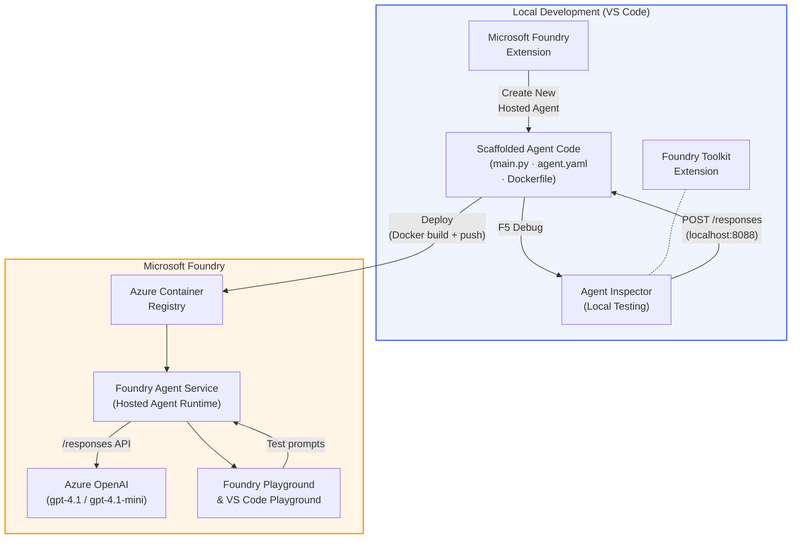

# Atelier Foundry Toolkit + Agenți găzduiți Foundry

[](https://www.python.org/)
[](https://github.com/microsoft/agents)
[](https://learn.microsoft.com/azure/foundry/agents/concepts/hosted-agents)
[](https://ai.azure.com/)
[](https://learn.microsoft.com/azure/ai-services/openai/)
[](https://learn.microsoft.com/cli/azure/install-azure-cli)
[](https://learn.microsoft.com/azure/developer/azure-developer-cli/install-azd)
[](https://www.docker.com/)
[](https://marketplace.visualstudio.com/items?itemName=ms-windows-ai-studio.windows-ai-studio)
[](LICENSE)

Construiește, testează și implementează agenți AI în **Microsoft Foundry Agent Service** ca **Agenți Găzduiți** - complet din VS Code folosind **extensia Microsoft Foundry** și **Foundry Toolkit**.

> **Agenții găzduiți sunt în prezent în previzualizare.** Regiunile suportate sunt limitate - vezi [disponibilitatea regiunilor](https://learn.microsoft.com/azure/foundry/agents/concepts/hosted-agents#region-availability).

> Dosarul `agent/` din fiecare laborator este **generat automat** de extensia Foundry - apoi personalizezi codul, testezi local și implementezi.

### 🌐 Suport Multi-Limbă

#### Suportat prin GitHub Action (automatizat și întotdeauna actualizat)

<!-- CO-OP TRANSLATOR LANGUAGES TABLE START -->
[Arabic](../ar/README.md) | [Bengali](../bn/README.md) | [Bulgarian](../bg/README.md) | [Burmese (Myanmar)](../my/README.md) | [Chineză (Simplificată)](../zh-CN/README.md) | [Chineză (Tradițională, Hong Kong)](../zh-HK/README.md) | [Chineză (Tradițională, Macau)](../zh-MO/README.md) | [Chineză (Tradițională, Taiwan)](../zh-TW/README.md) | [Croată](../hr/README.md) | [Cehă](../cs/README.md) | [Daneză](../da/README.md) | [Olandeză](../nl/README.md) | [Estonă](../et/README.md) | [Finnish](../fi/README.md) | [Franceză](../fr/README.md) | [Germană](../de/README.md) | [Greacă](../el/README.md) | [Ebraică](../he/README.md) | [Hindi](../hi/README.md) | [Maghiară](../hu/README.md) | [Indoneziană](../id/README.md) | [Italiană](../it/README.md) | [Japoneză](../ja/README.md) | [Kannada](../kn/README.md) | [Khmeră](../km/README.md) | [Coreeană](../ko/README.md) | [Lituaniană](../lt/README.md) | [Malay](../ms/README.md) | [Malayalam](../ml/README.md) | [Marathi](../mr/README.md) | [Nepaleză](../ne/README.md) | [Pidgin Nigerian](../pcm/README.md) | [Norvegiană](../no/README.md) | [Persană (Farsi)](../fa/README.md) | [Poloneză](../pl/README.md) | [Portugheză (Brazilia)](../pt-BR/README.md) | [Portugheză (Portugalia)](../pt-PT/README.md) | [Punjabi (Gurmukhi)](../pa/README.md) | [Română](./README.md) | [Rusă](../ru/README.md) | [Sârbă (Chirilică)](../sr/README.md) | [Slovacă](../sk/README.md) | [Slovenă](../sl/README.md) | [Spaniolă](../es/README.md) | [Swahili](../sw/README.md) | [Suedeză](../sv/README.md) | [Tagalog (Filipineză)](../tl/README.md) | [Tamil](../ta/README.md) | [Telugu](../te/README.md) | [Thai](../th/README.md) | [Turcă](../tr/README.md) | [Ucraineană](../uk/README.md) | [Urdu](../ur/README.md) | [Vietnameză](../vi/README.md)

> **Preferi să clonezi local?**
>
> Acest depozit include traduceri în peste 50 de limbi, ceea ce crește considerabil dimensiunea descărcării. Pentru a clona fără traduceri, folosește sparse checkout:
>
> **Bash / macOS / Linux:**
> ```bash
> git clone --filter=blob:none --sparse https://github.com/microsoft-foundry/Foundry_Toolkit_for_VSCode_Lab.git
> cd Foundry_Toolkit_for_VSCode_Lab
> git sparse-checkout set --no-cone '/*' '!translations' '!translated_images'
> ```
>
> **CMD (Windows):**
> ```cmd
> git clone --filter=blob:none --sparse https://github.com/microsoft-foundry/Foundry_Toolkit_for_VSCode_Lab.git
> cd Foundry_Toolkit_for_VSCode_Lab
> git sparse-checkout set --no-cone "/*" "!translations" "!translated_images"
> ```
>
> Acest lucru îți oferă tot ce ai nevoie pentru a termina cursul cu o descărcare mult mai rapidă.
<!-- CO-OP TRANSLATOR LANGUAGES TABLE END -->

---

## Arhitectură



**Flux:** Extensia Foundry generează scheletul agentului → personalizezi codul și instrucțiunile → testezi local cu Agent Inspector → implementezi în Foundry (imagine Docker împinsă în ACR) → verifici în Playground.

---

## Ce vei construi

| Laborator | Descriere | Stare |
|-----|-------------|--------|
| **Laborator 01 - Agent Unic** | Construiește **Agentul "Explică-mă ca și cum aș fi un executiv"**, testează-l local și implementează-l în Foundry | ✅ Disponibil |
| **Laborator 02 - Flux de lucru multi-agent** | Construiește **"Evaluator CV → Potrivire job"** - 4 agenți colaborează pentru a evalua potrivirea CV-ului și pentru a genera o foaie de parcurs de învățare | ✅ Disponibil |

---

## Cunoaște Agentul Executiv

În acest atelier vei construi **Agentul "Explică-mă ca și cum aș fi un executiv"** - un agent AI care ia jargon tehnic complicat și îl traduce în rezumate liniștite și gata pentru sala de consiliu. Pentru că, să fim sinceri, nimeni în conducerea superioară nu vrea să audă despre „exhaustarea pool-ului de fire cauzată de apeluri sincrone introduse în v3.2.”

Am construit acest agent după prea multe incidente în care raportul meu post-mortem perfect elaborat a primit răspunsul: *„Deci... site-ul este jos sau nu?”*

### Cum funcționează

Îi dai o actualizare tehnică. Îți returnează un rezumat executiv - trei puncte esențiale, fără jargon, fără stack trace-uri, fără frică existențială. Doar **ce s-a întâmplat**, **impactul asupra afacerii** și **următorul pas**.

### Vezi-l în acțiune

**Spui:**
> „Latenta API-ului a crescut din cauza epuizării pool-ului de fire cauzate de apeluri sincrone introduse în v3.2.”

**Agentul răspunde:**

> **Rezumat Executiv:**
> - **Ce s-a întâmplat:** După ultima versiune, sistemul a încetinit.
> - **Impact asupra afacerii:** Unii utilizatori au întâmpinat întârzieri în utilizarea serviciului.
> - **Următorul pas:** Modificarea a fost anulată și se pregătește o remediere înainte de redeploy.

### De ce acest agent?

Este un agent simplu, cu un singur scop - perfect pentru a învăța fluxul de lucru al agenților găzduiți de la cap la coadă fără a te complica cu lanțuri de unelte complexe. Și sincer? Orice echipă de ingineri ar putea utiliza unul ca acesta.

---

## Structura atelierului

```
📂 Foundry_Toolkit_for_VSCode_Lab/
├── 📄 README.md                      ← You are here
└── 📂 workshop/
    ├── 📂 lab01-single-agent/        ← Full lab: docs + agent code
    │   ├── README.md                 ← Hands-on lab instructions
    │   ├── 📂 docs/                  ← Step-by-step tutorial modules
    │   │   ├── 00-prerequisites.md
    │   │   ├── 01-setup.md
    │   │   ├── 02-create-hosted-agent.md
    │   │   ├── 03-configure-and-code.md
    │   │   ├── 04-test-locally.md
    │   │   ├── 05-deploy-to-foundry.md
    │   │   ├── 06-verify-in-playground.md
    │   │   ├── 07-summary.md
    │   │   └── 08-troubleshooting.md
    │   └── 📂 agent/                 ← Reference solution (auto-scaffolded by Foundry extension)
    │       ├── agent.yaml
    │       ├── Dockerfile
    │       ├── main.py
    │       └── requirements.txt
    └── 📂 lab02-multi-agent/         ← Resume → Job Fit Evaluator
        ├── README.md                 ← Hands-on lab instructions (end-to-end)
        ├── 📂 docs/                  ← Step-by-step tutorial modules
        │   ├── 00-prerequisites.md
        │   ├── 01-understand-multi-agent.md
        │   ├── 02-scaffold-multi-agent.md
        │   ├── 03-configure-agents.md
        │   ├── 04-orchestration-patterns.md
        │   ├── 05-test-locally.md
        │   ├── 06-deploy-to-foundry.md
        │   ├── 07-verify-in-playground.md
        │   └── 08-troubleshooting.md
        └── 📂 PersonalCareerCopilot/ ← Reference solution (multi-agent workflow)
            ├── agent.yaml
            ├── Dockerfile
            ├── main.py
            └── requirements.txt
```

> **Notă:** Dosarul `agent/` din fiecare laborator este generat de **extensia Microsoft Foundry** când rulezi `Microsoft Foundry: Create a New Hosted Agent` din Paleta de comenzi. Fișierele sunt apoi personalizate cu instrucțiunile, uneltele și configurația agentului tău. Laboratorul 01 îți arată cum să recreezi acest lucru de la zero.

---

## Începutul

### 1. Clonează depozitul

```bash
git clone https://github.com/microsoft-foundry/Foundry_Toolkit_for_VSCode_Lab.git
cd Foundry_Toolkit_for_VSCode_Lab
```

### 2. Configurează un mediu virtual Python

```bash
python -m venv venv
```

Activează-l:

- **Windows (PowerShell):**
  ```powershell
  .\venv\Scripts\Activate.ps1
  ```
- **macOS / Linux:**
  ```bash
  source venv/bin/activate
  ```

### 3. Instalează dependențele

```bash
pip install -r workshop/lab01-single-agent/agent/requirements.txt
```

### 4. Configurează variabilele de mediu

Copiază fișierul exemplu `.env` în dosarul agentului și completează valorile tale:

```bash
cp workshop/lab01-single-agent/agent/.env.example workshop/lab01-single-agent/agent/.env
```

Editează `workshop/lab01-single-agent/agent/.env`:

```env
AZURE_AI_PROJECT_ENDPOINT=https://<your-account>.services.ai.azure.com/api/projects/<your-project>
AZURE_AI_MODEL_DEPLOYMENT_NAME=<your-model-deployment-name>
```

### 5. Urmează laboratoarele atelierului

Fiecare laborator este autonom, cu modulele sale. Începe cu **Laboratorul 01** pentru a învăța elementele de bază, apoi treci la **Laboratorul 02** pentru fluxuri de lucru multi-agent.

#### Laborator 01 - Agent Unic ([instrucțiuni complete](workshop/lab01-single-agent/README.md))

| # | Modul | Link |
|---|--------|------|
| 1 | Citește cerințele preliminare | [00-prerequisites.md](workshop/lab01-single-agent/docs/00-prerequisites.md) |
| 2 | Instalează Foundry Toolkit și extensia Foundry | [01-setup.md](workshop/lab01-single-agent/docs/01-setup.md) |
| 3 | Creează un proiect Foundry | [01-setup.md](workshop/lab01-single-agent/docs/01-setup.md) |
| 4 | Creează un agent găzduit | [02-create-hosted-agent.md](workshop/lab01-single-agent/docs/02-create-hosted-agent.md) |
| 5 | Configurează instrucțiunile și mediul | [03-configure-and-code.md](workshop/lab01-single-agent/docs/03-configure-and-code.md) |
| 6 | Testează local | [04-test-locally.md](workshop/lab01-single-agent/docs/04-test-locally.md) |
| 7 | Implementează în Foundry | [05-deploy-to-foundry.md](workshop/lab01-single-agent/docs/05-deploy-to-foundry.md) |
| 8 | Verifică în playground | [06-verify-in-playground.md](workshop/lab01-single-agent/docs/06-verify-in-playground.md) |
| 9 | Depanare | [08-troubleshooting.md](workshop/lab01-single-agent/docs/08-troubleshooting.md) |

#### Laborator 02 - Flux de lucru multi-agent ([instrucțiuni complete](workshop/lab02-multi-agent/README.md))

| # | Modul | Link |
|---|--------|------|
| 1 | Cerințe preliminare (Laborator 02) | [00-prerequisites.md](workshop/lab02-multi-agent/docs/00-prerequisites.md) |
| 2 | Înțelege arhitectura multi-agent | [01-understand-multi-agent.md](workshop/lab02-multi-agent/docs/01-understand-multi-agent.md) |
| 3 | Generează proiectul multi-agent | [02-scaffold-multi-agent.md](workshop/lab02-multi-agent/docs/02-scaffold-multi-agent.md) |
| 4 | Configurează agenții și mediul | [03-configure-agents.md](workshop/lab02-multi-agent/docs/03-configure-agents.md) |
| 5 | Modele de orchestrare | [04-orchestration-patterns.md](workshop/lab02-multi-agent/docs/04-orchestration-patterns.md) |
| 6 | Testează local (multi-agent) | [05-test-locally.md](workshop/lab02-multi-agent/docs/05-test-locally.md) |
| 7 | Implementează în Foundry | [06-deploy-to-foundry.md](workshop/lab02-multi-agent/docs/06-deploy-to-foundry.md) |
| 8 | Verifică în playground | [07-verify-in-playground.md](workshop/lab02-multi-agent/docs/07-verify-in-playground.md) |
| 9 | Depanare (multi-agent) | [08-troubleshooting.md](workshop/lab02-multi-agent/docs/08-troubleshooting.md) |

---

## Administrator

<table>
<tr>
    <td align="center"><a href="https://github.com/ShivamGoyal03">
        <br />
        <sub><b>Shivam Goyal</b></sub>
    </a><br />
    </td>
</tr>
</table>

---

## Permisiuni necesare (referință rapidă)

| Scenariu | Roluri necesare |
|----------|---------------|
| Creează un proiect Foundry nou | **Proprietar Azure AI** pe resursa Foundry |
| Implementează în proiect existent (resurse noi) | **Proprietar Azure AI** + **Contribuitor** pe abonament |
| Implementează în proiect complet configurat | **Cititor** pe cont + **Utilizator Azure AI** pe proiect |

> **Important:** Rolurile Azure `Owner` și `Contributor` includ doar permisiuni de *gestiune*, nu permisiuni de *dezvoltare* (acțiuni de date). Ai nevoie de **Utilizator Azure AI** sau **Proprietar Azure AI** pentru a construi și implementa agenți.

---

## Referințe

- [Pornire rapidă: Desfășurați primul agent găzduit (VS Code)](https://learn.microsoft.com/azure/foundry/agents/quickstarts/quickstart-hosted-agent)
- [Ce sunt agenții găzduiți?](https://learn.microsoft.com/azure/foundry/agents/concepts/hosted-agents)
- [Creați fluxuri de lucru pentru agenți găzduiți în VS Code](https://learn.microsoft.com/azure/foundry/agents/how-to/vs-code-agents-workflow-pro-code)
- [Desfășurați un agent găzduit](https://learn.microsoft.com/azure/foundry/agents/how-to/deploy-hosted-agent)
- [RBAC pentru Microsoft Foundry](https://learn.microsoft.com/azure/foundry/concepts/rbac-foundry)
- [Exemplu de agent pentru revizuirea arhitecturii](https://github.com/Azure-Samples/agent-architecture-review-sample) - Agent găzduit din lumea reală cu instrumente MCP, diagrame Excalidraw și implementare duală

---


## Licență

[MIT](../../LICENSE)

---

<!-- CO-OP TRANSLATOR DISCLAIMER START -->
**Declinare a responsabilității**:
Acest document a fost tradus folosind serviciul de traducere AI [Co-op Translator](https://github.com/Azure/co-op-translator). În timp ce ne străduim pentru acuratețe, vă rugăm să rețineți că traducerile automate pot conține erori sau inexactități. Documentul original în limba sa nativă trebuie considerat sursa autorizată. Pentru informații critice, se recomandă traducerea profesională realizată de un om. Nu ne asumăm responsabilitatea pentru eventualele neînțelegeri sau interpretări greșite care decurg din utilizarea acestei traduceri.
<!-- CO-OP TRANSLATOR DISCLAIMER END -->
