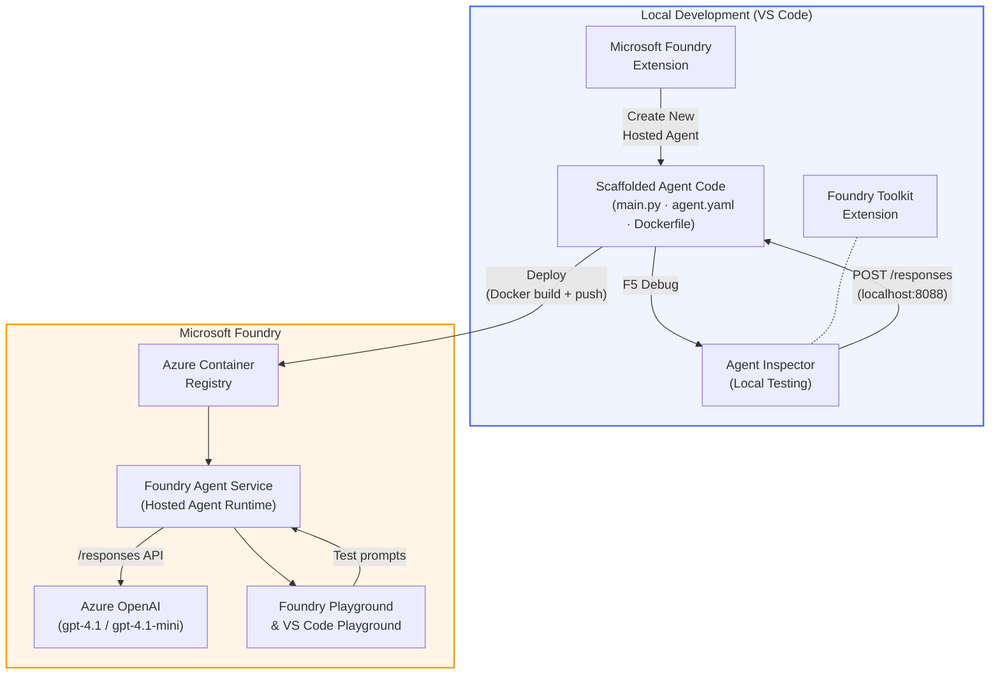

# Foundry Toolkit + Мастерская Foundry Hosted Agents

[](https://www.python.org/)
[](https://github.com/microsoft/agents)
[](https://learn.microsoft.com/azure/foundry/agents/concepts/hosted-agents)
[](https://ai.azure.com/)
[](https://learn.microsoft.com/azure/ai-services/openai/)
[](https://learn.microsoft.com/cli/azure/install-azure-cli)
[](https://learn.microsoft.com/azure/developer/azure-developer-cli/install-azd)
[](https://www.docker.com/)
[](https://marketplace.visualstudio.com/items?itemName=ms-windows-ai-studio.windows-ai-studio)
[](../../LICENSE)

Создавайте, тестируйте и разворачивайте ИИ-агентов в **Microsoft Foundry Agent Service** как **Hosted Agents** - полностью из VS Code с помощью **расширения Microsoft Foundry** и **Foundry Toolkit**.

> **Hosted Agents в настоящее время находятся в режиме предварительной версии.** Поддерживаемые регионы ограничены - см. [доступность по регионам](https://learn.microsoft.com/azure/foundry/agents/concepts/hosted-agents#region-availability).

> Папка `agent/` внутри каждой лаборатории **автоматически создаётся** расширением Foundry - затем вы настраиваете код, тестируете локально и разворачиваете.

### 🌐 Поддержка нескольких языков

#### Поддерживается с помощью GitHub Action (автоматизировано и всегда актуально)

<!-- CO-OP TRANSLATOR LANGUAGES TABLE START -->
[Арабский](../ar/README.md) | [Бенгальский](../bn/README.md) | [Болгарский](../bg/README.md) | [Бирманский (Мьянма)](../my/README.md) | [Китайский (упрощённый)](../zh-CN/README.md) | [Китайский (традиционный, Гонконг)](../zh-HK/README.md) | [Китайский (традиционный, Макао)](../zh-MO/README.md) | [Китайский (традиционный, Тайвань)](../zh-TW/README.md) | [Хорватский](../hr/README.md) | [Чешский](../cs/README.md) | [Датский](../da/README.md) | [Нидерландский](../nl/README.md) | [Эстонский](../et/README.md) | [Финский](../fi/README.md) | [Французский](../fr/README.md) | [Немецкий](../de/README.md) | [Греческий](../el/README.md) | [Иврит](../he/README.md) | [Хинди](../hi/README.md) | [Венгерский](../hu/README.md) | [Индонезийский](../id/README.md) | [Итальянский](../it/README.md) | [Японский](../ja/README.md) | [Каннада](../kn/README.md) | [Кхмерский](../km/README.md) | [Корейский](../ko/README.md) | [Литовский](../lt/README.md) | [Малайский](../ms/README.md) | [Малаялам](../ml/README.md) | [Маратхи](../mr/README.md) | [Непальский](../ne/README.md) | [Нигерийский пиджин](../pcm/README.md) | [Норвежский](../no/README.md) | [Персидский (фарси)](../fa/README.md) | [Польский](../pl/README.md) | [Португальский (Бразилия)](../pt-BR/README.md) | [Португальский (Португалия)](../pt-PT/README.md) | [Пенджаби (гурмукхи)](../pa/README.md) | [Румынский](../ro/README.md) | [Русский](./README.md) | [Сербский (кириллица)](../sr/README.md) | [Словацкий](../sk/README.md) | [Словенский](../sl/README.md) | [Испанский](../es/README.md) | [Свахили](../sw/README.md) | [Шведский](../sv/README.md) | [Тагальский (Филиппинский)](../tl/README.md) | [Тамильский](../ta/README.md) | [Телугу](../te/README.md) | [Тайский](../th/README.md) | [Турецкий](../tr/README.md) | [Украинский](../uk/README.md) | [Урду](../ur/README.md) | [Вьетнамский](../vi/README.md)

> **Предпочитаете клонировать локально?**
>
> В этом репозитории есть переводы на более чем 50 языков, что значительно увеличивает размер загрузки. Чтобы клонировать без переводов, используйте sparse checkout:
>
> **Bash / macOS / Linux:**
> ```bash
> git clone --filter=blob:none --sparse https://github.com/microsoft-foundry/Foundry_Toolkit_for_VSCode_Lab.git
> cd Foundry_Toolkit_for_VSCode_Lab
> git sparse-checkout set --no-cone '/*' '!translations' '!translated_images'
> ```
>
> **CMD (Windows):**
> ```cmd
> git clone --filter=blob:none --sparse https://github.com/microsoft-foundry/Foundry_Toolkit_for_VSCode_Lab.git
> cd Foundry_Toolkit_for_VSCode_Lab
> git sparse-checkout set --no-cone "/*" "!translations" "!translated_images"
> ```
>
> Это даст вам все необходимое для завершения курса с гораздо более быстрой загрузкой.
<!-- CO-OP TRANSLATOR LANGUAGES TABLE END -->

---

## Архитектура



**Flow:** Foundry extension создает каркас агента → вы настраиваете код и инструкции → тестируете локально с помощью Agent Inspector → развертываете в Foundry (образ Docker отправляется в ACR) → проверяете в Playground.

---

## Что вы создадите

| Лаборатория | Описание | Статус |
|-----|-------------|--------|
| **Лаборатория 01 - Один агент** | Соберите агента **«Объясни как руководителю»**, протестируйте его локально и разверните в Foundry | ✅ Доступно |
| **Лаборатория 02 - Мультиагентный рабочий поток** | Создайте **«Оценщик соответствия резюме → вакансии»** — 4 агента сотрудничают, чтобы оценить соответствие резюме и создать план обучения | ✅ Доступно |

---

## Познакомьтесь с агентом для руководства

В этом воркшопе вы создадите агента **«Объясни как руководителю»** — ИИ-агента, который берет сложный технический жаргон и переводит его в спокойные, готовые для заседания совета директоров сводки. Честно говоря, никому из руководства не хочется слушать о «истощении пула потоков, вызванном синхронными вызовами, введёнными в v3.2».

Я создал этого агента после того, как слишком часто после моего идеально составленного постмортема получал ответ: *"Так... сайт упал или нет?"*

### Как это работает

Вы даете ему техническое обновление. Он возвращает исполнительное резюме - три пункта, без жаргона, без трассировки стека, без экзистенциального ужаса. Только **что произошло**, **влияние на бизнес**, и **следующий шаг**.

### Посмотрите на практике

**Вы говорите:**
> "Задержка API увеличилась из‑за истощения пула потоков, вызванного синхронными вызовами, введёнными в v3.2."

**Агент отвечает:**

> **Исполнительное резюме:**
> - **Что произошло:** После последнего релиза система замедлилась.
> - **Влияние на бизнес:** Некоторые пользователи столкнулись с задержками при использовании сервиса.
> - **Следующий шаг:** Изменение откатили, готовится исправление перед повторным развёртыванием.

### Зачем этот агент?

Это предельно простой агент с одной целью — идеален для изучения рабочего процесса размещённых агентов от начала до конца, без утопления в сложных наборах инструментов. И, честно говоря, каждая инженерная команда могла бы иметь такой.

---

## Структура воркшопа

```
📂 Foundry_Toolkit_for_VSCode_Lab/
├── 📄 README.md                      ← You are here
└── 📂 workshop/
    ├── 📂 lab01-single-agent/        ← Full lab: docs + agent code
    │   ├── README.md                 ← Hands-on lab instructions
    │   ├── 📂 docs/                  ← Step-by-step tutorial modules
    │   │   ├── 00-prerequisites.md
    │   │   ├── 01-setup.md
    │   │   ├── 02-create-hosted-agent.md
    │   │   ├── 03-configure-and-code.md
    │   │   ├── 04-test-locally.md
    │   │   ├── 05-deploy-to-foundry.md
    │   │   ├── 06-verify-in-playground.md
    │   │   ├── 07-summary.md
    │   │   └── 08-troubleshooting.md
    │   └── 📂 agent/                 ← Reference solution (auto-scaffolded by Foundry extension)
    │       ├── agent.yaml
    │       ├── Dockerfile
    │       ├── main.py
    │       └── requirements.txt
    └── 📂 lab02-multi-agent/         ← Resume → Job Fit Evaluator
        ├── README.md                 ← Hands-on lab instructions (end-to-end)
        ├── 📂 docs/                  ← Step-by-step tutorial modules
        │   ├── 00-prerequisites.md
        │   ├── 01-understand-multi-agent.md
        │   ├── 02-scaffold-multi-agent.md
        │   ├── 03-configure-agents.md
        │   ├── 04-orchestration-patterns.md
        │   ├── 05-test-locally.md
        │   ├── 06-deploy-to-foundry.md
        │   ├── 07-verify-in-playground.md
        │   └── 08-troubleshooting.md
        └── 📂 PersonalCareerCopilot/ ← Reference solution (multi-agent workflow)
            ├── agent.yaml
            ├── Dockerfile
            ├── main.py
            └── requirements.txt
```

> **Примечание:** Папка `agent/` внутри каждой лаборатории — это то, что расширение **Microsoft Foundry** генерирует, когда вы запускаете `Microsoft Foundry: Create a New Hosted Agent` из палитры команд. Затем файлы настраиваются инструкциями, инструментами и конфигурацией вашего агента. Лаборатория 01 проведёт вас через воссоздание этого с нуля.

---

## Начало работы

### 1. Клонируйте репозиторий

```bash
git clone https://github.com/microsoft-foundry/Foundry_Toolkit_for_VSCode_Lab.git
cd Foundry_Toolkit_for_VSCode_Lab
```

### 2. Настройте виртуальное окружение Python

```bash
python -m venv venv
```

Активируйте его:

- **Windows (PowerShell):**
  ```powershell
  .\venv\Scripts\Activate.ps1
  ```
- **macOS / Linux:**
  ```bash
  source venv/bin/activate
  ```

### 3. Установите зависимости

```bash
pip install -r workshop/lab01-single-agent/agent/requirements.txt
```

### 4. Настройка переменных окружения

Скопируйте пример файла `.env` в папку агента и заполните его своими значениями:

```bash
cp workshop/lab01-single-agent/agent/.env.example workshop/lab01-single-agent/agent/.env
```

Отредактируйте `workshop/lab01-single-agent/agent/.env`:

```env
AZURE_AI_PROJECT_ENDPOINT=https://<your-account>.services.ai.azure.com/api/projects/<your-project>
AZURE_AI_MODEL_DEPLOYMENT_NAME=<your-model-deployment-name>
```

### 5. Выполняйте лабораторные задания

Каждая лаборатория автономна и содержит собственные модули. Начните с **Лаборатории 01**, чтобы изучить основы, затем переходите к **Лаборатории 02** для работы с мультиагентными сценариями.

#### Лаборатория 01 - Один агент ([полные инструкции](workshop/lab01-single-agent/README.md))

| # | Модуль | Ссылка |
|---|--------|------|
| 1 | Ознакомьтесь с предварительными требованиями | [00-prerequisites.md](workshop/lab01-single-agent/docs/00-prerequisites.md) |
| 2 | Установите Foundry Toolkit и расширение Foundry | [01-setup.md](workshop/lab01-single-agent/docs/01-setup.md) |
| 3 | Создайте проект Foundry | [01-setup.md](workshop/lab01-single-agent/docs/01-setup.md) |
| 4 | Создайте размещённого агента | [02-create-hosted-agent.md](workshop/lab01-single-agent/docs/02-create-hosted-agent.md) |
| 5 | Настройте инструкции и окружение | [03-configure-and-code.md](workshop/lab01-single-agent/docs/03-configure-and-code.md) |
| 6 | Протестируйте локально | [04-test-locally.md](workshop/lab01-single-agent/docs/04-test-locally.md) |
| 7 | Разверните в Foundry | [05-deploy-to-foundry.md](workshop/lab01-single-agent/docs/05-deploy-to-foundry.md) |
| 8 | Проверьте в Playground | [06-verify-in-playground.md](workshop/lab01-single-agent/docs/06-verify-in-playground.md) |
| 9 | Устранение неполадок | [08-troubleshooting.md](workshop/lab01-single-agent/docs/08-troubleshooting.md) |

#### Лаборатория 02 - Мультиагентный рабочий поток ([полные инструкции](workshop/lab02-multi-agent/README.md))

| # | Модуль | Ссылка |
|---|--------|------|
| 1 | Предварительные требования (Лаборатория 02) | [00-prerequisites.md](workshop/lab02-multi-agent/docs/00-prerequisites.md) |
| 2 | Разберитесь в архитектуре мультиагентной системы | [01-understand-multi-agent.md](workshop/lab02-multi-agent/docs/01-understand-multi-agent.md) |
| 3 | Сгенерируйте каркас мультиагентного проекта | [02-scaffold-multi-agent.md](workshop/lab02-multi-agent/docs/02-scaffold-multi-agent.md) |
| 4 | Настройте агентов и окружение | [03-configure-agents.md](workshop/lab02-multi-agent/docs/03-configure-agents.md) |
| 5 | Паттерны оркестрации | [04-orchestration-patterns.md](workshop/lab02-multi-agent/docs/04-orchestration-patterns.md) |
| 6 | Тестирование локально (мультиагентное) | [05-test-locally.md](workshop/lab02-multi-agent/docs/05-test-locally.md) |
| 7 | Разверните в Foundry | [06-deploy-to-foundry.md](workshop/lab02-multi-agent/docs/06-deploy-to-foundry.md) |
| 8 | Проверьте в Playground | [07-verify-in-playground.md](workshop/lab02-multi-agent/docs/07-verify-in-playground.md) |
| 9 | Устранение неполадок (мультиагентное) | [08-troubleshooting.md](workshop/lab02-multi-agent/docs/08-troubleshooting.md) |

---

## Поддерживает

<table>
<tr>
    <td align="center"><a href="https://github.com/ShivamGoyal03">
        <br />
        <sub><b>Shivam Goyal</b></sub>
    </a><br />
    </td>
</tr>
</table>

---

## Необходимые разрешения (краткая справка)

| Сценарий | Необходимые роли |
|----------|---------------|
| Создание нового проекта Foundry | **Azure AI Owner** на ресурсе Foundry |
| Развернуть в существующий проект (новые ресурсы) | **Azure AI Owner** + **Contributor** на подписке |
| Развернуть в полностью настроенный проект | **Reader** на учётной записи + **Azure AI User** на проекте |

> **Важно:** роли Azure `Owner` и `Contributor` включают только *права управления*, а не *права разработки* (действия с данными). Для создания и развёртывания агентов вам нужны **Azure AI User** или **Azure AI Owner**.

---

## Ссылки

- [Краткое руководство: Разверните вашего первого хостируемого агента (VS Code)](https://learn.microsoft.com/azure/foundry/agents/quickstarts/quickstart-hosted-agent)
- [Что такое хостируемые агенты?](https://learn.microsoft.com/azure/foundry/agents/concepts/hosted-agents)
- [Создание рабочих процессов для хостируемых агентов в VS Code](https://learn.microsoft.com/azure/foundry/agents/how-to/vs-code-agents-workflow-pro-code)
- [Развертывание хостируемого агента](https://learn.microsoft.com/azure/foundry/agents/how-to/deploy-hosted-agent)
- [RBAC для Microsoft Foundry](https://learn.microsoft.com/azure/foundry/concepts/rbac-foundry)
- [Образец агента обзора архитектуры](https://github.com/Azure-Samples/agent-architecture-review-sample) - Реальный хостируемый агент с инструментами MCP, диаграммами Excalidraw и двойным развёртыванием

---


## Лицензия

[MIT](../../LICENSE)

---

<!-- CO-OP TRANSLATOR DISCLAIMER START -->
**Отказ от ответственности**:
Этот документ был переведен с использованием сервиса машинного перевода [Co-op Translator](https://github.com/Azure/co-op-translator). Несмотря на наши усилия по обеспечению точности, имейте в виду, что автоматический перевод может содержать ошибки или неточности. Оригинальный документ на его исходном языке следует считать авторитетным источником. Для получения критически важной информации рекомендуется обратиться к профессиональному человеческому переводу. Мы не несем ответственности за любые недоразумения или неправильные толкования, возникшие в результате использования этого перевода.
<!-- CO-OP TRANSLATOR DISCLAIMER END -->
