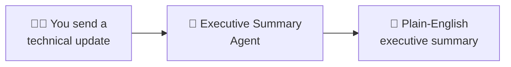

# Модуль 0 - Введение

⏱️ ~10 минут

> [!WARNING]
> **Предварительный просмотр и ограничения:** [Хостинговые агенты](https://learn.microsoft.com/azure/foundry/agents/concepts/hosted-agents) в настоящее время находятся в **публичном предварительном просмотре** - не рекомендуется для производственных нагрузок. Имейте в виду следующее:
> - **Поддерживаемые регионы ограничены** - проверьте [доступность регионов](https://learn.microsoft.com/azure/foundry/agents/concepts/hosted-agents#region-availability) перед созданием ресурсов. Если вы выберете неподдерживаемый регион, развертывание не удастся.
> - Пакет `agent-framework-foundry-hosting` находится в предварительной версии - API может изменяться между версиями.
> - Ограничения по масштабу: хостинговые агенты поддерживают 0–5 реплик (включая масштабирование до нуля).
> - Некоторые функции, показанные в этом мастер-классе, могут измениться по мере приближения сервиса к GA.

## Что вы создадите

В этом мастер-классе вы создадите агента **"Объясни, как директору"** - хостингового ИИ-агента, который берет сложные технические обновления и переписывает их в понятные исполнительные резюме на простом английском языке.

**Агент использует:**
- **Microsoft Agent Framework** - для логики и структуры агента
- **Foundry Toolkit для VS Code** - для создания каркаса, локального тестирования и развертывания
- **ИИ-модель** (например, `gpt-4.1-mini/gpt-5-mini`) - для создания резюме

К концу этой лабораторной работы у вас будет работающий агент, которого вы сможете тестировать локально через Agent Inspector, а опционально развернуть в облаке.

---

## Что такое хостинговые агенты?

**Хостинговый агент** — это ИИ-агент, который работает как управляемый сервис в Microsoft Foundry. Вместо того чтобы управлять собственной инфраструктурой, вы помещаете код агента в контейнер, и Foundry занимается масштабированием, хостингом и предоставлением доступа к нему через стандартную HTTP-точку входа.

| Понятие | Значение |
|---------|--------------|
| **Агент** | Ваш код на Python, который принимает сообщение пользователя, вызывает ИИ-модель и возвращает структурированный ответ |
| **Хостинг** | Foundry запускает ваш контейнер за вас - без ВМ, без Kubernetes, без управления инфраструктурой |
| **Протокол ответов** | Стандартный HTTP API (`POST /responses`), к которому может обращаться любой клиент для взаимодействия с вашим агентом |
| **Agent Inspector** | Локальный пользовательский интерфейс для тестирования (встроен в Foundry Toolkit), позволяющий общаться с вашим агентом перед развертыванием |

В этом мастер-классе вы пройдете путь от нуля до полностью хостингового агента — или остановитесь на локальном тестировании, если предпочитаете.

---

## Выберите ваш путь

> ⚠️ **Выберите один путь перед продолжением.** Ваш выбор определит, какие инструменты устанавливать и какие модули использовать. Позже можно переключиться с Пути B на Путь A, если у вас появится подписка.

<strong>🅰️ Путь A - Облако Azure (требуется подписка Azure)</strong>

| | Подробности |
|---|---|
| **Для кого?** | У вас есть активная подписка Azure и возможность создавать ресурсы Foundry |
| **Модель** | Azure OpenAI через Foundry (например, `gpt-4.1-mini/gpt-5-mini`) |
| **Модули** | Все модули (00–07) |
| **Развертывание в облаке?** | ✅ Да - полноценное развертывание |

<strong>🅱️ Путь B - Локально / бесплатный уровень (подписка Azure не требуется)</strong>

| | Подробности |
|---|---|
| **Для кого?** | MVP, студенты или все, у кого нет доступа к Azure |
| **Модель** | **Foundry Local** (бесплатно, работает на вашем компьютере) |
| **Модули** | Модули 00–04 (без развертывания и проверки в облаке) |
| **Развертывание в облаке?** | ❌ Нет - только локальное тестирование через Agent Inspector |

---

## Все пути: необходимые инструменты

Установите каждый из инструментов ниже. После установки проверьте их работу командой проверки.

| # | Инструмент | Версия | Установка | Проверка (ожидаемый результат) |
|---|------------|---------|------------|-------------------------------|
| 1 | **Visual Studio Code** | Последняя | [code.visualstudio.com](https://code.visualstudio.com/) | Открывается без ошибок |
| 2 | **Python** | 3.12 или выше | [python.org/downloads](https://www.python.org/downloads/) | `python --version` $\rightarrow$ `Python 3.12.x` |
| 3 | **Foundry Toolkit для VS Code** | Последняя | Идентификатор расширения: `ms-windows-ai-studio.windows-ai-studio` | Иконка Foundry в панели активности |
| 4 | **Расширение Python для VS Code** | Последняя | Идентификатор расширения: `ms-python.python` | Установлено в панели расширений |

> [!TIP]
> **Советы по установке:**
> - **Python PATH (Windows):** Всегда отмечайте **«Add Python to PATH»** на первом экране установщика Python. Без этого `python` не будет распознаваться в терминале.
> - **Несколько версий Python:** Если у вас установлены Python 3.10 и 3.12, используйте `python3.12 -m venv .venv`, чтобы убедиться, что для виртуального окружения используется правильная версия.
> - **Docker WSL 2 (Windows):** При установке Docker Desktop убедитесь, что выбран **бэкенд WSL 2**. Docker с Hyper-V работает медленнее и может вызвать проблемы с построением контейнеров Foundry.
> - **Docker не запускается?** Подождите 30–60 секунд после запуска Docker Desktop. Запустите `docker info` - если появится сообщение «Cannot connect to the Docker daemon», Docker все еще инициализируется.
> - **Расширения VS Code не загружаются?** После установки расширений перезагрузите окно: `Ctrl+Shift+P` → `Developer: Reload Window`.

> **Пользователи Windows:** Отметьте **«Add Python to PATH»** при установке Python.

**Далее:** [01 - Настройка →](01-setup.md)

---

<!-- CO-OP TRANSLATOR DISCLAIMER START -->
**Отказ от ответственности**:
Этот документ был переведен с использованием сервиса машинного перевода [Co-op Translator](https://github.com/Azure/co-op-translator). Несмотря на наши усилия по обеспечению точности, имейте в виду, что автоматический перевод может содержать ошибки или неточности. Оригинальный документ на его исходном языке следует считать авторитетным источником. Для получения критически важной информации рекомендуется обратиться к профессиональному человеческому переводу. Мы не несем ответственности за любые недоразумения или неправильные толкования, возникшие в результате использования этого перевода.
<!-- CO-OP TRANSLATOR DISCLAIMER END -->