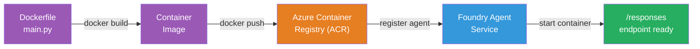
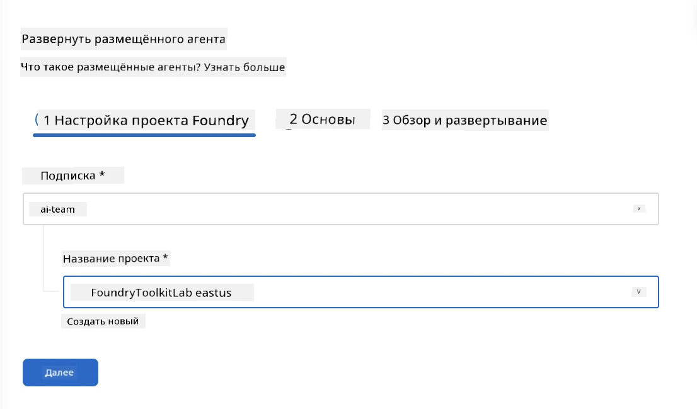
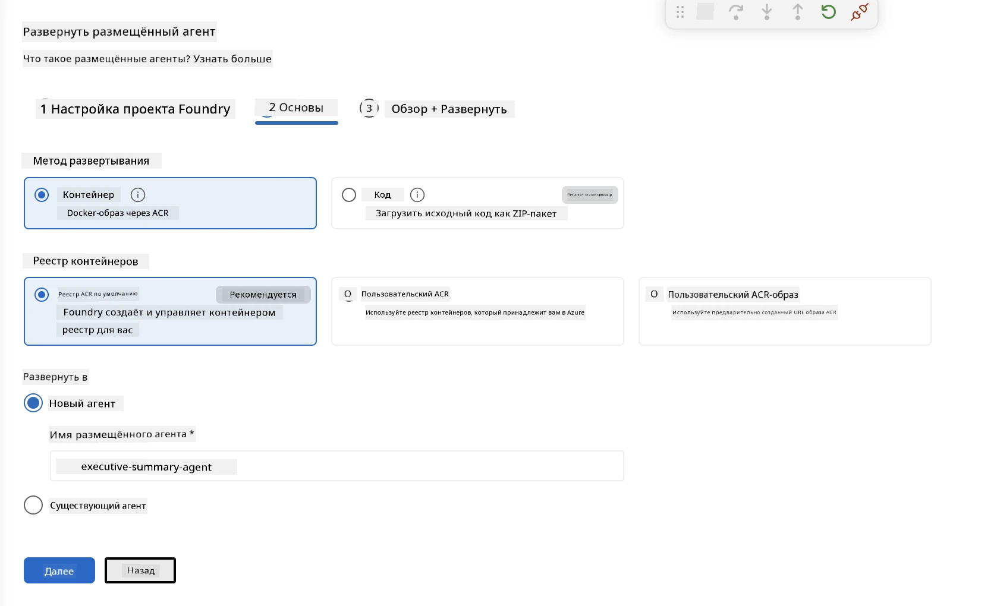
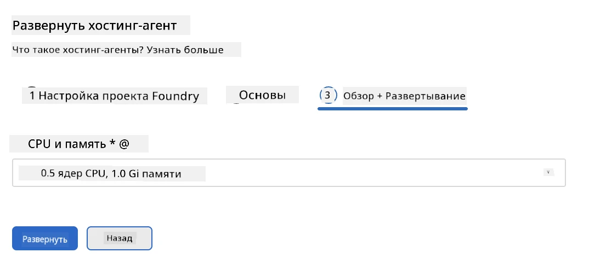
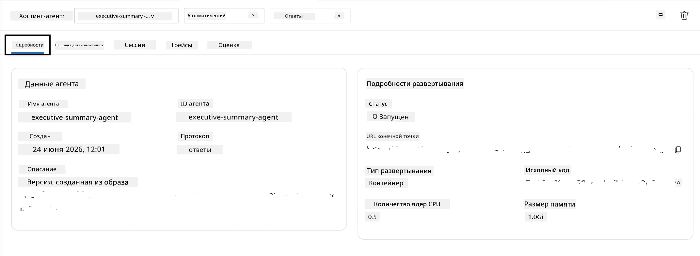

# Модуль 5 - Развертывание в службу агента Foundry

⏱️ ~10 минут

> ⚠️ **Пользователи пути B:** Этот модуль требует подписки Foundry. Если вы используете Foundry Local, перейдите к [Модуль 07 - Итог](07-summary.md). Вы успешно завершили рабочий процесс локальной разработки!

В этом модуле вы развернете вашего локально протестированного агента в Microsoft Foundry как **Размещенного агента**. Развертывание выполняет сборку образа контейнера, отправляет его в Azure Container Registry и запускает агента в управляемой инфраструктуре Foundry.

### Конвейер развертывания

---

## Проверка предварительных условий

Перед развертыванием убедитесь, что:

- [ ] Агент проходит все 3 локальных сценария из [Модуля 04](04-test-locally.md)
- [ ] У вас есть роль **Azure AI User** на уровне проекта ([Модуль 01, Назначение RBAC](01-setup.md#deploy-a-model--assign-rbac))
- [ ] Вы вошли в Azure в VS Code (иконка аккаунта показывает ваше имя)

---

## Шаг 1: Начало развертывания

### Вариант A: Развертывание из Agent Inspector (рекомендуется)

Если Agent Inspector открыт (после тестирования):
1. Нажмите кнопку **Deploy** в правом верхнем углу (иконка облака ↑).

### Вариант B: Развертывание через Command Palette

1. Нажмите `Ctrl+Shift+P` → **Foundry Toolkit: Deploy Hosted Agent**.

---

## Шаг 2: Конфигурация развертывания

Мастер запросит:

| Запрос | Выбор |
|--------|--------|
| **Подписка** | Ваша подписка Azure |
| **Целевой проект** | Ваш проект Foundry (например, `workshop-agents`) |

Нажмите **далее** для настройки агента.

| Запрос | Выбор |
|--------|--------|
| **Метод развертывания** | Контейнер |
| **Регистр контейнеров** | **ACR по умолчанию** (Microsoft Foundry создаёт и управляет им для вас) |
| **Развернуть в** | Новый агент (имя, `executive-summary-agent`) |

Нажмите **далее** для просмотра и запуска агента.

| Запрос | Выбор |
|--------|--------|
| **CPU и память** | **0.5 ядер CPU, 1.0 Gi памяти** (по умолчанию - достаточно для воркшопа) |

---

## Шаг 3: Развертывание и мониторинг

1. Нажмите **Deploy**.
2. Следите за панелью **Output** (выберите **Microsoft Foundry** в выпадающем списке).
3. Развертывание проходит следующие этапы:
   - **Сборка Docker** - сборка контейнера из вашего Dockerfile
   - **Отправка Docker** - отсылка образа в ACR (1–3 минуты при первом развертывании)
   - **Регистрация агента** - создание размещенного агента в Foundry
   - **Запуск контейнера** - старт с системной управляемой идентичностью

4. По завершении появится уведомление:
   > **executive-summary-agent успешно развернут.** `View logs` `Run agent`

5. Нажмите **Run agent** чтобы открыть Agent Playground.

### Статусы развертывания

| Статус | Значение |
|--------|----------|
| **Running** | Контейнер готов, агент отвечает |
| **Pending** | Контейнер запускается - подождите 30–60 секунд |
| **Failed** | Проверьте логи (см. устранение неполадок ниже) |

---

## Распространённые ошибки при развертывании

| Ошибка | Основная причина | Исправление |
|-------|----------------|-----------|
| `agents/write` отказано в разрешении | Отсутствует роль **Azure AI User** на уровне проекта | [Модуль 01, Назначение RBAC](01-setup.md#deploy-a-model--assign-rbac) |
| Docker не запущен | Docker Desktop не запущен | Запустите Docker Desktop → проверьте `docker info` |
| Авторизация ACR | Управляемая учётная запись не может извлечь образ | Смотрите [Модуль 08 - Устранение неполадок](08-troubleshooting.md) |

---

### ✅ Контрольная точка

- [ ] Развертывание выполнено без ошибок
- [ ] Агент отображается на вкладке **Hosted Agent**, когда вы нажимаете **Agents** под вашим проектом в боковой панели Foundry Toolkit
- [ ] Статус контейнера показывает **Running**
- [ ] Вкладка Agent Playground открыта с отображением деталей агента и URL конечной точки

---

**Предыдущий:** [04 - Тестирование локально](04-test-locally.md) · **Следующий:** [06 - Проверка в Playground →](06-verify-in-playground.md)

---

<!-- CO-OP TRANSLATOR DISCLAIMER START -->
**Отказ от ответственности**:
Этот документ был переведен с использованием сервиса машинного перевода [Co-op Translator](https://github.com/Azure/co-op-translator). Несмотря на наши усилия по обеспечению точности, имейте в виду, что автоматический перевод может содержать ошибки или неточности. Оригинальный документ на его исходном языке следует считать авторитетным источником. Для получения критически важной информации рекомендуется обратиться к профессиональному человеческому переводу. Мы не несем ответственности за любые недоразумения или неправильные толкования, возникшие в результате использования этого перевода.
<!-- CO-OP TRANSLATOR DISCLAIMER END -->