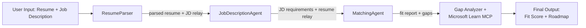

# PersonalCareerCopilot - Оценка соответствия резюме вакансии

Многоагентное приложение, ориентированное на рабочий процесс, которое оценивает, насколько резюме соответствует описанию вакансии, а затем генерирует персонализированную дорожную карту обучения для устранения пробелов.

---

## Агенты

| Агент | Роль | Инструменты |
|-------|------|------------|
| **ResumeParser** | Извлекает структурированные навыки, опыт, сертификаты из текста резюме | - |
| **JobDescriptionAgent** | Извлекает требуемые/предпочтительные навыки, опыт, сертификаты из описания вакансии | - |
| **MatchingAgent** | Сравнивает профиль с требованиями → оценка соответствия (0-100) + совпадающие/отсутствующие навыки | - |
| **GapAnalyzer** | Создаёт персонализированную дорожную карту обучения с ресурсами Microsoft Learn | `search_microsoft_learn_for_plan` (MCP) |

## Рабочий процесс



---

## Быстрый старт

### 1. Настройка окружения

Эта папка является эталонной реализацией для рабочей схемы Лаба 02. Его `main.py` использует существующие блоки подсказок плюс `WorkflowBuilder` для связки четырёх агентов вместе.

```powershell
cd workshop\lab02-multi-agent\PersonalCareerCopilot
python -m venv .venv
.\.venv\Scripts\Activate.ps1          # Windows PowerShell
# source .venv/bin/activate            # macOS / Linux
pip install -r requirements.txt
```

### 2. Настройка учетных данных

Создайте файл `.env` в этой папке:

```powershell
copy .env .env.bak 2>$null; echo $null > .env
```

Отредактируйте `.env`:

```env
FOUNDRY_PROJECT_ENDPOINT=https://<your-account>.services.ai.azure.com/api/projects/<your-project>
AZURE_AI_MODEL_DEPLOYMENT_NAME=gpt-4.1-mini
```

| Значение | Где найти |
|---------|-----------|
| `FOUNDRY_PROJECT_ENDPOINT` | Боковая панель Foundry Toolkit → клик правой кнопкой по вашему проекту → **Копировать Endpoint проекта** |
| `AZURE_AI_MODEL_DEPLOYMENT_NAME` | Боковая панель Foundry → разверните проект → **Модели + endpoints** → имя развёртывания |

### 3. Запуск локально

```powershell
python -m debugpy --listen 127.0.0.1:5679 main.py --port 8088
```

Или используйте задачу VS Code: `Ctrl+Shift+P` → **Задачи: Запустить задачу** → **Запуск HTTP сервера агента**.

Для отладки нажатием F5 используйте **Отладка локального HTTP сервера агента**.

### 4. Тестирование с Agent Inspector

Откройте Agent Inspector: `Ctrl+Shift+P` → **Foundry Toolkit: Открыть Agent Inspector**.

Вставьте этот тестовый запрос:

```
Resume:
Jane Doe
Senior Software Engineer with 5 years of experience in Python, Django, and AWS.
Built microservices handling 10K+ requests/second. Led a team of 4 developers.
Certifications: AWS Solutions Architect Associate.
Education: B.S. Computer Science, State University.

Job Description:
Senior Cloud Engineer at Contoso Ltd.
Required: Python, Azure, Kubernetes, Terraform, CI/CD pipelines.
Preferred: Go, monitoring (Prometheus/Grafana), cost optimization.
Experience: 5+ years in cloud infrastructure.
Certifications: Azure Solutions Architect Expert preferred.
```

**Ожидается:** Оценка соответствия (0–100), совпадающие/отсутствующие навыки и персонализированная дорожная карта обучения с URL Microsoft Learn.

### 5. Развёртывание в Foundry

`Ctrl+Shift+P` → **Foundry Toolkit: Развернуть Hosted Agent** → выберите ваш проект → подтвердите.

---

## Структура проекта

```
PersonalCareerCopilot/
├── .env                ← Your credentials (git-ignored)
├── agent.yaml          ← Hosted agent definition (name, resources, env vars)
├── Dockerfile          ← Container image for Foundry deployment
├── main.py             ← 4-agent workflow (instructions, MCP tool, WorkflowBuilder)
└── requirements.txt    ← Python dependencies
```

## Основные файлы

### `agent.yaml`

Определяет хостинг агента для Foundry Agent Service:
- `kind: hosted` - запускается как управляемый контейнер
- `protocols` - протокол `responses` с `version: 2.0.0`, выставляет HTTP endpoint `/responses`
- `environment_variables` - `AZURE_AI_MODEL_DEPLOYMENT_NAME` объявлен здесь; `FOUNDRY_PROJECT_ENDPOINT` автоматически внедряется при развертывании

### `main.py`

Содержит:
- **Инструкции агента** - четыре константы `*_INSTRUCTIONS`, по одной на каждого агента
- **Инструмент MCP** - `search_microsoft_learn_for_plan()` вызывает `https://learn.microsoft.com/api/mcp` через Streamable HTTP
- **Создание агентов** - четыре экземпляра `Agent()` + `AgentExecutor()`, использующих один `FoundryChatClient`
- **Граф рабочего процесса** - `WorkflowBuilder` связывает агентов в последовательную цепочку: ResumeParser → JD Agent → MatchingAgent → GapAnalyzer
- **Запуск сервера** - `ResponsesHostServer` слушает порт 8088

### `requirements.txt`

| Пакет | Назначение |
|-------|-----------|
| `agent-framework-foundry` | Основное время выполнения: `Agent`, `AgentExecutor`, `WorkflowBuilder`, `@tool`, `FoundryChatClient` |
| `agent-framework-foundry-hosting` | Интеграция с хостингом Foundry + `ResponsesHostServer` |
| `mcp<2,>=1.24.0` | Клиент MCP для GapAnalyzer (`streamable_http_client`) |
| `debugpy` | Отладка Python (F5 в VS Code) |

---

## Устранение неполадок

| Проблема | Решение |
|---------|----------|
| `KeyError: 'FOUNDRY_PROJECT_ENDPOINT'` или `KeyError: 'AZURE_AI_MODEL_DEPLOYMENT_NAME'` | Создайте `.env` с установленными `FOUNDRY_PROJECT_ENDPOINT` и `AZURE_AI_MODEL_DEPLOYMENT_NAME` |
| `ModuleNotFoundError: No module named 'agent_framework'` | Активируйте venv и выполните `pip install -r requirements.txt` |
| В выводе нет URL Microsoft Learn | Проверьте подключение к интернету для `https://learn.microsoft.com/api/mcp` |
| Отображается только 1 карточка пробела (усечена) | Проверьте, что `GAP_ANALYZER_INSTRUCTIONS` включает блок `CRITICAL:` |
| Порт 8088 занят | Остановите другие серверы: `netstat -ano \| findstr :8088` |

Для подробного устранения неполадок смотрите [Модуль 8 - Устранение неполадок](../docs/08-troubleshooting.md).

---

**Полное руководство:** [Документация Лаборатории 02](../docs/README.md) · **Вернуться к:** [README Лаборатории 02](../README.md) · [Главная страница семинара](../../../README.md)

---

<!-- CO-OP TRANSLATOR DISCLAIMER START -->
**Отказ от ответственности**:
Этот документ был переведен с использованием сервиса машинного перевода [Co-op Translator](https://github.com/Azure/co-op-translator). Несмотря на наши усилия по обеспечению точности, имейте в виду, что автоматический перевод может содержать ошибки или неточности. Оригинальный документ на его исходном языке следует считать авторитетным источником. Для получения критически важной информации рекомендуется обратиться к профессиональному человеческому переводу. Мы не несем ответственности за любые недоразумения или неправильные толкования, возникшие в результате использования этого перевода.
<!-- CO-OP TRANSLATOR DISCLAIMER END -->