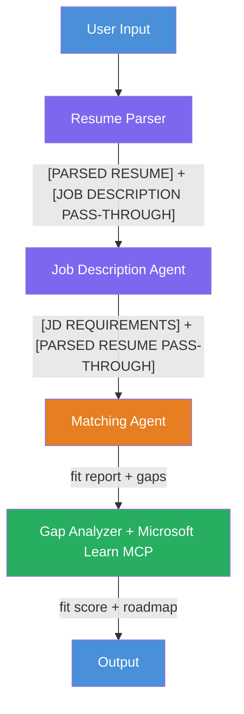

# Лабораторная работа 02 - Многоагентный рабочий процесс: Оценка соответствия резюме вакансии

## Обзор

В этой практической лабораторной работе вы создадите **многоагентное приложение, ориентированное на рабочий процесс**, используя Foundry Toolkit в VS Code и развернете его в Microsoft Foundry Agent Service.

**Что вы создадите:** Оценщик соответствия резюме и вакансии, который анализирует резюме и описание вакансий, оценивает совпадение и создает персональную дорожную карту обучения с использованием ресурсов Microsoft Learn.

---

## Архитектура

**Как это работает:**
1. Пользователь вставляет резюме и описание вакансии.
2. **ResumeParser** парсит резюме и копирует описание вакансии дословно в `[JOB DESCRIPTION PASS-THROUGH]` раздел.
3. **JD Agent** извлекает структурированные требования из переданного текста, затем передает `[PARSED RESUME]` дальше как `[PARSED RESUME PASS-THROUGH]`.
4. **MatchingAgent** сравнивает `[PARSED RESUME PASS-THROUGH]` и `[JD REQUIREMENTS]` и выдает оценку соответствия.
5. **GapAnalyzer** преобразует пробелы в практическую дорожную карту и получает реальные ссылки Microsoft Learn через MCP.

---

## Требования

Сначала выполните лабораторную работу 01:

- [Лабораторная работа 01 - Один агент](../lab01-single-agent/README.md)

---

## Часть 1: Ознакомьтесь с модулями по порядку

Полный учебный путь смотрите в:

- [Документация по лабораторной работе 2 - Требования](docs/00-prerequisites.md)
- [Документация по лабораторной работе 2 - Полный учебный путь](docs/README.md)
- [Руководство по запуску PersonalCareerCopilot](PersonalCareerCopilot/README.md)

---

## Часть 2: Создайте и протестируйте рабочий процесс

1. Используйте мастер Foundry Toolkit для создания проекта с рабочим процессом.
2. Скопируйте блоки запросов и граф рабочего процесса из `PersonalCareerCopilot/main.py` в ваше рабочее пространство.
3. Запустите локально с Agent Inspector и проверьте всех четырех агентов плюс инструмент MCP.
4. Разверните размещенного агента в Foundry после успешного локального тестирования.

---

## Паттерны оркестровки

В лабораторной работе 02 используется **последовательная цепочка**: вывод каждого агента передается следующему, а рабочий процесс возвращает ответ последнего агента. Для этого работают два паттерна:

- **Последовательная цепочка** - `WorkflowBuilder` соединяет ResumeParser → JD Agent → MatchingAgent → GapAnalyzer с одним вызовом `add_edge()` на каждом шаге
- **Передача содержимого** - так как каждый агент видит только вывод своего непосредственного предшественника, ResumeParser и JD Agent копируют данные, необходимые нижестоящим агентам, в помеченные проходные разделы

В документации также объясняется, почему лабораторная работа не использует распараллеливание (fan-out/fan-in), и как расширить граф еще одним агентом.

Смотрите [docs/04-orchestration-patterns.md](docs/04-orchestration-patterns.md).

---

**Предыдущая:** [Лабораторная работа 01 - Один агент](../lab01-single-agent/README.md) · **Назад к:** [Главная страница мастерской](../../README.md)

---

<!-- CO-OP TRANSLATOR DISCLAIMER START -->
**Отказ от ответственности**:
Этот документ был переведен с использованием сервиса машинного перевода [Co-op Translator](https://github.com/Azure/co-op-translator). Несмотря на наши усилия по обеспечению точности, имейте в виду, что автоматический перевод может содержать ошибки или неточности. Оригинальный документ на его исходном языке следует считать авторитетным источником. Для получения критически важной информации рекомендуется обратиться к профессиональному человеческому переводу. Мы не несем ответственности за любые недоразумения или неправильные толкования, возникшие в результате использования этого перевода.
<!-- CO-OP TRANSLATOR DISCLAIMER END -->