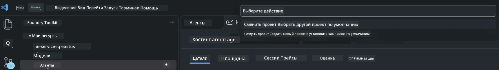

# Модуль 0 - Введение

⏱️ ~10 мин

> [!WARNING]
> **Предварительный просмотр и ограничения:** [Хостинговые агенты](https://learn.microsoft.com/azure/foundry/agents/concepts/hosted-agents) в настоящее время находятся в **открытом предварительном просмотре** — не рекомендуется для рабочих нагрузок в производстве. Некоторые функции, показанные в этом мастер-классе, могут измениться по мере приближения сервиса к общедоступной версии.

## Что вы построите

В этой лабораторной работе вы расширите навыки одного агента из Лабораторной работы 01, чтобы создать **многоагентный рабочий процесс** — Резюме → Оценщик соответствия вакансии.

Вы вставляете **резюме** и **описание вакансии**. Четыре специализированных агента последовательно обрабатывают ввод, затем возвращают:
- Оценку соответствия (0–100 с разбиением по баллам)
- Список недостающих навыков и сертификатов
- Персонализированную дорожную карту обучения с реальными ссылками Microsoft Learn для каждого недостатка

**В рабочем процессе используются:**
- **Microsoft Agent Framework** — `WorkflowBuilder` для последовательной организации пайплайна
- **Foundry Toolkit для VS Code** — создание каркаса, локальное тестирование, развертывание
- **Модель искусственного интеллекта** (например, `gpt-4.1-mini`) — используется всеми четырьмя агентами
- **Сервер Microsoft Learn MCP** — предоставляет реальные ссылки на обучающие материалы для каждой недостающей компетенции

---

## Выберите ваш путь

> ⚠️ **Продолжайте по тому же пути, что использовали в Лабораторной работе 01.**

<details open>
<summary><strong>🅰️ Путь A - Облако Azure (требуется подписка Azure)</strong></summary>

| | Подробности |
|---|---|
| **Для кого это?** | Вы завершили Лабораторную работу 01, используя подписку Azure |
| **Модель** | Azure OpenAI через Foundry (например, `gpt-4.1-mini`) |
| **Покрываемые модули** | Все модули (00–09) |
| **Развертывание в облаке?** | ✅ Да — полное сквозное развертывание |

</details>

<details open>
<summary><strong>🅱️ Путь B - Foundry Local (подписка Azure не нужна)</strong></summary>

| | Подробности |
|---|---|
| **Для кого это?** | Вы завершили Лабораторную работу 01, используя Foundry Local |
| **Модель** | Foundry Local (бесплатно, запускается на вашем компьютере) |
| **Покрываемые модули** | Модули 00–05 (пропускаем 06–07 — развертывание и проверка в облаке) |
| **Развертывание в облаке?** | ❌ Нет — только локальное тестирование через Agent Inspector |

</details>

---

## Проверка Лабораторной работы 01

Лабораторная работа 02 основывается напрямую на Лабораторной работе 01. Сначала завершите Лабораторную работу 01.

Не сделали Лабораторную работу 01? Начните здесь: [Лабораторная работа 01 - Введение](../../lab01-single-agent/docs/00-prerequisites.md)

<details open>
<summary><strong>🅰️ Путь A - Облако Azure</strong></summary>

```powershell
az account show --query "{name:name, id:id}" --output table
```

Если это не удалось, выполните `az login`. Затем проверьте в VS Code:

1. `Ctrl+Shift+P` → введите **Foundry Toolkit** → убедитесь, что команды отображаются.
2. Нажмите на значок **Foundry Toolkit** → ваш проект и развернутая модель должны показывать **Успех**.



> **RBAC:** Вы назначили роль **Foundry User** в Лабораторной работе 01. Если нужно переназначить, смотрите [Лабораторная работа 01, Модуль 1](../../lab01-single-agent/docs/01-setup.md#deploy-a-model--assign-rbac). Роль раньше называлась **Azure AI User** — те же права.

</details>

<details open>
<summary><strong>🅱️ Путь B - Foundry Local</strong></summary>

```powershell
Invoke-WebRequest -Uri "http://localhost:5273/v1/health" -UseBasicParsing | Select-Object StatusCode
```

Ожидается: `StatusCode: 200`. Если нет, перезапустите Foundry Local через боковую панель Foundry Toolkit.

> Все выводы происходят на вашем компьютере. Единственный исходящий вызов — инструмент MCP к `https://learn.microsoft.com/api/mcp`.

</details>

---

## Что нового в Лабораторной работе 02

| | Лабораторная работа 01 | Лабораторная работа 02 |
|--|--------|--------|
| Агенты | 1 | 4 (сцепленных с WorkflowBuilder) |
| Шаблон каркаса | Базовый — Agent Framework | Рабочие процессы — Agent Framework |
| Новый пакет | - | `mcp` |
| Оркестрация | Один разговорный агент | Последовательный пайплайн (WorkflowBuilder) |
| Новый инструмент | - | `search_microsoft_learn_for_plan` (MCP) |

---

**Далее:** [01 - Понимание архитектуры →](01-understand-multi-agent.md)

---

<!-- CO-OP TRANSLATOR DISCLAIMER START -->
**Отказ от ответственности**:
Этот документ был переведен с использованием сервиса машинного перевода [Co-op Translator](https://github.com/Azure/co-op-translator). Несмотря на наши усилия по обеспечению точности, имейте в виду, что автоматический перевод может содержать ошибки или неточности. Оригинальный документ на его исходном языке следует считать авторитетным источником. Для получения критически важной информации рекомендуется обратиться к профессиональному человеческому переводу. Мы не несем ответственности за любые недоразумения или неправильные толкования, возникшие в результате использования этого перевода.
<!-- CO-OP TRANSLATOR DISCLAIMER END -->