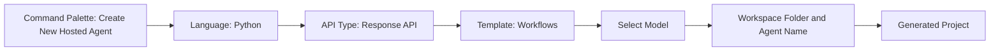
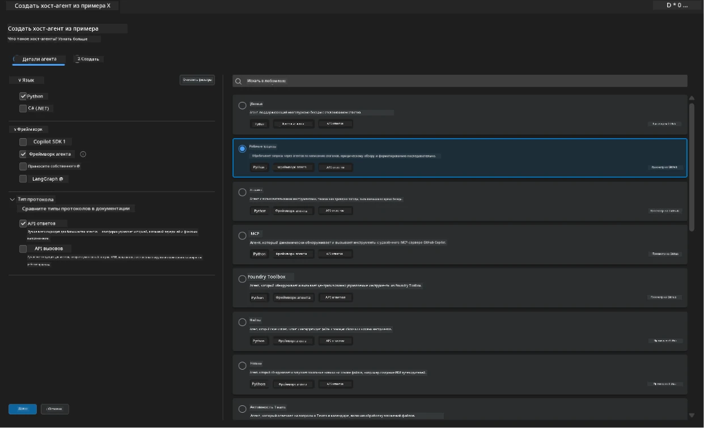
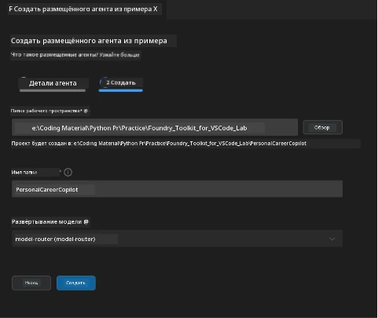

# Модуль 2 - Создание каркаса для проекта с несколькими агентами

⏱️ ~5 минут

В этом модуле вы используете [Foundry Toolkit для VS Code](https://aka.ms/foundrytk), чтобы **создать каркас проекта с несколькими агентами**. Мастер генерирует `agent.yaml`, `main.py`, `Dockerfile`, `requirements.txt`, `.env` и конфигурацию отладки VS Code — чтобы вы могли сосредоточиться на настройке рабочего процесса из 4 агентов в Модуле 3.

> **Ключевая идея:** Каркас — это рабочий шаблон с одним агентом. Вы заменяете логический заполнитель графом `WorkflowBuilder` в Модуле 3. Вам не нужно писать шаблонный код с нуля.

> **Референсная реализация:** [`PersonalCareerCopilot/`](../../../../../workshop/lab02-multi-agent/PersonalCareerCopilot) — полный рабочий пример. Используйте его для сравнения с вашей работой по мере продвижения.

### Поток мастера создания каркаса



---

## Шаг 1: Откройте мастер Create Hosted Agent

1. Нажмите `Ctrl+Shift+P` для открытия **Command Palette**.
2. Введите: **Foundry Toolkit: Create new Hosted Agent** и выберите эту команду.
3. Мастер откроется на вкладке **Agent Details**.

> **Альтернатива:** Нажмите на иконку **Foundry Toolkit** на панели Activity Bar → кликните на значок **+** рядом с **Hosted Agents** → выберите **Create New Hosted Agent**.

---

## Шаг 2: Выберите настройки



1. В секции слева выберите следующие параметры:

| Меню | Выбор | Примечания |
|--------|-----------|-------|
| **Язык** | Python | Также поддерживается C# (.NET) |
| **Фреймворк** | Agent Framework | Предоставляет `Agent`, `AgentExecutor`, `WorkflowBuilder` |
| **Тип API** | Response API | `POST /responses` - история платформы, поддержка потоковой передачи |
| **Шаблон** | **Workflows** | Обрабатывает запросы с последовательным участием нескольких агентов |

2. После выбора нажмите **Next**



3. В следующем окне выберите следующие параметры:

| Меню | Выбор | Примечания |
|--------|-----------|-------|
| **Папка проекта** | Выберите целевую папку | например, `workshop/lab02-multi-agent/` в этом репозитории |
| **Имя агента** | `PersonalCareerCopilot` | Это станет именем директории проекта |
| **Развернутый модель** | Выберите вашу развернутую модель | например, `gpt-4.1-mini` из Лабораторной работы 01 |

4. Нажмите **Create**, чтобы создать каркас проекта. VS Code сгенерирует файлы и откроет папку.

> **Совет:** [`gpt-4.1-mini`](https://learn.microsoft.com/azure/foundry/foundry-models/concepts/models-sold-directly-by-azure#gpt-41-series) хорошо сбалансирован по скорости и качеству для разработки с несколькими агентами.

---

## Шаг 3: Осмотрите созданный проект

После завершения создания каркаса проверьте, что в Проводнике (`Ctrl+Shift+E`) отображаются следующие файлы:

```
📂 <your-agent-name>/
├── .azdignore          ← Files excluded from Azure Developer CLI deployments
├── .dockerignore       ← Files excluded from Docker builds
├── .env                ← Environment variables (placeholders - fill in Module 3)
├── .vscode/
│   ├── launch.json     ← Debug config (F5 → run + Agent Inspector)
│   └── tasks.json      ← VS Code task definitions
├── agent.yaml          ← Agent definition (kind: hosted, protocol: responses)
├── Dockerfile          ← Container config for deployment
├── main.py             ← Stub agent entry point (replace with WorkflowBuilder in Module 3)
└── requirements.txt    ← Python dependencies
```

> **Важно:** Открывайте эту созданную папку напрямую в VS Code, чтобы `.vscode/launch.json` и `tasks.json` корректно применялись при отладке по F5.

### Объяснение ключевых файлов

| Файл | Назначение |
|------|---------|
| `agent.yaml` | Объявляет `kind: hosted`, сопоставляет переменные окружения, определяет протокол `/responses` |
| `main.py` | Заглушка: один `FoundryChatClient` → `Agent` → `ResponsesHostServer`. Вы замените это 4 агентами + `WorkflowBuilder` в Модуле 3 |
| `Dockerfile` | `python:3.12-slim`, устанавливает `requirements.txt`, открывает порт 8088, запускает `python main.py` |
| `requirements.txt` | `agent-framework-foundry`, `agent-framework-foundry-hosting`, `mcp<2,>=1.24.0`, `debugpy` |

> **Справка:** Смотрите [`PersonalCareerCopilot/agent.yaml`](../../../../../workshop/lab02-multi-agent/PersonalCareerCopilot/agent.yaml) и [`PersonalCareerCopilot/requirements.txt`](../../../../../workshop/lab02-multi-agent/PersonalCareerCopilot/requirements.txt) для полного содержания сгенерированных файлов.

---

### ✅ Контрольный список

- [ ] Мастер создания каркаса завершён — новая папка проекта видна в Проводнике
- [ ] Все ожидаемые файлы на месте: `agent.yaml`, `main.py`, `Dockerfile`, `requirements.txt`, `.env`
- [ ] `agent.yaml` показывает `kind: hosted` и `protocol: responses`
- [ ] `main.py` импортирует `Agent`, `FoundryChatClient`, `ResponsesHostServer`
- [ ] Каркасная папка открыта как корень рабочей области VS Code
- [ ] Вы понимаете, что `main.py` — это заглушка, а `WorkflowBuilder` будет добавлен в Модуле 3

---

**Предыдущий:** [01 - Понимание архитектуры с несколькими агентами](01-understand-multi-agent.md) · **Следующий:** [03 - Конфигурация агентов и окружения →](03-configure-agents.md)

---

<!-- CO-OP TRANSLATOR DISCLAIMER START -->
**Отказ от ответственности**:
Этот документ был переведен с использованием сервиса машинного перевода [Co-op Translator](https://github.com/Azure/co-op-translator). Несмотря на наши усилия по обеспечению точности, имейте в виду, что автоматический перевод может содержать ошибки или неточности. Оригинальный документ на его исходном языке следует считать авторитетным источником. Для получения критически важной информации рекомендуется обратиться к профессиональному человеческому переводу. Мы не несем ответственности за любые недоразумения или неправильные толкования, возникшие в результате использования этого перевода.
<!-- CO-OP TRANSLATOR DISCLAIMER END -->