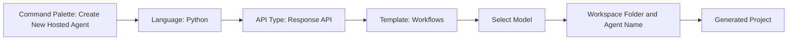

# Module 2 - Создание каркаса мультиагентного проекта

⏱️ ~5 мин

В этом модуле вы используете [Foundry Toolkit for VS Code](https://aka.ms/foundrytk) для **создания каркаса мультиагентного проекта**. Мастер генерирует `agent.yaml`, `main.py`, `Dockerfile`, `requirements.txt`, `.env`, и конфигурацию отладки VS Code — чтобы вы могли сосредоточиться на подключении рабочего процесса из 4 агентов в Модуле 3.

> **Ключевая концепция:** Каркас — это рабочая заглушка с одним агентом. Вы замените заглушечную логику графом `WorkflowBuilder` в Модуле 3. Вам не нужно писать шаблонный код с нуля.

> **Реализация примера:** [`PersonalCareerCopilot/`](../../../../../workshop/lab02-multi-agent/PersonalCareerCopilot) — это полный рабочий пример. Используйте его, чтобы сравнивать свою работу по ходу.

### Порядок работы мастера создания каркаса



---

## Шаг 1: Откройте мастер Create Hosted Agent

1. Нажмите `Ctrl+Shift+P`, чтобы открыть **Command Palette**.
2. Введите: **Foundry Toolkit: Create a New Hosted Agent** и выберите его.
3. Мастер откроется на вкладке **Agent Details**.

> **Альтернатива:** Нажмите на значок **Foundry Toolkit** в Activity Bar → нажмите значок **+** рядом с **Hosted Agents** → **Create New Hosted Agent**.

---

## Шаг 2: Выберите настройки


1. В левой части навигации/параметров выберите следующее:

| Меню | Выбор | Примечания |
|--------|-----------|-------|
| **Язык** | Python | Также поддерживается C# (.NET) |
| **Фреймворк** | Agent Framework | Предоставляет `Agent`, `AgentExecutor`, `WorkflowBuilder` |
| **Тип API** | Response API | `POST /responses` - история управляется платформой, поддержка стриминга |
| **Шаблон** | **Workflows** | Обрабатывает запросы через нескольких агентов последовательно |

2. После выбора нажмите **Next**


3. В следующем окне выберите следующее:

| Меню | Выбор | Примечания |
|--------|-----------|-------|
| **Папка рабочей области** | Browse to target folder | например, `workshop/lab02-multi-agent/` в этом репозитории |
| **Имя агента** | `PersonalCareerCopilot` | Это становится именем директории проекта |
| **Развертывание модели** | Выберите развернутую модель | например, `gpt-4.1-mini` из Lab 01 |

4. Нажмите **Create**, чтобы создать каркас проекта. VS Code сгенерирует файлы и откроет папку.

> **Совет:** [`gpt-4.1-mini`](https://learn.microsoft.com/azure/foundry/foundry-models/concepts/models-sold-directly-by-azure#gpt-41-series) хорошо балансирует скорость и качество для разработки с несколькими агентами.

---

## Шаг 3: Просмотрите сгенерированный проект

После завершения создания каркаса убедитесь, что вы видите эти файлы в Проводнике (`Ctrl+Shift+E`):

```
📂 <your-agent-name>/
├── .azdignore          ← Files excluded from Azure Developer CLI deployments
├── .dockerignore       ← Files excluded from Docker builds
├── .env                ← Environment variables (placeholders - fill in Module 3)
├── .vscode/
│   ├── launch.json     ← Debug config (F5 → run + Agent Inspector)
│   └── tasks.json      ← VS Code task definitions
├── agent.yaml          ← Agent definition (kind: hosted, protocol: responses)
├── Dockerfile          ← Container config for deployment
├── main.py             ← Stub agent entry point (replace with WorkflowBuilder in Module 3)
└── requirements.txt    ← Python dependencies
```

> **Важно:** Откройте эту сгенерированную папку непосредственно в VS Code, чтобы `.vscode/launch.json` и `tasks.json` корректно применялись для отладки F5.

### Объяснение ключевых файлов

| Файл | Назначение |
|------|---------|
| `agent.yaml` | Объявляет `kind: hosted`, сопоставляет переменные окружения, определяет протокол `/responses` |
| `main.py` | Заглушка: один `FoundryChatClient` → `Agent` → `ResponsesHostServer`. Вы замените это на 4 агентов + `WorkflowBuilder` в Модуле 3 |
| `Dockerfile` | `python:3.12-slim`, устанавливает `requirements.txt`, открывает порт 8088, запускает `python main.py` |
| `requirements.txt` | `agent-framework-foundry`, `agent-framework-foundry-hosting`, `mcp<2,>=1.24.0`, `debugpy` |

> **Справка:** Смотрите [`PersonalCareerCopilot/agent.yaml`](../../../../../workshop/lab02-multi-agent/PersonalCareerCopilot/agent.yaml) и [`PersonalCareerCopilot/requirements.txt`](../../../../../workshop/lab02-multi-agent/PersonalCareerCopilot/requirements.txt) для полного сгенерированного содержимого.

---

### ✅ Контрольная точка

- [ ] Мастер создания каркаса завершён - новая папка проекта видна в Проводнике
- [ ] Все ожидаемые файлы присутствуют: `agent.yaml`, `main.py`, `Dockerfile`, `requirements.txt`, `.env`
- [ ] `agent.yaml` показывает `kind: hosted` и `protocol: responses`
- [ ] `main.py` импортирует `Agent`, `FoundryChatClient`, `ResponsesHostServer`
- [ ] Сгенерированная папка открыта как корень рабочей области VS Code
- [ ] Вы понимаете, что `main.py` — это заглушка - `WorkflowBuilder` будет добавлен в Модуле 3

---

**Предыдущее:** [01 - Понимание архитектуры мультиагентной системы](01-understand-multi-agent.md) · **Далее:** [03 - Настройка агентов и окружения →](03-configure-agents.md)

---

<!-- CO-OP TRANSLATOR DISCLAIMER START -->
**Отказ от ответственности**:
Этот документ был переведен с использованием сервиса машинного перевода [Co-op Translator](https://github.com/Azure/co-op-translator). Несмотря на наши усилия по обеспечению точности, имейте в виду, что автоматический перевод может содержать ошибки или неточности. Оригинальный документ на его исходном языке следует считать авторитетным источником. Для получения критически важной информации рекомендуется обратиться к профессиональному человеческому переводу. Мы не несем ответственности за любые недоразумения или неправильные толкования, возникшие в результате использования этого перевода.
<!-- CO-OP TRANSLATOR DISCLAIMER END -->