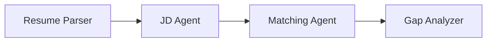
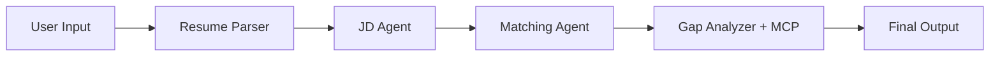

# Модуль 4 - Шаблоны оркестрации

⏱️ ~10 минут

В этом модуле вы изучите шаблоны оркестрации, используемые в Оценщике Соответствия Резюме и узнаете, как читать, изменять и расширять граф рабочего процесса. Понимание этих шаблонов важно для отладки проблем с потоками данных и создания собственных [многоагентных рабочих процессов](https://learn.microsoft.com/agent-framework/workflows/).

---

## Шаблон 1: Последовательная цепочка

Основной шаблон в рабочем процессе — это **последовательная цепочка** — вывод каждого агента напрямую передаётся следующему.



В коде каждый вызов `add_edge()` создаёт один шаг цепочки:

```python
.add_edge(resume_executor, jd_executor)       # ResumeParser output → JD Agent
.add_edge(jd_executor, matching_executor)     # JD Agent output → MatchingAgent
.add_edge(matching_executor, gap_executor)    # MatchingAgent output → GapAnalyzer
```

> **Почему последовательный, а не с ответвлениями/слияниями?** `WorkflowBuilder` использует **ИЛИ-семантику** для входящих рёбер: исполнитель downstream запускается, как только завершится **любой** из предшественников. Если бы `matching_executor` имел два входящих ребра (от `resume_executor` и `jd_executor`), он запустился бы дважды — при завершении ResumeParser и при завершении JD Agent — что вызвало бы двойной запуск GapAnalyzer и появление результата дважды. Последовательный конвейер этого полностью избегает.

## Шаблон 2: Передача содержимого

Поскольку `context_mode="last_agent"` означает, что каждый исполнитель видит только вывод своего **непосредственного предшественника**, агенты в последовательной цепочке должны явно передавать дальше любые данные, необходимые агентам downstream.

В этом рабочем процессе:
- **ResumeParser** копирует JD дословно в `[JOB DESCRIPTION PASS-THROUGH]` (чтобы JD Agent мог его найти).
- **JD Agent** копирует `[PARSED RESUME]` дословно в `[PARSED RESUME PASS-THROUGH]` (чтобы MatchingAgent мог сравнить оба профиля).

```
ResumeParser output
└─ [PARSED RESUME]               ← extracted by JD Agent
└─ [JOB DESCRIPTION PASS-THROUGH] ← extracted by JD Agent

JD Agent output
└─ [JD REQUIREMENTS]             ← extracted by MatchingAgent
└─ [PARSED RESUME PASS-THROUGH]  ← extracted by MatchingAgent
```

Каждый участок передачи должен копироваться **дословно** — суммирование или переформулирование нарушает работу downstream агента, который на этом зависит.

---

## Полный граф

Объединение шаблонов последовательной цепочки и передачи содержимого даёт полный рабочий процесс:



Инспектор Агента показывает ту же структуру графа, когда агент работает локально. Смотрите [Модуль 5 - Тестирование локально](05-test-locally.md) для скриншотов.

---

## Чтение кода WorkflowBuilder

Граф рабочего процесса строится в функции `main()` в [`PersonalCareerCopilot/main.py`](../../../../../workshop/lab02-multi-agent/PersonalCareerCopilot/main.py). Три вызова `add_edge()` строят последовательный конвейер:

| # | Ребро | Эффект |
|---|-------|--------|
| 1 | `resume_executor → jd_executor` | Агент JD получает `[PARSED RESUME]` + `[JOB DESCRIPTION PASS-THROUGH]` |
| 2 | `jd_executor → matching_executor` | MatchingAgent получает `[JD REQUIREMENTS]` + `[PARSED RESUME PASS-THROUGH]` |
| 3 | `matching_executor → gap_executor` | GapAnalyzer получает отчет о соответствии + список пробелов |

---

## Изменение графа

### Добавление нового агента

Чтобы добавить пятого агента (например, **InterviewPrepAgent** после GapAnalyzer):

1. Определите константу `INTERVIEW_PREP_INSTRUCTIONS`.
2. Создайте объекты `Agent` + `AgentExecutor` (по тому же шаблону, что и существующие четыре).
3. Добавьте `.add_edge(gap_executor, interview_exec)` в `WorkflowBuilder`.
4. Обновите `output_executors=[interview_exec]`.

> **Важно:** `start_executor` — единственный агент, который получает необработанный ввод пользователя. Все остальные агенты принимают вывод с их upstream рёбер.

---

## Частые ошибки графа

| Ошибка | Симптом | Решение |
|---------|---------|---------|
| Отсутствует ребро к `output_executors` | Агент запускается, но вывод пуст | Убедитесь, что существует путь от `start_executor` к каждому агенту в `output_executors` |
| Циклическая зависимость | Бесконечный цикл или таймаут | Проверьте, что ни один агент не передает обратно данные upstream агенту |
| Агент в `output_executors` без входящего ребра | Пустой вывод | Добавьте хотя бы одно `add_edge(source, that_agent)` |
| Несколько `output_executors` без слияния | Вывод содержит ответ только одного агента | Используйте один выходной агент, который агрегирует, или примите несколько выводов |
| Отсутствует `start_executor` | `ValueError` при сборке | Всегда указывайте `start_executor` в `WorkflowBuilder()` |

---

## Отладка графа

### Использование Agent Inspector

1. Запустите агента локально с помощью F5.
2. Откройте Agent Inspector (`Ctrl+Shift+P` → **Foundry Toolkit: Open Agent Inspector**).
3. Отправьте тестовое сообщение.
4. В панели ответов инспектора найдите **потоковый вывод** — он показывает вклад каждого агента по очереди.


### Использование логирования

Добавьте логирование в `main.py`, чтобы отслеживать поток данных:

```python
import logging
logger = logging.getLogger("resume-job-fit")

# In main(), after building the workflow:
logger.info("Workflow graph built with edges: RP→JD, JD→MA, MA→GA")
```

Логи сервера показывают порядок выполнения агентов и вызовы MCP-инструментов:

```
INFO:agent_framework:Executing agent: ResumeParser
INFO:agent_framework:Executing agent: JobDescriptionAgent
INFO:agent_framework:Executing agent: MatchingAgent
INFO:agent_framework:Executing agent: GapAnalyzer
INFO:agent_framework:Tool call: search_microsoft_learn_for_plan(skill="Kubernetes")
POST https://learn.microsoft.com/api/mcp → 200
INFO:agent_framework:Tool call: search_microsoft_learn_for_plan(skill="Terraform")
POST https://learn.microsoft.com/api/mcp → 200
```

---

### Контрольная точка

- [ ] Вы можете определить два шаблона оркестрации в рабочем процессе: последовательную цепочку и передачу содержимого
- [ ] Вы понимаете, почему `context_mode="last_agent"` требует явной передачи данных между агентами
- [ ] Вы можете читать код `WorkflowBuilder` и сопоставлять каждый вызов `add_edge()` с визуальным графом
- [ ] Вы знаете, как добавить нового агента в конец конвейера
- [ ] Вы можете выявить распространённые ошибки графа и их симптомы

---

**Предыдущий:** [03 - Настройка агентов и окружения](03-configure-agents.md) · **Следующий:** [05 - Тестирование локально →](05-test-locally.md)

---

<!-- CO-OP TRANSLATOR DISCLAIMER START -->
**Отказ от ответственности**:
Этот документ был переведен с использованием сервиса машинного перевода [Co-op Translator](https://github.com/Azure/co-op-translator). Несмотря на наши усилия по обеспечению точности, имейте в виду, что автоматический перевод может содержать ошибки или неточности. Оригинальный документ на его исходном языке следует считать авторитетным источником. Для получения критически важной информации рекомендуется обратиться к профессиональному человеческому переводу. Мы не несем ответственности за любые недоразумения или неправильные толкования, возникшие в результате использования этого перевода.
<!-- CO-OP TRANSLATOR DISCLAIMER END -->