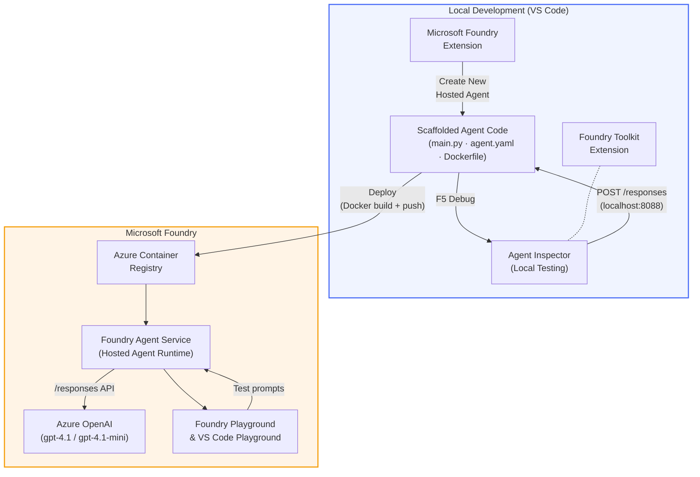

# Delavnica Foundry Toolkit + Foundry Hosted Agents

[](https://www.python.org/)
[](https://learn.microsoft.com/agent-framework/)
[](https://learn.microsoft.com/azure/foundry/agents/concepts/hosted-agents)
[](https://ai.azure.com/)
[](https://learn.microsoft.com/azure/ai-services/openai/)
[](https://learn.microsoft.com/cli/azure/install-azure-cli)
[](https://learn.microsoft.com/azure/developer/azure-developer-cli/install-azd)
[](https://www.docker.com/)
[](https://marketplace.visualstudio.com/items?itemName=ms-windows-ai-studio.windows-ai-studio)
[](LICENSE)

Zgradite, preizkusite in razporedite AI agente v **Microsoft Foundry Agent Service** kot **Hosted Agents** - popolnoma iz VS Code z uporabo **Microsoft Foundry razširitve** in **Foundry Toolkit**.

> **Hosted Agents so trenutno v predogledu.** Podprte regije so omejene - glejte [dostopnost regij](https://learn.microsoft.com/azure/foundry/agents/concepts/hosted-agents#region-availability).

> Mapa `agent/` znotraj vsake delavnice je **samodejno ustvarjena** s strani Foundry razširitve - nato prilagodite kodo, lokalno preizkusite in razporedite.

### 🌐 Podpora za več jezikov

#### Podprto preko GitHub Action (avtomatizirano & vedno posodobljeno)

<!-- CO-OP TRANSLATOR LANGUAGES TABLE START -->
[Arabic](../ar/README.md) | [Bengali](../bn/README.md) | [Bulgarian](../bg/README.md) | [Burmese (Myanmar)](../my/README.md) | [Chinese (Simplified)](../zh-CN/README.md) | [Chinese (Traditional, Hong Kong)](../zh-HK/README.md) | [Chinese (Traditional, Macau)](../zh-MO/README.md) | [Chinese (Traditional, Taiwan)](../zh-TW/README.md) | [Croatian](../hr/README.md) | [Czech](../cs/README.md) | [Danish](../da/README.md) | [Dutch](../nl/README.md) | [Estonian](../et/README.md) | [Finnish](../fi/README.md) | [French](../fr/README.md) | [German](../de/README.md) | [Greek](../el/README.md) | [Hebrew](../he/README.md) | [Hindi](../hi/README.md) | [Hungarian](../hu/README.md) | [Indonesian](../id/README.md) | [Italian](../it/README.md) | [Japanese](../ja/README.md) | [Kannada](../kn/README.md) | [Khmer](../km/README.md) | [Korean](../ko/README.md) | [Lithuanian](../lt/README.md) | [Malay](../ms/README.md) | [Malayalam](../ml/README.md) | [Marathi](../mr/README.md) | [Nepali](../ne/README.md) | [Nigerian Pidgin](../pcm/README.md) | [Norwegian](../no/README.md) | [Persian (Farsi)](../fa/README.md) | [Polish](../pl/README.md) | [Portuguese (Brazil)](../pt-BR/README.md) | [Portuguese (Portugal)](../pt-PT/README.md) | [Punjabi (Gurmukhi)](../pa/README.md) | [Romanian](../ro/README.md) | [Russian](../ru/README.md) | [Serbian (Cyrillic)](../sr/README.md) | [Slovak](../sk/README.md) | [Slovenian](./README.md) | [Spanish](../es/README.md) | [Swahili](../sw/README.md) | [Swedish](../sv/README.md) | [Tagalog (Filipino)](../tl/README.md) | [Tamil](../ta/README.md) | [Telugu](../te/README.md) | [Thai](../th/README.md) | [Turkish](../tr/README.md) | [Ukrainian](../uk/README.md) | [Urdu](../ur/README.md) | [Vietnamese](../vi/README.md)

> **Raje klonirate lokalno?**
>
> Ta repozitorij vključuje več kot 50 jezikovnih prevodov, kar znatno povečuje velikost prenosa. Če želite klonirati brez prevodov, uporabite sparse checkout:
>
> **Bash / macOS / Linux:**
> ```bash
> git clone --filter=blob:none --sparse https://github.com/microsoft-foundry/Foundry_Toolkit_for_VSCode_Lab.git
> cd Foundry_Toolkit_for_VSCode_Lab
> git sparse-checkout set --no-cone '/*' '!translations' '!translated_images'
> ```
>
> **CMD (Windows):**
> ```cmd
> git clone --filter=blob:none --sparse https://github.com/microsoft-foundry/Foundry_Toolkit_for_VSCode_Lab.git
> cd Foundry_Toolkit_for_VSCode_Lab
> git sparse-checkout set --no-cone "/*" "!translations" "!translated_images"
> ```
>
> Tako dobite vse, kar potrebujete za dokončanje tečaja, z veliko hitrejšim prenosom.
<!-- CO-OP TRANSLATOR LANGUAGES TABLE END -->

---

## Arhitektura



**Potek:** Razširitev Foundry ustvari osnovo za agenta → prilagodite kodo in navodila → preizkusite lokalno z Agent Inspector → razporedite v Foundry (Docker slika potisnjena v ACR) → preverjanje v Playground.

---

## Kaj boste zgradili

| Laboratorij | Opis | Status |
|-----|-------------|--------|
| **Lab 01 - Enotni agent** | Zgradite **"Razloži kot da sem izvršni direktor" agent**, ga preizkusite lokalno in razporedite v Foundry | ✅ Na voljo |
| **Lab 02 - Multi-agentni potek dela** | Zgradite **"Ocena ustreznosti življenjepisa za delo"** - 4 agenti sodelujejo pri ocenjevanju življenjepisa in generiranju učne poti | ✅ Na voljo |

---

## Spoznajte izvršnega agenta

V tej delavnici boste ustvarili **"Razloži kot da sem izvršni direktor" agenta** - AI agenta, ki sprejme zapleten tehnični žargon in ga prevede v mirne, za sestanke primerne povzetke. Saj bodimo iskreni, nihče v vodstvu noče slišati o "izčrpanju niza niti zaradi sinhronih klicev uvedenih v v3.2."

Ta agent sem ustvaril po preveč primerih, ko je moj popolnoma pripravljen povzetek z analizo dobil odgovor: *"Torej... ali je spletna stran dol ali ne?"*

### Kako deluje

Podate mu tehnično posodobitev. Odgovori z izvršnim povzetkom - trije poudarki, brez žargona, brez sledi v kupu, brez eksistencialne skrbi. Samo **kaj se je zgodilo**, **poslovni vpliv** in **naslednji korak**.

### Poglejte ga v akciji

**Vi rečete:**
> "Zakasnitev API je narasla zaradi izčrpanosti niza niti, povzročene s sinhronimi klici uvedenimi v v3.2."

**Agent odgovori:**

> **Izvršni povzetek:**
> - **Kaj se je zgodilo:** Po zadnji izdaji se je sistem upočasnil.
> - **Poslovni vpliv:** Nekateri uporabniki so med uporabo storitve doživeli zamude.
> - **Naslednji korak:** Sprememba je bila preklicana in pripravljajo popravek pred ponovnim razporejanjem.

### Zakaj ta agent?

Je izredno enostaven, enonamenski agent - popoln za učenje poteka dela hosted agenta od začetka do konca brez zapletov v kompleksnih orodnih verigah. In iskreno? Vsaka inženirska ekipa bi lahko potrebovala takega.

---

## Struktura delavnice

```
📂 Foundry_Toolkit_for_VSCode_Lab/
├── 📄 README.md                      ← You are here
└── 📂 workshop/
    ├── 📂 lab01-single-agent/        ← Full lab: docs + agent code
    │   ├── README.md                 ← Hands-on lab instructions
    │   ├── 📂 docs/                  ← Step-by-step tutorial modules
    │   │   ├── 00-prerequisites.md
    │   │   ├── 01-setup.md
    │   │   ├── 02-create-hosted-agent.md
    │   │   ├── 03-configure-and-code.md
    │   │   ├── 04-test-locally.md
    │   │   ├── 05-deploy-to-foundry.md
    │   │   ├── 06-verify-in-playground.md
    │   │   ├── 07-summary.md
    │   │   └── 08-troubleshooting.md
    │   └── 📂 agent/                 ← Reference solution (auto-scaffolded by Foundry extension)
    │       ├── agent.yaml
    │       ├── Dockerfile
    │       ├── main.py
    │       └── requirements.txt
    └── 📂 lab02-multi-agent/         ← Resume → Job Fit Evaluator
        ├── README.md                 ← Hands-on lab instructions (end-to-end)
        ├── 📂 docs/                  ← Step-by-step tutorial modules
        │   ├── 00-prerequisites.md
        │   ├── 01-understand-multi-agent.md
        │   ├── 02-scaffold-multi-agent.md
        │   ├── 03-configure-agents.md
        │   ├── 04-orchestration-patterns.md
        │   ├── 05-test-locally.md
        │   ├── 06-deploy-to-foundry.md
        │   ├── 07-verify-in-playground.md
        │   ├── 08-troubleshooting.md
        │   └── 09-summary.md
        └── 📂 PersonalCareerCopilot/ ← Reference solution (multi-agent workflow)
            ├── agent.yaml
            ├── Dockerfile
            ├── main.py
            └── requirements.txt
```

> **Opomba:** Mapa `agent/` znotraj vsake delavnice je to, kar **Microsoft Foundry razširitev** ustvari, ko zaženete `Microsoft Foundry: Create a New Hosted Agent` iz ukazne palete. Datoteke se nato prilagodijo z vašimi agentovimi navodili, orodji in konfiguracijo. Lab 01 vam korak za korakom pokaže, kako to ustvariti iz nič.

---

## Začni

### 1. Klonirajte repozitorij

```bash
git clone https://github.com/microsoft-foundry/Foundry_Toolkit_for_VSCode_Lab.git
cd Foundry_Toolkit_for_VSCode_Lab
```

### 2. Nastavite Python virtualno okolje

```bash
python -m venv venv
```

Aktivirajte ga:

- **Windows (PowerShell):**
  ```powershell
  .\venv\Scripts\Activate.ps1
  ```
- **macOS / Linux:**
  ```bash
  source venv/bin/activate
  ```

### 3. Namestite odvisnosti

```bash
pip install -r workshop/lab01-single-agent/agent/requirements.txt
```

### 4. Konfigurirajte spremenljivke okolja

Kopirajte primer datoteke `.env` znotraj mape agenta in vnesite svoje vrednosti:

```bash
cp workshop/lab01-single-agent/agent/.env.example workshop/lab01-single-agent/agent/.env
```

Uredite `workshop/lab01-single-agent/agent/.env`:

```env
FOUNDRY_PROJECT_ENDPOINT=https://<your-account>.services.ai.azure.com/api/projects/<your-project>
AZURE_AI_MODEL_DEPLOYMENT_NAME=<your-model-deployment-name>
```

### 5. Sledite laboratorijem delavnice

Vsak laboratorij je samostojen z lastnimi moduli. Začnite z **Lab 01**, da se naučite osnov, nato nadaljujte z **Lab 02** za večagentne poteke dela.

#### Lab 01 - Enotni agent ([polna navodila](workshop/lab01-single-agent/README.md))

| # | Modul | Povezava |
|---|--------|------|
| 1 | Preberite predpogoje | [00-prerequisites.md](workshop/lab01-single-agent/docs/00-prerequisites.md) |
| 2 | Namestite Foundry Toolkit & Foundry razširitev | [01-setup.md](workshop/lab01-single-agent/docs/01-setup.md) |
| 3 | Ustvarite Foundry projekt | [01-setup.md](workshop/lab01-single-agent/docs/01-setup.md) |
| 4 | Ustvarite hosted agenta | [02-create-hosted-agent.md](workshop/lab01-single-agent/docs/02-create-hosted-agent.md) |
| 5 | Konfigurirajte navodila in okolje | [03-configure-and-code.md](workshop/lab01-single-agent/docs/03-configure-and-code.md) |
| 6 | Preizkusite lokalno | [04-test-locally.md](workshop/lab01-single-agent/docs/04-test-locally.md) |
| 7 | Razporedite v Foundry | [05-deploy-to-foundry.md](workshop/lab01-single-agent/docs/05-deploy-to-foundry.md) |
| 8 | Preverite v playgroundu | [06-verify-in-playground.md](workshop/lab01-single-agent/docs/06-verify-in-playground.md) |
| 9 | Povzetek & naslednji koraki | [07-summary.md](workshop/lab01-single-agent/docs/07-summary.md) |
| 10 | Odpravljanje težav | [08-troubleshooting.md](workshop/lab01-single-agent/docs/08-troubleshooting.md) |

#### Lab 02 - Multi-agentni potek dela ([polna navodila](workshop/lab02-multi-agent/README.md))

| # | Modul | Povezava |
|---|--------|------|
| 1 | Predpogoji (Lab 02) | [00-prerequisites.md](workshop/lab02-multi-agent/docs/00-prerequisites.md) |
| 2 | Razumite večagentno arhitekturo | [01-understand-multi-agent.md](workshop/lab02-multi-agent/docs/01-understand-multi-agent.md) |
| 3 | Postavite osnovo za multi-agentni projekt | [02-scaffold-multi-agent.md](workshop/lab02-multi-agent/docs/02-scaffold-multi-agent.md) |
| 4 | Konfigurirajte agente & okolje | [03-configure-agents.md](workshop/lab02-multi-agent/docs/03-configure-agents.md) |
| 5 | Orkestracijski vzorci | [04-orchestration-patterns.md](workshop/lab02-multi-agent/docs/04-orchestration-patterns.md) |
| 6 | Preizkusite lokalno (multi-agentno) | [05-test-locally.md](workshop/lab02-multi-agent/docs/05-test-locally.md) |
| 7 | Razporedite v Foundry | [06-deploy-to-foundry.md](workshop/lab02-multi-agent/docs/06-deploy-to-foundry.md) |
| 8 | Preverite v playgroundu | [07-verify-in-playground.md](workshop/lab02-multi-agent/docs/07-verify-in-playground.md) |
| 9 | Odpravljanje težav (multi-agentno) | [08-troubleshooting.md](workshop/lab02-multi-agent/docs/08-troubleshooting.md) |
| 10 | Povzetek & naslednji koraki | [09-summary.md](workshop/lab02-multi-agent/docs/09-summary.md) |

---

## Vzdrževalec

<table>
<tr>
    <td align="center"><a href="https://github.com/ShivamGoyal03">
        <br />
        <sub><b>Shivam Goyal</b></sub>
    </a><br />
    </td>
</tr>
</table>

---

## Potrebna dovoljenja (hitri pregled)

| Scenarij | Potrebne vloge |
|----------|---------------|
| Ustvarjanje novega Foundry projekta | **Azure AI Owner** na viru Foundry |
| Razporeditev na obstoječ projekt (nove vire) | **Azure AI Owner** + **Contributor** na naročnini |
| Razporeditev na popolnoma konfiguriran projekt | **Reader** na računu + **Azure AI User** na projektu |

> **Pomembno:** Vloge Azure `Owner` in `Contributor` vključujejo le *upravljavske* pravice, ne pa *razvojnih* (dejanj z podatki). Za izdelavo in uvajanje agentov potrebujete **Azure AI User** ali **Azure AI Owner**.

---

## Reference

- [Hitri začetek: Uvedite svojega prvega gostovanega agenta (VS Code)](https://learn.microsoft.com/azure/foundry/agents/quickstarts/quickstart-hosted-agent)
- [Kaj so gostovani agenti?](https://learn.microsoft.com/azure/foundry/agents/concepts/hosted-agents)
- [Ustvarite delovne tokove za gostovane agente v VS Code](https://learn.microsoft.com/azure/foundry/agents/how-to/vs-code-agents-workflow-pro-code)
- [Uvedba gostovanega agenta](https://learn.microsoft.com/azure/foundry/agents/how-to/deploy-hosted-agent)
- [RBAC za Microsoft Foundry](https://learn.microsoft.com/azure/foundry/concepts/rbac-foundry)
- [Primer pregleda arhitekture agenta](https://github.com/Azure-Samples/agent-architecture-review-sample) - Dejanski gostovani agent z orodji MCP, diagrami Excalidraw in dvojno uvedbo

---


## Licenca

[MIT](../../LICENSE)

---

<!-- CO-OP TRANSLATOR DISCLAIMER START -->
**Omejitev odgovornosti**:
Ta dokument je bil preveden z uporabo AI prevajalske storitve [Co-op Translator](https://github.com/Azure/co-op-translator). Čeprav si prizadevamo za natančnost, vas prosimo, da upoštevate, da avtomatizirani prevodi lahko vsebujejo napake ali netočnosti. Izvirni dokument v njegovem izvirnem jeziku je treba obravnavati kot avtoritativni vir. Za kritične informacije je priporočljiv strokovni človeški prevod. Ne odgovarjamo za morebitna nesporazume ali napačne interpretacije, ki izhajajo iz uporabe tega prevoda.
<!-- CO-OP TRANSLATOR DISCLAIMER END -->