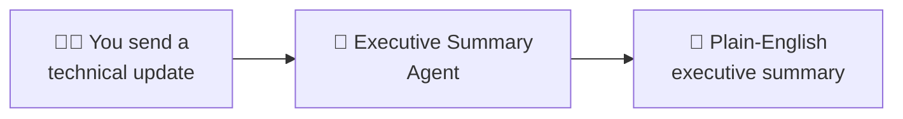

# Modul 0 - Uvod

⏱️ ~10 min

> [!WARNING]
> **Predogled in omejitve:** [Gostovani agenti](https://learn.microsoft.com/azure/foundry/agents/concepts/hosted-agents) so trenutno v **javnem predogledu** - ni priporočljivo za proizvodne obremenitve. Zavedajte se naslednjega:
> - **Podprte regije so omejene** - pred ustvarjanjem virov preverite [dostopnost regij](https://learn.microsoft.com/azure/foundry/agents/concepts/hosted-agents#region-availability). Če izberete nepodprto regijo, bo namestitev spodletela.
> - Paket `agent-framework-foundry-hosting` je predizdaja - API-ji se lahko spreminjajo med različicami.
> - Omejitve skaliranja: gostovani agenti podpirajo 0–5 replik (vključno z skaliranjem do nič).
> - Nekatere funkcije, prikazane v tej delavnici, se lahko spremenijo, ko storitev preide v GA.

## Kar boste ustvarili

V tej delavnici boste ustvarili **"Pojasni kot da sem izvršni direktor"** agenta - gostovanega AI agenta, ki vzame kompleksne tehnične posodobitve in jih prepiše v preproste izvršne povzetke v angleščini.

**Agent uporablja:**
- **Microsoft Agent Framework** - za logiko in strukturo agenta
- **Foundry Toolkit za VS Code** - za ustvarjanje osnove, lokalno testiranje in nameščanje
- **AI model** (npr. `gpt-4.1-mini/gpt-5-mini`) - za generiranje povzetkov

Ob koncu tega vnosa boste imeli delujočega agenta, ki ga lahko lokalno testirate prek Agent Inspectorja in po želji namestite v oblak.

---

## Kaj so gostovani agenti?

**Gostovani agent** je AI agent, ki teče kot upravljana storitev v Microsoft Foundry. Namesto da upravljate svojo infrastrukturo, spakirate kodo agenta v vsebnik in Foundry skrbi za skaliranje, gostovanje in izpostavitev prek standardne HTTP končne točke.

| Pojem | Kaj pomeni |
|---------|--------------|
| **Agent** | Vaša Python koda, ki prejme uporabniško sporočilo, pokliče AI model in vrne strukturiran odgovor |
| **Gostovan** | Foundry za vas poganja vsebnik - brez VM-jev, Kubernetes ali infrastrukture za upravljanje |
| **Protokol odgovorov** | Standardni HTTP API (`POST /responses`), ki ga lahko vsak odjemalec kliče za interakcijo z vašim agentom |
| **Agent Inspector** | Lokalni testni uporabniški vmesnik (vgrajen v Foundry Toolkit), ki vam omogoča, da se pogovarjate z agentom pred nameščanjem |

V tej delavnici boste prešli od nič do popolnoma gostovanega agenta - ali pa se ustavili pri lokalnem testiranju, če želite.

---

## Izberite svojo pot

> ⚠️ **Pred nadaljevanjem izberite eno pot.** Vaša izbira določa, katera orodja namestiti in kateri moduli veljajo. Kasneje se lahko zamenjate iz poti B → pot A, če pridobite naročnino.

<strong>🅰️ Pot A - Azure oblak (zahteva naročnino Azure)</strong>

| | Podrobnosti |
|---|---|
| **Za koga je?** | Imate aktivno naročnino Azure in lahko ustvarjate Foundry vire |
| **Model** | Azure OpenAI prek Foundry (npr. `gpt-4.1-mini/gpt-5-mini`) |
| **Pokriti moduli** | Vsi moduli (00–07) |
| **Namestiti v oblak?** | ✅ Da - popolna namestitev od začetka do konca |

<strong>🅱️ Pot B - Lokalno / brezplačni paket (naročnina Azure ni potrebna)</strong>

| | Podrobnosti |
|---|---|
| **Za koga je?** | MVP-ji, študentje ali kdorkoli brez dostopa do Azure |
| **Model** | **Foundry Local** (brezplačno, teče na vašem računalniku) |
| **Pokriti moduli** | Moduli 00–04 (preskočite nameščanje in preverjanje oblaka) |
| **Namestiti v oblak?** | ❌ Ne - samo lokalno testiranje prek Agent Inspectorja |

---

## Vse poti: Potrebna orodja

Namestite vsako orodje spodaj. Po namestitvi preverite, če deluje, z zagonom ukaza za preverjanje.

| # | Orodje | Verzija | Namestitev | Preverjanje (pričakovan izhod) |
|---|------|---------|---------|---------------------------|
| 1 | **Visual Studio Code** | Najnovejša | [code.visualstudio.com](https://code.visualstudio.com/) | Se odpre brez napak |
| 2 | **Python** | 3.12 ali novejši | [python.org/downloads](https://www.python.org/downloads/) | `python --version` $\rightarrow$ `Python 3.12.x` |
| 3 | **Foundry Toolkit za VS Code** | Najnovejša | ID razširitve: `ms-windows-ai-studio.windows-ai-studio` | Ikona Foundry v vrstici aktivnosti |
| 4 | **Python razširitev za VS Code** | Najnovejša | ID razširitve: `ms-python.python` | Nameščena v panelu razširitev |

> [!TIP]
> **Nasveti za namestitev:**
> - **Pot do Pythona (Windows):** Vedno označite **"Add Python to PATH"** na prvem zaslonu namestitvenega programa za Python. Brez tega ukaz `python` ne bo prepoznan v vašem terminalu.
> - **Več različic Pythona:** Če imate nameščena tako Python 3.10 kot 3.12, uporabite `python3.12 -m venv .venv`, da zagotovite uporabo pravilne različice za vaše virtualno okolje.
> - **Docker WSL 2 (Windows):** Med namestitvijo Docker Desktop zagotovite izbiro **WSL 2 backend**. Docker s Hyper-V je počasnejši in lahko povzroča težave pri gradnji Foundry vsebnikov.
> - **Docker se ne začne?** Po zaganjanju Docker Desktop počakajte 30–60 sekund. Zaženite `docker info` - če vidite "Cannot connect to the Docker daemon," Docker se še vedno inicializira.
> - **Razširitve VS Code se ne naložijo?** Po namestitvi razširitev osvežite okno: `Ctrl+Shift+P` → `Developer: Reload Window`.

> **Uporabniki Windows:** Med namestitvijo Pythona označite **"Add Python to PATH"**.

**Naslednje:** [01 - Nastavitev →](01-setup.md)

---

<!-- CO-OP TRANSLATOR DISCLAIMER START -->
**Omejitev odgovornosti**:
Ta dokument je bil preveden z uporabo AI prevajalske storitve [Co-op Translator](https://github.com/Azure/co-op-translator). Čeprav si prizadevamo za natančnost, vas prosimo, da upoštevate, da avtomatizirani prevodi lahko vsebujejo napake ali netočnosti. Izvirni dokument v njegovem izvirnem jeziku je treba obravnavati kot avtoritativni vir. Za kritične informacije je priporočljiv strokovni človeški prevod. Ne odgovarjamo za morebitna nesporazume ali napačne interpretacije, ki izhajajo iz uporabe tega prevoda.
<!-- CO-OP TRANSLATOR DISCLAIMER END -->