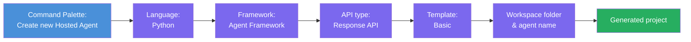
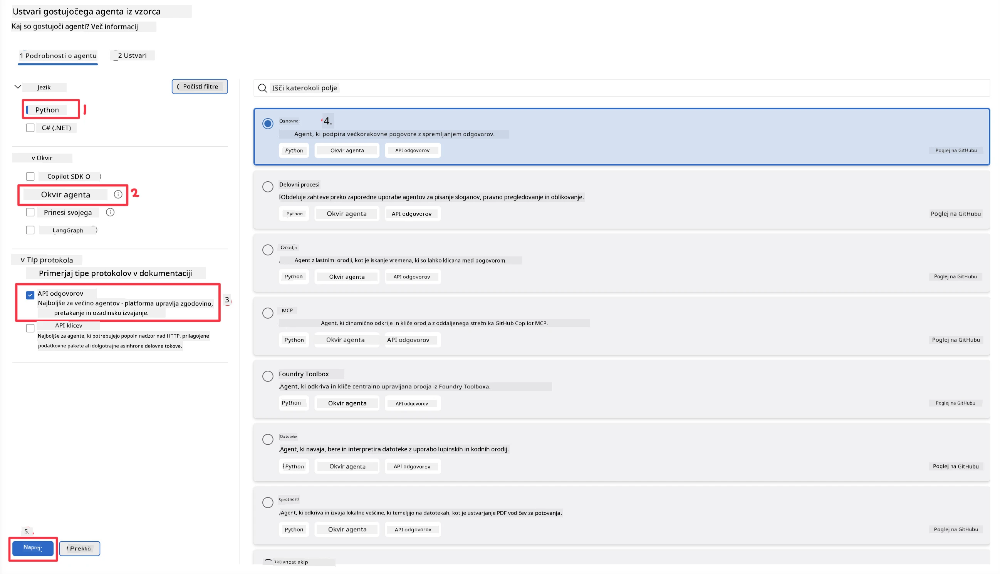
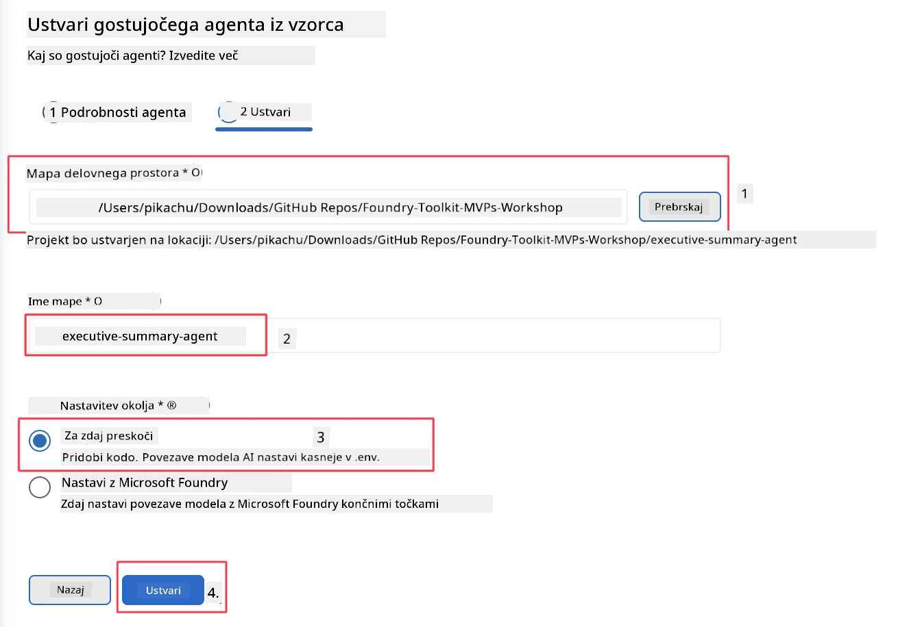

# Modul 2 - Ustvari novega gostujočega agenta

⏱️ ~5 min

V tem modulu boste s pomočjo Foundry Toolkit **zasnovali projekt gostujočega agenta**. Scaffold ustvari celotno strukturo projekta - `agent.yaml`, `main.py`, `Dockerfile`, `requirements.txt` in konfiguracijo za razhroščevanje v VS Code - tako da se lahko osredotočite na prilagajanje vedenja agenta.

> **Ključni koncept:** Mapa `agent/` v temu vajah je primer tega, kar generira Foundry Toolkit. Te datoteke ne pišete iz nič.

### Potek čarovnika za scaffold



---

## Korak 1: Odpri čarovnika Ustvari gostujočega agenta

1. Pritisnite `Ctrl+Shift+P`, da odprete **Command Palette**.
2. Vnesite: **Foundry Toolkit: Create new Hosted Agent** in ga izberite.

> **Alternativa: Ustvari prek Foundry portala**
> Če raje uporabljate brskalnik, lahko projekt ustvarite na [https://ai.azure.com](https://ai.azure.com). Ko je projekt pripravljen, se vrnite v VS Code in uporabite stranski meni **Foundry Toolkit** za povezavo z njim.

> **Alternativa:** V stranskem meniju Foundry Toolkit se postavite na **Agents** pod vašim projektom, kliknite na ikono **+**, nato izberite **Create in Code With Template**.

## Korak 2: Izberite nastavitve



1. Na levi navigaciji/možnostih izberite naslednje:

| Meni | Izbira | Opombe |
|--------|-----------|-------|
| **Jezik** | Python | Podprt je tudi C# |
| **Okvir** | Agent Framework | Preprost začetek z uporabo Agent Framework SDK |
| **Vrsta API** | Response API | `POST /responses` - konverzacijski, z zgodovino, ki jo upravlja platforma |
| **Predloga** | Basic | Preprost začetek z uporabo Agent Framework SDK |

2. Ko izberete, kliknite **Naprej**



3. V naslednjem oknu izberite naslednje:

| Meni | Izbira | Opombe |
|--------|-----------|-------|
| **Delovna mapa** | Izberite ciljno mapo | npr. `/workspace/Foundry_Toolkit_for_VSCode_Lab/` ali podmapa v tem repozitoriju |
| **Ime agenta** | Vnesite ime | npr. `executive-summary-agent` |
| **Nastavitev okolja** | za zdaj preskočite nastavitev |  |

Kliknite **ustvari**, da ustvarite našega agenta. Ustvarila se bo nova mapa z imenom gostujočega agenta.

## Korak 3: Oglejte si ustvarjeni projekt

Po končanem scaffoldingu preverite, če vidite te datoteke v Raziskovalcu (`Ctrl+Shift+E`):

```
📂 executive-summary-agent/
├── .env                ← Environment variables (placeholders)
├── .vscode/
│   ├── launch.json     ← Debug config (F5 → run + Agent Inspector)
│   └── tasks.json      ← VS Code task definitions
├── agent.yaml          ← Agent definition (kind: hosted)
├── Dockerfile          ← Container config for deployment
├── main.py             ← Agent entry point (your main code)
└── requirements.txt    ← Python dependencies
```

### Pojasnilo ključnih datotek

| Datoteka | Namen |
|------|---------|
| `agent.yaml` | Deklarira agenta kot `kind: hosted`, preslika okoljske spremenljivke, definira protokol `/responses` |
| `main.py` | Ustvari `FoundryChatClient` → ovoja ga v `Agent` z navodili → postreže preko `ResponsesHostServer` na vratih 8088 |
| `Dockerfile` | Uporablja `python:3.12-slim`, namešča odvisnosti, izpostavi vrata 8088, zažene `main.py` |
| `requirements.txt` | `agent-framework-foundry`, `agent-framework-foundry-hosting`, `mcp`, `debugpy` |

> **Pomembno:** Odprite scaffoldano mapo agenta neposredno v VS Code (samo mapo `agent/`), da bo `.vscode/launch.json` in `tasks.json` pravilno delovalo za razhroščevanje s F5.

---

### ✅ Kontrolna točka

- [ ] Scaffoldan projekt ustvarjen z vsemi pričakovanimi datotekami
- [ ] `agent.yaml` prikazuje `kind: hosted` in `protocol: responses`
- [ ] `main.py` uvaža `Agent`, `FoundryChatClient`, `ResponsesHostServer`
- [ ] Mapa agenta je odprta v VS Code kot koren delovnega prostora

---

**Prejšnje:** [01 - Nastavitev](01-setup.md) · **Naslednje:** [03 - Konfiguracija in koda →](03-configure-and-code.md)

---

<!-- CO-OP TRANSLATOR DISCLAIMER START -->
**Omejitev odgovornosti**:
Ta dokument je bil preveden z uporabo AI prevajalske storitve [Co-op Translator](https://github.com/Azure/co-op-translator). Čeprav si prizadevamo za natančnost, vas prosimo, da upoštevate, da avtomatizirani prevodi lahko vsebujejo napake ali netočnosti. Izvirni dokument v njegovem izvirnem jeziku je treba obravnavati kot avtoritativni vir. Za kritične informacije je priporočljiv strokovni človeški prevod. Ne odgovarjamo za morebitna nesporazume ali napačne interpretacije, ki izhajajo iz uporabe tega prevoda.
<!-- CO-OP TRANSLATOR DISCLAIMER END -->