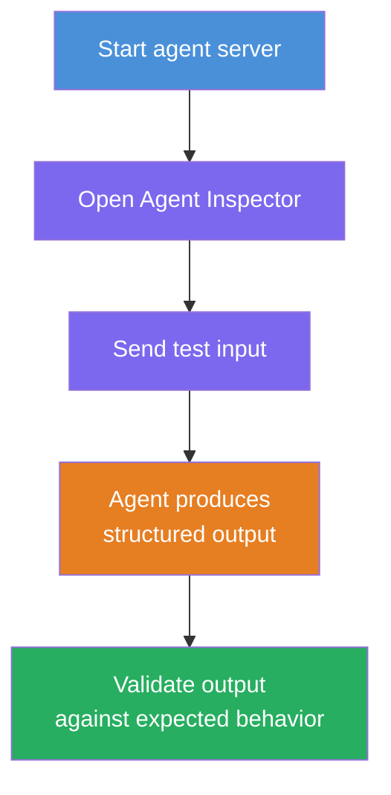
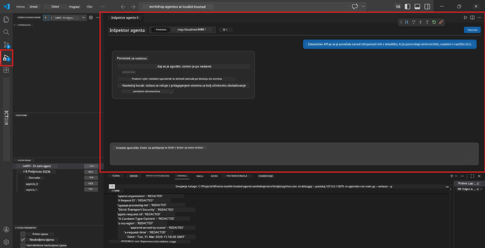
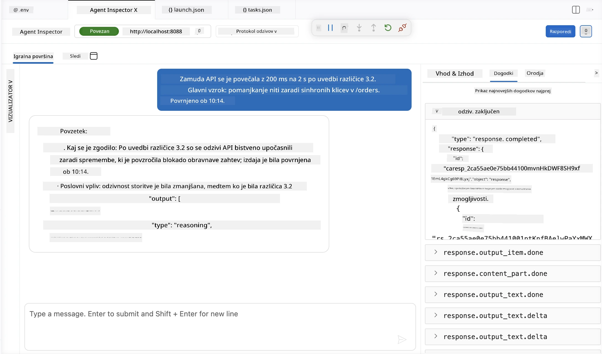

# Modul 4 - Lokalno testiranje

⏱️ ~10 min

V tem modulu boste svojega agenta zagnali lokalno in preverili, ali deluje pravilno z uporabo **funkcionalnih testov uspešnih poti**. Uporabili boste Agent Inspector (vizualni uporabniški vmesnik) ali neposredne HTTP klice, da potrdite, da agent proizvaja strukturirane in natančne odgovore.

### Potek lokalnega testiranja



---

## Možnost 1: Pritisnite F5 - Razhroščevanje z Agent Inspectorjem (priporočeno)

### Zaženite razhroščevalnik

1. Odprite mapo **executive-summary-agent/** neposredno v VS Code (`File → Open Folder`).
2. Odprite **Zaženi in odpravljanje napak** ploščo (`Ctrl+Shift+D`).
3. Izberite **Debug Local Agent HTTP Server** iz spustnega seznama.
4. Pritisnite **F5** (ali kliknite ▶ Začni razhroščevati).

> ⚠️ **Kritično: Izberite svoj Python Interpreter**
> Če dobite "ModuleNotFoundError" ali se razhroščevalnik ne zažene, morate VS Code sporočiti, naj uporablja vaše virtualno okolje:
  > 1. Pritisnite `Ctrl+Shift+P` $\rightarrow$ vtipkajte **Python: Select Interpreter**.
  > 2. Izberite interpreter, ki se nahaja v mapi `.venv` vašega projekta (npr. `.\.venv\Scripts\python.exe` na Windows).
  > 3. Ponovno zaženite sejo razhroščevanja.
> Če še vedno prejmete napake, ročno posodobite datoteko `tasks.json` na naslednji način:
  > 1. Odprite datoteko `.vscode/tasks.json`
  > 2. Poiščite nalogo z oznako: `Run Agent HTTP Server`
  > 3. Posodobite vrednost ukaza takole:
  >    - **Windows:** `"value": "${workspaceFolder}/.venv/Scripts/python.exe",`
  >    - **macOS/Linux:** `"value": "${workspaceFolder}/.venv/bin/python",`

### Kaj se zgodi

1. HTTP strežnik se zažene na `http://localhost:8088/responses`.
2. Pojavi se panel **Agent Inspector** - vizualni klepetalni vmesnik za testiranje.
3. Prekinitvene točke so omogočene v `main.py`.

Spremljajte Terminal za:
```
Starting executive summary hosted agent
Executive agent server running on http://localhost:8088
```

> **Če se Agent Inspector ne odpre:** pritisnite `Ctrl+Shift+P` → **Foundry Toolkit: Open Agent Inspector**.



> *Posnetek zaslona lahko prikazuje starejšo znamko 'AI TOOLKIT' iz predhodne različice razširitve.*

---

## Možnost 2: Testiranje prek terminala (alternativa)

Zaženite agenta v enem terminalu, zahtevke pošljite iz drugega:

```bash
# Terminal 1: Start agent
cd executive-summary-agent/
source .venv/bin/activate
python main.py
```

```bash
# Terminal 2: Send test (curl)
curl -sS -X POST http://localhost:8088/responses \
  -H "Content-Type: application/json" \
  -d '{"input": "The API latency increased due to thread pool exhaustion caused by sync calls in v3.2.", "stream": false}'
```

---

## Preizkusi scenarijev: Funkcionalna validacija po srečnem poteku

Zaženite **vse tri** spodnje scenarije. Ti preverjajo, da vaš agent ustvarja pravilen, strukturiran izhod za realistične vnose.



### Scenarij 1: IT incident - Pojav zakasnitve API-ja

**Vnos:**
```
The API latency increased from 200ms to 2s after deploying v3.2.
Root cause: thread pool starvation from synchronous calls in /orders.
Rolled back at 10:14.
```

**Pričakovano vedenje:**
- ✅ Sledi strukturi "Izvršni povzetek" (Kaj se je zgodilo / Poslovni vpliv / Naslednji korak)
- ✅ Brez tehničnega žargona (ni "thread pool", ni "/orders", ni "v3.2")
- ✅ Jasno navede poslovni vpliv (npr. uporabniki so imeli zamude)
- ✅ Vključuje naslednji korak (npr. uvedena popravka, vzpostavljeno spremljanje)

---

### Scenarij 2: Podatkovni tok - Napaka ETL

**Vnos:**
```
The nightly ETL job failed because the upstream schema changed. APAC dashboards show missing data.
```

**Pričakovano vedenje:**
- ✅ Povzame napako osvežitve podatkov v preprostem jeziku
- ✅ Omenja vpliv na nadzorno ploščo APAC
- ✅ Vključuje popravek/naslednji korak
- ✅ NE omenja "ETL", "sheme" ali drugih tehničnih izrazov

---

### Scenarij 3: Varnost - Razkritje poverilnic

**Vnos:**
```
Static analysis flagged a hardcoded secret in the repository.
The secret may have been exposed in commit history.
```

**Pričakovano vedenje:**
- ✅ Opisuje težavo z akreditivi/varnostjo v jeziku, prijaznem do vodstva
- ✅ Opozori na morebitno tveganje (nepooblaščen dostop)
- ✅ Navaja ukrep za odpravo (rotacija poverilnic, revizija)
- ✅ NE vključuje izrazov, kot so "statčna analiza", "zgodovina commita" ali "trdo kodirano"

---

## Merila za preverjanje

Za vsak scenarij preverite:

| # | Merilo | Pogoj za uspeh |
|---|----------|---------------|
| 1 | **Struktura** | Odgovor uporablja obliko "Izvršni povzetek" z vsemi tremi odstavki |
| 2 | **Preprosti jezik** | Brez tehničnega žargona, ki ga izvršni direktor ne bi razumel |
| 3 | **Natančnost** | Povzetek odraža vhod - brez izmišljenih podrobnosti |
| 4 | **Jedrnatost** | Odgovor je krajši od 100 besed |
| 5 | **Naslednji korak** | Jasno navedeno ukrepanje ali ublažitev tveganja |

---

## Nasveti za odpravljanje napak

| Težava | Popravek |
|-------|-----|
| Agent se ne zažene | Preverite vrednosti `.env`, preverite, ali je venv aktiviran, zaženite `pip install -r requirements.txt` |
| Prazen ali splošen odgovor | Preverite navodila v `main.py` - zagotovite, da je določen izhodni format |
| Odgovor vsebuje žargon | Okrepite pravila "odstranite tehnične izraze" v navodilih |
| Agent Inspector se ne odpre | `Ctrl+Shift+P` → **Foundry Toolkit: Odpri Agent Inspector** |
| Napake modela v Terminalu | Preverite, ali se `AZURE_AI_MODEL_DEPLOYMENT_NAME` ujema natančno (občutljivo na velike/male črke) |

---

### ✅ Kontrolna točka

- [ ] Agent se lokalno zažene brez napak
- [ ] Agent Inspector se odpre in prikaže klepetalni vmesnik (če uporabljate F5)
- [ ] **Scenarij 1** (IT incident) - strukturiran Izvršni povzetek, brez žargona
- [ ] **Scenarij 2** (podatkovni tok) - ustrezen povzetek s poslovnim vplivom
- [ ] **Scenarij 3** (varnostno opozorilo) - ustrezna komunikacija tveganja
- [ ] Vsi odgovori sledijo definirani strukturi izhoda

> **Shrani svoje odgovore** (kopiraj ali posnetek zaslona) - primerjali jih boste z rezultati v oblaku v Modulu 06.

---

**Prejšnje:** [03 - Konfiguriraj & Kodiraj](03-configure-and-code.md) · **Naslednje:** [05 - Namesti v Foundry →](05-deploy-to-foundry.md)

---

<!-- CO-OP TRANSLATOR DISCLAIMER START -->
**Omejitev odgovornosti**:
Ta dokument je bil preveden z uporabo AI prevajalske storitve [Co-op Translator](https://github.com/Azure/co-op-translator). Čeprav si prizadevamo za natančnost, vas prosimo, da upoštevate, da avtomatizirani prevodi lahko vsebujejo napake ali netočnosti. Izvirni dokument v njegovem izvirnem jeziku je treba obravnavati kot avtoritativni vir. Za kritične informacije je priporočljiv strokovni človeški prevod. Ne odgovarjamo za morebitna nesporazume ali napačne interpretacije, ki izhajajo iz uporabe tega prevoda.
<!-- CO-OP TRANSLATOR DISCLAIMER END -->