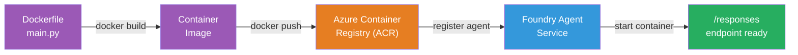

# Modul 5 - Namestitev v storitev Foundry Agent

⏱️ ~10 min

> ⚠️ **Uporabniki poti B:** Ta modul zahteva naročnino za Foundry. Če uporabljate Foundry Local, preskočite na [Modul 07 - Povzetek](07-summary.md). Uspešno ste zaključili lokalni razvojni potek!

V tem modulu namestite lokalno preizkušenega agenta v Microsoft Foundry kot **gostovanega agenta**. Namestitev zgradi kontejnersko sliko, jo potisne v Azure Container Registry in zažene agenta v upravljani infrastrukturi Foundry.

### Potek namestitve

---

## Preverjanje predpogojev

Pred namestitvijo preverite:

- [ ] Agent uspešno prestane vseh 3 lokalnih scenarijev iz [Modul 04](04-test-locally.md)
- [ ] Imate vlogo **Azure AI User** na ravni projekta ([Modul 01, Dodelitev RBAC](01-setup.md#uvedite-model-in-dodelite-rbac))
- [ ] Prijavljeni ste v Azure v VS Code (ikona Računi prikazuje vaše ime)

---

## Korak 1: Začnite namestitev

### Možnost A: Namestitev iz Agent Inspectorja (priporočeno)

Če je Agent Inspector odprt (po testiranju):
1. Kliknite gumb **Deploy** v zgornjem desnem kotu (ikona oblak ↑).

### Možnost B: Namestitev iz Ukazne palete

1. Pritisnite `Ctrl+Shift+P` → **Foundry Toolkit: Deploy Hosted Agent**.

---

## Korak 2: Konfigurirajte namestitev

Čarovnik vas bo pozval k:

| Poziv | Izbira |
|--------|-----------|
| **Naročnina** | Vaša Azure naročnina |
| **Ciljni projekt** | Vaš Foundry projekt (npr., `workshop-agents`) |

Kliknite **next** da konfigurirate svojega agenta.

| Poziv | Izbira |
|--------|-----------|
| **Metoda nameščanja** | Kontejner |
| **Register kontejnerjev** | **Privzeti ACR** (Microsoft Foundry ustvari in upravlja enega za vas) |
| **Namesti v** | Novega agenta (ime, `executive-summary-agent`) |

Kliknite **next** da pregledate in namestite svojega agenta.

| Poziv | Izbira |
|--------|-----------|
| **CPU in pomnilnik** | **0.25 CPU jedra, 0.5 Gi pomnilnika** (zadostno za delavnico) |

---

## Korak 3: Namestitev in spremljanje

1. Kliknite **Deploy**.
2. Spremljajte ploščo **Output** (izberite **Microsoft Foundry** iz spustnega seznama).
3. Namestitev poteka skozi naslednje faze:
   - **Docker build** - zgradi kontejnersko sliko iz vaše Dockerfile
   - **Docker push** - potisne sliko v ACR (1–3 min pri prvi namestitvi)
   - **Agent registration** - ustvari gostovanega agenta v Foundry
   - **Container start** - zažene z identiteto, ki jo upravlja sistem

4. Ko je končano, se prikaže obvestilo:
   > **my-agent je uspešno nameščen.** `View logs` `Run agent`

5. Kliknite **Run agent**, da odprete Agent Playground.

### Stanja namestitve

| Stanje | Pomen |
|--------|---------|
| **Running** | Kontejner pripravljen, agent odgovarja |
| **Pending** | Kontejner se začenja - počakajte 30–60 sekund |
| **Failed** | Preverite dnevnike (glejte odpravljanje težav spodaj) |

---

## Pogoste napake pri namestitvi

| Napaka | Vzrok | Popravek |
|-------|-----------|-----|
| `agents/write` permission denied | Manjka vloga **Azure AI User** na ravni projekta | [Modul 01, Dodelitev RBAC](01-setup.md#uvedite-model-in-dodelite-rbac) |
| Docker ni zagnan | Docker Desktop ni zagnan | Zaženite Docker Desktop → preverite `docker info` |
| ACR avtentikacija | Upravljana identiteta ne more potegniti slike | Oglejte si [Modul 08 - Odpravljanje težav](08-troubleshooting.md) |

---

### ✅ Kontrolna točka

- [ ] Namestitev zaključena brez napak
- [ ] Agent se pojavi pod **Hosted Agents (Preview)** v stranskem meniju Foundry
- [ ] Stanje kontejnerja prikazuje **Running**
- [ ] Zavihek Agent Playground je odprt in prikazuje podrobnosti agenta in URL končne točke

---

**Prejšnje:** [04 - Testiraj lokalno](04-test-locally.md) · **Naslednje:** [06 - Preveri v Playgroundu →](06-verify-in-playground.md)

---

<!-- CO-OP TRANSLATOR DISCLAIMER START -->
**Omejitev odgovornosti**:
Ta dokument je bil preveden z uporabo AI prevajalske storitve [Co-op Translator](https://github.com/Azure/co-op-translator). Čeprav si prizadevamo za natančnost, vas prosimo, da upoštevate, da avtomatizirani prevodi lahko vsebujejo napake ali netočnosti. Izvirni dokument v njegovem izvirnem jeziku je treba obravnavati kot avtoritativni vir. Za kritične informacije je priporočljiv strokovni človeški prevod. Ne odgovarjamo za morebitna nesporazume ali napačne interpretacije, ki izhajajo iz uporabe tega prevoda.
<!-- CO-OP TRANSLATOR DISCLAIMER END -->
