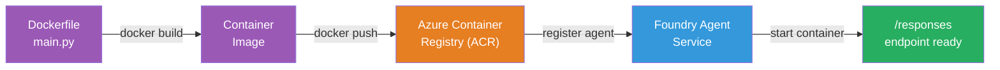
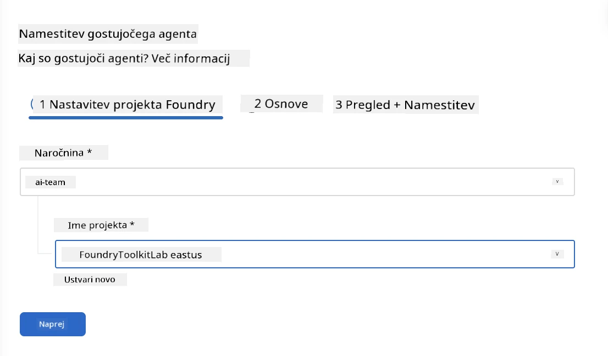
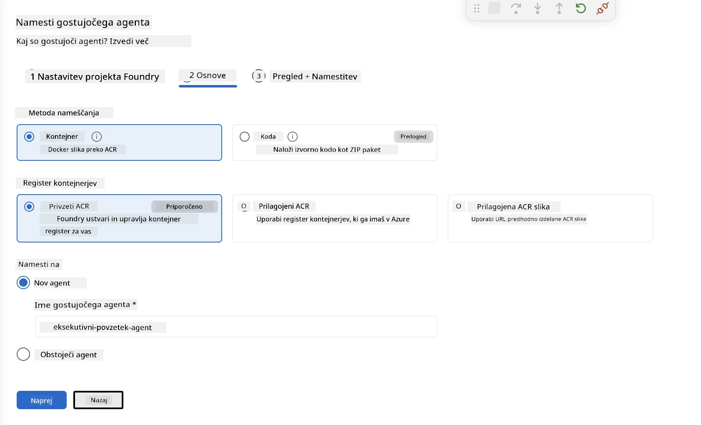
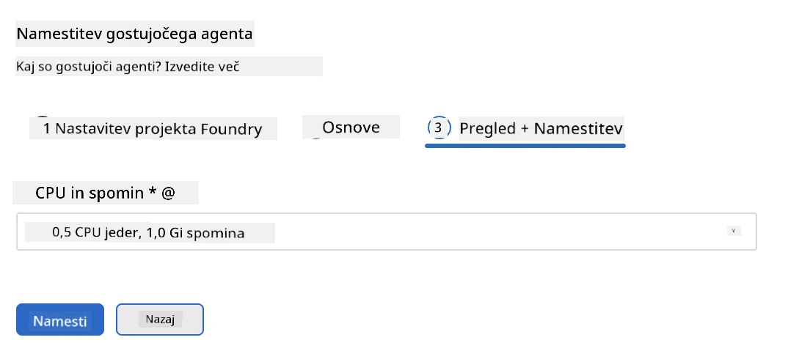
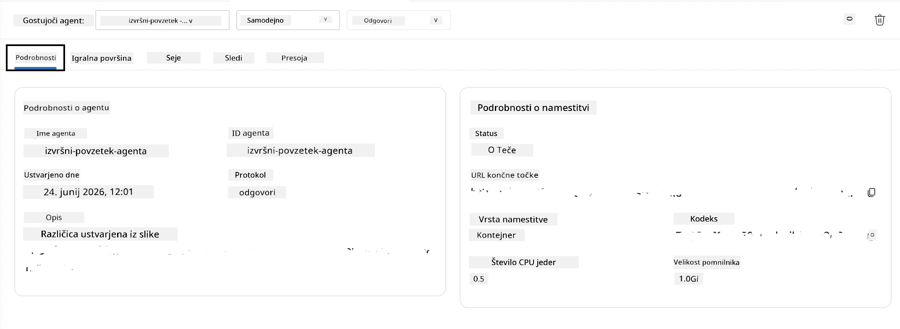

# Modul 5 - Namestitev v Foundry Agent Service

⏱️ ~10 min

> ⚠️ **Uporabniki poti B:** Ta modul zahteva naročnino na Foundry. Če uporabljate Foundry Local, preskočite na [Modul 07 - Povzetek](07-summary.md). Uspešno ste zaključili lokalni razvojni potek!

V tem modulu namestite svoj lokalno preizkušen agent v Microsoft Foundry kot **Gostujočega agenta**. Namestitev ustvari sliko kontejnerja, jo potisne v Azure Container Registry in zažene agenta v upravljani infrastrukturi Foundry.

### Pipeline namestitve

---

## Preverjanje predpogojev

Pred namestitvijo preverite:

- [ ] Agent uspešno prestane vseh 3 lokalne scenarije iz [Modul 04](04-test-locally.md)
- [ ] Imate vlogo **Azure AI User** na ravni projekta ([Modul 01, Dodelitev RBAC](01-setup.md#deploy-a-model--assign-rbac))
- [ ] Prijavljeni ste v Azure v VS Code (ikona Računi prikazuje vaše ime)

---

## 1. korak: Začni namestitev

### Možnost A: Namesti iz Agent Inspectora (priporočeno)

Če je Agent Inspector odprt (iz testiranja):
1. Kliknite gumb **Namesti** v zgornjem desnem kotu (ikona oblaka ↑).

### Možnost B: Namesti iz Command Palette

1. Pritisnite `Ctrl+Shift+P` → **Foundry Toolkit: Deploy Hosted Agent**.

---

## 2. korak: Konfiguriraj namestitev

Čarovnik vas vpraša za:

| Vprašanje | Izbira |
|--------|-----------|
| **Naročnina** | Vaša naročnina Azure |
| **Ciljni projekt** | Vaš projekt Foundry (npr. `workshop-agents`) |

Kliknite **naprej** za konfiguracijo agenta.

| Vprašanje | Izbira |
|--------|-----------|
| **Metoda namestitve** | Kontejner |
| **Registrska zbirka kontejnerjev** | **Privzeti ACR** (Microsoft Foundry ustvari in upravlja za vas) |
| **Namesti na** | Nov agent (ime, `executive-summary-agent`) |

Kliknite **naprej** za pregled in namestitev vašega agenta.

| Vprašanje | Izbira |
|--------|-----------|
| **CPU in pomnilnik** | **0.5 CPU jeder, 1.0 Gi pomnilnika** (privzeto - dovolj za delavnico) |

---

## 3. korak: Namesti in spremljaj

1. Kliknite **Namesti**.
2. Spremljajte panel **Izhod** (izberite **Microsoft Foundry** iz spustnega menija).
3. Namestitev poteka skozi naslednje faze:
   - **Docker build** - ustvari kontejner iz vaše Dockerfile
   - **Docker push** - potisne sliko v ACR (1–3 min pri prvi namestitvi)
   - **Registracija agenta** - ustvari gostujočega agenta v Foundry
   - **Zagon kontejnerja** - začne se z identiteto, ki jo upravlja sistem

4. Ko je končano, se prikaže obvestilo:
   > **executive-summary-agent je uspešno nameščen.** `View logs` `Run agent`

5. Kliknite **Zaženi agenta**, da odprete Agent Playground.

### Vrednosti stanja namestitve

| Stanje | Pomen |
|--------|---------|
| **V teku** | Kontejner pripravljen, agent odgovarja |
| **Čakanje** | Začetek kontejnerja - počakajte 30–60 sekund |
| **Neuspešno** | Preverite dnevnike (glejte odpravljanje težav spodaj) |

---

## Pogoste napake pri namestitvi

| Napaka | Glavni vzrok | Popravilo |
|-------|-----------|-----|
| `agents/write` zavrnjena dovoljenja | Manjka vloga **Azure AI User** na ravni projekta | [Modul 01, Dodelitev RBAC](01-setup.md#deploy-a-model--assign-rbac) |
| Docker ne teče | Docker Desktop ni zagnan | Zaženite Docker Desktop → preverite `docker info` |
| Avtorizacija ACR | Upravljana identiteta ne more potegniti slike | Glejte [Modul 08 - Odpravljanje težav](08-troubleshooting.md) |

---

### ✅ Kontrolna točka

- [ ] Namestitev končana brez napak
- [ ] Agent se prikaže na zavihku **Hosted Agent**, ko kliknete **Agenti** pod vašim projektom v Foundry Toolkit stranski vrstici
- [ ] Stanje kontejnerja kaže **V teku**
- [ ] Odprt zavihek Agent Playground, ki prikazuje podrobnosti agenta in URL končne točke

---

**Prejšnji:** [04 - Testiranje lokalno](04-test-locally.md) · **Naslednji:** [06 - Preverjanje v Playground →](06-verify-in-playground.md)

---

<!-- CO-OP TRANSLATOR DISCLAIMER START -->
**Omejitev odgovornosti**:
Ta dokument je bil preveden z uporabo AI prevajalske storitve [Co-op Translator](https://github.com/Azure/co-op-translator). Čeprav si prizadevamo za natančnost, vas prosimo, da upoštevate, da avtomatizirani prevodi lahko vsebujejo napake ali netočnosti. Izvirni dokument v njegovem izvirnem jeziku je treba obravnavati kot avtoritativni vir. Za kritične informacije je priporočljiv strokovni človeški prevod. Ne odgovarjamo za morebitna nesporazume ali napačne interpretacije, ki izhajajo iz uporabe tega prevoda.
<!-- CO-OP TRANSLATOR DISCLAIMER END -->