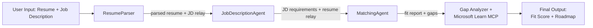

# PersonalCareerCopilot - Ocena primernosti življenjepisa za delo

Aplikacija z več agenti, ki je osredotočena na potek dela in oceni, kako dobro življenjepis ustreza opisu delovnega mesta, nato pa ustvari osebni načrt učenja za zapolnitev vrzeli.

---

## Agentje

| Agent | Vloga | Orodja |
|-------|------|-------|
| **ResumeParser** | Izvleče strukturirane veščine, izkušnje, certifikate iz besedila življenjepisa | - |
| **JobDescriptionAgent** | Izvleče zahtevane/priporočene veščine, izkušnje, certifikate iz opisa delovnega mesta | - |
| **MatchingAgent** | Primerja profil s zahtevami → rezultat primernosti (0-100) + ujemajoče/se manjkajoče veščine | - |
| **GapAnalyzer** | Ustvari osebni načrt učenja z viri Microsoft Learn | `search_microsoft_learn_for_plan` (MCP) |

## Potek dela



---

## Hiter začetek

### 1. Nastavite okolje

Ta mapa je referenčna izvedba za ogrodje delovnega procesa Lab 02. Njena `main.py` uporablja obstoječe bloke pozivov plus `WorkflowBuilder` za povezavo štirih agentov.

```powershell
cd workshop\lab02-multi-agent\PersonalCareerCopilot
python -m venv .venv
.\.venv\Scripts\Activate.ps1          # Windows PowerShell
# source .venv/bin/activate            # macOS / Linux
pip install -r requirements.txt
```

### 2. Konfigurirajte poverilnice

Ustvarite datoteko `.env` v tej mapi:

```powershell
copy .env .env.bak 2>$null; echo $null > .env
```

Uredite `.env`:

```env
FOUNDRY_PROJECT_ENDPOINT=https://<your-account>.services.ai.azure.com/api/projects/<your-project>
AZURE_AI_MODEL_DEPLOYMENT_NAME=gpt-4.1-mini
```

| Vrednost | Kje jo najti |
|-------|------------------|
| `FOUNDRY_PROJECT_ENDPOINT` | Orodna vrstica Foundry → desni klik na vaš projekt → **Kopiraj konec projekta** |
| `AZURE_AI_MODEL_DEPLOYMENT_NAME` | Stran Foundry → razširi projekt → **Modeli + končne točke** → ime uvajanja |

### 3. Zaženite lokalno

```powershell
python -m debugpy --listen 127.0.0.1:5679 main.py --port 8088
```

Ali uporabite opravilo v VS Code: `Ctrl+Shift+P` → **Opravila: Zaženi opravilo** → **Zaženi lokalni agent HTTP strežnik**.

Za odpravljanje napak s F5 uporabite **Odpravljanje napak lokalnega HTTP strežnika agenta**.

### 4. Testirajte z Agent Inspector

Odprite Agent Inspector: `Ctrl+Shift+P` → **Foundry Toolkit: Odpri Agent Inspector**.

Prilepite ta testni poziv:

```
Resume:
Jane Doe
Senior Software Engineer with 5 years of experience in Python, Django, and AWS.
Built microservices handling 10K+ requests/second. Led a team of 4 developers.
Certifications: AWS Solutions Architect Associate.
Education: B.S. Computer Science, State University.

Job Description:
Senior Cloud Engineer at Contoso Ltd.
Required: Python, Azure, Kubernetes, Terraform, CI/CD pipelines.
Preferred: Go, monitoring (Prometheus/Grafana), cost optimization.
Experience: 5+ years in cloud infrastructure.
Certifications: Azure Solutions Architect Expert preferred.
```

**Pričakovano:** Rezultat primernosti (0-100), ujemajoče/manjkajoče veščine in osebni načrt učenja z URL-ji Microsoft Learn.

### 5. Uvedite v Foundry

`Ctrl+Shift+P` → **Foundry Toolkit: Uvedi gostujočega agenta** → izberite svoj projekt → potrdite.

---

## Struktura projekta

```
PersonalCareerCopilot/
├── .env                ← Your credentials (git-ignored)
├── agent.yaml          ← Hosted agent definition (name, resources, env vars)
├── Dockerfile          ← Container image for Foundry deployment
├── main.py             ← 4-agent workflow (instructions, MCP tool, WorkflowBuilder)
└── requirements.txt    ← Python dependencies
```

## Ključne datoteke

### `agent.yaml`

Določa gostujočega agenta za Foundry Agent Service:
- `kind: hosted` - teče kot upravljan kontejner
- `protocols` - `responses` protokol z `version: 2.0.0`, razkriva HTTP konec `/responses`
- `environment_variables` - `AZURE_AI_MODEL_DEPLOYMENT_NAME` je tukaj deklariran; `FOUNDRY_PROJECT_ENDPOINT` se samodejno vstavi ob uvajanju

### `main.py`

Vsebuje:
- **Navodila za agente** - štiri `*_INSTRUCTIONS` konstante, po ena za vsakega agenta
- **Orodje MCP** - `search_microsoft_learn_for_plan()` kliče `https://learn.microsoft.com/api/mcp` preko Streamable HTTP
- **Ustvarjanje agentov** - štiri primerki `Agent()` + `AgentExecutor()` delijo en `FoundryChatClient`
- **Graf poteka dela** - `WorkflowBuilder` povezuje agente kot zaporedno cevovod: ResumeParser → JD Agent → MatchingAgent → GapAnalyzer
- **Zagon strežnika** - `ResponsesHostServer` teče na vratih 8088

### `requirements.txt`

| Paket | Namen |
|---------|----------|
| `agent-framework-foundry` | Osnovno izvajanje: `Agent`, `AgentExecutor`, `WorkflowBuilder`, `@tool`, `FoundryChatClient` |
| `agent-framework-foundry-hosting` | `ResponsesHostServer` + Integracija gostovanja Foundry |
| `mcp<2,>=1.24.0` | MCP odjemalec za GapAnalyzer (`streamable_http_client`) |
| `debugpy` | Razhroščevanje Pythona (F5 v VS Code) |

---

## Odpravljanje težav

| Težava | Rešitev |
|-------|-----|
| `KeyError: 'FOUNDRY_PROJECT_ENDPOINT'` ali `KeyError: 'AZURE_AI_MODEL_DEPLOYMENT_NAME'` | Ustvari `.env` z nastavljeno tako `FOUNDRY_PROJECT_ENDPOINT` kot `AZURE_AI_MODEL_DEPLOYMENT_NAME` |
| `ModuleNotFoundError: No module named 'agent_framework'` | Aktiviraj venv in zaženi `pip install -r requirements.txt` |
| Brez URL-jev Microsoft Learn v izhodu | Preveri internetno povezavo do `https://learn.microsoft.com/api/mcp` |
| Samo ena kartica vrzeli (okrajšano) | Prepričaj se, da `GAP_ANALYZER_INSTRUCTIONS` vključuje blok `CRITICAL:` |
| Vrata 8088 so zasedena | Ustavi druge strežnike: `netstat -ano \| findstr :8088` |

Za podrobno odpravljanje težav glej [Modul 8 - Odpravljanje težav](../docs/08-troubleshooting.md).

---

**Celoten potek:** [Lab 02 Docs](../docs/README.md) · **Nazaj na:** [Lab 02 README](../README.md) · [Domača stran delavnice](../../../README.md)

---

<!-- CO-OP TRANSLATOR DISCLAIMER START -->
**Omejitev odgovornosti**:
Ta dokument je bil preveden z uporabo AI prevajalske storitve [Co-op Translator](https://github.com/Azure/co-op-translator). Čeprav si prizadevamo za natančnost, vas prosimo, da upoštevate, da avtomatizirani prevodi lahko vsebujejo napake ali netočnosti. Izvirni dokument v njegovem izvirnem jeziku je treba obravnavati kot avtoritativni vir. Za kritične informacije je priporočljiv strokovni človeški prevod. Ne odgovarjamo za morebitna nesporazume ali napačne interpretacije, ki izhajajo iz uporabe tega prevoda.
<!-- CO-OP TRANSLATOR DISCLAIMER END -->