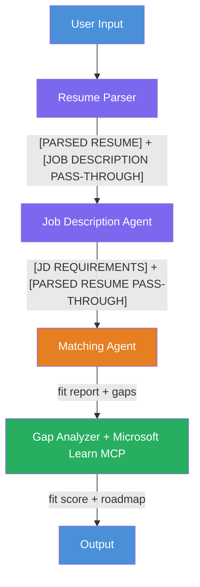

# Laboratorij 02 - Večagentni delovni proces: Evalvator ujemanja življenjepisa z delovnim mestom

## Pregled

V tem praktičnem laboratoriju boste z orodjem Foundry Toolkit v VS Code izdelali **večagentno aplikacijo, usmerjeno na delovni proces** in jo namestili v Microsoft Foundry Agent Service.

**Kaj boste izdelali:** Evalvator ujemanja življenjepisa z delovnim mestom, ki analizira življenjepis in opis delovnega mesta, oceni ujemanje in pripravi osebni načrt učenja z uporabo virov Microsoft Learn.

---

## Arhitektura

**Kako deluje:**
1. Uporabnik prilepi življenjepis in opis delovnega mesta.
2. **ResumeParser** analizira življenjepis in prepiše opis delovnega mesta dobesedno v razdelek `[JOB DESCRIPTION PASS-THROUGH]`.
3. **JD Agent** izvleče strukturirane zahteve iz prehoda in nato posreduje `[PARSED RESUME]` naprej kot `[PARSED RESUME PASS-THROUGH]`.
4. **MatchingAgent** primerja `[PARSED RESUME PASS-THROUGH]` z `[JD REQUIREMENTS]` in ustvari oceno ujemanja.
5. **GapAnalyzer** spremeni vrzeli v praktični načrt in pridobi dejanske povezave do Microsoft Learn prek MCP.

---

## Predpogoji

Najprej dokončajte Laboratorij 01:

- [Laboratorij 01 - Enotni agent](../lab01-single-agent/README.md)

---

## Del 1: Preberite module po vrsti

Ogledajte si celotno učna pot v:

- [Doc 2 laboratorija - Predpogoji](docs/00-prerequisites.md)
- [Doc 2 laboratorija - Celotna učna pot](docs/README.md)
- [Vodnik za osebnega kariernega pilota](PersonalCareerCopilot/README.md)

---

## Del 2: Zgradite in preizkusite delovni proces

1. Uporabite čarovnika Foundry Toolkit za ustvarjanje projekta, osnovanega na delovnem procesu.
2. Kopirajte bloke pozivov in graf delovnega procesa iz `PersonalCareerCopilot/main.py` v vaše delovno okolje.
3. Zaženite lokalno z Agent Inspector in preverite vse štiri agente plus orodje MCP.
4. Namestite gostujočega agenta v Foundry, ko lokalno testiranje uspe.

---

## Vzorce orkestracije

Laboratorij 02 uporablja **zaporedno cevovodno vezje**: izhod vsakega agenta je vhod naslednjemu, delo pa vrne odgovor zadnjega agenta. Dva vzorca to omogočata:

- **Zaporedna veriga** - `WorkflowBuilder` povezuje ResumeParser → JD Agent → MatchingAgent → GapAnalyzer z enim `add_edge()` klicem na korak
- **Posredovanje vsebine** - ker vsak agent vidi le izhod svojega neposrednega predhodnika, ResumeParser in JD Agent kopirata podatke, ki jih potrebujejo naslednji agenti, v označene prehodne razdelke

Dokumentacija pojasnjuje tudi, zakaj laboratorij ne uporablja razvejitve / združitve in kako razširiti graf s še enim agentom.

Glejte [docs/04-orchestration-patterns.md](docs/04-orchestration-patterns.md).

---

**Prejšnji:** [Laboratorij 01 - Enotni agent](../lab01-single-agent/README.md) · **Nazaj na:** [Domača stran delavnice](../../README.md)

---

<!-- CO-OP TRANSLATOR DISCLAIMER START -->
**Omejitev odgovornosti**:
Ta dokument je bil preveden z uporabo AI prevajalske storitve [Co-op Translator](https://github.com/Azure/co-op-translator). Čeprav si prizadevamo za natančnost, vas prosimo, da upoštevate, da avtomatizirani prevodi lahko vsebujejo napake ali netočnosti. Izvirni dokument v njegovem izvirnem jeziku je treba obravnavati kot avtoritativni vir. Za kritične informacije je priporočljiv strokovni človeški prevod. Ne odgovarjamo za morebitna nesporazume ali napačne interpretacije, ki izhajajo iz uporabe tega prevoda.
<!-- CO-OP TRANSLATOR DISCLAIMER END -->