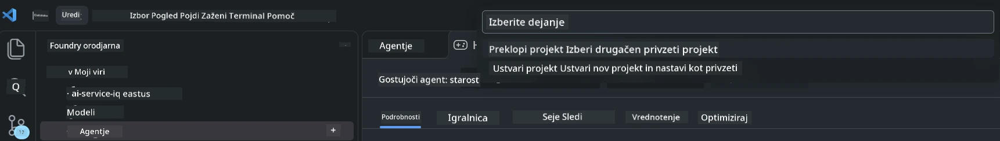

# Modul 0 - Uvod

⏱️ ~10 min

> [!WARNING]
> **Predogled in omejitve:** [Gostujoči agenti](https://learn.microsoft.com/azure/foundry/agents/concepts/hosted-agents) so trenutno v **javnem predogledu** - niso priporočeni za produktivne obremenitve. Nekatere funkcije, prikazane v tej delavnici, se lahko spremenijo, ko storitev doseže GA.

## Kaj boste zgradili

V tej laboratorijski vaji razširite veščine enega agenta iz Laboratorija 01 in zgradite **večagentni potek dela** - Evalvator usklajenosti življenjepisa in delovnega mesta.

Prilepite **življenjepis** in **opis delovnega mesta**. Štirje specializirani agenti obdelajo vhod zaporedno in nato vrnejo:
- Usklajenostno oceno (0–100 z razčlenitvijo ocene)
- Seznam vrzeli veščin in certifikatov
- Osebno učni načrt z resničnimi povezavami Microsoft Learn za vsako vrzel

**Potek dela uporablja:**
- **Microsoft Agent Framework** - `WorkflowBuilder` za zaporedno orkestracijo cevovoda
- **Foundry Toolkit za VS Code** - okvir, lokalno testiranje, uvajanje
- **Model umetne inteligence** (npr. `gpt-4.1-mini`) - uporabljen pri vseh štirih agentih
- **Microsoft Learn MCP strežnik** - nudi resnične povezave do učnih virov za vsako vrzel

---

## Izberite svojo pot

> ⚠️ **Nadaljujte z isto potjo, kot ste jo uporabili v Laboratoriju 01.**

<details open>
<summary><strong>🅰️ Pot A - oblak Azure (zahteva naročnino na Azure)</strong></summary>

| | Podrobnosti |
|---|---|
| **Za koga je to?** | Dokončali ste Laboratorij 01 z uporabo naročnine Azure |
| **Model** | Azure OpenAI prek Foundry (npr. `gpt-4.1-mini`) |
| **Kriti moduli** | Vsi moduli (00–09) |
| **Uvajanje v oblak?** | ✅ Da - popolno uvajanje od začetka do konca |

</details>

<details open>
<summary><strong>🅱️ Pot B - Foundry Local (ne potrebuje naročnine Azure)</strong></summary>

| | Podrobnosti |
|---|---|
| **Za koga je to?** | Dokončali ste Laboratorij 01 z uporabo Foundry Local |
| **Model** | Foundry Local (brezplačen, deluje na vašem računalniku) |
| **Kriti moduli** | Moduli 00–05 (preskočite 06–07 - uvajanje in preverjanje oblaka) |
| **Uvajanje v oblak?** | ❌ Ne - samo lokalno testiranje preko Agent Inspector |

</details>

---

## Preverjanje Laboratorija 01

Laboratorij 02 temelji neposredno na Laboratoriju 01. Najprej dokončajte Laboratorij 01, preden začnete tukaj.

Še niste opravili Laboratorija 01? Začnite tukaj: [Laboratorij 01 - Uvod](../../lab01-single-agent/docs/00-prerequisites.md)

<details open>
<summary><strong>🅰️ Pot A - oblak Azure</strong></summary>

```powershell
az account show --query "{name:name, id:id}" --output table
```

Če se to ne izvede, zaženite `az login`. Nato preverite v VS Code:

1. `Ctrl+Shift+P` → vtipkajte **Foundry Toolkit** → potrdite, da se prikažejo ukazi.
2. Kliknite ikono **Foundry Toolkit** → vaš projekt in nameščen model kažeta **Uspešno**.



> **RBAC:** Dodelili ste vlogo **Foundry User** v Laboratoriju 01. Če jo morate ponovno dodeliti, si oglejte [Laboratorij 01, Modul 1](../../lab01-single-agent/docs/01-setup.md#deploy-a-model--assign-rbac). Vloga je bila prej imenovana **Azure AI User** - enake pravice.

</details>

<details open>
<summary><strong>🅱️ Pot B - Foundry Local</strong></summary>

```powershell
Invoke-WebRequest -Uri "http://localhost:5273/v1/health" -UseBasicParsing | Select-Object StatusCode
```

Pričakovano: `StatusCode: 200`. Če ne, znova zaženite Foundry Local iz stranske vrstice Foundry Toolkit.

> Vse sklepanje poteka na vašem računalniku. Edini odhodni klic je orodje MCP do `https://learn.microsoft.com/api/mcp`.

</details>

---

## Kaj je novega v Laboratoriju 02

| | Laboratorij 01 | Laboratorij 02 |
|--|--------|--------|
| Agenti | 1 | 4 (povezani z WorkflowBuilder) |
| Osnovni okvir | Osnovni - Agent Framework | Poteki dela - Agent Framework |
| Nov paket | - | `mcp` |
| Orkestracija | En sam pogovorni agent | Zaporedna cevovodna obdelava (WorkflowBuilder) |
| Novo orodje | - | `search_microsoft_learn_for_plan` (MCP) |

---

**Naprej:** [01 - Razumeti arhitekturo →](01-understand-multi-agent.md)

---

<!-- CO-OP TRANSLATOR DISCLAIMER START -->
**Omejitev odgovornosti**:
Ta dokument je bil preveden z uporabo AI prevajalske storitve [Co-op Translator](https://github.com/Azure/co-op-translator). Čeprav si prizadevamo za natančnost, vas prosimo, da upoštevate, da avtomatizirani prevodi lahko vsebujejo napake ali netočnosti. Izvirni dokument v njegovem izvirnem jeziku je treba obravnavati kot avtoritativni vir. Za kritične informacije je priporočljiv strokovni človeški prevod. Ne odgovarjamo za morebitna nesporazume ali napačne interpretacije, ki izhajajo iz uporabe tega prevoda.
<!-- CO-OP TRANSLATOR DISCLAIMER END -->