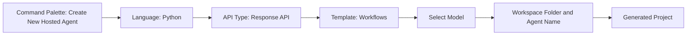
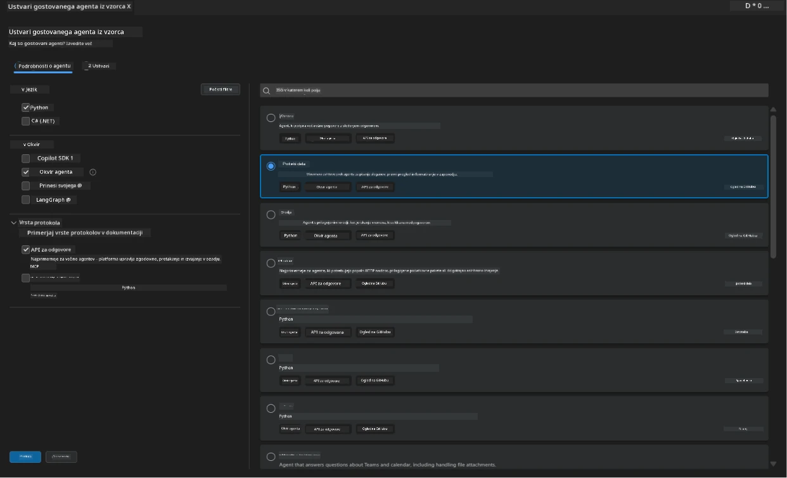
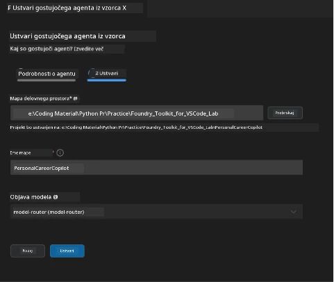

# Modul 2 - Postavitev projekta z več agenti

⏱️ ~5 min

V tem modulu uporabite [Foundry Toolkit za VS Code](https://aka.ms/foundrytk), da **postavite projekt z več agenti**. Čarovnik ustvari `agent.yaml`, `main.py`, `Dockerfile`, `requirements.txt`, `.env` in konfiguracijo za razhroščevanje v VS Code - tako se lahko osredotočite na povezovanje poteka dela s 4 agenti v Modulu 3.

> **Ključni koncept:** Postavitev je delujoča osnova z enim agentom. Nadomestite logiko nadomestnega znaka z `WorkflowBuilder` grafom v Modulu 3. Ne pišete izhodiščne kode od začetka.

> **Referenčna implementacija:** [`PersonalCareerCopilot/`](../../../../../workshop/lab02-multi-agent/PersonalCareerCopilot) je popoln delujoči primer. Uporabite ga za primerjavo svojega dela med postopkom.

### Potek čarovnika za postavitev



---

## Korak 1: Odprite čarovnika Create Hosted Agent

1. Pritisnite `Ctrl+Shift+P` za odprtje **Command Palette**.
2. Vpišite: **Foundry Toolkit: Create new Hosted Agent** in ga izberite.
3. Čarovnik se odpre na zavihku **Agent Details**.

> **Alternativa:** Kliknite ikono **Foundry Toolkit** v vrstici aktivnosti → kliknite ikono **+** poleg **Hosted Agents** → **Create New Hosted Agent**.

---

## Korak 2: Izberite nastavitve



1. Na levi navigaciji/oddelku za možnosti izberite naslednje:

| Meni | Izbira | Opombe |
|--------|-----------|-------|
| **Jezik** | Python | Podprt je tudi C# (.NET) |
| **Okvir** | Agent Framework | Zagotavlja `Agent`, `AgentExecutor`, `WorkflowBuilder` |
| **Vrsta API** | Response API | `POST /responses` - zgodovina podprta s platformo, podpora za pretakanje |
| **Predloga** | **Workflows** | Obdeluje zahteve skozi več agentov zaporedoma |

2. Ko izberete, kliknite **Next**



3. V naslednjem oknu izberite naslednje:

| Meni | Izbira | Opombe |
|--------|-----------|-------|
| **Mapa delovnega prostora** | Izberite ciljno mapo | npr. `workshop/lab02-multi-agent/` v tem repozitoriju |
| **Ime agenta** | `PersonalCareerCopilot` | To postane ime imenika projekta |
| **Model Deployment** | Izberite svoj nameščeni model | npr. `gpt-4.1-mini` iz Laboratorija 01 |

4. Kliknite **Create** da postavite projekt. VS Code ustvari datoteke in odpre mapo.

> **Nasvet:** [`gpt-4.1-mini`](https://learn.microsoft.com/azure/foundry/foundry-models/concepts/models-sold-directly-by-azure#gpt-41-series) dobro uravnoteži hitrost in kakovost za razvoj z več agenti.

---

## Korak 3: Preverite ustvarjeni projekt

Ko je postavitev končana, preverite, da v Explorerju (`Ctrl+Shift+E`) vidite te datoteke:

```
📂 <your-agent-name>/
├── .azdignore          ← Files excluded from Azure Developer CLI deployments
├── .dockerignore       ← Files excluded from Docker builds
├── .env                ← Environment variables (placeholders - fill in Module 3)
├── .vscode/
│   ├── launch.json     ← Debug config (F5 → run + Agent Inspector)
│   └── tasks.json      ← VS Code task definitions
├── agent.yaml          ← Agent definition (kind: hosted, protocol: responses)
├── Dockerfile          ← Container config for deployment
├── main.py             ← Stub agent entry point (replace with WorkflowBuilder in Module 3)
└── requirements.txt    ← Python dependencies
```

> **Pomembno:** To postavljeno mapo odprite neposredno v VS Code, da se pravilno uporabita `.vscode/launch.json` in `tasks.json` za razhroščevanje s pritiskom na F5.

### Pojasnilo ključnih datotek

| Datoteka | Namen |
|------|---------|
| `agent.yaml` | Določa `kind: hosted`, mapira okoljske spremenljivke, definira protokol `/responses` |
| `main.py` | Osnova: en `FoundryChatClient` → `Agent` → `ResponsesHostServer`. To nadomestite z 4 agenti + `WorkflowBuilder` v Modulu 3 |
| `Dockerfile` | `python:3.12-slim`, namesti `requirements.txt`, razkriva vrata 8088, zažene `python main.py` |
| `requirements.txt` | `agent-framework-foundry`, `agent-framework-foundry-hosting`, `mcp<2,>=1.24.0`, `debugpy` |

> **Referenca:** Oglejte si [`PersonalCareerCopilot/agent.yaml`](../../../../../workshop/lab02-multi-agent/PersonalCareerCopilot/agent.yaml) in [`PersonalCareerCopilot/requirements.txt`](../../../../../workshop/lab02-multi-agent/PersonalCareerCopilot/requirements.txt) za celotno ustvarjeno vsebino.

---

### ✅ Kontrolna točka

- [ ] Čarovnik za postavitev zaključen - nova mapa projekta vidna v Explorerju
- [ ] Prisotne vse pričakovane datoteke: `agent.yaml`, `main.py`, `Dockerfile`, `requirements.txt`, `.env`
- [ ] `agent.yaml` prikazuje `kind: hosted` in `protocol: responses`
- [ ] `main.py` uvaža `Agent`, `FoundryChatClient`, `ResponsesHostServer`
- [ ] Postavljena mapa je odprta kot koren delovnega prostora VS Code
- [ ] Razumete, da je `main.py` osnova - `WorkflowBuilder` je dodan v Modulu 3

---

**Prejšnji:** [01 - Razumeti arhitekturo z več agenti](01-understand-multi-agent.md) · **Naslednji:** [03 - Konfiguracija agentov in okolja →](03-configure-agents.md)

---

<!-- CO-OP TRANSLATOR DISCLAIMER START -->
**Omejitev odgovornosti**:
Ta dokument je bil preveden z uporabo AI prevajalske storitve [Co-op Translator](https://github.com/Azure/co-op-translator). Čeprav si prizadevamo za natančnost, vas prosimo, da upoštevate, da avtomatizirani prevodi lahko vsebujejo napake ali netočnosti. Izvirni dokument v njegovem izvirnem jeziku je treba obravnavati kot avtoritativni vir. Za kritične informacije je priporočljiv strokovni človeški prevod. Ne odgovarjamo za morebitna nesporazume ali napačne interpretacije, ki izhajajo iz uporabe tega prevoda.
<!-- CO-OP TRANSLATOR DISCLAIMER END -->