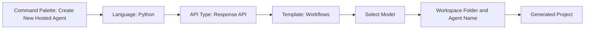

# Modul 2 - Postavite ogrodje večagentnega projekta

⏱️ ~5 min

V tem modulu uporabite [Foundry Toolkit za VS Code](https://aka.ms/foundrytk), da **postavite ogrodje večagentnega projekta**. Čarovnik ustvari `agent.yaml`, `main.py`, `Dockerfile`, `requirements.txt`, `.env`, in konfiguracijo za razhroščevanje v VS Code - tako se lahko osredotočite na povezovanje delovnega toka s 4 agenti v Modulu 3.

> **Ključni koncept:** Ogrodje je delujoč osnutek z enim agentom. Nadomestite nadomestno logiko z grafom `WorkflowBuilder` v Modulu 3. Ne pišete kode ogrodja iz nič.

> **Referenčna izvedba:** [`PersonalCareerCopilot/`](../../../../../workshop/lab02-multi-agent/PersonalCareerCopilot) je popoln delujoč primer. Uporabite ga za primerjavo vašega dela med postopkom.

### Potek čarovnika za ogrodje



---

## Korak 1: Odprite čarovnika Create Hosted Agent

1. Pritisnite `Ctrl+Shift+P` za odprtje **Command Palette**.
2. Vnesite: **Foundry Toolkit: Create a New Hosted Agent** in ga izberite.
3. Čarovnik se odpre na zavihku **Agent Details**.

> **Alternativa:** Kliknite ikono **Foundry Toolkit** v Activity Bar → kliknite ikono **+** poleg **Hosted Agents** → **Create New Hosted Agent**.

---

## Korak 2: Izberite nastavitve


1. V levem navigacijskem/izbirnem razdelku izberite naslednje:

| Meni | Izbira | Opombe |
|--------|-----------|-------|
| **Jezik** | Python | Podprto je tudi C# (.NET) |
| **Okvir** | Agent Framework | Nudi `Agent`, `AgentExecutor`, `WorkflowBuilder` |
| **Tip API** | Response API | `POST /responses` - zgodovina, ki jo upravlja platforma, podpora pretakanju |
| **Predloga** | **Workflows** | Obdeluje zahteve skozi več agentov zaporedno |

2. Ko je izbrano, kliknite **Next**


3. V naslednjem oknu izberite naslednje:

| Meni | Izbira | Opombe |
|--------|-----------|-------|
| **Mapa delovnega prostora** | Brskajte do ciljne mape | npr. `workshop/lab02-multi-agent/` v tem repozitoriju |
| **Ime agenta** | `PersonalCareerCopilot` | To postane ime imenika projekta |
| **Model Deployment** | Izberite svoj nameščeni model | npr. `gpt-4.1-mini` iz Lab 01 |

4. Kliknite **Create** za postavitev ogrodja projekta. VS Code ustvari datoteke in odpre mapo.

> **Namig:** [`gpt-4.1-mini`](https://learn.microsoft.com/azure/foundry/foundry-models/concepts/models-sold-directly-by-azure#gpt-41-series) dobro uravnoteži hitrost in kakovost za razvoj večagentnih sistemov.

---

## Korak 3: Preverite ustvarjen projekt

Ko je postavitev ogrodja zaključena, preverite, ali v Explorerju (`Ctrl+Shift+E`) vidite te datoteke:

```
📂 <your-agent-name>/
├── .azdignore          ← Files excluded from Azure Developer CLI deployments
├── .dockerignore       ← Files excluded from Docker builds
├── .env                ← Environment variables (placeholders - fill in Module 3)
├── .vscode/
│   ├── launch.json     ← Debug config (F5 → run + Agent Inspector)
│   └── tasks.json      ← VS Code task definitions
├── agent.yaml          ← Agent definition (kind: hosted, protocol: responses)
├── Dockerfile          ← Container config for deployment
├── main.py             ← Stub agent entry point (replace with WorkflowBuilder in Module 3)
└── requirements.txt    ← Python dependencies
```

> **Pomembno:** Odprite to ustvarjeno mapo neposredno v VS Code, da se `.vscode/launch.json` in `tasks.json` pravilno uporabita za razhroščevanje s F5.

### Razlaga ključnih datotek

| Datoteka | Namen |
|------|---------|
| `agent.yaml` | Določa `kind: hosted`, preslika okoljske spremenljivke, definira protokol `/responses` |
| `main.py` | Osnutek: en `FoundryChatClient` → `Agent` → `ResponsesHostServer`. To nadomestite s 4 agenti + `WorkflowBuilder` v modulu 3 |
| `Dockerfile` | `python:3.12-slim`, namesti `requirements.txt`, odpre vrata 8088, zažene `python main.py` |
| `requirements.txt` | `agent-framework-foundry`, `agent-framework-foundry-hosting`, `mcp<2,>=1.24.0`, `debugpy` |

> **Referenca:** Glejte [`PersonalCareerCopilot/agent.yaml`](../../../../../workshop/lab02-multi-agent/PersonalCareerCopilot/agent.yaml) in [`PersonalCareerCopilot/requirements.txt`](../../../../../workshop/lab02-multi-agent/PersonalCareerCopilot/requirements.txt) za popolno ustvarjeno vsebino.

---

### ✅ Kontrolna točka

- [ ] Čarovnik za ogrodje končan - nova mapa projekta je vidna v Explorerju
- [ ] Vse pričakovane datoteke prisotne: `agent.yaml`, `main.py`, `Dockerfile`, `requirements.txt`, `.env`
- [ ] `agent.yaml` prikazuje `kind: hosted` in `protocol: responses`
- [ ] `main.py` uvozi `Agent`, `FoundryChatClient`, `ResponsesHostServer`
- [ ] Ustvarjena mapa je odprta kot koren delovnega prostora v VS Code
- [ ] Razumete, da je `main.py` osnutek - `WorkflowBuilder` je dodan v modulu 3

---

**Prejšnje:** [01 - Razumite arhitekturo več agentov](01-understand-multi-agent.md) · **Naslednje:** [03 - Konfigurirajte agente in okolje →](03-configure-agents.md)

---

<!-- CO-OP TRANSLATOR DISCLAIMER START -->
**Omejitev odgovornosti**:
Ta dokument je bil preveden z uporabo AI prevajalske storitve [Co-op Translator](https://github.com/Azure/co-op-translator). Čeprav si prizadevamo za natančnost, vas prosimo, da upoštevate, da avtomatizirani prevodi lahko vsebujejo napake ali netočnosti. Izvirni dokument v njegovem izvirnem jeziku je treba obravnavati kot avtoritativni vir. Za kritične informacije je priporočljiv strokovni človeški prevod. Ne odgovarjamo za morebitna nesporazume ali napačne interpretacije, ki izhajajo iz uporabe tega prevoda.
<!-- CO-OP TRANSLATOR DISCLAIMER END -->