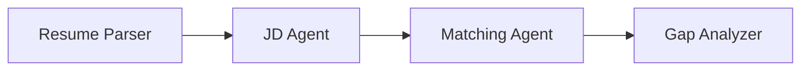
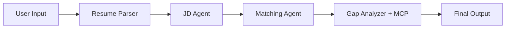

# Modul 4 - Orkestracijski vzorci

⏱️ ~10 min

V tem modulu boste raziskali orkestracijske vzorce, uporabljene v Resume Job Fit Evaluatorju, in se naučili, kako brati, spreminjati in razširjati graf delovnega toka. Razumevanje teh vzorcev je bistvenega pomena za odpravljanje težav s pretokom podatkov in gradnjo lastnih [večagentnih delovnih tokov](https://learn.microsoft.com/agent-framework/workflows/).

---

## Vzorec 1: Zaporedni verižni tok

Temeljni vzorec v delovnem toku je **zaporedni verižni tok** - izhod vsakega agenta se neposredno vnese v naslednjega.



V kodi vsak klic `add_edge()` ustvari en korak v verigi:

```python
.add_edge(resume_executor, jd_executor)       # ResumeParser output → JD Agent
.add_edge(jd_executor, matching_executor)     # JD Agent output → MatchingAgent
.add_edge(matching_executor, gap_executor)    # MatchingAgent output → GapAnalyzer
```

> **Zakaj zaporedni in ne fan-out/fan-in?** `WorkflowBuilder` uporablja **OR-semantiko** za vhodne povezave: izvajalec se sproži takoj, ko **katerikoli** predhodnik konča. Če bi imel `matching_executor` dve vhodni povezavi (iz obeh `resume_executor` in `jd_executor`), bi se sprožil dvakrat - enkrat, ko ResumeParser konča, in še enkrat, ko JD Agent konča - kar bi povzročilo, da bi GapAnalyzer prav tako deloval dvakrat, izhod pa bi bil prikazan dvakrat. Zaporedna linija tega popolnoma prepreči.

## Vzorec 2: Posredovanje vsebine

Ker `context_mode="last_agent"` pomeni, da vsak izvajalec vidi samo **izhod svojega neposrednega predhodnika**, morajo agenti v zaporedni verigi eksplicitno posredovati vse podatke, ki jih potrebujejo spodaj ležeči agenti.

V tem delovnem toku:
- **ResumeParser** kopira JD dobesedno v `[JOB DESCRIPTION PASS-THROUGH]` (tako da ga JD Agent lahko najde).
- **JD Agent** kopira `[PARSED RESUME]` dobesedno v `[PARSED RESUME PASS-THROUGH]` (tako da MatchingAgent lahko primerja oba profila).

```
ResumeParser output
└─ [PARSED RESUME]               ← extracted by JD Agent
└─ [JOB DESCRIPTION PASS-THROUGH] ← extracted by JD Agent

JD Agent output
└─ [JD REQUIREMENTS]             ← extracted by MatchingAgent
└─ [PARSED RESUME PASS-THROUGH]  ← extracted by MatchingAgent
```

Vsak del posredovanja mora biti kopiran **do besede natančno** - povzema ali parafrazira, da ne poškoduje spodaj ležečega agenta, ki je odvisen od njega.

---

## Celoten graf

Kombinacija vzorcev zaporednega verižnega toka in posredovanja vsebine ustvari celoten delovni tok:



Agent Inspector prikazuje isto strukturo grafa, ko agent deluje lokalno. Za posnetke zaslona glejte [Modul 5 - Preizkus lokalno](05-test-locally.md).

---

## Branje kode WorkflowBuilder

Graf delovnega toka se gradi v funkciji `main()` v [`PersonalCareerCopilot/main.py`](../../../../../workshop/lab02-multi-agent/PersonalCareerCopilot/main.py). Trije klici `add_edge()` gradijo zaporedno cevovod:

| # | Povezava | Učinek |
|---|---------|---------|
| 1 | `resume_executor → jd_executor` | JD Agent prejme `[PARSED RESUME]` + `[JOB DESCRIPTION PASS-THROUGH]` |
| 2 | `jd_executor → matching_executor` | MatchingAgent prejme `[JD REQUIREMENTS]` + `[PARSED RESUME PASS-THROUGH]` |
| 3 | `matching_executor → gap_executor` | GapAnalyzer prejme poročilo združljivosti + seznam vrzeli |

---

## Spreminjanje grafa

### Dodajanje novega agenta

Za dodajanje petega agenta (npr. **InterviewPrepAgent** po GapAnalyzerju):

1. Določite konstantno `INTERVIEW_PREP_INSTRUCTIONS`.
2. Ustvarite objekte `Agent` + `AgentExecutor` (isti vzorec kot obstoječi štirje).
3. Dodajte `.add_edge(gap_executor, interview_exec)` v `WorkflowBuilder`.
4. Posodobite `output_executors=[interview_exec]`.

> **Pomembno:** `start_executor` je edini agent, ki prejema surov uporabniški vnos. Vsi ostali agenti prejmejo izhod iz svojih zgornjih povezav.

---

## Pogoste napake v grafu

| Napaka | Simptomi | Popravek |
|--------|----------|----------|
| Manjka povezava do `output_executors` | Agent teče, a je izhod prazen | Zagotovite pot iz `start_executor` do vsakega agenta v `output_executors` |
| Krožna odvisnost | Neskončna zanka ali prekoračitev časa | Preverite, da noben agent ne vrača v zgornjega agenta |
| Agent v `output_executors` brez vhodne povezave | Prazen izhod | Dodajte vsaj eno `add_edge(source, that_agent)` |
| Več `output_executors` brez fan-in | Izhod vsebuje samo odgovor enega agenta | Uporabite enega izhodnega agenta, ki združuje, ali sprejmite več izhodov |
| Manjka `start_executor` | `ValueError` v času gradnje | Vedno določite `start_executor` v `WorkflowBuilder()` |

---

## Odpravljanje težav z grafom

### Uporaba Agent Inspectorja

1. Zaženite agenta lokalno s F5.
2. Odprite Agent Inspector (`Ctrl+Shift+P` → **Foundry Toolkit: Odpri Agent Inspector**).
3. Pošljite testno sporočilo.
4. V odzivnem panelu Inspectorja poiščite **tokovni izhod** - prikazuje prispevek vsakega agenta v zaporedju.


### Uporaba beleženja

Dodajte beleženje v `main.py` za sledenje pretoka podatkov:

```python
import logging
logger = logging.getLogger("resume-job-fit")

# In main(), after building the workflow:
logger.info("Workflow graph built with edges: RP→JD, JD→MA, MA→GA")
```

Dnevniki strežnika prikazujejo vrstni red izvajanja agentov in klice orodij MCP:

```
INFO:agent_framework:Executing agent: ResumeParser
INFO:agent_framework:Executing agent: JobDescriptionAgent
INFO:agent_framework:Executing agent: MatchingAgent
INFO:agent_framework:Executing agent: GapAnalyzer
INFO:agent_framework:Tool call: search_microsoft_learn_for_plan(skill="Kubernetes")
POST https://learn.microsoft.com/api/mcp → 200
INFO:agent_framework:Tool call: search_microsoft_learn_for_plan(skill="Terraform")
POST https://learn.microsoft.com/api/mcp → 200
```

---

### Kontrolna točka

- [ ] Prepoznate dva orkestracijska vzorca v delovnem toku: zaporedni verižni tok in posredovanje vsebine
- [ ] Razumete, zakaj `context_mode="last_agent"` zahteva eksplicitno posredovanje podatkov med agenti
- [ ] Znate prebrati kodo `WorkflowBuilder` in povezati vsak klic `add_edge()` z vizualnim grafom
- [ ] Znate dodati novega agenta na konec cevovoda
- [ ] Prepoznate pogoste napake v grafu in njihove simptome

---

**Prejšnji:** [03 - Konfiguracija agentov in okolja](03-configure-agents.md) · **Naslednji:** [05 - Preizkus lokalno →](05-test-locally.md)

---

<!-- CO-OP TRANSLATOR DISCLAIMER START -->
**Omejitev odgovornosti**:
Ta dokument je bil preveden z uporabo AI prevajalske storitve [Co-op Translator](https://github.com/Azure/co-op-translator). Čeprav si prizadevamo za natančnost, vas prosimo, da upoštevate, da avtomatizirani prevodi lahko vsebujejo napake ali netočnosti. Izvirni dokument v njegovem izvirnem jeziku je treba obravnavati kot avtoritativni vir. Za kritične informacije je priporočljiv strokovni človeški prevod. Ne odgovarjamo za morebitna nesporazume ali napačne interpretacije, ki izhajajo iz uporabe tega prevoda.
<!-- CO-OP TRANSLATOR DISCLAIMER END -->