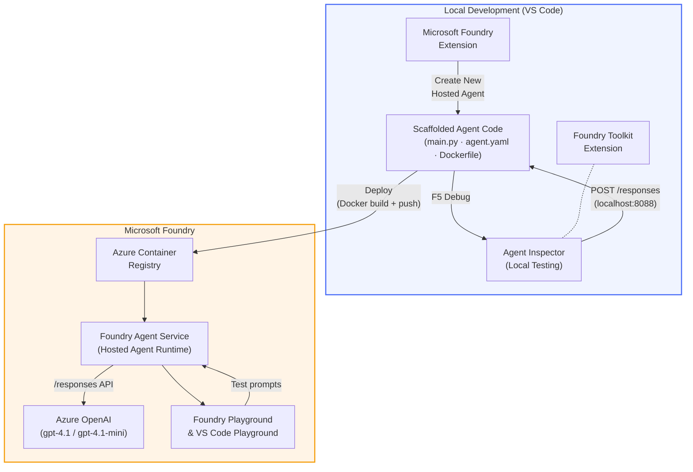

# Foundry Toolkit + Foundry Hosted Agents Workshop

[](https://www.python.org/)
[](https://learn.microsoft.com/agent-framework/)
[](https://learn.microsoft.com/azure/foundry/agents/concepts/hosted-agents)
[](https://ai.azure.com/)
[](https://learn.microsoft.com/azure/ai-services/openai/)
[](https://learn.microsoft.com/cli/azure/install-azure-cli)
[](https://learn.microsoft.com/azure/developer/azure-developer-cli/install-azd)
[](https://www.docker.com/)
[](https://marketplace.visualstudio.com/items?itemName=ms-windows-ai-studio.windows-ai-studio)
[](LICENSE)

Креирајте, тестирате и распоређујте AI агенте у **Microsoft Foundry Agent Service** као **Hosted Agents** - у потпуности из VS Code користећи **Microsoft Foundry екстензију** и **Foundry Toolkit**.

> **Hosted Agents су тренутно у прегледу.** Подржани региони су ограничени - погледајте [доступност региона](https://learn.microsoft.com/azure/foundry/agents/concepts/hosted-agents#region-availability).

> Фасцикла `agent/` унутар сваке лабораторије је **аутоматски креирана** од стране Foundry екстензије - затим прилагођавате код, тестирајте локално и распоређујете.

### 🌐 Подршка више језика

#### Подржано путем GitHub Action (аутоматски и увек ажурирано)

<!-- CO-OP TRANSLATOR LANGUAGES TABLE START -->
[Arabic](../ar/README.md) | [Bengali](../bn/README.md) | [Bulgarian](../bg/README.md) | [Burmese (Myanmar)](../my/README.md) | [Chinese (Simplified)](../zh-CN/README.md) | [Chinese (Traditional, Hong Kong)](../zh-HK/README.md) | [Chinese (Traditional, Macau)](../zh-MO/README.md) | [Chinese (Traditional, Taiwan)](../zh-TW/README.md) | [Croatian](../hr/README.md) | [Czech](../cs/README.md) | [Danish](../da/README.md) | [Dutch](../nl/README.md) | [Estonian](../et/README.md) | [Finnish](../fi/README.md) | [French](../fr/README.md) | [German](../de/README.md) | [Greek](../el/README.md) | [Hebrew](../he/README.md) | [Hindi](../hi/README.md) | [Hungarian](../hu/README.md) | [Indonesian](../id/README.md) | [Italian](../it/README.md) | [Japanese](../ja/README.md) | [Kannada](../kn/README.md) | [Khmer](../km/README.md) | [Korean](../ko/README.md) | [Lithuanian](../lt/README.md) | [Malay](../ms/README.md) | [Malayalam](../ml/README.md) | [Marathi](../mr/README.md) | [Nepali](../ne/README.md) | [Nigerian Pidgin](../pcm/README.md) | [Norwegian](../no/README.md) | [Persian (Farsi)](../fa/README.md) | [Polish](../pl/README.md) | [Portuguese (Brazil)](../pt-BR/README.md) | [Portuguese (Portugal)](../pt-PT/README.md) | [Punjabi (Gurmukhi)](../pa/README.md) | [Romanian](../ro/README.md) | [Russian](../ru/README.md) | [Serbian (Cyrillic)](./README.md) | [Slovak](../sk/README.md) | [Slovenian](../sl/README.md) | [Spanish](../es/README.md) | [Swahili](../sw/README.md) | [Swedish](../sv/README.md) | [Tagalog (Filipino)](../tl/README.md) | [Tamil](../ta/README.md) | [Telugu](../te/README.md) | [Thai](../th/README.md) | [Turkish](../tr/README.md) | [Ukrainian](../uk/README.md) | [Urdu](../ur/README.md) | [Vietnamese](../vi/README.md)

> **Више волите да клонујете локално?**
>
> Ово складиште укључује преводе на више од 50 језика, што значајно повећава величину преузимања. Да бисте клонирали без превода, користите sparse checkout:
>
> **Bash / macOS / Linux:**
> ```bash
> git clone --filter=blob:none --sparse https://github.com/microsoft-foundry/Foundry_Toolkit_for_VSCode_Lab.git
> cd Foundry_Toolkit_for_VSCode_Lab
> git sparse-checkout set --no-cone '/*' '!translations' '!translated_images'
> ```
>
> **CMD (Windows):**
> ```cmd
> git clone --filter=blob:none --sparse https://github.com/microsoft-foundry/Foundry_Toolkit_for_VSCode_Lab.git
> cd Foundry_Toolkit_for_VSCode_Lab
> git sparse-checkout set --no-cone "/*" "!translations" "!translated_images"
> ```
>
> Ово вам даје све што вам је потребно да завршите курс са много бржим преузимањем.
<!-- CO-OP TRANSLATOR LANGUAGES TABLE END -->

---

## Архитектура



**Ток:** Foundry екстензија креира агента → прилагођавате код и инструкције → тестирате локално помоћу Agent Inspector-а → распоређујете на Foundry (Docker слика послата у ACR) → проверавате у Playground-у.

---

## Шта ћете направити

| Лабораторија | Опис | Статус |
|-----|-------------|--------|
| **Лаб 01 - Један агент** | Направите **"Објасни као да сам директор" агента**, тестирате га локално и распоредите на Foundry | ✅ Доступно |
| **Лаб 02 - Вишерадни агенти** | Направите **"Резиме → Процена прикладности посла"** - 4 агента сарађују да оцењују прикладност резимеа и генеришу план учења | ✅ Доступно |

---

## Упознајте директора агента

У овом радионичарском курсу направићете **"Објасни као да сам директор" агента** - AI агента који узима компликован технички жаргон и преводи га у смирене, спремне за седницу управног одбора резиме. Јер, будимо искрени, нико на врху не жели да чује о "истрошености thread pool-а изазваној синхроним позивима уведеним у верзији 3.2."

Направио сам овог агента након превише случајева кад је мој савршено састављен извештај после инцидента добио одговор: *"Дакле... да ли је сајт у прекиду или није?"*

### Како ради

Унесете му техничко ажурирање. Он враћа извршни резиме - три тачке, без жаргона, без stack traces-ова, без егзистенцијалног страха. Само **шта се десило**, **пословни утицај** и **следећи корак**.

### Погледајте како ради

**Кажете:**
> "API латенција се повећала због истрошености thread pool-а узроковане синхроним позивима уведеним у верзији 3.2."

**Агент одговара:**

> **Извршни резиме:**
> - **Шта се десило:** Након најновије верзије, систем је успорио.
> - **Пословни утицај:** Неки корисници су искусили кашњења током коришћења сервиса.
> - **Следећи корак:** Промена је враћена и припрема се поправка пре поновног распоређивања.

### Зашто овај агент?

То је једноставан агент са једном сврхом - савршен за учење процеса рада хостованих агената од почетка до краја без загушења сложеним ланцима алата. И искрено? Сваки инжењерски тим би могао имати овог.

---

## Структура радионице

```
📂 Foundry_Toolkit_for_VSCode_Lab/
├── 📄 README.md                      ← You are here
└── 📂 workshop/
    ├── 📂 lab01-single-agent/        ← Full lab: docs + agent code
    │   ├── README.md                 ← Hands-on lab instructions
    │   ├── 📂 docs/                  ← Step-by-step tutorial modules
    │   │   ├── 00-prerequisites.md
    │   │   ├── 01-setup.md
    │   │   ├── 02-create-hosted-agent.md
    │   │   ├── 03-configure-and-code.md
    │   │   ├── 04-test-locally.md
    │   │   ├── 05-deploy-to-foundry.md
    │   │   ├── 06-verify-in-playground.md
    │   │   ├── 07-summary.md
    │   │   └── 08-troubleshooting.md
    │   └── 📂 agent/                 ← Reference solution (auto-scaffolded by Foundry extension)
    │       ├── agent.yaml
    │       ├── Dockerfile
    │       ├── main.py
    │       └── requirements.txt
    └── 📂 lab02-multi-agent/         ← Resume → Job Fit Evaluator
        ├── README.md                 ← Hands-on lab instructions (end-to-end)
        ├── 📂 docs/                  ← Step-by-step tutorial modules
        │   ├── 00-prerequisites.md
        │   ├── 01-understand-multi-agent.md
        │   ├── 02-scaffold-multi-agent.md
        │   ├── 03-configure-agents.md
        │   ├── 04-orchestration-patterns.md
        │   ├── 05-test-locally.md
        │   ├── 06-deploy-to-foundry.md
        │   ├── 07-verify-in-playground.md
        │   ├── 08-troubleshooting.md
        │   └── 09-summary.md
        └── 📂 PersonalCareerCopilot/ ← Reference solution (multi-agent workflow)
            ├── agent.yaml
            ├── Dockerfile
            ├── main.py
            └── requirements.txt
```

> **Напомена:** Фасцикла `agent/` унутар сваке лабораторије је оно што **Microsoft Foundry екстензија** генерише када покренете `Microsoft Foundry: Create a New Hosted Agent` из Command Palette-а. Фајлови се затим прилагођавају упутствима вашег агента, алатима и конфигурацији. Лабораторија 01 вас води кроз креирање ове фасцикле од темеља.

---

## Како почети

### 1. Клонирајте репозиторијум

```bash
git clone https://github.com/microsoft-foundry/Foundry_Toolkit_for_VSCode_Lab.git
cd Foundry_Toolkit_for_VSCode_Lab
```

### 2. Подесите Python виртуелно окружење

```bash
python -m venv venv
```

Активирајте га:

- **Windows (PowerShell):**
  ```powershell
  .\venv\Scripts\Activate.ps1
  ```
- **macOS / Linux:**
  ```bash
  source venv/bin/activate
  ```

### 3. Инсталирајте зависности

```bash
pip install -r workshop/lab01-single-agent/agent/requirements.txt
```

### 4. Конфигуришите променљиве окружења

Копирајте пример `.env` фајла унутар фасцикле агента и попуните ваше вредности:

```bash
cp workshop/lab01-single-agent/agent/.env.example workshop/lab01-single-agent/agent/.env
```

Уредите `workshop/lab01-single-agent/agent/.env`:

```env
FOUNDRY_PROJECT_ENDPOINT=https://<your-account>.services.ai.azure.com/api/projects/<your-project>
AZURE_AI_MODEL_DEPLOYMENT_NAME=<your-model-deployment-name>
```

### 5. Пратите лабораторије радионице

Свака лабораторија је самостална са својим модулима. Почните са **Лаб 01** да научите основе, затим наставите са **Лаб 02** за вишерадни процес рада агената.

#### Лаб 01 - Један агент ([пуна упутства](workshop/lab01-single-agent/README.md))

| # | Модул | Линк |
|---|--------|------|
| 1 | Прочитајте претходне услове | [00-prerequisites.md](workshop/lab01-single-agent/docs/00-prerequisites.md) |
| 2 | Инсталирајте Foundry Toolkit и Foundry екстензију | [01-setup.md](workshop/lab01-single-agent/docs/01-setup.md) |
| 3 | Креирајте Foundry пројекат | [01-setup.md](workshop/lab01-single-agent/docs/01-setup.md) |
| 4 | Креирајте хостованог агента | [02-create-hosted-agent.md](workshop/lab01-single-agent/docs/02-create-hosted-agent.md) |
| 5 | Конфигуришите инструкције и окружење | [03-configure-and-code.md](workshop/lab01-single-agent/docs/03-configure-and-code.md) |
| 6 | Тестирајте локално | [04-test-locally.md](workshop/lab01-single-agent/docs/04-test-locally.md) |
| 7 | Распоредите на Foundry | [05-deploy-to-foundry.md](workshop/lab01-single-agent/docs/05-deploy-to-foundry.md) |
| 8 | Потврдите у playground-у | [06-verify-in-playground.md](workshop/lab01-single-agent/docs/06-verify-in-playground.md) |
| 9 | Резиме и следећи кораци | [07-summary.md](workshop/lab01-single-agent/docs/07-summary.md) |
| 10 | Решавање проблема | [08-troubleshooting.md](workshop/lab01-single-agent/docs/08-troubleshooting.md) |

#### Лаб 02 - Вишерадни агенти ([пуна упутства](workshop/lab02-multi-agent/README.md))

| # | Модул | Линк |
|---|--------|------|
| 1 | Претходни услови (Лаб 02) | [00-prerequisites.md](workshop/lab02-multi-agent/docs/00-prerequisites.md) |
| 2 | Разумевање архитектуре вишерадних агената | [01-understand-multi-agent.md](workshop/lab02-multi-agent/docs/01-understand-multi-agent.md) |
| 3 | Креирање пројекта са више агената | [02-scaffold-multi-agent.md](workshop/lab02-multi-agent/docs/02-scaffold-multi-agent.md) |
| 4 | Конфигурисање агената и окружења | [03-configure-agents.md](workshop/lab02-multi-agent/docs/03-configure-agents.md) |
| 5 | Обрасци оркестрације | [04-orchestration-patterns.md](workshop/lab02-multi-agent/docs/04-orchestration-patterns.md) |
| 6 | Тестирање локално (вишерадни агенти) | [05-test-locally.md](workshop/lab02-multi-agent/docs/05-test-locally.md) |
| 7 | Распоређивање на Foundry | [06-deploy-to-foundry.md](workshop/lab02-multi-agent/docs/06-deploy-to-foundry.md) |
| 8 | Потврђивање у playground-у | [07-verify-in-playground.md](workshop/lab02-multi-agent/docs/07-verify-in-playground.md) |
| 9 | Решавање проблема (вишерадни агенти) | [08-troubleshooting.md](workshop/lab02-multi-agent/docs/08-troubleshooting.md) |
| 10 | Резиме и следећи кораци | [09-summary.md](workshop/lab02-multi-agent/docs/09-summary.md) |

---

## Одржаваоци

<table>
<tr>
    <td align="center"><a href="https://github.com/ShivamGoyal03">
        <br />
        <sub><b>Шивам Гоjал</b></sub>
    </a><br />
    </td>
</tr>
</table>

---

## Потребне дозволе (брзи преглед)

| Сценарио | Потребне улоге |
|----------|---------------|
| Креирање новог Foundry пројекта | **Azure AI Owner** на Foundry ресурсу |
| Распоређивање на постојећи пројекат (нови ресурси) | **Azure AI Owner** + **Contributor** на претплати |
| Распоређивање на потпуно конфигурисан пројекат | **Reader** на налогу + **Azure AI User** на пројекту |

> **Важно:** Azure `Owner` и `Contributor` улоге укључују само *управљачка* права, а не *развојна* (права за рад са подацима). Потребна вам је **Azure AI User** или **Azure AI Owner** улога за израду и развијање агената.

---

## Референце

- [Брзи почетак: Распоредите свог првог хостованог агента (VS Code)](https://learn.microsoft.com/azure/foundry/agents/quickstarts/quickstart-hosted-agent)
- [Шта су хостовани агенти?](https://learn.microsoft.com/azure/foundry/agents/concepts/hosted-agents)
- [Креирање радних токова за хостоване агенте у VS Code](https://learn.microsoft.com/azure/foundry/agents/how-to/vs-code-agents-workflow-pro-code)
- [Распоређивање хостованог агента](https://learn.microsoft.com/azure/foundry/agents/how-to/deploy-hosted-agent)
- [RBAC за Microsoft Foundry](https://learn.microsoft.com/azure/foundry/concepts/rbac-foundry)
- [Пример агента за преглед архитектуре](https://github.com/Azure-Samples/agent-architecture-review-sample) - Стварни хостовани агент са MCP алатима, Excalidraw дијаграмима и двоструким распоредом

---


## Лиценца

[MIT](../../LICENSE)

---

<!-- CO-OP TRANSLATOR DISCLAIMER START -->
**Изјава о одрицању одговорности**:
Овај документ је преведен коришћењем услуге за аутоматски превод [Co-op Translator](https://github.com/Azure/co-op-translator). Иако тежимо тачности, имајте у виду да аутоматски преводи могу садржати грешке или нетачности. Оригинални документ на његовом изворном језику треба сматрати ауторитативним извором. За критичне информације препоручује се професионални људски превод. Нисмо одговорни за било каква неспоразума или погрешна тумачења која произилазе из коришћења овог превода.
<!-- CO-OP TRANSLATOR DISCLAIMER END -->