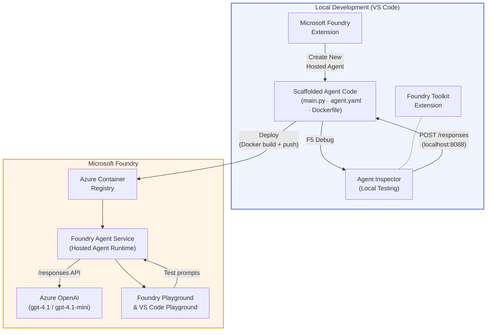

# Foundry Toolkit + Foundry Hosted Agents радионица

[](https://www.python.org/)
[](https://github.com/microsoft/agents)
[](https://learn.microsoft.com/azure/foundry/agents/concepts/hosted-agents)
[](https://ai.azure.com/)
[](https://learn.microsoft.com/azure/ai-services/openai/)
[](https://learn.microsoft.com/cli/azure/install-azure-cli)
[](https://learn.microsoft.com/azure/developer/azure-developer-cli/install-azd)
[](https://www.docker.com/)
[](https://marketplace.visualstudio.com/items?itemName=ms-windows-ai-studio.windows-ai-studio)
[](../../LICENSE)

Изградите, тестирате и разместите AI агенте на **Microsoft Foundry Agent Service** као **Hosted Agents** - потпуно из VS Code користећи **Microsoft Foundry extension** и **Foundry Toolkit**.

> **Hosted Agents су тренутно у preview режиму.** Подржани региони су ограничени - видите [доступност региона](https://learn.microsoft.com/azure/foundry/agents/concepts/hosted-agents#region-availability).

> Фолдер `agent/` унутар сваког лаба је **аутоматски генерисан** од стране Foundry екстензије - затим прилагођавате код, тестирате локално и распоређујете.

### 🌐 Мулти-језична подршка

#### Подржано преко GitHub Action (аутоматски и увек ажурно)

<!-- CO-OP TRANSLATOR LANGUAGES TABLE START -->
[Арапски](../ar/README.md) | [Бенгалски](../bn/README.md) | [Бугарски](../bg/README.md) | [Бирмански (Мјанмар)](../my/README.md) | [Кинески (поједностављени)](../zh-CN/README.md) | [Кинески (традиционални, Хонг Конг)](../zh-HK/README.md) | [Кинески (традиционални, Макао)](../zh-MO/README.md) | [Кинески (традиционални, Тајван)](../zh-TW/README.md) | [Хрватски](../hr/README.md) | [Чешки](../cs/README.md) | [Дански](../da/README.md) | [Холандски](../nl/README.md) | [Естонски](../et/README.md) | [Фински](../fi/README.md) | [Француски](../fr/README.md) | [Немачки](../de/README.md) | [Грчки](../el/README.md) | [Хебрејски](../he/README.md) | [Хинди](../hi/README.md) | [Мађарски](../hu/README.md) | [Индонежански](../id/README.md) | [Италијански](../it/README.md) | [Јапански](../ja/README.md) | [Каннада](../kn/README.md) | [Кмер](../km/README.md) | [Корејски](../ko/README.md) | [Литвански](../lt/README.md) | [Малајски](../ms/README.md) | [Малајалам](../ml/README.md) | [Марати](../mr/README.md) | [Непали](../ne/README.md) | [Нигеријски пиџин](../pcm/README.md) | [Норвешки](../no/README.md) | [Персијски (Фарси)](../fa/README.md) | [Пољски](../pl/README.md) | [Португалски (Бразил)](../pt-BR/README.md) | [Португалски (Португал)](../pt-PT/README.md) | [Пенџабски (Гурмухи)](../pa/README.md) | [Румунски](../ro/README.md) | [Руски](../ru/README.md) | [Српски (ћирилица)](./README.md) | [Словачки](../sk/README.md) | [Словеначки](../sl/README.md) | [Шпански](../es/README.md) | [Свахили](../sw/README.md) | [Шведски](../sv/README.md) | [Тагалог (Филипински)](../tl/README.md) | [Тамилски](../ta/README.md) | [Телугу](../te/README.md) | [Тајландски](../th/README.md) | [Турски](../tr/README.md) | [Украјински](../uk/README.md) | [Урду](../ur/README.md) | [Вијетнамски](../vi/README.md)

> **Преферирате да клонирате локално?**
>
> Ово репозиторијум укључује преко 50 превода који значајно повећавају величину преузимања. Да бисте клонирали без превода, користите sparse checkout:
>
> **Bash / macOS / Linux:**
> ```bash
> git clone --filter=blob:none --sparse https://github.com/microsoft-foundry/Foundry_Toolkit_for_VSCode_Lab.git
> cd Foundry_Toolkit_for_VSCode_Lab
> git sparse-checkout set --no-cone '/*' '!translations' '!translated_images'
> ```
>
> **CMD (Windows):**
> ```cmd
> git clone --filter=blob:none --sparse https://github.com/microsoft-foundry/Foundry_Toolkit_for_VSCode_Lab.git
> cd Foundry_Toolkit_for_VSCode_Lab
> git sparse-checkout set --no-cone "/*" "!translations" "!translated_images"
> ```
>
> Ово вам даје све што вам треба да завршите курс уз много брже преузимање.
<!-- CO-OP TRANSLATOR LANGUAGES TABLE END -->

---

## Архитектура



**Ток:** Foundry екстензија креира шаблон агента → ви прилагођавате код и инструкције → тестирате локално са Agent Inspector → распоређујете на Foundry (Docker слика послата у ACR) → верификујете у Playground.

---

## Шта ћете направити

| Лаб | Опис | Статус |
|-----|-------------|--------|
| **Lab 01 - Појединачни агент** | Изградите **"Explain Like I'm an Executive" агента**, тестирајте га локално и разместите на Foundry | ✅ Доступно |
| **Lab 02 - Multi-Agent Workflow** | Изградите **"Resume → Job Fit Evaluator"** - 4 агента сарађују да оцењују уклопљеност резимеа и генеришу план учења | ✅ Доступно |

---

## Упознајте Executive агента

У овој радионици ћете изградити **"Explain Like I'm an Executive" агента** - AI агента који узима компликован технички жаргон и преводи га у смирене, спремне за одбор резимее. Јер, будимо искрени, нико у врхунском менаџменту не жели да чује о "thread pool exhaustion caused by synchronous calls introduced in v3.2."

Овог агента сам направио након још једног превише инцидената где је мој савршено састављени post-mortem добио одговор: *"Значи... да ли је веб сајт пао или није?"*

### Како ради

Унесете техничко ажурирање. Он враћа извршни сажетак - три тачке, без жаргона, без траса стака, без егзистенцијалног страха. Само **шта се десило**, **пословни утицај**, и **следећи корак**.

### Погледајте га у акцији

**Ви кажете:**
> "Латенција API-ја се повећала због истрошености thread pool-а изазване синхроним позивима уведеним у v3.2."

**Агент одговара:**

> **Извршни резиме:**
> - **Шта се десило:** Након последњег издања, систем је успорио.
> - **Пословни утицај:** Неки корисници су пријавили закашњења приликом коришћења сервиса.
> - **Следећи корак:** Измена је поништена и припрема се исправка пре поновног распоређивања.

### Зашто овај агент?

То је врло једноставан, једнонаменски агент - савршен за учење целокупног радног тока Hosted агената од почетка до краја без заплитања у сложене ланце алата. И, искрено? Сваком инжењерском тиму би добро дошао један од ових.

---

## Структура радионице

```
📂 Foundry_Toolkit_for_VSCode_Lab/
├── 📄 README.md                      ← You are here
└── 📂 workshop/
    ├── 📂 lab01-single-agent/        ← Full lab: docs + agent code
    │   ├── README.md                 ← Hands-on lab instructions
    │   ├── 📂 docs/                  ← Step-by-step tutorial modules
    │   │   ├── 00-prerequisites.md
    │   │   ├── 01-setup.md
    │   │   ├── 02-create-hosted-agent.md
    │   │   ├── 03-configure-and-code.md
    │   │   ├── 04-test-locally.md
    │   │   ├── 05-deploy-to-foundry.md
    │   │   ├── 06-verify-in-playground.md
    │   │   ├── 07-summary.md
    │   │   └── 08-troubleshooting.md
    │   └── 📂 agent/                 ← Reference solution (auto-scaffolded by Foundry extension)
    │       ├── agent.yaml
    │       ├── Dockerfile
    │       ├── main.py
    │       └── requirements.txt
    └── 📂 lab02-multi-agent/         ← Resume → Job Fit Evaluator
        ├── README.md                 ← Hands-on lab instructions (end-to-end)
        ├── 📂 docs/                  ← Step-by-step tutorial modules
        │   ├── 00-prerequisites.md
        │   ├── 01-understand-multi-agent.md
        │   ├── 02-scaffold-multi-agent.md
        │   ├── 03-configure-agents.md
        │   ├── 04-orchestration-patterns.md
        │   ├── 05-test-locally.md
        │   ├── 06-deploy-to-foundry.md
        │   ├── 07-verify-in-playground.md
        │   └── 08-troubleshooting.md
        └── 📂 PersonalCareerCopilot/ ← Reference solution (multi-agent workflow)
            ├── agent.yaml
            ├── Dockerfile
            ├── main.py
            └── requirements.txt
```

> **Напомена:** Фолдер `agent/` унутар сваког лаба је оно што **Microsoft Foundry extension** генерише када покренете `Microsoft Foundry: Create a New Hosted Agent` из Command Palette. Фајлови се затим прилагођавају упутствима, алатима и конфигурацијом вашег агента. Lab 01 вас води кроз поновно креирање овога од нуле.

---

## Како почети

### 1. Клонирајте репозиторијум

```bash
git clone https://github.com/microsoft-foundry/Foundry_Toolkit_for_VSCode_Lab.git
cd Foundry_Toolkit_for_VSCode_Lab
```

### 2. Подесите Python виртуелно окружење

```bash
python -m venv venv
```

Активирајте га:

- **Windows (PowerShell):**
  ```powershell
  .\venv\Scripts\Activate.ps1
  ```
- **macOS / Linux:**
  ```bash
  source venv/bin/activate
  ```

### 3. Инсталирајте зависности

```bash
pip install -r workshop/lab01-single-agent/agent/requirements.txt
```

### 4. Конфигуришите променљиве окружења

Копирајте пример `.env` фајла унутар фолдера агента и унесите своје вредности:

```bash
cp workshop/lab01-single-agent/agent/.env.example workshop/lab01-single-agent/agent/.env
```

Уредите `workshop/lab01-single-agent/agent/.env`:

```env
AZURE_AI_PROJECT_ENDPOINT=https://<your-account>.services.ai.azure.com/api/projects/<your-project>
AZURE_AI_MODEL_DEPLOYMENT_NAME=<your-model-deployment-name>
```

### 5. Пратите лабораторијске вежбе радионице

Сваки лаб је самосталан са својим модулима. Почните са **Lab 01** да бисте научили основе, затим пређите на **Lab 02** за вишeагентске радне токове.

#### Lab 01 - Појединачни агент ([пуна упутства](workshop/lab01-single-agent/README.md))

| # | Модул | Линк |
|---|--------|------|
| 1 | Прочитајте предуслове | [00-prerequisites.md](workshop/lab01-single-agent/docs/00-prerequisites.md) |
| 2 | Инсталирајте Foundry Toolkit & Foundry extension | [01-setup.md](workshop/lab01-single-agent/docs/01-setup.md) |
| 3 | Креирајте Foundry пројекат | [01-setup.md](workshop/lab01-single-agent/docs/01-setup.md) |
| 4 | Креирајте Hosted агента | [02-create-hosted-agent.md](workshop/lab01-single-agent/docs/02-create-hosted-agent.md) |
| 5 | Конфигуришите упутства & окружење | [03-configure-and-code.md](workshop/lab01-single-agent/docs/03-configure-and-code.md) |
| 6 | Тестирајте локално | [04-test-locally.md](workshop/lab01-single-agent/docs/04-test-locally.md) |
| 7 | Распоредите на Foundry | [05-deploy-to-foundry.md](workshop/lab01-single-agent/docs/05-deploy-to-foundry.md) |
| 8 | Верификујте у playground-у | [06-verify-in-playground.md](workshop/lab01-single-agent/docs/06-verify-in-playground.md) |
| 9 | Отстрањивање проблема | [08-troubleshooting.md](workshop/lab01-single-agent/docs/08-troubleshooting.md) |

#### Lab 02 - Вишеагентски радни ток ([пуна упутства](workshop/lab02-multi-agent/README.md))

| # | Модул | Линк |
|---|--------|------|
| 1 | Предуслови (Lab 02) | [00-prerequisites.md](workshop/lab02-multi-agent/docs/00-prerequisites.md) |
| 2 | Разумевање вишeагентске архитектуре | [01-understand-multi-agent.md](workshop/lab02-multi-agent/docs/01-understand-multi-agent.md) |
| 3 | Скафолдујте вишeагент пројекат | [02-scaffold-multi-agent.md](workshop/lab02-multi-agent/docs/02-scaffold-multi-agent.md) |
| 4 | Конфигуришите агенте & окружење | [03-configure-agents.md](workshop/lab02-multi-agent/docs/03-configure-agents.md) |
| 5 | Обрасци оркестрације | [04-orchestration-patterns.md](workshop/lab02-multi-agent/docs/04-orchestration-patterns.md) |
| 6 | Тестирајте локално (вишeагент) | [05-test-locally.md](workshop/lab02-multi-agent/docs/05-test-locally.md) |
| 7 | Распоредите на Foundry | [06-deploy-to-foundry.md](workshop/lab02-multi-agent/docs/06-deploy-to-foundry.md) |
| 8 | Верификујте у playground-у | [07-verify-in-playground.md](workshop/lab02-multi-agent/docs/07-verify-in-playground.md) |
| 9 | Отстрањивање проблема (вишeагент) | [08-troubleshooting.md](workshop/lab02-multi-agent/docs/08-troubleshooting.md) |

---

## Одржавач

<table>
<tr>
    <td align="center"><a href="https://github.com/ShivamGoyal03">
        <br />
        <sub><b>Shivam Goyal</b></sub>
    </a><br />
    </td>
</tr>
</table>

---

## Потребне дозволе (брзи преглед)

| Сценарио | Потребне улоге |
|----------|---------------|
| Креирање новог Foundry пројекта | **Azure AI Owner** на Foundry ресурсу |
| Распоређивање на постојећи пројекат (нови ресурси) | **Azure AI Owner** + **Contributor** на претплати |
| Распоређивање у потпуно конфигурисан пројекат | **Reader** на налогу + **Azure AI User** на пројекту |

> **Важно:** Azure `Owner` и `Contributor` улоге укључују само *управљачка* овлашћења, не *развојна* (операције над подацима) овлашћења. Потребни су вам **Azure AI User** или **Azure AI Owner** да бисте креирали и распоредили агенте.

---

## Референце

- [Брзи почетак: Разместите свог првог хостованог агента (VS Code)](https://learn.microsoft.com/azure/foundry/agents/quickstarts/quickstart-hosted-agent)
- [Шта су хостовани агенти?](https://learn.microsoft.com/azure/foundry/agents/concepts/hosted-agents)
- [Креирајте радне токове хостованих агената у VS Code](https://learn.microsoft.com/azure/foundry/agents/how-to/vs-code-agents-workflow-pro-code)
- [Разместите хостованог агента](https://learn.microsoft.com/azure/foundry/agents/how-to/deploy-hosted-agent)
- [RBAC за Microsoft Foundry](https://learn.microsoft.com/azure/foundry/concepts/rbac-foundry)
- [Пример агента за преглед архитектуре](https://github.com/Azure-Samples/agent-architecture-review-sample) - Реалан хостовани агент са MCP алатима, Excalidraw дијаграмима и двоструким распоређивањем

---


## Лиценца

[MIT](../../LICENSE)

---

<!-- CO-OP TRANSLATOR DISCLAIMER START -->
**Изјава о одрицању одговорности**:
Овај документ је преведен коришћењем услуге за аутоматски превод [Co-op Translator](https://github.com/Azure/co-op-translator). Иако тежимо тачности, имајте у виду да аутоматски преводи могу садржати грешке или нетачности. Оригинални документ на његовом изворном језику треба сматрати ауторитативним извором. За критичне информације препоручује се професионални људски превод. Нисмо одговорни за било каква неспоразума или погрешна тумачења која произилазе из коришћења овог превода.
<!-- CO-OP TRANSLATOR DISCLAIMER END -->
