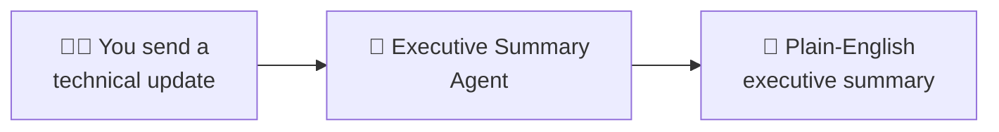

# Модул 0 - Увод

⏱️ ~10 мин

> [!WARNING]
> **Превју и ограничења:** [Хостовани агенти](https://learn.microsoft.com/azure/foundry/agents/concepts/hosted-agents) су тренутно у **јавном превјуу** - нису препоручљиви за продукционе радне оптерећења. Имајте у виду следеће:
> - **Подржани региони су ограничени** - проверите [доступност региона](https://learn.microsoft.com/azure/foundry/agents/concepts/hosted-agents#region-availability) пре креирања ресурса. Ако изаберете неподржан регион, деплојмент ће пропасти.
> - `agent-framework-foundry-hosting` пакет је у претпремијери - API-ји могу да се мењају између верзија.
> - Ограничења скалирања: хостовани агенти подржавају 0–5 реплика (укључујући скалирање на нулу).
> - Неке функције приказане у овом радионичарском водичу могу да се промене како услуга буде ишла ка општој доступности (GA).

## Шта ћете направити

У овој радионици направићете **агента „Објасни као да сам извршни директор“** - хостованог AI агента који узима сложене техничке извештаје и препише их као једноставне резимеје на енглеском језику за руководиоце.

**Агент користи:**
- **Microsoft Agent Framework** - за логику и структуру агента
- **Foundry Toolkit за VS Code** - за скелетисање, локално тестирање и деплојмент
- **AI модел** (нпр. `gpt-4.1-mini/gpt-5-mini`) - за генерисање резимеја

На крају овог лабораторијског рада имаћете функционалног агента који можете тестирати локално преко Agent Inspectora, а по жељи и депловати у облак.

---

## Шта су хостовани агенти?

**Хостовани агент** је AI агент који ради као управљана услуга у Microsoft Foundry-у. Уместо да управљате својом инфраструктуром, пакујете свој код агента у контејнер и Foundry брине о скалирању, хостингу и излагању преко стандардне HTTP тачке.

| Концепт | Шта значи |
|---------|--------------|
| **Агент** | Ваш Python код који прима поруку корисника, позива AI модел и враћа структурисани одговор |
| **Хостовано** | Foundry покреће ваш контејнер уместо вас - нема виртуелних машина, Kubernetes-а, нити инфраструктуре за управљање |
| **Протокол одговора** | Стандардни HTTP API (`POST /responses`) који сваки клијент може позвати за интеракцију са вашим агентом |
| **Agent Inspector** | Локални UI за тестирање (уграђен у Foundry Toolkit) који вам омогућава да ћаскате са агентом пре деплоја |

У овој радионици проћи ћете пут од нуле до потпуно хостованог агента – или можете да станете само на локалном тестирању ако желите.

---

## Изаберите свој пут

> ⚠️ **Изаберите један пут пре наставка.** Ваш избор одређује која алатка ће се инсталирати и који модули важе. Можете променити пут са Пута Б → Пута А касније ако добијете претплату.

<strong>🅰️ Пут А - Azure облак (захтева Azure претплату)</strong>

| | Детаљи |
|---|---|
| **За кога је намењено?** | Имате активну Azure претплату и можете креирати Foundry ресурсе |
| **Модел** | Azure OpenAI преко Foundry-ја (нпр. `gpt-4.1-mini/gpt-5-mini`) |
| **Обухваћени модули** | Сви модули (00–07) |
| **Деплој у облак?** | ✅ Да - целокупан крај-до-краја деплојмент |

<strong>🅱️ Пут Б - Локално / бесплатни ниво (није потребна Azure претплата)</strong>

| | Детаљи |
|---|---|
| **За кога је намењено?** | MVP, студенти или било ко без приступа Azure-у |
| **Модел** | **Foundry Local** (бесплатно, ради на вашем рачунару) |
| **Обухваћени модули** | Модули 00–04 (без деплоја и проверу у облаку) |
| **Деплој у облак?** | ❌ Не - само локално тестирање преко Agent Inspectora |

---

## Сви путеви: Потребни алати

Инсталирајте сваки алат испод. Након инсталације, проверите да ради покретањем команде за проверу.

| # | Алат | Верзија | Инсталација | Верификација (Очекивани Излаз) |
|---|------|---------|---------|---------------------------|
| 1 | **Visual Studio Code** | Најновија | [code.visualstudio.com](https://code.visualstudio.com/) | Отвара се без грешака |
| 2 | **Python** | 3.12 или новији | [python.org/downloads](https://www.python.org/downloads/) | `python --version` $\rightarrow$ `Python 3.12.x` |
| 3 | **Foundry Toolkit за VS Code** | Најновија | Extension ID: `ms-windows-ai-studio.windows-ai-studio` | Foundry икона у Activity Bar-у |
| 4 | **Python екстензија за VS Code** | Најновија | Extension ID: `ms-python.python` | Инсталирана у Extensions панелу |

> [!TIP]
> **Професионални савети за инсталацију:**
> - **Python PATH (Windows):** Увек означите **„Add Python to PATH“** на првом екрану инсталера за Python. Без тога, `python` неће бити препознат у вашем терминалу.
> - **Вишеструке верзије Pythona:** Ако имате и Python 3.10 и 3.12, користите `python3.12 -m venv .venv` да обезбедите коришћење праве верзије за ваш виртуелни енвиронмент.
> - **Docker WSL 2 (Windows):** Током инсталације Docker Desktop-а, уверите се да је изабран **WSL 2 backend**. Docker са Hyper-V је спорији и може изазвати проблеме са Foundry контејнер билдовима.
> - **Docker не покреће?** Сачекајте 30–60 секунди након покретања Docker Desktop-а. Покрените `docker info` - ако видите „Cannot connect to the Docker daemon,“ Docker се још увек инициализује.
> - **VS Code екстензије се не учитавају?** Након инсталације екстензија, освежите прозор: `Ctrl+Shift+P` → `Developer: Reload Window`.

> **Корисници Windows-а:** Проверите **„Add Python to PATH“** током инсталације Python-а.

**Следеће:** [01 - Подешавање →](01-setup.md)

---

<!-- CO-OP TRANSLATOR DISCLAIMER START -->
**Изјава о одрицању одговорности**:
Овај документ је преведен коришћењем услуге за аутоматски превод [Co-op Translator](https://github.com/Azure/co-op-translator). Иако тежимо тачности, имајте у виду да аутоматски преводи могу садржати грешке или нетачности. Оригинални документ на његовом изворном језику треба сматрати ауторитативним извором. За критичне информације препоручује се професионални људски превод. Нисмо одговорни за било каква неспоразума или погрешна тумачења која произилазе из коришћења овог превода.
<!-- CO-OP TRANSLATOR DISCLAIMER END -->