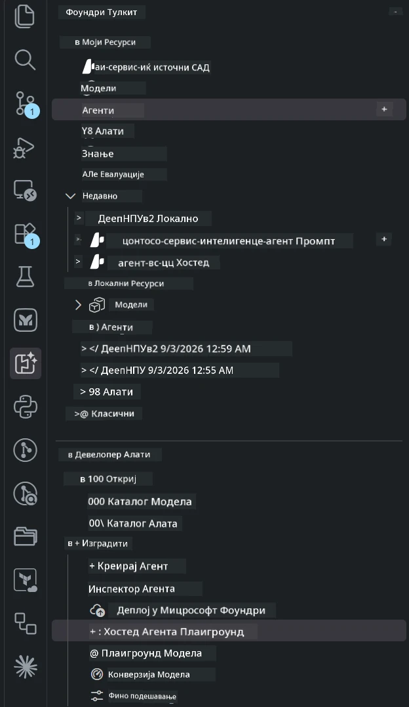
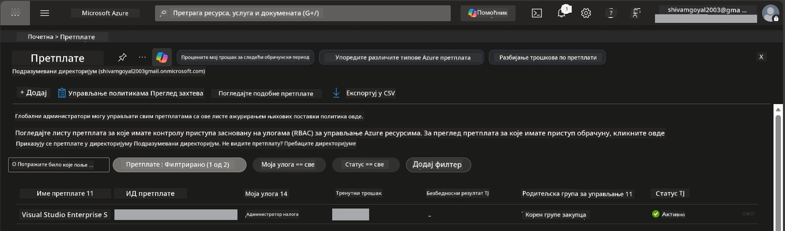
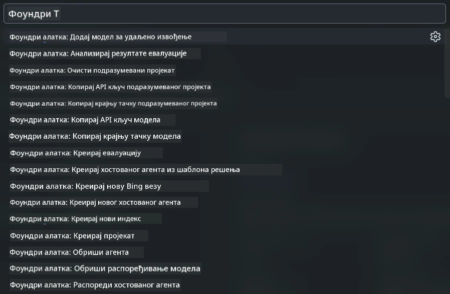
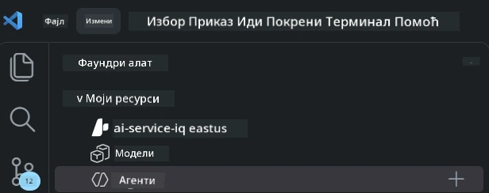
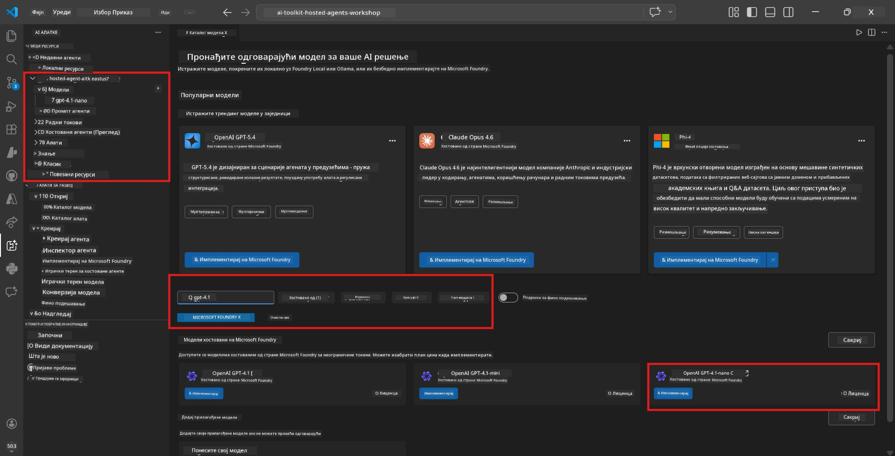
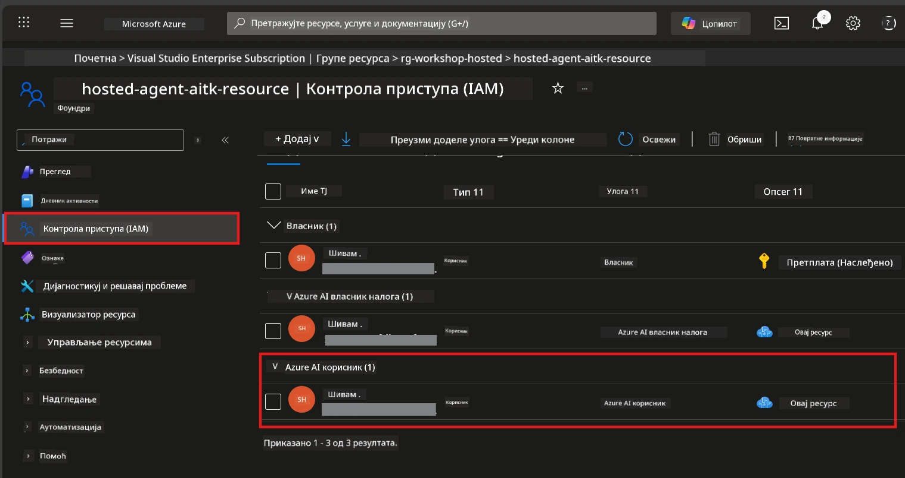

# Подешавање: Екстензија, Пројекат и Модел

⏱️ ~15 мин

У овом модулу инсталирате и проверите Foundry Toolkit екстензију, креирате (или се повежете са) Foundry пројектом и распоређујете модел који ће ваш агент користити.

## Корак 1: Инсталирајте Foundry Toolkit

**Foundry Toolkit за VS Code** је главна екстензија за овај радионички пројекат. Она пружа креирање пројекта, распоређивање модела, изградњу агента, локално тестирање (Agent Inspector), и распоређивање у облак - све из VS Code-а.

1. Отворите VS Code, затим притисните `Ctrl+Shift+X` да бисте отворили панел **Extensions**.
2. Претражите **Foundry Toolkit**.
3. Инсталирајте **Foundry Toolkit for VS Code** (Издавач: Microsoft, ID: `ms-windows-ai-studio.windows-ai-studio`).
4. Након инсталације, икона **Foundry Toolkit** ће се појавити у Activity Bar-у (леви бочни панел).

> *Напомена: Activity Bar у старијим верзијама екстензије може показивати "AI TOOLKIT". Функционалност је иста.*



## Корак 2: Поставите у складу са вашим приступом

> **Изаберите свој пут:** Проширите одељак испод који одговара вашем подешавању. Потребно је да завршите само **један** пут.

<details>
<summary><strong>🅰️ Пут А - Azure облак (захтева Azure претплату)</strong></summary>

### Azure CLI

1. Инсталирајте са [learn.microsoft.com/cli/azure/install-azure-cli](https://learn.microsoft.com/cli/azure/install-azure-cli).
2. Проверите: `az --version` (очекује се 2.80.0+).
3. Пријавите се: `az login`

### Опције аутентификације

Оквир [Microsoft Agent Framework](https://learn.microsoft.com/agent-framework/overview/) користи [`DefaultAzureCredential`](https://learn.microsoft.com/azure/developer/python/sdk/authentication/credential-chains#defaultazurecredential-overview) који испробава више метода аутентификације редом. Одаберите онај који одговара вашем окружењу:

#### Опција 1: VS Code налози (препоручено за радионице)
1. Кликните на икону **Accounts** (силуета особе) у доњем левом углу VS Code-а.
2. Изаберите **Sign in to use Microsoft Foundry** (или **Sign in with Azure**).
3. Отвориће се претраживач – пријавите се са Azure налогом који има приступ вашем претплатном плану.
4. Вратите се у VS Code. Требало би да видите име налога у доњем левом углу.

#### Опција 2: Azure CLI
```bash
az login
az account set --subscription "<your-subscription-id>"
```

#### Опција 3: Service Principal (Enterprise/CI)
За закључана окружења или CI/CD цевоводе, поставите ове променљиве окружења у ваш `.env` фајл:
```env
AZURE_TENANT_ID=<your-tenant-id>
AZURE_CLIENT_ID=<your-client-id>
AZURE_CLIENT_SECRET=<your-client-secret>
```

> **Како ради `DefaultAzureCredential`:** Прво покушава променљиве окружења, затим управљани идентитет, потом VS Code пријаву, па Azure CLI – и користи прву успешну методи. Погледајте [документацију ланца акредитива](https://learn.microsoft.com/azure/developer/python/sdk/authentication/credential-chains#defaultazurecredential-overview).

### Azure Developer CLI (azd)

1. Инсталирајте: `winget install microsoft.azd` (Windows) или погледајте [документацију за инсталацију](https://learn.microsoft.com/azure/developer/azure-developer-cli/install-azd).
2. Провера: `azd version`
3. Пријавите се: `azd auth login`

### Docker Desktop (опционо)

Docker је потребан само ако желите да локално градите контејнере. Foundry екстензија аутоматски обрађује градњу током распореда.

1. Инсталирајте са [docs.docker.com/get-docker](https://docs.docker.com/get-docker/).
2. Провера: `docker info`

### Azure претплата и RBAC

1. Пријавите се на [portal.azure.com](https://portal.azure.com).
2. Идите на **Subscriptions** и потврдите да је бар једна **Активна**.
3. Запишите **Subscription ID** – биће вам потребан у Модулу 01.



#### Табела сценарија RBAC

[Hosted Agent](https://learn.microsoft.com/azure/foundry/agents/concepts/hosted-agents) распоређивање захтева дозволе за **акције над подацима** које уобичајене Azure `Owner` и `Contributor` улоге **не** укључују. Користите табелу испод да одредите које улоге су вам потребне:

| Сценарио | Потребне улоге | Где их доделити |
|----------|---------------|----------------------|
| Креирање новог Foundry пројекта | **Azure AI Owner** на Foundry ресурсу | Foundry ресурс у Azure Portalu |
| Распоређивање на постојећи пројекат (нови ресурси) | **Azure AI Owner** + **Contributor** на претплату | Претплата + Foundry ресурс |
| Распоређивање на потпуно конфигурисани пројекат | **Reader** на налогу + **Azure AI User** на пројекту | Налог + Пројекат у Azure Portalu |
| Локално тестирање (без распореда) | **Azure AI User** на пројекту | Пројекат у Azure Portalu |

> **Кључна поента:** Azure `Owner` и `Contributor` улоге покривају само *управљачке* дозволе (ARM операције). Потребан вам је [**Azure AI User**](https://learn.microsoft.com/azure/foundry/concepts/rbac-foundry#built-in-roles) (или виши ниво) за *акције над подацима* као што је `agents/write` које су потребне за креирање и распореда агената.

## Повежите се или креирајте Foundry пројекат



1. Притисните `Ctrl+Shift+P` → укуцајте **Foundry Toolkit: Create Project** → изаберите.
2. Изаберите вашу **Azure претплату** из падајућег менија.
3. Изаберите или креирајте **resource group** (нпр. `rg-hosted-agents-workshop`).
4. Изаберите **регион** који подржава хостоване агенте: `East US`, `West US 2` или `Sweden Central`. Погледајте [доступност региона](https://learn.microsoft.com/azure/foundry/agents/concepts/hosted-agents#region-availability).
5. Унесите име пројекта (нпр. `workshop-agents`).
6. Сачекајте 2–5 минута за провизију. Обавештење о напретку ће се појавити у VS Code-у.
7. Када буде готово, ваш пројекат се појављује у **Foundry Toolkit** бочној траци под **My Resources**.



## Распоредите модел и доделите RBAC

Ваш хостовани агент треба AI модел за генерисање одговора.

#### Матрикс избора модела
У зависности од ваших потреба, можете изабрати моделе различитих нивоа:

| Модел | Најприкладнији за | Цена | Напомене |
|-------|----------|------|-------|
| `gpt-4.1` | Висококвалитетни, нијансирани одговори | Виша | Најбољи резултати, препоручено за завршно тестирање |
| `gpt-4.1-mini/gpt-5-mini` | Брзе итерације, нижа цена | Нижа | Добро за развој радионица и брзо тестирање |
| `gpt-4.1-nano` | Лагани задаци | Најнижа | Најекономичније, али једноставнији одговори |

1. Притисните `Ctrl+Shift+P` → **Foundry Toolkit: Open Model Catalog** (или кликните на **Model Catalog** у бочној траци под **Developer Tools** → **Discover**).
2. Потражите **gpt-4.1** у каталогу.
3. Пронађите **OpenAI GPT-4.1-mini** (или `gpt-5-mini` за бољи квалитет) и кликните **Deploy**.



4. У конфигурацији распореда:
   - **Име распореда:** Оставите подразумевано или унесите прилагођено име. **Запамтите ово име.**
   - **Циљ:** Изаберите **Deploy to Foundry Toolkit** → изаберите ваш пројекат.
5. Кликните **Deploy** и сачекајте 1–3 минута.

> **Препорука:** Користите `gpt-4.1-mini/gpt-5-mini` за радионицу – брзо, приступачно и даје добре резултате.

### Запишите ваше податке

Након распореда, запишите следеће вредности (биће вам потребне у Модулу 03):

| Вредност | Где је пронаћи |
|-------|-----------------|
| **Project endpoint** | Кликните ваш пројекат у бочној траци → детаљи приказују URL (нпр. `https://<account>.services.ai.azure.com/api/projects/<project>`) |
| **Име распореда модела** | Проширите пројекат → **Models** → име поред вашег распореченог модела (нпр. `gpt-4.1-mini/gpt-5-mini`) |

### Доделите RBAC улогу

> ⚠️ **Ово је најчешће пропуштен корак.** Без исправне улоге, распоређивање у Модулу 05 ће бити неуспешно.

#### Коју улогу ми треба?
У зависности од вашег сценарија, требају вам следеће комбинације улога:

| Сценарио | Потребне улоге | Где их доделити |
|----------|---------------|----------------------|
| Креирање новог Foundry пројекта | **Azure AI Owner** на Foundry ресурсу | Foundry ресурс у Azure Portalu |
| Распоређивање на постојећи пројекат (нови ресурси) | **Azure AI Owner** + **Contributor** на претплату | Претплата + Foundry ресурс |
| Распоређивање на потпуно конфигурисани пројекат | **Reader** на налогу + **Azure AI User** на пројекту | Налог + Пројекат у Azure Portalu |

**Кључна поента:** Azure `Owner` и `Contributor` улоге покривају само *управљачке* дозволе. Потребан вам је **Azure AI User** (или виши ниво) за *акције над подацима* као што је `agents/write` потребно за креирање и распореда агената.

1. Отворите [portal.azure.com](https://portal.azure.com).
2. Потражите име вашег **Foundry пројекта** → кликните резултат који је типа **"Foundry Toolkit project"** (НЕ родитељски налог).
3. Кликните **Access control (IAM)** у левој навигацији.
4. Кликните **+ Add** → **Add role assignment**.
5. **Улога таб:** Потражите **Azure AI User**, изаберите је, кликните **Next**.
6. **Чланови таб:** Изаберите **User, group, or service principal** → кликните **+ Select members** → пронађите и изаберите себе → кликните **Select**.
7. Кликните **Review + assign** → поново **Review + assign**.
8. **Сачекајте 1–2 минута** за пропагацију.

> **Зашто ова улога?** Azure `Owner`/`Contributor` дозвољавају само управљачке дозволе. Улога **Azure AI User** даје `agents/write` акцију над подацима потребну за креирање и распореда агената. Погледајте [Foundry RBAC документацију](https://learn.microsoft.com/azure/foundry/concepts/rbac-foundry#built-in-roles).



</details>

<details>
<summary><strong>🅱️ Путања Б - Локално / бесплатни ниво (није потребна Azure претплата)</strong></summary>

### Foundry Local

Foundry Local вам омогућава да покрећете AI моделе на вашем рачунару – није потребан налог у облаку. Можете приступити Foundry Local моделима користећи Foundry Toolkit кроз каталог модела на следећи начин:

1. Идите у Foundry Toolkit екстензију.
2. У Foundry Toolkit навигацији идите на **Developer Tools** > и изаберите **Model Catalog**
3. У новом прозору изаберите **local** из навигационе траке.
4. Скрајнете до **Phi 4 Mini,** и кликните на дугме за додавање; појавиће се искачући прозор који показује да се модел скида.
5. Кад се модел преузме, можете прећи на следећи корак.

</details>

### ✅ Контролна тачка


- [ ] `Ctrl+Shift+P` → "Foundry Toolkit" приказује доступне команде
- [ ] Foundry Toolkit екстензија инсталирана и бочна трака се учитава без грешака
- [ ] VS Code се отвара и исправно ради
- [ ] `python --version` приказује 3.12+
- [ ] Икона Foundry Toolkit видљива у VS Code Activity Bar-у
- [ ] **Путања А:** `az login` успева, претплата је активна
- [ ] **Путања Б:** Foundry Local ради (`foundry local status`)
- [ ] **Путања А:** Foundry пројекат видљив у бочној траци, модел распоређен, улога Azure AI User додељена
- [ ] **Путања Б:** Foundry Local ради са моделом
- [ ] Записали сте ваш **endpoint** и **име распореда модела**


**Претходно:** [00 - Претходни захтеви](00-prerequisites.md) · **Следеће:** [02 - Креирање хостованог агента →](02-create-hosted-agent.md)

---

<!-- CO-OP TRANSLATOR DISCLAIMER START -->
**Изјава о одрицању одговорности**:
Овај документ је преведен коришћењем услуге за аутоматски превод [Co-op Translator](https://github.com/Azure/co-op-translator). Иако тежимо тачности, имајте у виду да аутоматски преводи могу садржати грешке или нетачности. Оригинални документ на његовом изворном језику треба сматрати ауторитативним извором. За критичне информације препоручује се професионални људски превод. Нисмо одговорни за било каква неспоразума или погрешна тумачења која произилазе из коришћења овог превода.
<!-- CO-OP TRANSLATOR DISCLAIMER END -->